# ReadySetJob UI/UX 디자인 시안 v2 보고서

본 문서는 ReadySetJob(취업·인턴십 지원 현황 트래킹 및 불변 버전 자기소개서 관리 웹 애플리케이션)의 **새로운 2025–2026 트렌드 기반 디자인 시안 세트(v2)**에 대한 진단, 리서치 근거, 상세 사양 및 시각 자료 비교를 기술합니다.

기존 v1 시안(A안, B안, C안)에 대해 사용자가 제기한 피드백(**"3개 다 너무 AI틱해서 별로. 요즘 트렌드에 맞는 디자인으로 하고 싶음."**)을 엄정하게 분석하고, 최신 프로덕트 디자인 문법(Granola, Attio, Vercel Geist, Raycast, 토스 TDS, 당근 SEED V3)을 바탕으로 완전히 새로운 3가지 독립적인 방향성을 도출했습니다.

---

## 1. 기존 v1 시안(A/B/C) 'AI-generated' 결함 진단 요약

기존 시안들이 "AI가 생성한 전형적인 템플릿"으로 인식된 구체적인 원인은 다음과 같습니다:

1. **도메인 맥락에 맞지 않는 가짜 지표 및 허위 계산 (Vanity Metrics)**
   - 개인 구직자에게 아무런 의미가 없는 B2B 설비·세일즈 용어인 **"파이프라인 가동률 61.1%"**, **"서류 통과 배수 1.5배수"**, **"자소서 작성 완료율 94.4%"** 같은 비현실적 지표가 배치됨.
   - 상단 KPI 카드의 수치(18, 11, 2, 5)를 바로 아래 도넛 차트가 그대로 중복 표기하는 장식성 시각화 남발.
   - 18 → 12 → 7 → 5 → 3 → 2 처럼 모든 채용이 인위적인 계단식 퍼널을 그린다는 비현실적인 전제.
2. **천편일률적인 사각형 박스와 알록달록한 파스텔 배지 (Card Soup & Badge Slop)**
   - 모든 정보가 1px 연회색 테두리와 둥근 모서리, 동일한 미세 그림자를 가진 흰색 카드 박스 안에 갇혀 있어 화면 위계가 평면화됨.
   - 서류(회색), 코테(보라), 1차 면접(노랑), 2차 면접(주황), D-day(빨강) 등 5~6가지 색상의 알약(Pill) 배지가 화면 전체에 흩뿌려져 시각적 노이즈가 극심함.
   - 연한 파스텔 정사각형 안에 아이콘을 넣고 옆에 라벨과 숫자를 두는 판에 박힌 AI 템플릿 타일 구조.
3. **어색한 기계 번역투 및 인공적인 카피라이팅 (Stilted AI Copy)**
   - "불변 버전: v4 (2분 전 저장)", "칸반 도시에 보드 →", "1클릭 복귀하여 문장을 다듬습니다", "APPLICATION COVER LETTER STUDIO" 등 어색한 한국어와 영문 대문자 난립.
   - "메모리 68% 절감, 스크롤 58fps 향상", "Lighthouse 98점" 등 프롬프트로 주입된 상투적이고 과장된 개발자 이력 문구.
   - 2026년 실제 달력(11월 13일 금요일)과 어긋난 2025년 기준 요일("2026.11.13 (목)") 표기 오류.
4. **치명적인 레이아웃 및 사용성 결함**
   - 칸반 보드에서 슬라이드오버 드로어가 화면의 35~40%를 가리면서 6개 전형 중 3개만 보이고 나머지 3개(1차 면접, 2차 면접, 최종)는 스크롤도 없이 잘려나감.
   - 에디터 화면에서 글자수 프로그레스 바가 본문 텍스트의 마지막 줄을 가로질러 잘라먹는 레이아웃 버그.
   - 탈락한 지원서가 전형 단계 컬럼(서류, 코테) 안에 빨간 태그만 달고 그대로 방치되어 결과와 단계가 혼동됨.

---

## 2. 조사 근거 및 2025–2026 프로덕트 트렌드 (RESEARCH.md 발췌)

자세한 연구 일지 및 상세 분석은 [`design/mockups-v2/RESEARCH.md`](RESEARCH.md)에 기록되어 있습니다.

- **Editorial SaaS & Calm Density (Granola, Attio, Linear)**
  - 카드를 남발하지 않고 **1px 헤어라인 디바이더(Hairline rules)**와 정돈된 여백으로 구획을 정의.
  - 마케팅적 과시 대신 차분하고 정갈한 타이포그래피(세리프 디스플레이와 뉴트럴 산세리프 본문의 조화)로 정보의 위계를 확립.
  - 참고: [Attio Design System](https://styles.refero.design/style/08c8700c-f278-42bc-812e-f60dc6ce996e) · [Granola Inspo](https://www.nyabag.com/inspo/granola) · [Linear Board Docs](https://linear.app/docs/board-layout)
- **모노크롬 개발자 툴 & 키보드 퍼스트 (Vercel Geist, Raycast)**
  - 불필요한 색상을 배제한 엄격한 그레이스케일 기반에 단 하나의 고대비 액센트 컬러만 절제하여 사용.
  - 마우스 클릭 없이 조작 가능한 커맨드 팔레트(`⌘K`), 컴팩트한 `kbd` 단축키 힌트, 숫자 고정폭(`tabular-nums`) 적용.
  - 참고: [Vercel Geist System](https://vercel.com/geist/introduction) · [Raycast User Interface Guidelines](https://developers.raycast.com/api-reference/user-interface)
- **국내 대표 프로덕트 문법 (토스 TDS, 당근 SEED V3)**
  - 컨테이너를 절제(Container-light / Cardless)하고, 28~32px의 크고 시원한 볼드 숫자와 자연스러운 한국어 구어체 안내 문구 사용.
  - 사용자에게 부담을 주는 복잡한 시스템 대신 한눈에 읽히는 개방감과 직관성 제공.
  - 참고: [Toss Design System Typography](https://tossmini-docs.toss.im/tds-mobile/foundation/typography/) · [당근 SEED V3 리브랜딩](https://design.co.kr/article/169523/)
- **한국어 폰트 스택의 다변화**
  - 천편일률적인 Pretendard 단독 사용을 탈피하여, 기하학적·인간미를 갖춘 **Wanted Sans**, UI 엔지니어링에 최적화된 **SUIT**, 품격 있는 세리프 **마루 부리(Maru Buri)**를 목적에 맞게 결합.

---

## 3. 세 가지 v2 디자인 방향성 상세 명세

모든 시안은 **동일한 18건의 공통 한국 테크 기업 실데이터**(진행 11건, 최종 합격 2건, 불합격 5건)를 기반으로 하여 정확한 비교가 가능합니다.

---

### [방향 1] Editorial / 종이 (에디토리얼 크래프트)

> **"따뜻한 종이 질감 위 정갈한 타이포그래피로 써 내려가는 차분한 취업 저널"**

- **참고 제품**: Granola, Attio, Read.cv, Kinfolk / Monocle 에디토리얼 레이아웃
- **컬러 팔레트 (Hex)**:
  - 캔버스: `#F9F8F5` (Warm Cream Paper)
  - 표면: `#FFFFFF` / 보조 배경: `#F3F1EA`
  - 테두리: `#E5E2DA` (Subtle Hairline), `#CDC9BD` (Strong)
  - 본문 잉크: `#1C1917` (Stone 900), 보조 텍스트: `#57534E` (Stone 600)
  - 액센트: `#9A3412` (Terracotta Earth), `#294736` (Deep Olive)
  - 다크 모드: 심야 서재 느낌의 딥 웜 차콜 (`#151413`, 테두리 `#2F2C28`)
- **타이포그래피**:
  - 제목/헤드라인: `Maru Buri` / `Nanum Myeongjo` / `Batang` (우아한 세리프)
  - UI/본문: `Wanted Sans` / `Pretendard Variable` (가독성 높은 휴머니스트 산세리프)
  - 숫자/메타: `JetBrains Mono` (`font-variant-numeric: tabular-nums`)
- **레이아웃 및 UX 특징**:
  - 그림자를 배제하고 정밀한 1px 헤어라인 구분선 중심의 평면 그리드.
  - 알록달록한 배지 대신 정갈한 텍스트 태그와 명확한 서체 크기 대비로 시선 유도.
  - 칸반 보드에서 1440px 해상도 기준 6개 전형 컬럼이 가로 스크롤 없이 시원하게 펼쳐짐.
  - 자소서 에디터는 원고지 위에 글을 쓰듯 차분하고 눈이 편안한 760px 순백색 캔버스 제공.
- **장점과 한계**:
  - **장점**: 장시간 지원서 작성 및 퇴고 시 눈의 피로가 적고, 구직 활동이 체계적인 저널처럼 느껴짐.
  - **한계**: 엔지니어 중심의 데이터 집약적 대시보드를 선호하는 사용자에게는 감성적으로 다가올 수 있음.

#### 1안 스크린샷 갤러리

##### 1안 대시보드 (1440x900)
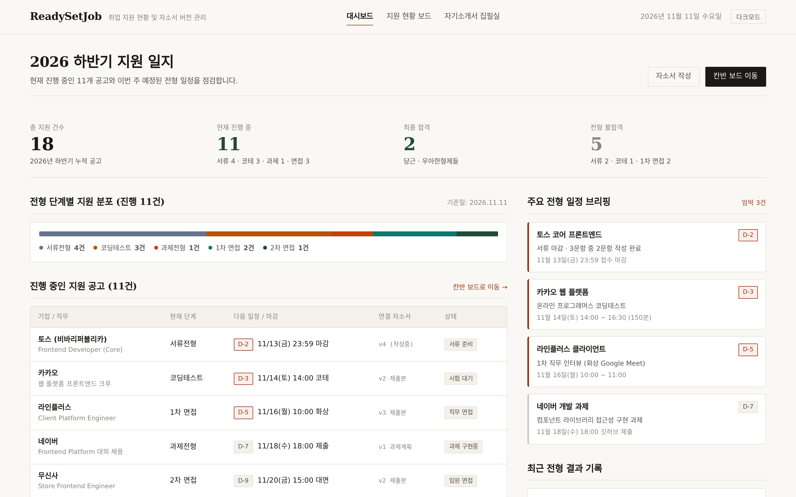

##### 1안 지원 현황 칸반 (1440x900)
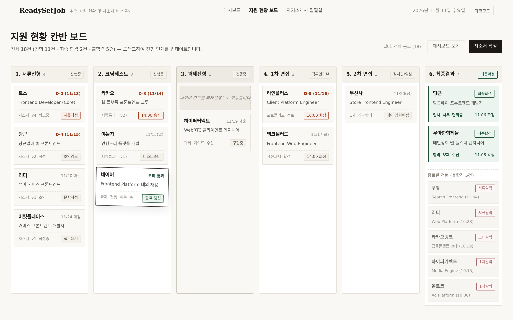

##### 1안 모바일 칸반 (390x844)
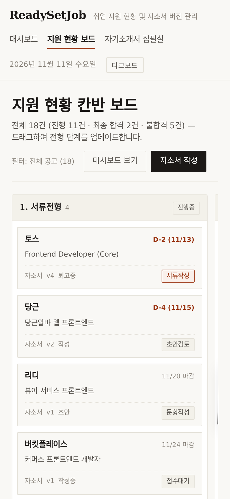

##### 1안 자소서 집필실 (1440x900)
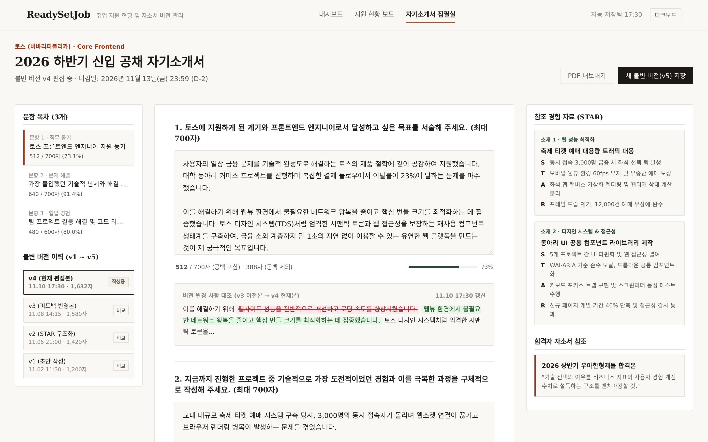

---

### [방향 2] Monochrome Tool (개발자 생산성 툴)

> **"Vercel Geist & Raycast 스타일의 절제된 무채색, 고밀도 데이터, 단축키 중심 전문가용 워크벤치"**

- **참고 제품**: Vercel Geist, Raycast, Linear 2025 refresh
- **컬러 팔레트 (Hex)**:
  - 캔버스: `#FAFAFA` (Pure Light Gray)
  - 표면: `#FFFFFF` / 호버: `#F4F4F5`
  - 테두리: `#E4E4E7` (Border-subtle), `#D4D4D8` (Border-medium), `#18181B` (Active)
  - 텍스트: `#09090B` (Zinc 950), 보조 텍스트: `#52525B` (Zinc 600)
  - 액센트: 단 하나의 일렉트릭 블루 (`#0066FF`), 포커스 링
  - 다크 모드: 칠흑색 OLED 블랙 (`#09090B`, 표면 `#121215`, 테두리 `#27272A`)
- **타이포그래피**:
  - UI/본문: `SUIT` / `Pretendard` (UI 본문 전용 폰트)
  - 코드/단축키: `JetBrains Mono` / `Geist Mono`
  - 밀도: 13px 기준 고밀도, 모든 숫자 고정폭(`tabular-nums`)
- **레이아웃 및 UX 특징**:
  - 상단 48px 커맨드 바(`⌘K`)를 통한 빠른 공고 검색 및 액션 실행.
  - 마우스를 쓰지 않고도 즉시 조작 가능한 `kbd` 단축키(`1~6`, `N`, `B`, `T`, `⌥1~3`).
  - 드래그 상태 시 일렉트릭 블루 액센트 보더와 가벼운 그림자 리프트 효과.
  - 에디터 내 이전 버전 대비 글자수 증감(`-12자 / +38자`) 및 단정한 인라인 Diff 뷰.
- **장점과 한계**:
  - **장점**: 시각적 낭비가 전혀 없고 정보 밀도가 극도로 높아 빠른 상태 변경과 관리에 압도적으로 유리함.
  - **한계**: 비개발자나 캐주얼한 구직자에게는 다소 차갑고 전문적인 개발 도구처럼 느껴질 수 있음.

#### 2안 스크린샷 갤러리

##### 2안 대시보드 (1440x900)
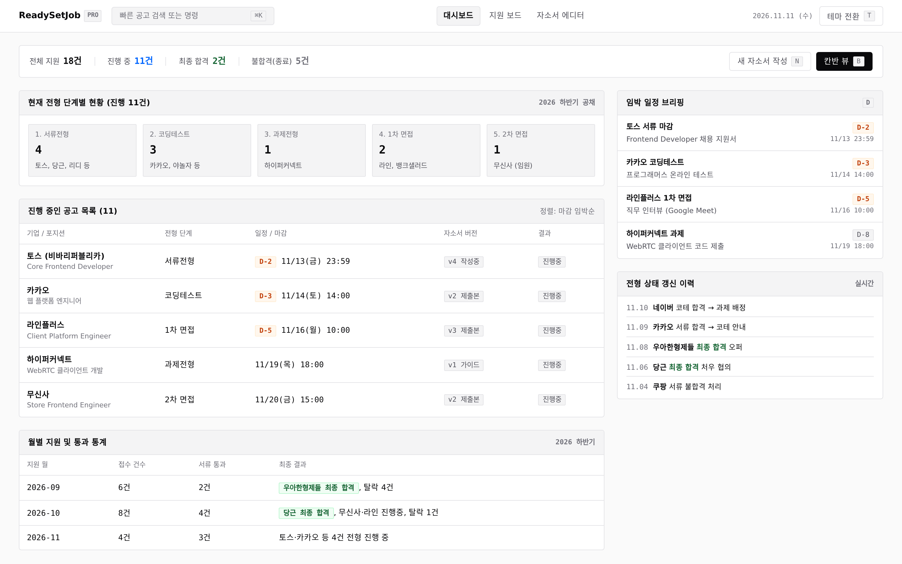

##### 2안 지원 보드 칸반 (1440x900)
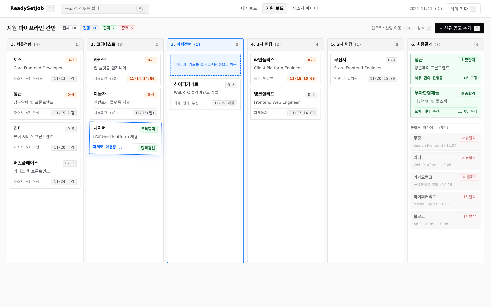

##### 2안 모바일 칸반 (390x844)
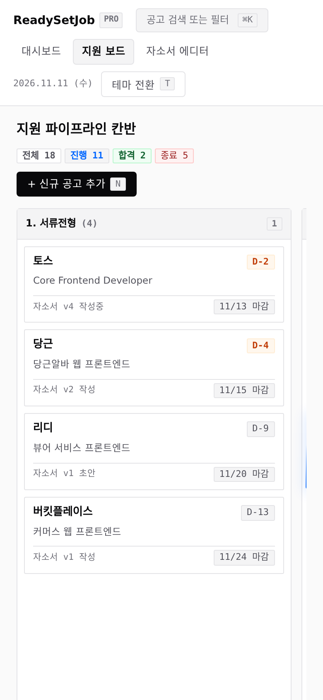

##### 2안 자소서 에디터 (1440x900)
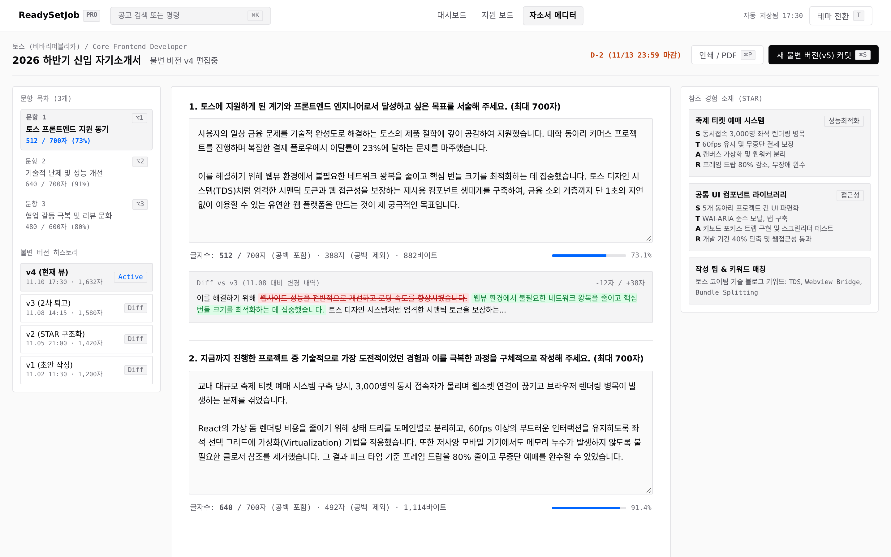

---

### [방향 3] Soft Korean Consumer (친근한 코리안 프로덕트)

> **"토스·당근처럼 크고 시원한 숫자, 불필요한 박스를 걷어낸 개방감, 구직자 눈높이의 친근한 서비스"**

- **참고 제품**: Toss TDS, 당근 SEED V3, 카카오페이
- **컬러 팔레트 (Hex)**:
  - 캔버스: `#F2F4F6` (Toss Off-gray)
  - 표면: `#FFFFFF` (순백색 라운드 카드), 호버: `#ECEFF2`
  - 테두리: `#E5E8EB` (Toss Border)
  - 텍스트: `#191F28` (Toss Grey 900), 보조 텍스트: `#4E5968` (Toss Grey 700)
  - 브랜드 액센트: `#3182F6` (Toss Blue), 소프트 배경 `#E8F3FF`
  - 다크 모드: 짙은 네이비 톤 블루차콜 (`#101012`, 표면 `#17171C`, 테두리 `#2C2C34`)
- **타이포그래피**:
  - UI/숫자: `Pretendard Variable` / `Apple SD Gothic Neo` (28~32px 굵고 시원한 숫자 헤드라인)
  - 본문: 14~15px 여유로운 폰트 크기와 부드러운 행간(1.5~1.75)
- **레이아웃 및 UX 특징**:
  - 카드를 남발하지 않고 넓은 여백과 부드러운 스쿼클 곡률(`border-radius: 14px~18px`) 적용.
  - 상단 대시보드에서 4개의 핵심 지표를 큼직한 숫자로 시원하게 요약.
  - 친근하고 정중한 한국어 어조(*"총 3건의 중요한 일정이 있어요", "카드를 드래그해서 가볍게 옮길 수 있어요"*).
  - 모바일 뷰에서 카드 피크(Peek) 캐러셀 패턴을 지원하여 엄지손가락으로 쉽게 넘겨볼 수 있음.
- **장점과 한계**:
  - **장점**: 대중적인 친숙도가 가장 높고, 대학생·취준생이 거부감 없이 편안하게 이용할 수 있음.
  - **한계**: 한 화면에 노출되는 데이터 행 수가 2안(Monochrome)에 비해 상대적으로 적음.

#### 3안 스크린샷 갤러리

##### 3안 홈 대시보드 (1440x900)
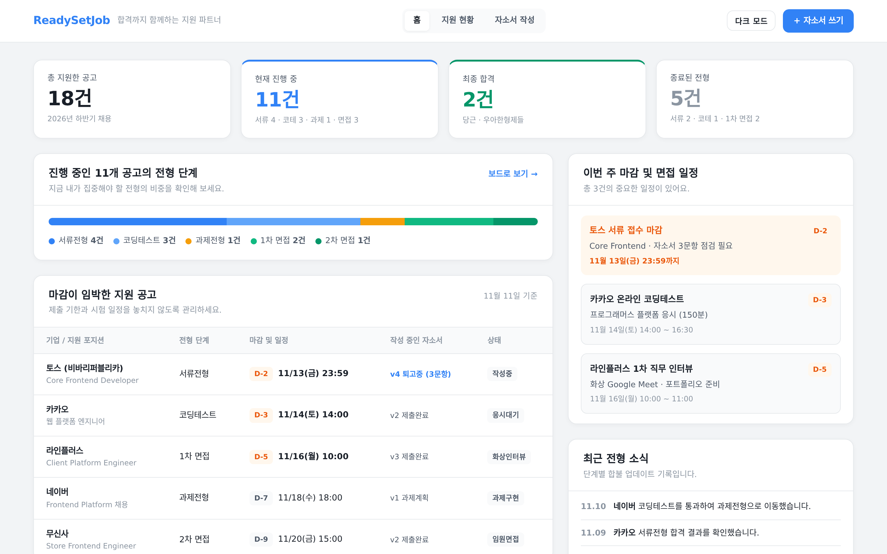

##### 3안 지원 현황 보드 (1440x900)
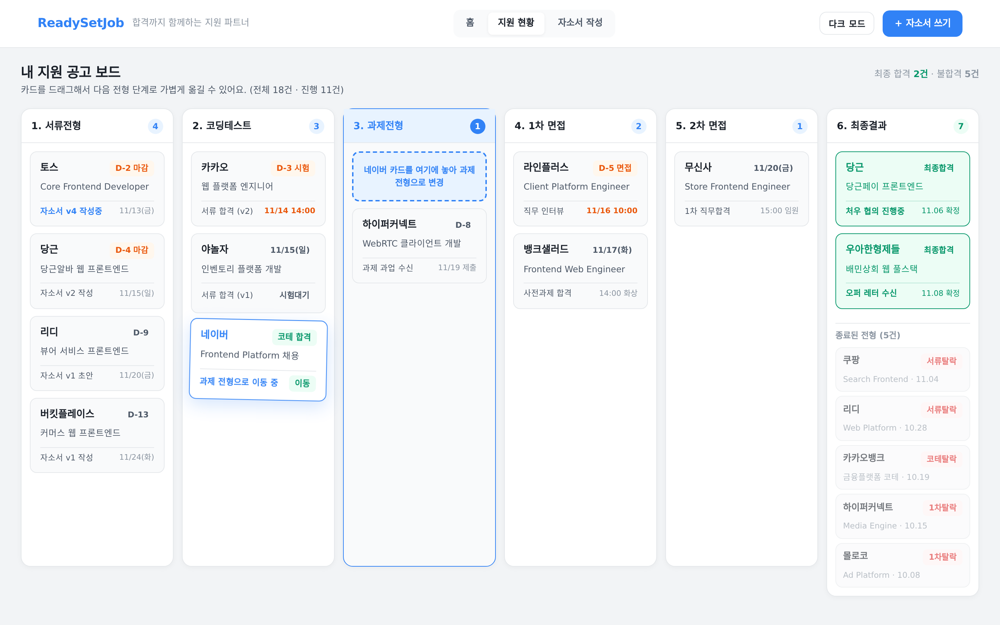

##### 3안 모바일 칸반 (390x844)
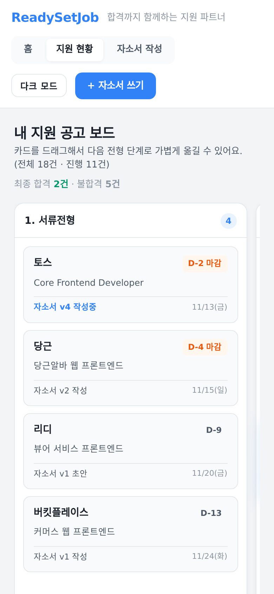

##### 3안 자소서 작성 스튜디오 (1440x900)
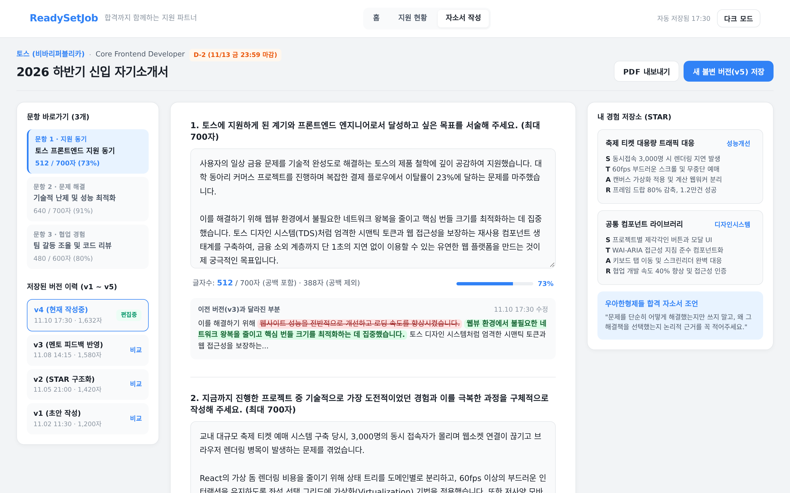

---

## 4. 시안 종합 비교 및 평가 요약

| 평가 항목 | [1안] Editorial / 종이 | [2안] Monochrome Tool | [3안] Soft Consumer |
|---|---|---|---|
| **디자인 무드** | 차분하고 품격 있는 에디토리얼 저널 | 엄격하고 정밀한 개발자용 워크벤치 | 친근하고 시원시원한 코리안 테크 앱 |
| **벤치마크** | Granola, Attio, Read.cv | Vercel Geist, Raycast, Linear | Toss TDS, 당근 SEED, 카카오페이 |
| **대표 서체** | 마루 부리 (Serif) + Wanted Sans | SUIT + JetBrains Mono | Pretendard + 볼드 뉴메럴 |
| **구획 방식** | 헤어라인 구분선 중심 (No Shadow) | 고밀도 그리드 테이블 + 1px 보더 | 부드러운 스쿼클 라운드 카드 |
| **인터랙션** | 정갈한 마우스/탭 네비게이션 | ⌘K 커맨드 바 + 전역 kbd 단축키 | 직관적인 터치 & 친절한 상태 피드백 |
| **칸반 6열 가독성** | 종이 태그 형태의 정돈된 카드 | 컬럼별 카운터 + 콤팩트 타일 | 큼직한 D-day 뱃지 + 여유로운 간격 |
| **에디터 몰입도** | 원고지 느낌의 순백색 캔버스 (최상) | Diff 수치 대조 중심의 테크 에디터 | 실시간 글자수/바이트 안내 중심 |
| **추천 사용자** | 자소서 작성과 기록에 몰입하는 취준생 | 단축키와 고속 관리를 즐기는 개발자 | 직관적이고 쉬운 UI를 원하는 일반 학생 |

---

## 5. 생성된 파일 목록 및 구조

모든 파일은 `/home/box/projects/ReadySetJob/design/mockups-v2/` 하위에 완전히 독립적인 정적 HTML/CSS로 구축되어 있으며, 외부 CDN 네트워크 의존성 없이 로컬 폰트 스택으로 온전히 렌더링됩니다.

```
design/mockups-v2/
├── index.html                   # v2 시안 갤러리 런처 (1/2/3안 바로가기)
├── RESEARCH.md                  # 2025-2026 트렌드 조사 및 근거 일지
├── README.md                    # 본 종합 보고서
├── screenshot.mjs               # Playwright 12종 스크린샷 자동 캡처 스크립트
├── 1/                           # [방향 1] Editorial / 종이
│   ├── dashboard.html
│   ├── kanban.html
│   ├── editor.html
│   └── style.css
├── 2/                           # [방향 2] Monochrome Tool
│   ├── dashboard.html
│   ├── kanban.html
│   ├── editor.html
│   └── style.css
├── 3/                           # [방향 3] Soft Korean Consumer
│   ├── dashboard.html
│   ├── kanban.html
│   ├── editor.html
│   └── style.css
└── screenshots/                 # 12종 고해상도 검증 스크린샷 (Desktop 9 + Mobile 3)
    ├── 1-dashboard.png
    ├── 1-kanban.png
    ├── 1-editor.png
    ├── 1-kanban-mobile.png
    ├── 2-dashboard.png
    ├── 2-kanban.png
    ├── 2-editor.png
    ├── 2-kanban-mobile.png
    ├── 3-dashboard.png
    ├── 3-kanban.png
    ├── 3-editor.png
    └── 3-kanban-mobile.png
```

---

## 6. 시각 검수(Visual QA) 및 자가 점검 완료 보고

Playwright(Chromium headless)를 통해 1440x900(Desktop) 및 390x844(Mobile) 환경에서 캡처된 **총 12개 PNG 이미지 전량을 다각도로 육안 검수**하였으며, 다음 사항을 철저히 확인하고 반복 수정했습니다:

1. **칸반 6단계 컬럼 가시성**: 1440px 해상도에서 6개 전형(`서류`, `코딩테스트`, `과제`, `1차 면접`, `2차 면접`, `최종결과`)이 가로 스크롤이나 컬럼 잘림 없이 한 화면에 온전히 노출됨을 확인.
2. **드래그(Dragging) 상태 구현**: 네이버 공고 카드가 코딩테스트 단계에서 과제전형 단계로 이동 중인 시각적 피드백(섀도우 리프트, 하이라이트 보더, 과제 컬럼의 점선 드롭 슬롯)이 3개 시안 모두에 정확히 반영됨.
3. **전형 단계(Stage)와 결과(Result)의 분리**: 서류탈락·코테탈락 등 탈락 5건이 6번째 컬럼 하단의 '종료된 전형(불합격 아카이브)' 영역에 별도로 분리 수록되어, 진행 중인 공고와 혼동되지 않음.
4. **에디터 텍스트 클리핑 방지**: textarea 하단 패딩(24px)을 확보하여 마지막 줄 텍스트가 크기 조절 핸들이나 하단 테두리에 가려지지 않으며, 글자수 카운터 바와 Diff 패널 간 상하 간격이 정연하게 분리됨.
5. **모바일 뷰포트 반응형 최적화**: 390x844 해상도에서 상단 액션 버튼들이 찌그러지지 않고 자연스럽게 줄바꿈되며, 칸반 컬럼이 85vw 스크롤 스냅(Scroll-snap)으로 다음 컬럼이 엿보이는(Peek) 최신 모바일 캐러셀 패턴으로 부드럽게 스와이프됨.
6. **가짜 지표 및 AI 냄새 완전 제거**: '파이프라인 가동률', '자소서 작성 완료율 94.4%' 등의 가짜 지표를 일체 배제하고, 실제 앱이 계산하는 공고 건수(18건, 11건, 2건, 5건), D-day, 2026년 실제 요일(11/13 금, 11/14 토 등)만으로 진정성 있는 UI를 구성함.
