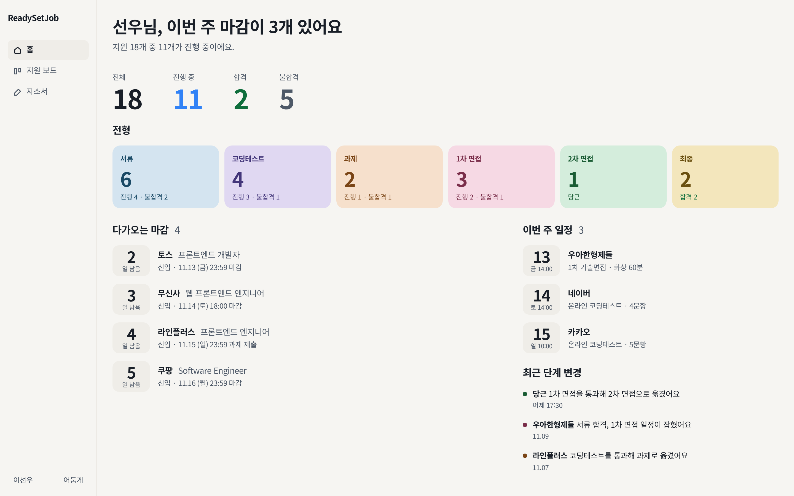
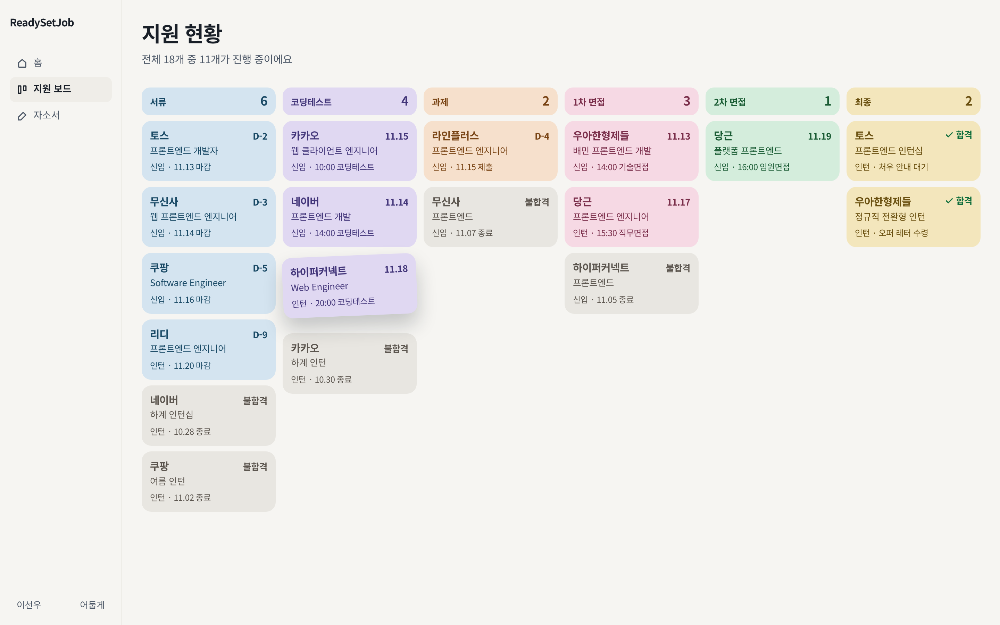
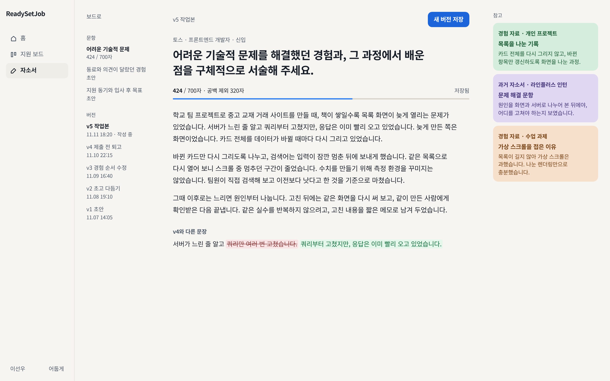
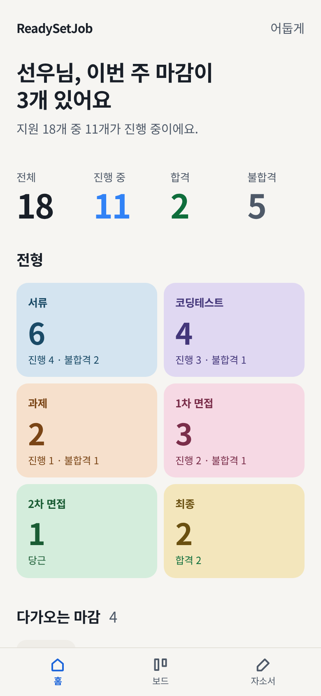
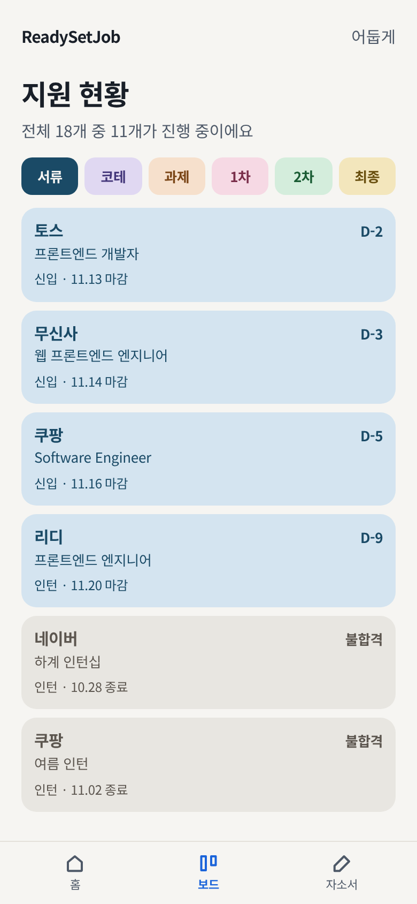
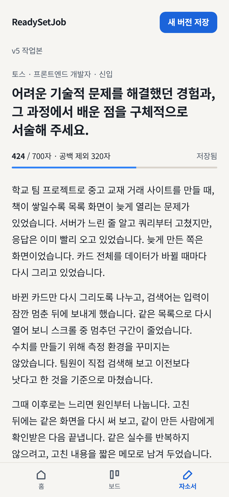

# ReadySetJob 시안 v3

토스·토스증권의 큰 숫자와 짧은 말투, 노션·Things 3의 종이 같은 화면, 색은 전형 카드에만. 한 방향으로 맞춘 정적 시안이다.

기준일은 2026-11-11(수). 숫자는 앱이 실제로 세는 값만 쓴다. 전체 18, 진행 중 11, 합격 2, 불합격 5. 단계와 결과는 별도다. 불합격 5건은 떨어진 전형 칸에 회색 카드로 둔다. 최종 칸의 2는 합격이다.

## 디자인 원칙

1. 페이지는 따뜻한 종이(`#F6F5F2`)다. 사이드바, 목록, 요약 숫자에 흰 박스와 그림자를 두지 않는다. 여백과 글자 크기가 구획이다.
2. 색은 여섯 전형의 면과 글자에만 산다. 알약 배지, 무지개 점, 아이콘 사각 타일은 쓰지 않는다.
3. 숫자는 토스처럼 크게, 고정폭으로. 제목은 700, 자간 -0.02em. 중간 굵기(500·600)는 쓰지 않는다. 이 환경의 한글 고딕은 Regular/Bold만 있어 합성 볼드가 번진다.
4. 액센트 블루는 아낀다. 큰 숫자 “진행 중”과 글자 수 막대만 `#3182F6`이다. 토스에서 이미 “누르는 색”으로 읽히고, 전형 팔레트(슬레이트·보라·모래·장미·세이지·버터)와 겹치지 않는다. 흰 글자 버튼은 같은 계열을 한 단계 누른 `#1B64DA`다. `#3182F6` 위 흰 글자는 3.7:1이라 본문 크기 버튼에는 부족하다.
5. 합격은 녹색 표시, 불합격·지원취소는 회색 카드와 작은 라벨. 빨간 경보를 깔지 않는다. 이번 18건에는 지원취소가 없어 화면에는 불합격만 있다. 취소도 같은 회색에 라벨만 다르다.
6. 칸반 카드는 테두리 없는 색 면이다. 그림자는 드래그 중인 카드 하나에만.
7. 말투는 짧게. “선우님, 이번 주 마감이 3개 있어요.” 영문 대문자 눈썹, 이모지, PRO 배지, 꾸민 그라데이션은 없다.

## 팔레트

| 이름 | Hex | 쓰는 곳 |
|---|---|---|
| 종이 | `#F6F5F2` | 페이지 |
| 눌린 면 | `#EFEDE8` | 선택 메뉴, D-day 칩 |
| 잉크 | `#191F28` | 제목, 본문 |
| 보조 | `#4E5968` | 메타, 불합격 요약 숫자 |
| 선 | `#E4E1DA` | 사이드바·탭바 헤어라인 |
| 막대 트랙 | `#D9D4CC` | 글자 수 막대 바닥 |
| 액센트 | `#3182F6` | 진행 중 숫자, 막대 |
| 버튼 | `#1B64DA` | 새 버전 저장 |
| 합격 | `#0F6E3C` | 합격 숫자, 체크 |
| 불합격 면 / 글자 | `#E8E6E1` / `#5C564F` | 종료된 카드 |
| 추가 표시 | `#E5F6EA` / `#0F6E3C` | `<ins>` |
| 삭제 표시 | `#F8E4E4` / `#8A3A3A` | `<del>` |

전형 면은 비슷한 밝기의 파스텔이고, 글자는 그 색을 눌러 6:1 이상이다.

| 단계 | 면 | 글자 |
|---|---|---|
| 서류 | `#D4E4F0` | `#1A4A66` |
| 코딩테스트 | `#E0D8F2` | `#43367A` |
| 과제 | `#F6E0CC` | `#7A4516` |
| 1차 면접 | `#F6D9E4` | `#7A2E4A` |
| 2차 면접 | `#D4EDDC` | `#1A5C34` |
| 최종 | `#F3E6BC` | `#6A5010` |

다크 모드는 `[data-theme="dark"]`에 같은 이름만 바꿔 두었다. 시안 캡처는 라이트다.

## 타이포

글꼴: `"Pretendard Variable", Pretendard, "Toss Product Sans", -apple-system, "Apple SD Gothic Neo", "Noto Sans KR", "Noto Sans CJK KR", sans-serif`. 웹폰트는 받지 않는다. 이 머신에는 Pretendard가 없어 Noto Sans CJK KR로 떨어진다.

| 역할 | 크기 | 굵기 | 자간 |
|---|---|---|---|
| 페이지 제목 | 30px (390px에서 26px) | 700 | -0.02em |
| 요약 숫자 | 48px (390px에서 36px) | 700 | -0.03em, tabular-nums |
| 전형 타일 숫자 | 36px | 700 | -0.03em |
| D-day / 날짜 칩 | 28px | 700 | -0.04em |
| 섹션 제목 | 18px | 700 | -0.02em |
| 본문 | 15px | 400 | 0 |
| 자소서 본문 | 16px, 행간 1.75 | 400 | 0 |
| 보조·메타 | 13px / 12px | 400 | 0 |

## 간격과 라운드

4px 기준. 8, 12, 16, 20, 24, 28, 32, 40, 48.

라운드는 색 카드 14px, 칩·컬럼 헤더 12px, 버튼 10px. 알약(pill)은 쓰지 않는다. 쉬는 면에는 그림자가 없다.

## 컴포넌트

- 사이드바: 글자 + 16px 선 아이콘. 현재 항목만 굵게, 눌린 면.
- 요약 숫자: 라벨 위 맨 숫자. 박스 없음.
- 전형 타일: 단계 색 면, 건수, 진행/불합격처럼 계산되는 한 줄.
- D-day 칩: 숫자와 “일 남음”. 색 배지 아님.
- 목록·변경 로그: 선으로 나누지 않고 간격으로 나눈다. 로그의 점은 도착 단계 색.
- 칸반 카드: 회사, 직무, 인턴/신입, D-day 또는 다음 일정, 결과 표시.
- 드래그 카드: 위로 6px, -2.4도, 그림자. 옆 카드 글을 가리지 않게 위아래 여백을 둔다.
- 자소서: 700px 글 열, 테두리 없는 본문, `424 / 700자 · 공백 제외 320자`, 3px 막대, “저장됨”.
- 참고 카드: 경험 자료·과거 자소서. 단계 팔레트를 재사용.
- 비교: `<ins>` / `<del>`. 패널로 감싸지 않는다.
- 모바일: 하단 탭. 보드는 한 줄 단계 전환(서류·코테·과제·1차·2차·최종) 아래 그 단계 카드만.

## v1·v2와 다른 점

v1은 가동률·통과 배수 같은 없는 지표, 사각 박스, 알록한 배지, 잘린 칸반이었다. v2는 방향을 셋으로 나눴지만 카드 위 카드, 색 띠 KPI, D-day 알약이 남아 “만든 티”가 났다.

v3는 방향을 하나로 줄였다. 요약은 박스 없이 숫자만 두고, 색은 전형 카드의 면 자체다. 탈락은 빨간 태그가 아니라 그 단계 칸의 회색 카드다. 1440에서 여섯 칸이 한 화면에 들어온다. 에디터는 원고처럼 읽고, 글자 수 막대가 본문을 자르지 않는다.

## 화면

### 홈 1440×900

### 지원 보드 1440×900

### 자소서 1440×900

### 홈 390×844

### 지원 보드 390×844

### 자소서 390×844

## 다듬은 과정

1. 첫 구현은 종이 배경과 전형 색 카드로 다시 짰다. 이전 v3의 흰 요약 박스와 D-day 알약은 뺐다.
2. 캡처에서 자소서 왼쪽 목록이 그리드 자동 배치 때문에 글 아래로 내려갔고, 드래그 카드가 옆 칸 글을 가렸으며, 모바일 탭이 “2차”를 잘랐다. 글자 수 막대 바닥이 종이와 붙어 안 보였다.
3. 편집 레이아웃을 `rail / doc / ref`로 고정하고, 드래그는 제자리 들림으로 바꿨다. 모바일 단계는 한 줄에 여섯 글자가 다 보이게 줄였고, 간격을 줄여 로그와 마지막 카드가 탭바에 잘리지 않게 맞췄다.
