# ReadySetJob UI/UX 디자인 시안 비교 보고서 (A / B / C안)

본 문서는 ReadySetJob(채용·인턴십 지원 관리 및 불변 버전 자기소개서 관리 웹 애플리케이션)의 세 가지 라이트 모드 디자인 시안(A안, B안, C안)에 대한 비교 분석 및 평가를 기술합니다.

모든 시안은 **공통 데모 데이터**(전체 18건, 진행 중 11건, 최종 합격 2건, 불합격 5건, 동일 10대 기업 및 자소서 문항)를 기반으로 하여 객관적인 비교가 가능하도록 제작되었습니다.

---

## 1. 목업 갤러리 및 파일 구성

- **갤러리 인덱스 페이지**: [`index.html`](index.html)
- **A안 (Linear 미니멀 SaaS)**:
  - 대시보드: [`a/dashboard.html`](a/dashboard.html)
  - 지원 현황 칸반: [`a/kanban.html`](a/kanban.html)
  - 자소서 에디터: [`a/editor.html`](a/editor.html)
  - 스타일시트: [`a/style.css`](a/style.css)
- **B안 (Huntr 채용 파이프라인 중심)**:
  - 대시보드: [`b/dashboard.html`](b/dashboard.html)
  - 지원 현황 칸반: [`b/kanban.html`](b/kanban.html)
  - 자소서 에디터: [`b/editor.html`](b/editor.html)
  - 스타일시트: [`b/style.css`](b/style.css)
- **C안 (Craft 문서 작업 중심)**:
  - 대시보드: [`c/dashboard.html`](c/dashboard.html)
  - 지원 현황 칸반: [`c/kanban.html`](c/kanban.html)
  - 자소서 에디터: [`c/editor.html`](c/editor.html)
  - 스타일시트: [`c/style.css`](c/style.css)
- **스크린샷 모음**: [`screenshots/`](screenshots/) (데스크톱 9장 + 모바일 3장)

---

## 2. [A안] Linear 기반 미니멀 SaaS형 (고밀도 워크스페이스 & 슬라이드오버)

### 2.1 콘셉트 및 레이아웃
Linear의 2024~2026 리디자인과 Attio의 정교한 데이터 조작 패턴을 결합한 고밀도 전문가용 SaaS 레이아웃입니다.
- **역 L자형 애플리케이션 크롬**: 좌측 220px 저채도 오프화이트 사이드바와 상단 48px 단일 뷰 헤더가 메인 작업 캔버스를 감쌉니다.
- **슬라이드오버 드로어(440px)**: 칸반 카드 클릭 시 페이지를 이탈하지 않고 우측에서 부드럽게 드로어가 열려 전형 단계 변경, 합불 상태 토글, 연결 자소서 미리보기를 즉시 조작합니다.
- **2단 분할 에디터**: 좌측 65% 문항 아코디언 카드와 우측 35%(340px) 고정 컨텍스트 독(버전 히스토리, 경험 자료실, AI 면접 질문 탭)을 제공합니다.

### 2.2 컬러 팔레트 및 토큰 명세
- **Canvas / Sidebar**: `#F8FAFC`
- **Card Surface**: `#FFFFFF`
- **Border**: `#E2E8F0` (1px solid 저대비 테두리)
- **Primary Text**: `#0F172A` | **Secondary Text**: `#475569` | **Muted Text**: `#94A3B8`
- **Primary Accent (Indigo Slate)**: `#4F46E5` (Hover `#4338CA`, Soft `#EEF2FF`)
- **Semantic Pass**: `#059669` (Bg `#ECFDF5`, Border `#A7F3D0`)
- **Semantic Fail**: `#DC2626` (Bg `#FEF2F2`, Border `#FECACA`)
- **Warning / D-Day**: `#B45309` (Bg `#FFFBEB`, Border `#FDE68A`)

### 2.3 타이포그래피 및 정보 밀도
- **기본 폰트**: Pretendard Variable (`tabular-nums` 적용)
- **밀도**: 고밀도 (UI 본문 13px, 카드 패딩 12px, 행 높이 38px, 카드 높이 84px)
- 한 화면 안에서 15~20개 이상의 지원 공고를 스크롤 없이 신속하게 모니터링할 수 있습니다.

### 2.4 장점과 한계
- **장점**: 화면 여백 낭비가 전혀 없으며, 리스트와 칸반 간 전환이 매끄럽고 키보드 중심 탐색 및 빠른 상태 갱신에 최적화되어 있습니다.
- **한계**: 정보 밀도가 높아 초보자에게 다소 차갑고 복잡하게 느껴질 수 있으며, 모바일 환경에서는 사이드바 숨김 처리가 필수적입니다.

### 2.5 시각 자료 (스크린샷)

#### A안 대시보드
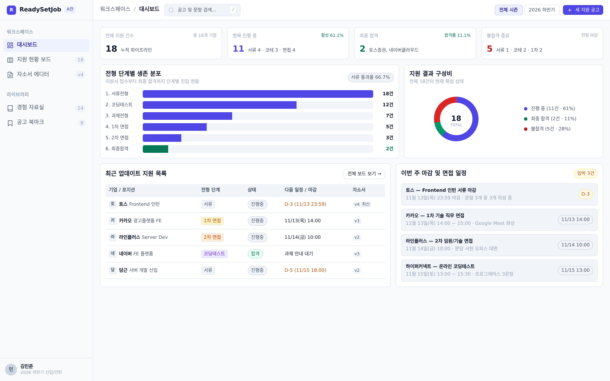

#### A안 지원 현황 칸반
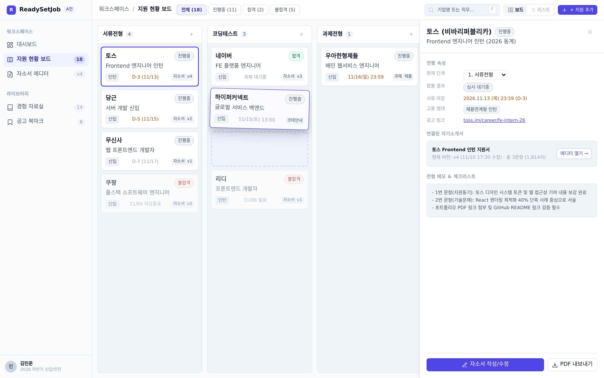

#### A안 모바일 칸반 (390x844)
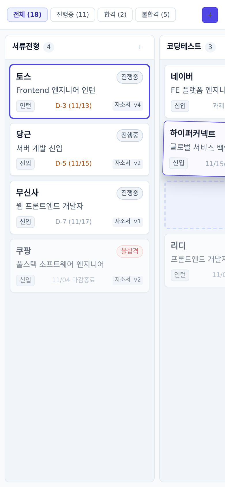

#### A안 자소서 에디터
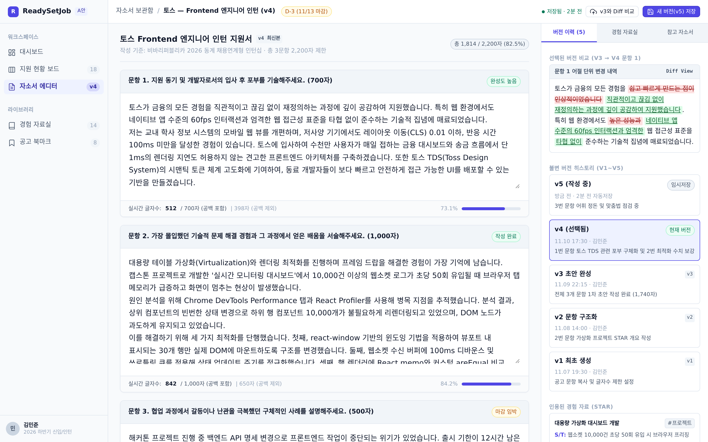

---

## 3. [B안] Huntr 기반 채용 관리 중심형 (파이프라인 & 일정 브리핑 허브)

### 3.1 콘셉트 및 레이아웃
글로벌 1위 구직 트래커인 Huntr의 장점을 수용한 파이프라인 중심 방향입니다.
- **상단 56px 수평 GNB**: 좌측 사이드바를 완전히 제거하여 화면 가로 폭 100%를 칸반 보드와 통계에 할애합니다.
- **64px 전형 단계 퍼널 배너**: GNB 직하단에 `서류(18) → 코테(12) → 과제(7) → 1차(5) → 2차(3) → 최종(2)`의 단계별 통과 건수와 전환율을 전폭으로 노출합니다.
- **전폭 6열 칸반 보드**: 1440px 화면에서 6개 열이 가로 스크롤 없이 한눈에 들어오며, 110px 높이의 풍부한 카드 표면에 좌측 3px 상태 바, D-day 배지, 자소서 작성률을 보여줍니다.
- **860px 중앙 상세 탭 모달**: 카드 클릭 시 화면 중앙에 모달이 떠서 전형 일정, 제출 자소서, 경험 자료를 종합 관리합니다.

### 3.2 컬러 팔레트 및 토큰 명세
- **App Canvas**: `#F4F6F9` (차분한 쿨그레이 보드 배경)
- **Card Surface**: `#FFFFFF`
- **Border**: `#DCE3EC`
- **Primary Text**: `#111827` | **Secondary Text**: `#4B5563` | **Muted Text**: `#6B7280`
- **Primary Accent (Royal Blue)**: `#2563EB` (Hover `#1D4ED8`, Soft `#EFF6FF`)
- **Schedule Highlight**: `#D97706` (Bg `#FFFBEB`, Border `#FDE68A`)
- **Semantic Pass**: `#10B981` (Bg `#ECFDF5`) | **Fail**: `#EF4444` (Bg `#FEF2F2`)

### 3.3 타이포그래피 및 정보 밀도
- **기본 폰트**: Pretendard Variable (`tabular-nums` 적용)
- **밀도**: 중간 밀도 (UI 본문 14px, 카드 패딩 14~16px, 카드 높이 110px)
- 시각적 계층이 뚜렷하여 "이번 주에 당장 챙겨야 할 코테 및 면접"의 우선순위가 명확합니다.

### 3.4 장점과 한계
- **장점**: 6개 전형 열이 수평 스크롤 없이 시원하게 펼쳐지며, 일정 브리핑과 퍼널 통과율이 직관적입니다.
- **한계**: 상단 GNB와 퍼널 배너가 상단 세로 공간을 약 120px 차지하므로 본문 세로 높이가 약간 줄어듭니다.

### 3.5 시각 자료 (스크린샷)

#### B안 대시보드
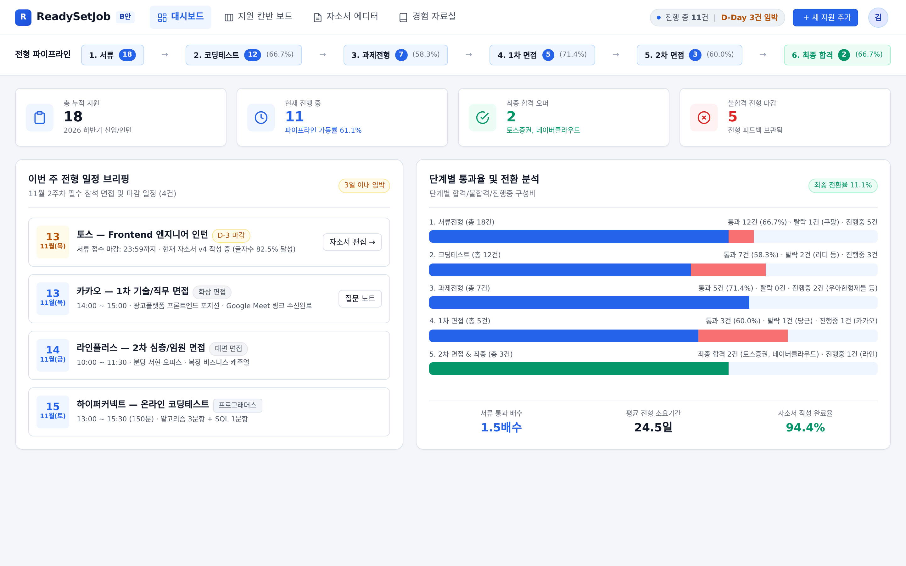

#### B안 지원 현황 칸반
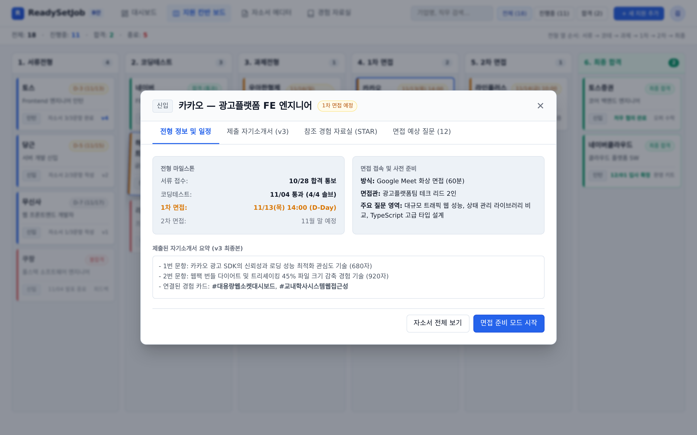

#### B안 모바일 칸반 (390x844)
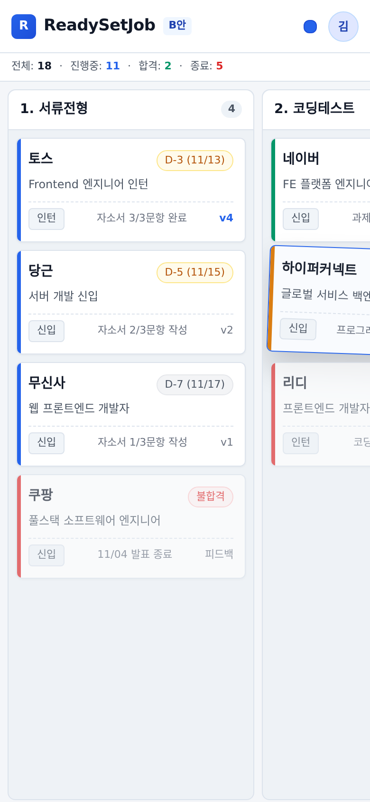

#### B안 자소서 에디터
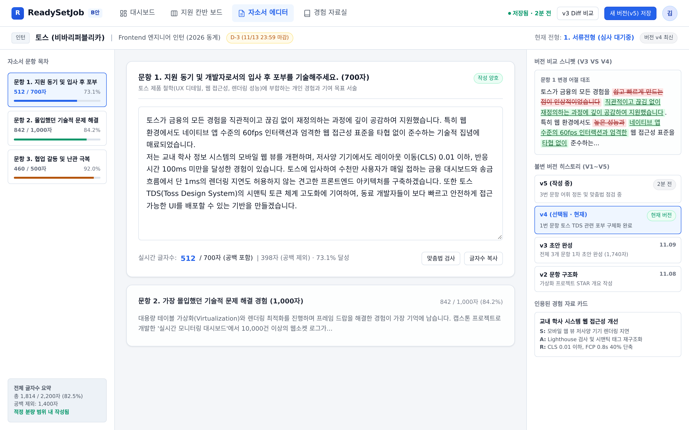

---

## 4. [C안] Craft 기반 문서 작업 중심형 (자소서 집필 & 불변 버전 비교 스튜디오)

### 4.1 콘셉트 및 레이아웃
Craft의 감성적인 문서 중심 인터페이스와 불변 버전 관리 철학을 결합한 에디터 특화 방향입니다.
- **200px 목차(TOC) 내비게이션 바**: 자소서 1~3번 문항의 글자수 달성률을 신호등 도트(초록/황색)로 보여주며 클릭 시 부드럽게 점프합니다.
- **760px 순백색 종이 캔버스**: 따뜻한 오프화이트(`#F7F7F5`) 배경 위에 중앙 집중형 시트가 떠 있어 장시간 한국어 문장 퇴고 시 눈의 피로를 최소화합니다.
- **어절 단위 인라인/나란히 버전 비교(Diff) 뷰**: 과거 버전(v3)과 현재 버전(v4)의 문구 차이를 삭제 취소선(`<del>`)과 추가 밑줄(`<ins>`)로 명확히 대조합니다.
- **도시에(Dossier) 칸반 카드**: 지원 카드 위에 연결된 자소서 버전 스냅샷(`v4 제출본 · 3문항 · 1,814자`)과 인용된 경험 태그(`#웹접근성`, `#컴포넌트설계`)를 직접 표시합니다.

### 4.2 컬러 팔레트 및 토큰 명세
- **App Canvas (Warm Paper)**: `#F7F7F5`
- **Document Sheet / Card Surface**: `#FFFFFF`
- **Border**: `#E5E5E0` (은은한 웜 그레이 테두리)
- **Primary Text**: `#18181B` | **Secondary Text**: `#52525B` | **Muted Text**: `#A1A1AA`
- **Primary Accent (Deep Teal Ink)**: `#0F766E` (Hover `#0D9488`, Soft `#F0FDFA`)
- **Diff Added (`<ins>`)**: `#DCFCE7` (Text `#166534`, Border `#BBF7D0`)
- **Diff Removed (`<del>`)**: `#FEE2E2` (Text `#991B1B`, Border `#FECACA`)

### 4.3 타이포그래피 및 정보 밀도
- **기본 폰트**: Pretendard Variable (`word-break: keep-all`)
- **밀도**: 여유로운 문서 밀도 (에디터 본문 15px, 행간 1.75, 시트 패딩 24~32px)
- 장문 글쓰기와 문장 퇴고 호흡에 최적화된 편안한 타이포그래피를 제공합니다.

### 4.4 장점과 한계
- **장점**: 글쓰기 몰입도와 버전 비교 가독성이 압도적으로 뛰어나며, 어떤 경험 소재가 어느 기업에 합격했는지 스토리 맥락이 보존됩니다.
- **한계**: 한 화면에 노출되는 칸반 카드 개수가 A안에 비해 적어 한눈에 수십 개 공고를 조망하기에는 밀도가 낮습니다.

### 4.5 시각 자료 (스크린샷)

#### C안 대시보드
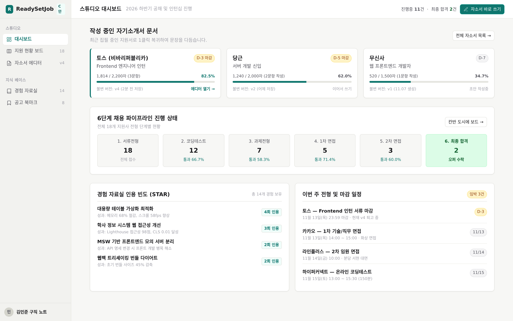

#### C안 지원 현황 칸반
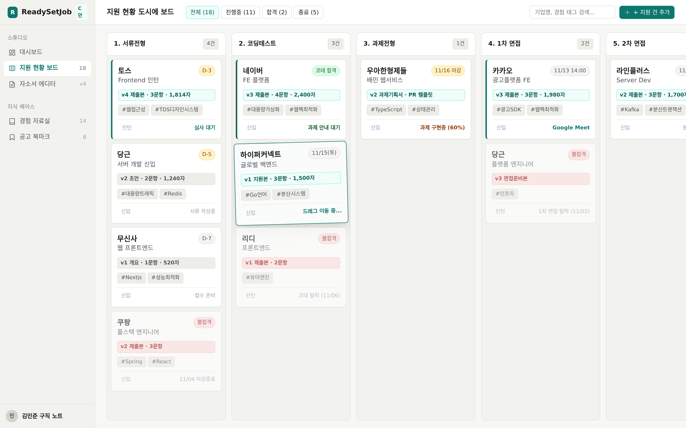

#### C안 모바일 칸반 (390x844)
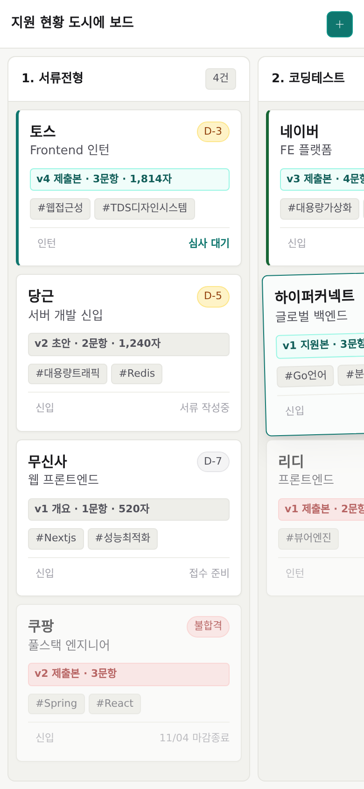

#### C안 자소서 에디터
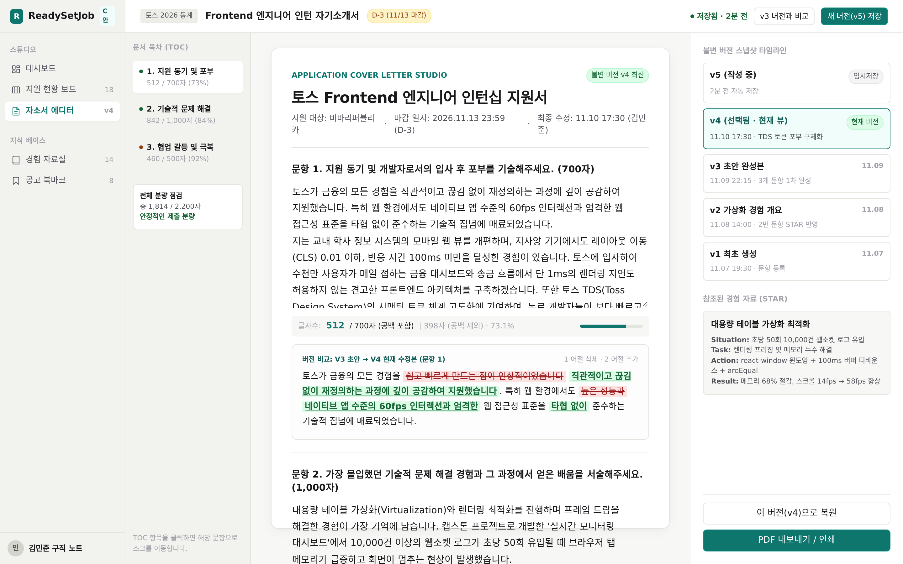

---

## 5. 세 가지 시안 종합 비교 요약

| 평가 항목 | [A안] Linear 스타일 미니멀 SaaS | [B안] Huntr 스타일 채용 중심형 | [C안] Craft 스타일 문서 중심형 |
| :--- | :--- | :--- | :--- |
| **전역 내비게이션** | 좌측 고정 사이드바 (220px) + 뷰 헤더 | 상단 수평 GNB (56px) | 좌측 접이식 탐색/목차 바 (200px) |
| **대시보드 강조점** | 4열 압축 KPI + 생존 차트 + 최근 테이블 | 6단계 퍼널 배너 + 주간 전형 일정 브리핑 | 작성 중인 자소서 카드 그리드 + 경험 빈도 |
| **지원 칸반 레이아웃** | 84px 컴팩트 타일 + 440px 슬라이드 드로어 | 전폭 100% 6열 보드 + 860px 중앙 탭 모달 | 자소서 버전 및 경험 태그가 달린 도시에 보드 |
| **자소서 에디터** | 2단 분할 (문항 카드 + 340px 독) | 3단 분할 (문항 탭 + 중앙 에디터 + 우측 패널) | 200px 목차 + 760px 순백색 종이 캔버스 & Diff |
| **타이포 및 밀도** | 본문 13px / 고밀도 | 본문 14px / 중간 밀도 | 본문 15px (행간 1.75) / 여유로운 문서 밀도 |
| **브랜드 액센트** | 인디고 슬레이트 (`#4F46E5`) | 로열 블루 & 앰버 (`#2563EB`, `#D97706`) | 딥 틸 잉크 (`#0F766E`) |
| **추천 적용 대상** | 동시 지원 15개 이상의 빠른 상태 관리 | 전형 단계별 일정/통과율 브리핑 | 심층적인 자소서 작성 및 불변 버전 퇴고 |

---

## 6. 결론 및 최종 구현 권장안

세 시안 모두 완성도 높은 라이트 모드 디자인 시스템과 한국어 사용자 경험을 제공하지만, ReadySetJob의 핵심 차별화 요소인 **"불변 버전 기반 자기소개서 관리"**와 **"6단계 채용 파이프라인 트래킹"**을 최적화하기 위해 다음과 같은 하이브리드 조합을 권장합니다:
1. **전체 앱 크롬 및 지원 칸반**: **B안**의 상단 GNB 및 전폭 6단계 칸반 보드를 기본 구조로 채택하여 1440px 화면에서 모든 전형 단계가 한눈에 들어오도록 구성.
2. **자기소개서 에디터 및 버전 비교**: **C안**의 760px 순백색 종이 캔버스, 어절 단위 Diff 뷰, 좌측 문항 목차(TOC) 신호등을 채택하여 작성 몰입도 극대화.
3. **상세 속성 조회 인터랙션**: **A안**의 슬라이드오버 드로어를 접목하여 칸반 보드 위에서 화면 전환 없이 공고 상세와 메모를 조회.
