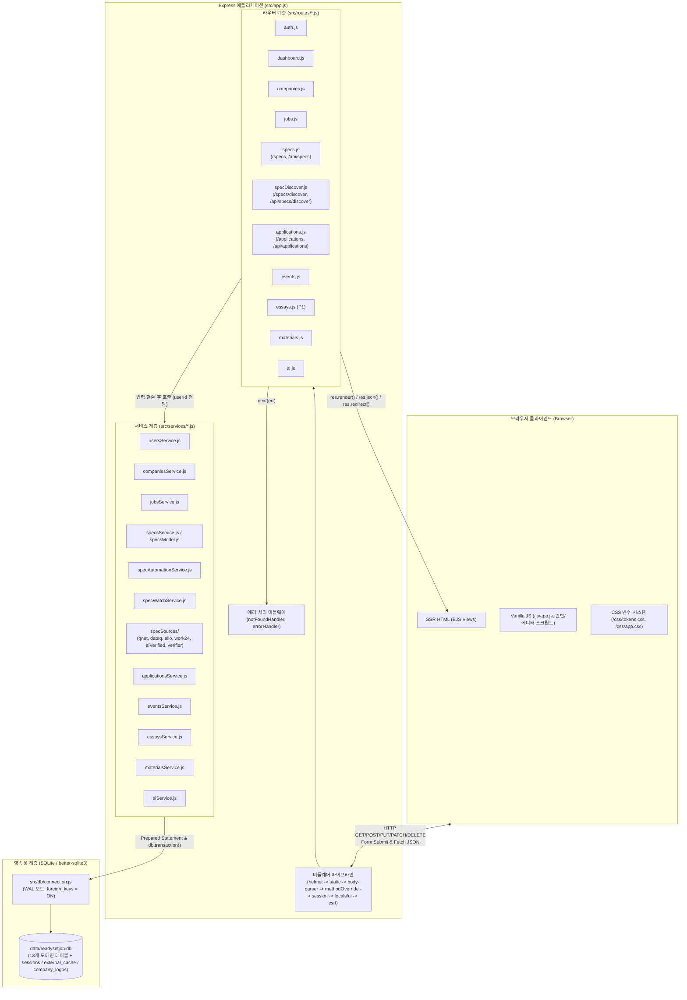
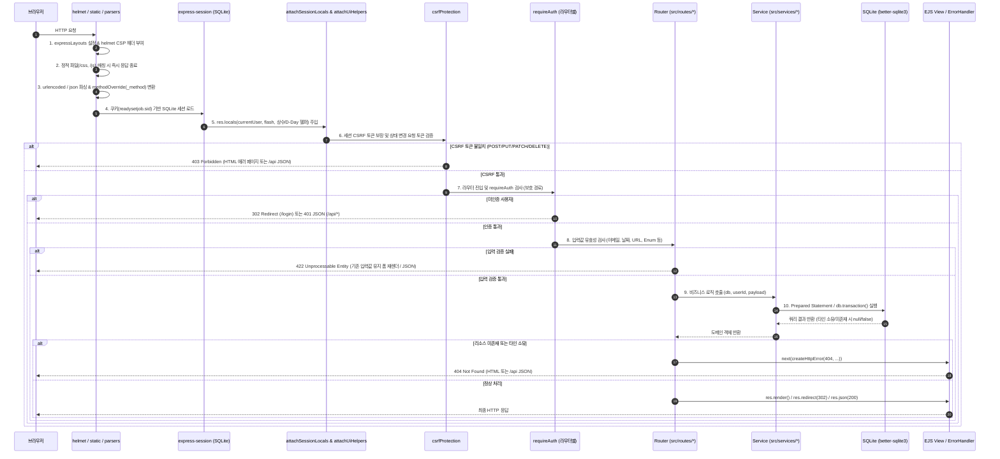
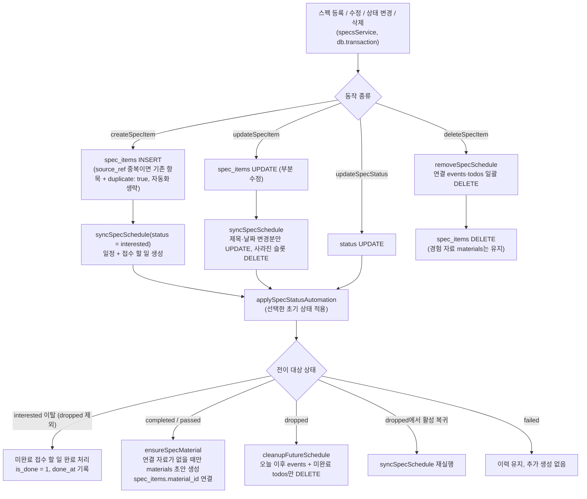

# ReadySetJob 시스템 아키텍처 및 라우터 명세서 (ARCHITECTURE)

본 문서는 **ReadySetJob**의 계층형 아키텍처, 요청 처리 생명주기, 디렉터리 구조, 미들웨어 책임, 에러 처리 전략, 보안 모델 및 전체 HTTP 라우터 명세를 기술한다. 모든 내용은 `src/app.js`, `src/middleware/*.js`, `src/routes/*.js`, `src/services/*.js`의 실제 구현 코드에 기반하며, 현재 병행 개발 중인 P1 기능(칸반 보드 및 자기소개서 버전 관리)은 **P1: 구현 완료 (2026-11-10 자동 테스트·브라우저 확인)**로 구분하여 기술한다.

---

## 1. 계층형 아키텍처 (Layered Architecture)

ReadySetJob은 외부 프레임워크나 상주 백그라운드 프로세스 없이 Node.js 22와 Express 4 기반의 3계층(Presentation / Application-Router / Service-Data) 구조로 동작한다.



### 계층별 설계 원칙
1. **앱 팩토리 패턴 (`createApp({ dbPath })`)**: `src/app.js`는 데이터베이스 경로를 주입받아 독립된 Express 인스턴스를 반환한다. 운영 서버(`src/server.js`)는 기본 파일 DB(`data/readysetjob.db`)를 사용하고, 테스트(`test/helpers.js`)는 임시 디렉터리 내 격리된 SQLite 파일을 생성해 병렬·반복 실행 시 데이터 간섭을 원천 차단한다.
2. **얇은 라우터(Thin Router)와 서비스 분리**: 라우터(`src/routes/*.js`)는 요청 파라미터 추출, 입력값 검증, HTTP 상태 코드 결정(`302`, `422`, `404`), 뷰 렌더링만 담당한다. 모든 SQL 실행과 트랜잭션(`db.transaction`)은 `src/services/*.js`에 캡슐화한다.
3. **명시적 `user_id` 전달**: 모든 서비스 함수는 첫 번째 인자로 `db`, 두 번째 인자로 `userId`(`req.session.user.id`)를 받아 SQL `WHERE` 절에서 소유권을 강제한다.
4. **스펙 관리 코어 및 발견 모듈의 파사드와 어댑터 분리**: `specsService.js`는 도메인 모델(`specsModel.js`), 자동화(`specAutomationService.js`), 구독·캐시(`specWatchService.js`)를 통합 노출하는 파사드(Facade) 역할을 수행한다. 외부 공공·검증 데이터 연동은 `specSources/` 어댑터 패키지로 캡슐화하여 독립적인 검색·캐싱·SSRF 검증 파이프라인을 구축한다.

---

## 2. 요청 생명주기 (Request Lifecycle)

`src/app.js`에 등록된 실제 미들웨어 실행 순서는 다음과 같다.



### 미들웨어 파이프라인 단계별 상세 (`src/app.js`)
1. **뷰 엔진 및 레이아웃**: `ejs` 엔진과 `express-ejs-layouts`를 등록하고 기본 레이아웃을 `views/layouts/main.ejs`로 지정한다.
2. **보안 헤더 (`helmet`)**: `defaultSrc`, `scriptSrc`, `styleSrc`, `fontSrc`, `connectSrc`, `formAction`, `baseUri`를 `'self'`로 제한하고, `imgSrc`는 `'self'`와 `data:`, `frameAncestors`와 `objectSrc`는 `'none'`으로 고정한다.
3. **요청 로깅 (`morgan`)**: `NODE_ENV === 'development'`일 때만 `morgan('dev')`를 활성화한다.
4. **정적 자산 서빙 (`express.static`)**: `public/` 디렉터리를 세션 및 CSRF 미들웨어보다 먼저 마운트하여 정적 자산 요청 시 불필요한 DB 세션 조회가 발생하지 않도록 한다.
5. **바디 파서 및 메서드 오버라이드 (`method-override`)**: `express.urlencoded({ extended: false })`와 `express.json()` 실행 직후, 쿼리 파라미터(`?_method=PUT|DELETE`)와 폼 바디(`req.body._method`) 양쪽 모두에서 HTTP 메서드를 변환하고 `req.body._method` 프로퍼티를 정리한다.
6. **세션 관리 (`express-session` + `better-sqlite3-session-store`)**: `SqliteSessionStore` 서브클래스를 통해 만료 세션 정리 타이머(`900000ms` = 15분)에 `timer.unref()`를 적용하여 테스트 프로세스가 정상 종료되도록 보장한다.
7. **템플릿 로컬 변수 주입 (`attachSessionLocals`, `attachUiHelpers`)**:
   - `res.locals.currentUser`: 현재 로그인 사용자 정보(`{ id, email, name }`) 또는 `null`
   - `res.locals.currentPath`: 사이드바 활성 메뉴 표시용 `req.path`
   - `res.locals.flash`: 1회성 플래시 메시지(`{ type, message }`) 조회 후 세션에서 즉시 삭제
   - `req.setFlash(type, message)`: 리다이렉트 전 플래시 메시지 등록 헬퍼
   - `res.locals.STAGE_LABELS`, `RESULT_LABELS`, `EMPLOYMENT_TYPE_LABELS`, `EVENT_TYPE_LABELS`, `calculateDday`: 뷰에서 사용하는 상수 및 D-Day 계산 함수
8. **CSRF 보호 (`csrfProtection`)**: 모든 요청에서 `res.locals.csrfToken`을 보장하고, 안전하지 않은 메서드(`POST`, `PUT`, `PATCH`, `DELETE`)에 대해 토큰 일치 여부를 검증한다.

---

## 3. 디렉터리 구조 (Directory Layout)

```text
ReadySetJob/
├── AGENTS.md                        # 에이전트 개발 규칙 및 제약 사항
├── README.md                        # 설치, 시드, 실행, 테스트 안내
├── package.json                     # 의존성 및 npm 스크립트 정의
├── .env.example                     # 환경 변수 템플릿 (PORT, SESSION_SECRET, DB_PATH, OPENAI_API_KEY 등)
├── data/
│   └── readysetjob.db               # 런타임 SQLite 데이터베이스 파일 (Git 제외)
├── src/
│   ├── app.js                       # Express 앱 팩토리 (createApp)
│   ├── server.js                    # HTTP 서버 엔트리포인트 및 Graceful Shutdown
│   ├── db/
│   │   ├── connection.js            # better-sqlite3 연결, WAL 및 foreign_keys 활성화
│   │   ├── schema.sql               # 10개 테이블 및 14개 인덱스 DDL
│   │   ├── migrate.js               # schema.sql 실행 마이그레이션 모듈/CLI
│   │   └── seed.js                  # 한국어 데모 계정 및 샘플 데이터 시드
│   ├── middleware/
│   │   ├── auth.js                  # attachSessionLocals, requireAuth
│   │   ├── csrf.js                  # ensureCsrfToken, csrfProtection (timingSafeEqual)
│   │   ├── validation.js            # 도메인 상수, 이메일/날짜/URL 검증기, calculateDday, attachUiHelpers
│   │   └── error.js                 # createHttpError, notFoundHandler, errorHandler
│   ├── routes/
│   │   ├── auth.js                  # /, /signup, /login, /logout
│   │   ├── dashboard.js             # /dashboard
│   │   ├── companies.js             # /companies CRUD
│   │   ├── jobs.js                  # /jobs CRUD 및 /:id/bookmark 토글
│   │   ├── specs.js                 # /specs CRUD, 상태 변경, 관심 자격증 구독, /api/specs 상태 API
│   │   ├── specDiscover.js          # /specs/discover 탐색, 검색, 세션 토큰 등록, 카탈로그 API
│   │   ├── applications.js          # /applications CRUD 및 /api/applications/:id/stage (+ P1 칸반 보드)
│   │   ├── events.js                # /events 조회/등록/삭제
│   │   ├── essays.js                # [P1 개발 중] /essays, /api/essays 버전/비교/복원/검색
│   │   ├── materials.js             # [P2 계획] /materials 경험 자료함 CRUD
│   │   └── ai.js                    # [P4 구현] OpenAI Responses API 기반 AI 기능 라우터 (피드백/STAR/공고파싱)
│   └── services/
│       ├── usersService.js          # 사용자 조회/생성/인증, 대시보드 카운트 집계
│       ├── companiesService.js      # 기업 CRUD 및 공고/지원 수 집계
│       ├── jobsService.js           # 채용 공고 CRUD, 인라인 기업 생성 트랜잭션, 북마크 토글
│       ├── specsService.js          # 스펙 CRUD, 다중 조건 검색, 대시보드 일정 집계, 공개 계약 파사드
│       ├── specsModel.js            # 스펙 도메인 모델, enums, 유효성 검증, 뷰 데코레이션 (Pure functions)
│       ├── specAutomationService.js # 일정(events)·할 일(todos) 자동 동기화, 상태 전이 시 경험 자료함 초안 생성
│       ├── specWatchService.js      # 관심 자격증 구독(spec_watch) 및 외부 응답 공유 캐시(external_cache)
│       ├── specSources/             # 외부 데이터 소스 어댑터 패키지 (Q-Net, DataQ, ALIO, Work24, AI, SSRF Verifier)
│       ├── applicationsService.js   # 지원 내역 CRUD, stage_logs 자동 기록 트랜잭션
│       ├── eventsService.js         # 일정 조회/등록/삭제
│       └── essaysService.js         # [P1 개발 중] 자소서 초안/버전 스냅샷/Diff/복원 트랜잭션
├── views/
│   ├── layouts/main.ejs             # 공통 쉘 (사이드바, 탑바, 테마 토글, 플래시 메시지)
│   ├── error.ejs                    # 공통 에러 페이지 (403, 404, 500)
│   ├── auth/                        # login.ejs, signup.ejs
│   ├── dashboard/                   # index.ejs
│   ├── companies/                   # index.ejs, form.ejs, detail.ejs
│   ├── jobs/                        # index.ejs, form.ejs, detail.ejs
│   ├── specs/                       # index.ejs (보드/목록), form.ejs, detail.ejs, discover.ejs
│   ├── applications/                # index.ejs, form.ejs, detail.ejs (+ P1 board.ejs)
│   ├── events/                      # index.ejs
│   └── essays/                      # [P1 개발 중] index.ejs, form.ejs, editor.ejs, compare.ejs
├── public/
│   ├── css/
│   │   ├── tokens.css               # 라이트/다크 모드 디자인 토큰 (CSS Variables)
│   │   └── app.css                  # 레이아웃, 컴포넌트, 배지, 타임라인 스타일
│   └── js/
│       └── app.js                   # 테마 전환(localStorage) 및 삭제 확인(data-confirm)
├── design/mockups/                  # 정적 HTML 디자인 시안 (A/B/C) 및 스크린샷 도구
├── docs/                            # 프로젝트 문서 (SPEC, ARCHITECTURE, DB_DESIGN, TASKS 등)
└── test/
    ├── helpers.js                   # 임시 DB 컨텍스트, CSRF 추출, 회원가입/로그인 에이전트 헬퍼
    ├── auth-and-security.test.js    # 인증, 세션 재생성, requireAuth, CSRF 검증 테스트
    ├── crud-and-ownership.test.js   # 기업, 공고, 지원, 단계 변경 API, 일정 CRUD 테스트
    ├── ownership-and-seed.test.js   # 다중 사용자 소유권 격리(404) 및 한국어 시드 검증 테스트
    ├── specs.test.js                # 스펙 관리 라우터 CRUD, 뷰, CSRF, 소유권 테스트
    ├── specs-service.test.js        # 스펙 서비스 함수, 유효성 검증, 캐시, 소유권 계약 테스트
    ├── specs-automation.test.js     # 스펙 연동 일정/할 일/자료함 초안 멱등 자동화 테스트
    ├── specs-dashboard.test.js      # 스펙 대시보드 위젯 및 관심 자격증 구독 테스트
    ├── spec-discover.test.js        # 스펙 찾기 라우터, 카탈로그, 세션 토큰 등록 테스트
    ├── spec-sources.test.js         # 외부 데이터 소스 어댑터 파싱, 정규화, 에러 처리 테스트
    └── spec-verifier.test.js        # SSRF 방어, DNS 핀닝, 도메인 Allow-list, 페이지 증거 검증 테스트
```

---

## 4. 미들웨어 책임 및 에러 처리 전략

### 4.1 미들웨어 모듈별 역할
| 파일 | 주요 함수 | 책임 및 동작 방식 |
|---|---|---|
| `src/middleware/auth.js` | `attachSessionLocals` | `req.session.user`를 `res.locals.currentUser`에 바인딩하고, 세션 내 1회성 `flash`를 꺼내 `res.locals.flash`에 설정한 뒤 삭제한다. `req.setFlash(type, message)` 메서드를 주입한다. |
| `src/middleware/auth.js` | `requireAuth` | 미인증 요청 차단. `req.originalUrl.startsWith('/api')`이면 `401` JSON(`{ error: '로그인이 필요합니다.' }`), 일반 요청이면 `302 /login` 리다이렉트를 수행한다. |
| `src/middleware/csrf.js` | `ensureCsrfToken`, `csrfProtection` | 세션에 64자리 hex 토큰(`crypto.randomBytes(32)`)을 유지한다. 변경 요청(`POST`, `PUT`, `PATCH`, `DELETE`) 시 `req.body._csrf` 또는 `X-CSRF-Token` 헤더를 상수 시간 비교(`crypto.timingSafeEqual`)로 검증한다. |
| `src/middleware/validation.js` | `isValidEmail`, `isValidDate`, `isValidDateTime`, `isValidUrl`, `calculateDday`, `attachUiHelpers` | 라우터 진입부 입력 검증 함수와 도메인 허용값 배열(`EMPLOYMENT_TYPES`, `APPLICATION_STAGES`, `APPLICATION_RESULTS`, `EVENT_TYPES`), 한글 라벨 맵을 제공하며 뷰 로컬 변수로 주입한다. |
| `src/middleware/error.js` | `createHttpError`, `notFoundHandler`, `errorHandler` | 표준화된 HTTP 에러 객체 생성(`err.status`, `err.expose = true`), 미매칭 경로 `404` 처리, 전역 예외 포착 및 HTML/JSON 분기 응답을 담당한다. |

### 4.2 상태 코드별 에러 처리 규칙
| HTTP 상태 | 발생 조건 | 일반 페이지 응답 (`Accept: text/html`) | API 응답 (`/api/*`) |
|---|---|---|---|
| `401 Unauthorized` | 비로그인 상태에서 보호 리소스 접근 또는 로그인 자격증명 불일치 | 보호 경로 접근 시 `302 /login` 리다이렉트. `POST /login` 실패 시 `401`과 함께 `auth/login` 재렌더링 | `{ error: '로그인이 필요합니다.' }` |
| `403 Forbidden` | 상태 변경 요청에서 CSRF 토큰 누락 또는 불일치 | `views/error.ejs` 렌더링 (`title: '보안 토큰 오류 (403)'`) | `{ error: '유효하지 않은 CSRF 토큰입니다.' }` |
| `404 Not Found` | 존재하지 않는 경로, 존재하지 않는 리소스 ID, 또는 **타 사용자 소유 리소스 접근** | `views/error.ejs` 렌더링 (`title: '페이지를 찾을 수 없습니다 (404)'`) | `{ error: '요청한 ...을(를) 찾을 수 없습니다.' }` |
| `422 Unprocessable Entity` | 필수값 누락, 형식 오류(이메일/날짜/URL/Enum), 중복 기업명, 동일 공고 중복 지원 | 사용자가 입력한 `values`를 보존하여 해당 입력 폼(`form.ejs` 등) 재렌더링 + 에러 배너 표시 | `{ error: '유효하지 않은 ...입니다.' }` |
| `500 Internal Server Error` | 예기치 않은 런타임/DB 예외 (`err.expose`가 아닌 경우) | 내부 스택 트레이스를 숨기고 일반 안내 문구(`서버 처리 중 오류가 발생했습니다.`)로 `views/error.ejs` 렌더링 | `{ error: '서버 처리 중 오류가 발생했습니다.' }` |

---

## 5. 보안 모델 (Session, CSRF, Ownership)

1. **세션 고정 방지 및 안전한 쿠키 설정**:
   - 회원가입(`POST /signup`)과 로그인(`POST /login`) 성공 시 반드시 `req.session.regenerate()`를 호출해 기존 세션 ID를 폐기하고 새 세션 ID를 발급한 뒤 `ensureCsrfToken(req)`로 CSRF 토큰도 새로 생성한다.
   - 세션 쿠키(`readysetjob.sid`)는 `httpOnly: true`(자바스크립트 `document.cookie` 접근 차단), `sameSite: 'lax'`(외부 사이트 크로스 사이트 POST 전송 억제), `maxAge: 7일`로 설정된다.
2. **이중 경로 CSRF 검증**:
   - 동기 HTML `<form>` 제출은 `<input type="hidden" name="_csrf" value="<%= csrfToken %>">` 필드를 사용한다.
   - 비동기 `fetch()` 요청(칸반 카드 이동, 자소서 초안 저장 등)은 `<meta name="csrf-token">`에서 읽은 값을 `X-CSRF-Token` 요청 헤더에 담아 전송한다.
   - 서버는 버퍼 길이를 먼저 확인한 뒤 `crypto.timingSafeEqual`로 비교하여 타이밍 공격을 방지한다.
3. **소유권 격리 (Ownership Isolation)**:
   - 모든 루트 도메인 테이블(`companies`, `job_posts`, `applications`, `events`, `essays`, `materials`, `interview_questions`)은 `user_id` 컬럼을 가진다.
   - 조인 쿼리에서도 `INNER JOIN companies c ON c.id = jp.company_id AND c.user_id = jp.user_id`와 같이 테이블 간 `user_id` 일치를 이중으로 검증한다.
    - 타 사용자의 리소스 ID로 상세 조회, 수정, 삭제, 북마크, 단계 변경을 시도하면 쿼리 결과가 `null` 또는 `changes === 0`이 되어 즉시 `404`를 반환한다 (`403`을 반환해 리소스 존재 여부를 노출하지 않음).
    - 스펙 관리 테이블(`spec_items`, `spec_watch`)도 `user_id`를 직접 보유하며, `specsService`의 조회·수정·삭제 함수는 소유하지 않은 항목에 `null`/`false`를 반환하고 라우터가 `404`로 변환한다. `external_cache`는 개인 데이터가 없는 공유 캐시다.
4. **스펙 찾기 세션 토큰 등록 모델**:
   - `POST /specs/discover` 및 `POST /api/specs/discover` 검색 결과는 최대 60건(`MAX_STORED_RESULTS`)까지 `crypto.randomBytes(12)`로 만든 24자리 hex 토큰을 키로 서버 세션(`req.session.specDiscover`)에 저장하고, 브라우저에는 토큰이 부여된 표시용 데이터만 전달한다.
   - `POST /specs/discover/register`는 토큰 형식(`/^[a-f0-9]{24}$/`)을 검증한 뒤 세션에 저장된 어댑터 반환 항목으로만 `createSpecItem`을 호출한다. 브라우저가 보낸 제목·날짜·출처·검증 여부는 신뢰하지 않으며, 다른 사용자의 토큰이나 새 검색으로 만료된 토큰은 `422`로 거절한다.
   - `category: 'job'`(ALIO 공공기관 채용) 결과는 스펙으로 등록할 수 없고 기존 `POST /jobs` 폼으로 안내한다.
5. **외부 소스 SSRF 검증 모델 (`src/services/specSources/verifier.js`)**: AI 검색(`ai_verified`)이 반환한 후보 URL은 서버가 직접 접속해 원문 증거를 확인하며, 다음 방어선을 모두 통과해야 결과로 노출된다.

   | 단계 | 방어 항목 | 구현 규칙 |
   |---|---|---|
   | 1 | URL 형식 | `http:`/`https:`만 허용하고 사용자 정보(`user:pass@`)와 명시적 포트를 금지한다. 해시(`#`)는 제거한다. |
   | 2 | 호스트 Allow-list (`isHostAllowed`) | 대학원 `*.ac.kr`, 민간자격 `exam.toeic.co.kr`·`opic.or.kr`·`dataq.or.kr`, 공모전·대외활동·부트캠프 `*.go.kr`·`*.or.kr`·`*.ac.kr`·`*.re.kr`·`*.mil.kr`만 허용한다. IP 리터럴과 취업·공모전 중개 사이트(`BLOCKED_HOSTS`: `AGGREGATOR_DOMAINS`, `wevity.com`, `thinkcontest.com` 등)는 차단한다. |
   | 3 | DNS 결과 검사 (`resolvePublic`) | A/AAAA 레코드 전체를 조회해 하나라도 사설(`10.0.0.0/8`, `172.16.0.0/12`, `192.168.0.0/16`)·루프백·링크 로컬(`169.254.0.0/16`, 클라우드 메타데이터 포함)·CGNAT(`100.64.0.0/10`)·예약 대역·IPv4-mapped IPv6이면 `blocked_address`로 거절한다. |
   | 4 | DNS 리바인딩 방어 (`pinnedFetch`) | 기본 HTTP transport의 `lookup` 훅이 위 검사를 통과한 주소로만 소켓을 연결하므로 재조회 시 사설 주소로 바뀌어도 연결되지 않는다. |
   | 5 | 리다이렉트 재검증 | `redirect: 'manual'`로 처리하며 최대 `MAX_REDIRECTS = 2`회까지만 따라가고, 각 홉에서 URL 형식·호스트 Allow-list·DNS 검사를 다시 수행한다. |
   | 6 | 응답 제한 | 전체 검증 시간 `VERIFY_TIMEOUT_MS = 5000`ms, 본문 `MAX_VERIFY_BYTES = 1 MiB`, `Content-Type`은 `text/html` 또는 `text/plain`만 허용한다. |
   | 7 | 원문 증거 교차 검증 | `script`·`style` 등을 제거한 가시 텍스트에서 제목 핵심어가 `min(2, 핵심어 수)`개 이상 일치하고(`titleKeywordsOverlap`), 접수 마감일(없으면 시험·시작일)이 `YYYY.MM.DD`·`YYYY년 M월 D일` 등 형식으로 실제 존재해야 한다(`dateAppearsInText`). 월·일만 있는 표기는 직전 문맥의 연도가 일치할 때만 인정한다. |

   - 검증에 실패한 후보는 결과에서 제외되고 제외 건수만 응답의 `dropped`로 전달된다. AI 후보가 캐시에 적중하더라도 매 검색마다 페이지 증거를 다시 검증한다.
   - 공식 API 어댑터(`qnet`, `dataq`, `alio`, `work24`)는 `specSources/common.js`의 공통 가드(8초 `TIMEOUT_MS`, 1 MiB `MAX_BYTES`, `redirect: 'error'`, 허용 `Content-Type` 검사)를 적용하고, 업스트림 오류 메시지를 그대로 전달하지 않아 인증키가 포함된 URL이 노출되지 않는다.

---

## 6. 전체 라우터 명세 (Router Specification)

### 6.1 구현 및 검증 완료 라우트 (P0)

#### 인증 라우터 (`src/routes/auth.js`, 마운트 경로: `/`)
| Method | Path | 인증 | 입력 필드 및 검증 규칙 | 성공 응답 | 실패/에러 응답 |
|---|---|---|---|---|---|
| `GET` | `/` | 불필요 | 없음 | 로그인 시 `302 /dashboard`, 비로그인 시 `302 /login` | - |
| `GET` | `/signup` | 불필요 | 없음 | 로그인 시 `302 /dashboard`, 비로그인 시 `200` `auth/signup` 렌더 | - |
| `POST` | `/signup` | 불필요 + CSRF | `name`(필수), `email`(`isValidEmail`, 중복 불가), `password`(8자 이상) | 사용자 생성, 세션 재생성 후 `302 /dashboard` | 검증/중복 실패 시 `422` `auth/signup` 재렌더, CSRF 실패 시 `403` |
| `GET` | `/login` | 불필요 | 없음 | 로그인 시 `302 /dashboard`, 비로그인 시 `200` `auth/login` 렌더 | - |
| `POST` | `/login` | 불필요 + CSRF | `email`(`isValidEmail`), `password`(필수) | 자격증명 확인, 세션 재생성 후 `302 /dashboard` | 형식 누락 `422`, 불일치 `401` (`auth/login` 재렌더), CSRF 실패 `403` |
| `POST` | `/logout` | 세션 + CSRF | `_csrf` | 세션 파기, `readysetjob.sid` 쿠키 삭제 후 `302 /login` | CSRF 실패 시 `403` |

#### 대시보드 라우터 (`src/routes/dashboard.js`, 마운트 경로: `/`)
| Method | Path | 인증 | 입력 필드 및 검증 규칙 | 성공 응답 | 실패/에러 응답 |
|---|---|---|---|---|---|
| `GET` | `/dashboard` | `requireAuth` | 없음 | `200` `dashboard/index` 렌더 (`counts`: 기업/공고/북마크/지원/진행중/합격/일정 수) | 미인증 시 `302 /login` |

#### 기업 관리 라우터 (`src/routes/companies.js`, 마운트 경로: `/companies`)
| Method | Path | 인증 | 입력 필드 및 검증 규칙 | 성공 응답 | 실패/에러 응답 |
|---|---|---|---|---|---|
| `GET` | `/companies` | `requireAuth` | Query: `q`(선택, 기업명·산업군·메모 검색) | `200` `companies/index` 렌더 (`companies`, `q`) | 미인증 시 `302 /login` |
| `GET` | `/companies/new` | `requireAuth` | 없음 | `200` `companies/form` 렌더 (`isEdit: false`) | 미인증 시 `302 /login` |
| `POST` | `/companies` | `requireAuth` + CSRF | Body: `name`(필수, 사용자 내 고유), `industry`, `website`(`isValidUrl`), `memo` | 기업 생성 후 `302 /companies/:id` | 검증/중복 실패 시 `422` `companies/form` 재렌더 |
| `GET` | `/companies/:id` | `requireAuth` | Param: `id` | `200` `companies/detail` 렌더 (기업 정보 + 연결 공고 목록) | 미존재/타인 소유 시 `404` |
| `GET` | `/companies/:id/edit` | `requireAuth` | Param: `id` | `200` `companies/form` 렌더 (`isEdit: true`) | 미존재/타인 소유 시 `404` |
| `PUT` | `/companies/:id` | `requireAuth` + CSRF | Param: `id`, Body: `name`(필수, 타 기업과 중복 불가), `industry`, `website`(`isValidUrl`), `memo` | 기업 수정 후 `302 /companies/:id` | 미존재/타인 소유 `404`, 검증/중복 실패 `422` |
| `DELETE` | `/companies/:id` | `requireAuth` + CSRF | Param: `id` | 기업 삭제 후 `302 /companies` | 미존재/타인 소유 시 `404` |

#### 채용 공고 라우터 (`src/routes/jobs.js`, 마운트 경로: `/jobs`)
| Method | Path | 인증 | 입력 필드 및 검증 규칙 | 성공 응답 | 실패/에러 응답 |
|---|---|---|---|---|---|
| `GET` | `/jobs` | `requireAuth` | Query: `q`, `employment_type`, `bookmarked`(`1`), `sort`(`deadline`\|`recent`) | `200` `jobs/index` 렌더 (`jobs`, `filters`) | 미인증 시 `302 /login` |
| `GET` | `/jobs/new` | `requireAuth` | Query: `company_id`(선택, 사전 선택용) | `200` `jobs/form` 렌더 (`isEdit: false`, `companies`) | 미인증 시 `302 /login` |
| `POST` | `/jobs` | `requireAuth` + CSRF | Body: `title`(필수), `company_id` 또는 `new_company_name`(둘 중 하나 필수), `new_company_industry`, `new_company_website`(`isValidUrl`), `position`, `employment_type`(`EMPLOYMENT_TYPES`), `url`(`isValidUrl`), `deadline`(`isValidDate`), `memo`, `is_bookmarked` | 트랜잭션으로 공고(+신규 기업) 생성 후 `302 /jobs/:id` | 검증 실패 `422` `jobs/form` 재렌더, 타인/미존재 `company_id` 지정 시 `404` |
| `GET` | `/jobs/:id` | `requireAuth` | Param: `id` | `200` `jobs/detail` 렌더 | 미존재/타인 소유 시 `404` |
| `GET` | `/jobs/:id/edit` | `requireAuth` | Param: `id` | `200` `jobs/form` 렌더 (`isEdit: true`) | 미존재/타인 소유 시 `404` |
| `PUT` | `/jobs/:id` | `requireAuth` + CSRF | Param: `id`, Body: `company_id`(본인 소유 기업), `title`(필수), `position`, `employment_type`, `url`, `deadline`, `memo`, `is_bookmarked` | 공고 수정 후 `302 /jobs/:id` | 미존재/타인 소유 공고·기업 `404`, 검증 실패 `422` |
| `POST` | `/jobs/:id/bookmark` | `requireAuth` + CSRF | Param: `id`, Body: `redirect_to`(선택) | `Accept: application/json` 시 `200` `{ id, is_bookmarked }`, 일반 요청 시 `302` 리다이렉트 | 미존재/타인 소유 시 `404` |
| `DELETE` | `/jobs/:id` | `requireAuth` + CSRF | Param: `id` | 공고 삭제 후 `302 /jobs` | 미존재/타인 소유 시 `404` |

#### 지원 현황 및 단계 API 라우터 (`src/routes/applications.js`, 마운트 경로: `/applications`, `/api/applications`)
| Method | Path | 인증 | 입력 필드 및 검증 규칙 | 성공 응답 | 실패/에러 응답 |
|---|---|---|---|---|---|
| `GET` | `/applications` | `requireAuth` | Query: `stage`, `result`, `q` | `200` `applications/index` 렌더 | 미인증 시 `302 /login` |
| `GET` | `/applications/new` | `requireAuth` | Query: `job_post_id`(선택) | `200` `applications/form` 렌더 (`isEdit: false`, 기본 지원일 오늘) | 미인증 시 `302 /login` |
| `POST` | `/applications` | `requireAuth` + CSRF | Body: `job_post_id`(필수, 본인 소유 공고, 중복 지원 불가), `stage`(`APPLICATION_STAGES`), `result`(`APPLICATION_RESULTS`), `applied_at`(`isValidDate`), `memo` | 트랜잭션으로 `applications` + 초기 `stage_logs` 생성 후 `302 /applications/:id` | 검증/중복 지원 실패 시 `422` 폼 재렌더, 미존재/타인 공고 `404` |
| `GET` | `/applications/:id` | `requireAuth` | Param: `id` | `200` `applications/detail` 렌더 (상세 + `stageLogs` + `events`) | 미존재/타인 소유 시 `404` |
| `GET` | `/applications/:id/edit` | `requireAuth` | Param: `id` | `200` `applications/form` 렌더 (`isEdit: true`) | 미존재/타인 소유 시 `404` |
| `PUT` | `/applications/:id` | `requireAuth` + CSRF | Param: `id`, Body: `stage`, `result`, `applied_at`, `memo` | 수정 및 단계/결과 변경 시 `stage_logs` 추가 후 `302 /applications/:id` | 미존재/타인 소유 `404`, 검증 실패 `422` |
| `DELETE` | `/applications/:id` | `requireAuth` + CSRF | Param: `id` | 지원 내역 삭제 후 `302 /applications` | 미존재/타인 소유 시 `404` |
| `PATCH` | `/api/applications/:id/stage` | `requireAuth` + CSRF | Param: `id`, JSON Body: `stage`(필수, `APPLICATION_STAGES`), `result`(선택, `APPLICATION_RESULTS`), `board_order`(선택) | `200` JSON `{ id, stage, result, board_order, application, stageLogs, stage_logs }` | 미인증 `401` JSON, CSRF 실패 `403` JSON, 검증 실패 `422` JSON, 미존재/타인 소유 `404` JSON |

#### 일정 관리 라우터 (`src/routes/events.js`, 마운트 경로: `/events`)
| Method | Path | 인증 | 입력 필드 및 검증 규칙 | 성공 응답 | 실패/에러 응답 |
|---|---|---|---|---|---|
| `GET` | `/events` | `requireAuth` | Query: `application_id`(선택, 등록 폼 기본 선택값) | `200` `events/index` 렌더 (`events`, `applications`) | 미인증 시 `302 /login` |
| `POST` | `/events` | `requireAuth` + CSRF | Body: `title`(필수), `type`(`EVENT_TYPES`), `starts_at`(`isValidDateTime`), `application_id`(선택, 본인 소유 검증), `memo`, `redirect_to`(선택) | 일정 생성 후 `302` (`redirect_to` 또는 `/events`) | 검증 실패 `422` `events/index` 재렌더, 타인/미존재 `application_id` 시 `404` |
| `DELETE` | `/events/:id` | `requireAuth` + CSRF | Param: `id`, Body: `redirect_to`(선택) | 일정 삭제 후 `302` (`redirect_to` 또는 `/events`) | 미존재/타인 소유 시 `404` |

---

### 6.2 P1: 구현 완료 (2026-11-10 자동 테스트·브라우저 확인) 라우트

현재 병행 작업으로 추가되고 있는 칸반 보드 및 자기소개서(버전·비교·복원·검색·자료 연결) 라우트 명세는 다음과 같다.

| Method | Path | 인증 | 입력 필드 및 검증 규칙 | 성공 응답 | 실패/에러 응답 | 상태 |
|---|---|---|---|---|---|---|
| `GET` | `/applications/board` | `requireAuth` | Query: `q`(선택), `result`(선택) | `200` 전형 단계별(`document` ~ `final`) 그룹화된 칸반 보드 뷰 렌더링 | 미인증 시 `302 /login` | P1: 구현 완료 (2026-11-10 자동 테스트·브라우저 확인) |
| `PATCH` | `/api/applications/:id/stage` | `requireAuth` + CSRF | Param: `id`, JSON Body: `{ stage, result?, index? }` (`index`는 대상 컬럼 내 정렬 순서) | `200` JSON: 대상 컬럼 내 카드 `board_order` 재정렬 및 단계/결과 변경 시 `stage_logs` 기록 후 갱신 상태 반환 | `401`, `403`, `404`, `422` JSON | P1: 구현 완료 (2026-11-10 자동 테스트·브라우저 확인) |
| `GET` | `/essays` | `requireAuth` | Query: `q`(선택), `application_id`(선택) | `200` 자기소개서 목록 뷰 렌더링 | 미인증 시 `302 /login` | P1: 구현 완료 (2026-11-10 자동 테스트·브라우저 확인) |
| `GET` | `/essays/new` | `requireAuth` | Query: `application_id`(선택) | `200` 새 자기소개서 작성 폼 렌더링 | 미인증 시 `302 /login` | P1: 구현 완료 (2026-11-10 자동 테스트·브라우저 확인) |
| `POST` | `/essays` | `requireAuth` + CSRF | Body: `title`(필수), `application_id`(선택, 본인 소유), 문항 배열(`question`, `char_limit`, `answer`) | 트랜잭션으로 `essays` 및 `essay_questions` 생성 후 `302 /essays/:id` | 검증 실패 `422`, 타인 지원 건 `404` | P1: 구현 완료 (2026-11-10 자동 테스트·브라우저 확인) |
| `GET` | `/essays/:id` | `requireAuth` | Param: `id` | `200` 자기소개서 멀티 문항 에디터 + 버전 목록 + 연결된 자료함 렌더링 | 미존재/타인 소유 시 `404` | P1: 구현 완료 (2026-11-10 자동 테스트·브라우저 확인) |
| `PUT` | `/api/essays/:id/draft` | `requireAuth` + CSRF | Param: `id`, JSON/Form Body: `title`, `questions` 배열(`id?`, `sort_order`, `question`, `char_limit`, `answer`) | `200` JSON: `essay_questions` 작업 초안만 갱신 (새 `essay_versions` 레코드 생성 안 함) | `401`, `403`, `404`, `422` JSON | P1: 구현 완료 (2026-11-10 자동 테스트·브라우저 확인) |
| `POST` | `/essays/:id/versions` | `requireAuth` + CSRF | Param: `id`, Body: `label`(선택, 버전 메모) | 현재 초안을 `snapshot_json`으로 직렬화해 불변 버전(`version_no = max + 1`) 생성 후 `302` 또는 `201` JSON | 미존재/타인 소유 `404`, 검증 실패 `422` | P1: 구현 완료 (2026-11-10 자동 테스트·브라우저 확인) |
| `GET` | `/essays/:id/versions` | `requireAuth` | Param: `id` | `200` 해당 자기소개서의 전체 버전 히스토리 목록(HTML/JSON) 반환 | 미존재/타인 소유 시 `404` | P1: 구현 완료 (2026-11-10 자동 테스트·브라우저 확인) |
| `GET` | `/essays/:id/versions/:no` | `requireAuth` | Param: `id`, `no`(`version_no`) | `200` 특정 버전 번호(`:no`)의 불변 스냅샷 상세 조회 | 미존재/타인 소유 시 `404` | P1: 구현 완료 (2026-11-10 자동 테스트·브라우저 확인) |
| `GET` | `/essays/:id/compare` | `requireAuth` | Param: `id`, Query: `from`(버전 번호), `to`(버전 번호) | `200` 서버 사이드 `jsdiff` 단어 단위 Diff 결과 렌더링 (HTML 이스케이프 적용) | 버전 미존재/타인 소유 `404`, 파라미터 오류 `422` | P1: 구현 완료 (2026-11-10 자동 테스트·브라우저 확인) |
| `POST` | `/essays/:id/versions/:no/restore` | `requireAuth` + CSRF | Param: `id`, `no`(복원할 `version_no`) | 트랜잭션: (1) 미저장 초안 변경분이 있으면 자동 버전 백업, (2) `:no` 스냅샷으로 `essay_questions` 초안 덮어쓰기, (3) `restored_from_version_id`를 설정한 새 버전(`max + 1`) 생성 후 에디터로 리다이렉트/응답 | 미존재/타인 소유 `404` | P1: 구현 완료 (2026-11-10 자동 테스트·브라우저 확인) |
| `GET` | `/api/essays/search` | `requireAuth` | Query: `q`(검색 키워드) | `200` JSON: 사용자의 자기소개서 문항 질문·답변 매칭 목록 반환 | 미인증 시 `401` JSON | P1: 구현 완료 (2026-11-10 자동 테스트·브라우저 확인) |
| `POST` | `/essays/:id/materials` (및 unlink) | `requireAuth` + CSRF | Param: `id`, Body/Param: `material_id` | 본인 소유의 자기소개서와 경험 자료(`materials`) 간 `essay_materials` 연결/해제 처리 | 미존재/타인 소유 시 `404` | P1: 구현 완료 (2026-11-10 자동 테스트·브라우저 확인) |

---

### 6.3 P2 및 P4 계획 라우트

| Method | Path | 인증 | 설명 | 우선순위 및 상태 |
|---|---|---|---|---|
| `GET / POST / PUT / DELETE` | `/materials`, `/materials/:id` | `requireAuth` (+ CSRF) | 경험·프로젝트·수상·대외활동 자료함(`materials`) CRUD 및 분류(`kind`)·태그 검색 | P2: 계획 |
| `POST` | `/applications/:id/interview-questions/generate` | `requireAuth` + CSRF | 지원 공고 및 연결 자기소개서 기반 서버 사이드 OpenAI 면접 예상 질문 생성 (`OPENAI_API_KEY` 미설정 시 비활성화) | P4: 구현 완료 |
| `GET / POST` | `/api/essays/:id/questions/:qid/feedback` | `requireAuth` (+ CSRF) | 자기소개서 문항별 OpenAI 구조화 첨삭 피드백 조회 및 생성 (`essay_feedback` 저장) | P4: 구현 완료 |
| `POST` | `/materials/:id/star-draft`, `/api/materials/:id/star-draft` | `requireAuth` + CSRF | 경험 자료 기반 OpenAI STAR 초안 생성 (`material_star_drafts` 저장) 및 `/:draftId/apply` 본문 반영 | P4: 구현 완료 |
| `POST` | `/api/jobs/parse` | `requireAuth` + CSRF | 채용 공고 원문 텍스트에서 기업명·직무·마감일·자소서 문항 구조화 추출 (DB 미저장) | P4: 구현 완료 |
| `GET` | `/settings/ai` | `requireAuth` | OpenAI 활성화 상태 및 기능별 모델 매핑·환경 변수 설정 안내 화면 | P4: 구현 완료 |

---

### 6.4 스펙 관리 라우트 (SPEC): 검증 완료 (`test/specs*.test.js`, `test/spec-*.test.js`)

`src/app.js`는 `mountSpecDiscover(app, db)`로 `src/routes/specDiscover.js`가 존재할 때만 `/specs/discover` 라우터를 **`createSpecsRouter`보다 먼저** 마운트한다. 리터럴 경로 `/specs/discover`가 `/specs/:id`에 포획되지 않게 하기 위함이며, `createSpecDiscoverRouter`의 mount 이벤트가 부모 앱에 `/api/specs` 검색 API를 함께 등록한다.

#### 스펙 코어 라우터 (`src/routes/specs.js`, 마운트 경로: `/specs`, `/api/specs`)
| Method | Path | 인증 | 입력 필드 및 검증 규칙 | 성공 응답 | 실패/에러 응답 |
|---|---|---|---|---|---|
| `GET` | `/specs` | `requireAuth` | Query: `view`(`list` 외에는 보드), `kind`(`SPEC_KINDS`), `status`(`SPEC_STATUSES`), `q`(최대 100자, 제목·주최·메모 검색), `from`·`to`(`isValidDate`) | `200` `specs/index` 렌더 (5개 상태 컬럼 `columns`, `items`, 구독 목록 `watches`) | 미인증 시 `302 /login` |
| `GET` | `/specs/new` | `requireAuth` | Query: `kind`(선택, 기본 `certificate`) | `200` `specs/form` 렌더 (`isEdit: false`, 기본 상태 `interested`) | 미인증 시 `302 /login` |
| `POST` | `/specs` | `requireAuth` + CSRF | Body: `kind`, `title`(필수, 200자 이하), `organizer`, `source_url`(`isValidUrl`), `status`, `apply_start`, `apply_end`, `event_date`, `end_date`, `result_date`(`isValidDate`), `memo`(5000자 이하) | 스펙 생성 및 일정·할 일 자동 등록 후 `302 /specs/:id` | 검증 실패 `422` `specs/form` 재렌더 (`SpecValidationError`) |
| `POST` | `/specs/watch` | `requireAuth` + CSRF | Body: `cert_code`(`/^[A-Za-z0-9_-]{1,40}$/`), `cert_name`(100자 이하), `redirect_to`(선택, `safeRedirectPath`) | 구독 추가(중복이면 멱등 처리) 후 `302` (`redirect_to` 또는 `/specs`) | 검증 실패 `422` `specs/index` 재렌더 |
| `DELETE` | `/specs/watch/:code` | `requireAuth` + CSRF | Param: `code`, Body: `redirect_to`(선택) | 구독 해제 후 `302` | 구독 미존재 시 `404` |
| `GET` | `/specs/:id` | `requireAuth` | Param: `id` | `200` `specs/detail` 렌더 (상세 + 날짜 타임라인 `timeline` + 연결 일정·할 일·자료 `links`) | 미존재/타인 소유 `404` |
| `GET` | `/specs/:id/edit` | `requireAuth` | Param: `id` | `200` `specs/form` 렌더 (`isEdit: true`) | 미존재/타인 소유 `404` |
| `PUT` | `/specs/:id` | `requireAuth` + CSRF | Param: `id`, Body: 등록과 동일한 폼 필드 | 수정 및 일정·할 일 동기화 후 `302 /specs/:id` | 미존재/타인 소유 `404`, 검증·출처 중복 실패 `422` `specs/form` 재렌더 |
| `POST` | `/specs/:id/status` | `requireAuth` + CSRF | Param: `id`, Body: `status`(`SPEC_STATUSES`), `redirect_to`(선택) | 상태 변경 및 자동화 실행 후 `302` (`redirect_to` 또는 `/specs/:id`) | 미존재/타인 소유 `404`, 잘못된 상태 `422` `specs/detail` 재렌더 |
| `DELETE` | `/specs/:id` | `requireAuth` + CSRF | Param: `id` | 스펙과 연결된 일정·할 일 삭제 후 `302 /specs` | 미존재/타인 소유 `404` |
| `PATCH` | `/api/specs/:id/status` | `requireAuth` + CSRF | Param: `id`, JSON Body: `status`(`SPEC_STATUSES`) | `200` JSON `{ ok: true, spec, automation, message }` | 미인증 `401` JSON, CSRF 실패 `403` JSON, 잘못된 상태 `422` JSON, 미존재/타인 소유 `404` JSON |

#### 스펙 찾기 라우터 (`src/routes/specDiscover.js`, 마운트 경로: `/specs`, `/api/specs`)
| Method | Path | 인증 | 입력 필드 및 검증 규칙 | 성공 응답 | 실패/에러 응답 |
|---|---|---|---|---|---|
| `GET` | `/specs/discover` | `requireAuth` | 없음 | `200` `specs/discover` 렌더 (종류 칩, 카탈로그, 소스별 활성 상태 `statuses`) | 미인증 시 `302 /login` |
| `GET` | `/specs/discover/catalog` | `requireAuth` | Query: `q`(최대 40자) | `200` JSON `{ ok: true, items: [{ jmCd, name, field }] }` (Q-Net 카탈로그, 조회 실패 시 정적 폴백) | 미인증 시 `302 /login` |
| `POST` | `/specs/discover` | `requireAuth` + CSRF | Body: `discoverOptions.validateDiscoverInput` 화이트리스트(종류·필드·지역 등), `cert_query`(최대 40자) | `200` `specs/discover` 렌더 (토큰이 부여된 결과 카드, `notices`, `dropped`) | 입력 오류 `422`, 속도 제한 `429`, 외부 응답 지연 `504`, 그 외 외부 오류 `502` |
| `POST` | `/api/specs/discover` | `requireAuth` + CSRF | 위와 동일 | `200` JSON `{ ok: true, items, notices, dropped }` | 미인증 `401` JSON, CSRF 실패 `403` JSON, `422`·`429`·`502`·`504` JSON `{ error }` |
| `POST` | `/specs/discover/register` | `requireAuth` + CSRF | Body: `token`(24자리 hex, 세션 저장 결과 키) | 세션에 저장된 항목으로 `createSpecItem` 호출 후 `302 /specs/:id` (중복 출처면 기존 항목으로 이동) | 토큰 형식 오류·만료·타 사용자 토큰·`job` 카테고리 `422`, 스펙 검증 실패 `422` |
| `POST` | `/specs/discover/watch` | `requireAuth` + CSRF | Body: `cert_code`(`/^\d{1,8}$/`, Q-Net 카탈로그에서 재확인) | `addWatch` 호출 후 `302 /specs/discover` | 카탈로그에 없는 코드 `422` |

---

## 7. 스펙 관리 자동화 흐름 (Spec Automation Flow)

`src/services/specAutomationService.js`의 모든 부수효과는 `spec_item_id`로 키가 부여되어 재실행해도 일정·할 일·자료가 중복 생성되지 않는다(멱등). `specsService`가 `createSpecItem`, `updateSpecItem`, `updateSpecStatus`, `deleteSpecItem`의 `db.transaction` 내부에서 호출하므로 스펙 변경과 자동화 결과는 원자적으로 반영된다. 수동으로 등록한 일정·할 일은 `spec_item_id`가 없으므로 자동화가 건드리지 않는다.



### 7.1 일정(`events`) 자동 생성 규칙 (`scheduleSlots`, `syncSpecEvents`)
활성 상태(`interested`, `applied`, `in_progress`)에서만 동기화하며, 일정 제목은 `[스펙 제목] 슬롯명`, 메모는 `스펙 관리에서 자동 등록된 일정`이다. 기존 연결 일정은 제목으로 매칭해 `starts_at`·`type`만 갱신하고, 날짜가 비워진 슬롯의 일정은 삭제한다.

| 날짜 컬럼 | 슬롯명 | 시각 | `events.type` | 비고 |
|---|---|---|---|---|
| `apply_start` | 접수 시작 | `09:00` | `other` | |
| `apply_end` | 접수 마감 | `18:00` | `deadline` | |
| `event_date` | 시험(자격증) / 시작(그 외) | `09:00` | `test`(자격증) / `other` | |
| `end_date` | 종료 | `09:00` | - | `timelineOnly`: 일정을 만들지 않고 타임라인·자료 기간 요약에만 사용 |
| `result_date` | 결과 발표 | `09:00` | `announcement` | |

### 7.2 할 일(`todos`) 자동 생성 규칙 (`syncSpecTodo`, `completeApplyTodo`)
- 스펙당 접수 할 일 1건만 만든다. 제목은 자격증이면 `[스펙 제목] 원서 접수`, 그 외에는 `[스펙 제목] 신청서 제출`(120자 초과 시 말줄임)이며 `category = 'other'`, `due_date = apply_end`다.
- 상태가 `interested`일 때만 새로 생성한다. 이미 접수한 상태로 등록해도 접수 이력이 연결되도록 등록 트랜잭션이 먼저 기본 일정·접수 할 일을 만든 뒤 선택된 상태를 적용하며, `interested`를 벗어나는 순간 미완료 접수 할 일은 완료 처리된다.
- 활성 항목을 수정하면 미완료 접수 할 일의 제목과 마감일을 동기화한다. 이미 완료된 할 일은 변경하지 않는다.

### 7.3 경험 자료함 초안 연결 (`ensureSpecMaterial`, `materialShape`)
`completed` 또는 `passed`로 전이될 때 `spec_items.material_id`가 비어 있거나 가리키는 자료가 없는 경우에만 `materials` 초안을 만들고 연결한다. `materials`에는 별도 draft 컬럼이 없으므로 본문 첫 줄에 자동 생성 초안임과 STAR 보완 안내를 명시한다. `material_id`는 이 자동화만 설정하며 클라이언트 입력으로 임의 자료를 연결할 수 없다.

| 스펙 `kind` | 조건 | `materials.kind` | `materials.tags` |
|---|---|---|---|
| `certificate` | - | `award` | `자격증` |
| `contest` | `passed` | `award` | `공모전,수상` |
| `contest` | `completed` | `activity` | `공모전` |
| `bootcamp` | - | `project` | `교육,부트캠프` |
| `activity` | - | `activity` | `대외활동` |
| `grad_school` | - | `other` | `대학원` |
| `other` | - | `other` | `스펙` |

### 7.4 중단·삭제 정리 정책
- `dropped`: `date(starts_at) >= 오늘`인 연결 일정과 미완료(`is_done = 0`) 연결 할 일만 삭제하고, 과거 일정과 완료된 할 일은 이력으로 유지한다.
- `deleteSpecItem`: 연결된 모든 일정·할 일을 명시적으로 삭제한 뒤 스펙을 삭제한다. 신규 DB는 `ON DELETE CASCADE`가 있지만 마이그레이션된 기존 DB는 FK가 없어 두 경로 모두 동일하게 동작하도록 서비스에서 직접 삭제한다. 이미 생성된 경험 자료는 유지한다.
- 대시보드 위젯(`listUpcomingSpecDates`)은 활성 스펙의 `apply_start`·`apply_end`·`event_date` 중 오늘부터 14일 이내 날짜를 오름차순으로 최대 5건 조회하며, D-3 이하(`isUrgent`)는 강조한다.
