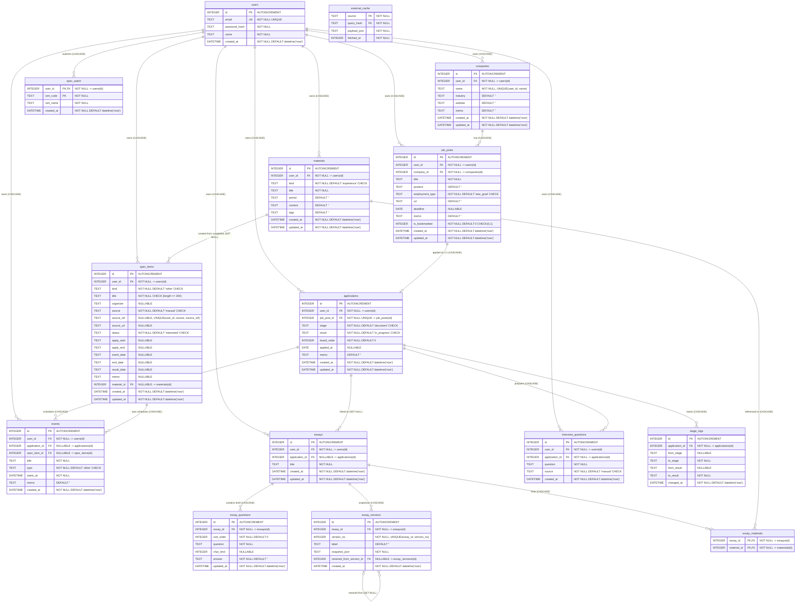
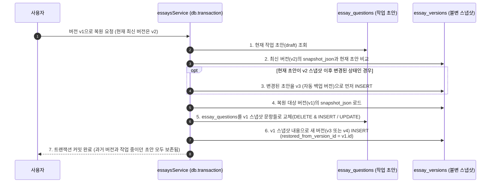

# ReadySetJob 데이터베이스 설계서 (DB_DESIGN)

본 문서는 `src/db/schema.sql`, `src/db/connection.js`, `src/services/*.js`에 구현된 SQLite 데이터베이스의 ERD, 테이블별 컬럼 명세, 참조 무결성(`ON DELETE`) 정책, 인덱스 설계, 핵심 설계 의사결정 및 트랜잭션 구조를 기술한다.

---

## 1. 데이터베이스 엔진 및 연결 설정 (`src/db/connection.js`)

| 항목 | 설정값 | 설명 |
|---|---|---|
| DBMS | SQLite 3 (`better-sqlite3` `^11.5.0`) | 동기식 C++ 네이티브 바인딩 드라이버 사용 |
| 기본 파일 경로 | `data/readysetjob.db` | 환경 변수 `DB_PATH` 또는 `createApp({ dbPath })` 인자로 재정의 가능 |
| 저널 모드 | `PRAGMA journal_mode = WAL;` | 읽기·쓰기 동시성 향상 및 파일 잠금 경합 최소화 |
| 외래키 제약 | `PRAGMA foreign_keys = ON;` | 연결 생성 시점(`openDatabase`) 및 마이그레이션 시점(`migrate`) 모두 강제 활성화 |
| 세션 스토어 | `sessions` 테이블 (`better-sqlite3-session-store`) | `express-session`이 동일 SQLite DB 내에 세션 레코드를 자동 생성·관리 |

---

## 2. 개체-관계 다이어그램 (ERD)

아래 다이어그램은 `src/db/schema.sql`에 정의된 도메인 테이블 중 지원·자기소개서·경험 자료 영역 12개 테이블과 스펙 관리 영역 3개 테이블(`spec_items`, `spec_watch`, `external_cache`)의 구조와 카디널리티를 정확히 반영한다.

---

## 3. 테이블별 상세 컬럼 명세

### 3.1 `users` (사용자 계정)
| 컬럼명 | 타입 | 제약 조건 | 기본값 | 설명 |
|---|---|---|---|---|
| `id` | `INTEGER` | `PRIMARY KEY AUTOINCREMENT` | - | 사용자 고유 식별자 |
| `email` | `TEXT` | `NOT NULL UNIQUE` | - | 로그인 이메일 (서비스 계층에서 소문자 정규화) |
| `password_hash` | `TEXT` | `NOT NULL` | - | `bcryptjs` 해시 문자열 (cost 10) |
| `name` | `TEXT` | `NOT NULL` | - | 사용자 이름 |
| `created_at` | `DATETIME` | `NOT NULL` | `(datetime('now'))` | 가입 일시 (UTC) |

### 3.2 `companies` (지원 대상 기업)
| 컬럼명 | 타입 | 제약 조건 | 기본값 | 설명 |
|---|---|---|---|---|
| `id` | `INTEGER` | `PRIMARY KEY AUTOINCREMENT` | - | 기업 고유 식별자 |
| `user_id` | `INTEGER` | `NOT NULL REFERENCES users(id) ON DELETE CASCADE` | - | 소유 사용자 ID |
| `name` | `TEXT` | `NOT NULL`, `UNIQUE(user_id, name)` | - | 기업명 (동일 사용자 내 중복 불가) |
| `industry` | `TEXT` | - | `''` | 산업군/도메인 |
| `website` | `TEXT` | - | `''` | 기업 웹사이트 (`http://` 또는 `https://`) |
| `memo` | `TEXT` | - | `''` | 기업 분석 및 인재상 메모 |
| `created_at` | `DATETIME` | `NOT NULL` | `(datetime('now'))` | 등록 일시 |
| `updated_at` | `DATETIME` | `NOT NULL` | `(datetime('now'))` | 최종 수정 일시 |

### 3.3 `job_posts` (채용 공고)
| 컬럼명 | 타입 | 제약 조건 | 기본값 | 설명 |
|---|---|---|---|---|
| `id` | `INTEGER` | `PRIMARY KEY AUTOINCREMENT` | - | 채용 공고 고유 식별자 |
| `user_id` | `INTEGER` | `NOT NULL REFERENCES users(id) ON DELETE CASCADE` | - | 소유 사용자 ID |
| `company_id` | `INTEGER` | `NOT NULL REFERENCES companies(id) ON DELETE CASCADE` | - | 소속 기업 ID |
| `title` | `TEXT` | `NOT NULL` | - | 공고 제목 |
| `position` | `TEXT` | - | `''` | 모집 직무/포지션 |
| `employment_type` | `TEXT` | `NOT NULL CHECK (employment_type IN ('intern', 'new_grad', 'experienced', 'other'))` | `'new_grad'` | 채용 형태 (인턴/신입/경력/기타) |
| `url` | `TEXT` | - | `''` | 채용 공고 원문 URL |
| `deadline` | `DATE` | `NULLABLE` | `NULL` | 서류 마감일 (`YYYY-MM-DD`, 상시 채용 시 `NULL`) |
| `memo` | `TEXT` | - | `''` | 자격 요건·전형 절차 메모 |
| `is_bookmarked` | `INTEGER` | `NOT NULL CHECK (is_bookmarked IN (0, 1))` | `0` | 관심 공고 북마크 여부 (`0`: 해제, `1`: 설정) |
| `created_at` | `DATETIME` | `NOT NULL` | `(datetime('now'))` | 등록 일시 |
| `updated_at` | `DATETIME` | `NOT NULL` | `(datetime('now'))` | 최종 수정 일시 |

### 3.4 `applications` (지원 내역)
| 컬럼명 | 타입 | 제약 조건 | 기본값 | 설명 |
|---|---|---|---|---|
| `id` | `INTEGER` | `PRIMARY KEY AUTOINCREMENT` | - | 지원 내역 고유 식별자 |
| `user_id` | `INTEGER` | `NOT NULL REFERENCES users(id) ON DELETE CASCADE` | - | 소유 사용자 ID |
| `job_post_id` | `INTEGER` | `NOT NULL UNIQUE REFERENCES job_posts(id) ON DELETE CASCADE` | - | 대상 채용 공고 ID (공고당 1회 지원 제한) |
| `stage` | `TEXT` | `NOT NULL CHECK (stage IN ('document', 'coding_test', 'assignment', 'interview1', 'interview2', 'final'))` | `'document'` | 현재 전형 단계 |
| `result` | `TEXT` | `NOT NULL CHECK (result IN ('in_progress', 'passed', 'failed', 'withdrawn'))` | `'in_progress'` | 현재 전형 결과 상태 |
| `board_order` | `INTEGER` | `NOT NULL` | `0` | 칸반 보드 동일 단계 컬럼 내 정렬 순서 |
| `applied_at` | `DATE` | `NULLABLE` | `NULL` | 지원서 제출일 (`YYYY-MM-DD`) |
| `memo` | `TEXT` | - | `''` | 지원 관련 메모 및 회고 |
| `created_at` | `DATETIME` | `NOT NULL` | `(datetime('now'))` | 생성 일시 |
| `updated_at` | `DATETIME` | `NOT NULL` | `(datetime('now'))` | 최종 수정 일시 |

### 3.5 `stage_logs` (전형 단계·결과 변경 이력)
| 컬럼명 | 타입 | 제약 조건 | 기본값 | 설명 |
|---|---|---|---|---|
| `id` | `INTEGER` | `PRIMARY KEY AUTOINCREMENT` | - | 로그 고유 식별자 |
| `application_id` | `INTEGER` | `NOT NULL REFERENCES applications(id) ON DELETE CASCADE` | - | 대상 지원 내역 ID |
| `from_stage` | `TEXT` | `NULLABLE` | `NULL` | 변경 전 단계 (최초 생성 시 `NULL`) |
| `to_stage` | `TEXT` | `NOT NULL` | - | 변경 후 단계 |
| `from_result` | `TEXT` | `NULLABLE` | `NULL` | 변경 전 결과 (최초 생성 시 `NULL`) |
| `to_result` | `TEXT` | `NOT NULL` | - | 변경 후 결과 |
| `changed_at` | `DATETIME` | `NOT NULL` | `(datetime('now'))` | 상태 변경 시각 |

### 3.6 `events` (전형 일정)
| 컬럼명 | 타입 | 제약 조건 | 기본값 | 설명 |
|---|---|---|---|---|
| `id` | `INTEGER` | `PRIMARY KEY AUTOINCREMENT` | - | 일정 고유 식별자 |
| `user_id` | `INTEGER` | `NOT NULL REFERENCES users(id) ON DELETE CASCADE` | - | 소유 사용자 ID |
| `application_id` | `INTEGER` | `NULLABLE REFERENCES applications(id) ON DELETE CASCADE` | `NULL` | 연결된 지원 내역 ID (일반 개인 취업 일정은 `NULL` 가능) |
| `spec_item_id` | `INTEGER` | `NULLABLE REFERENCES spec_items(id) ON DELETE CASCADE` | `NULL` | 연결된 스펙 항목 ID (스펙 관리에서 자동 생성된 일정) |
| `title` | `TEXT` | `NOT NULL` | - | 일정 제목 |
| `type` | `TEXT` | `NOT NULL CHECK (type IN ('deadline', 'test', 'interview', 'announcement', 'other'))` | `'other'` | 일정 유형 |
| `starts_at` | `DATETIME` | `NOT NULL` | - | 일정 시작 일시 (`YYYY-MM-DDTHH:mm`) |
| `memo` | `TEXT` | - | `''` | 장소, 화상 링크, 준비물 메모 |
| `created_at` | `DATETIME` | `NOT NULL` | `(datetime('now'))` | 등록 일시 |

### 3.7 `essays` (자기소개서 마스터)
| 컬럼명 | 타입 | 제약 조건 | 기본값 | 설명 |
|---|---|---|---|---|
| `id` | `INTEGER` | `PRIMARY KEY AUTOINCREMENT` | - | 자기소개서 고유 식별자 |
| `user_id` | `INTEGER` | `NOT NULL REFERENCES users(id) ON DELETE CASCADE` | - | 소유 사용자 ID |
| `application_id` | `INTEGER` | `NULLABLE REFERENCES applications(id) ON DELETE SET NULL` | `NULL` | 연결된 지원 내역 ID (지원 삭제 시에도 자소서는 보존) |
| `title` | `TEXT` | `NOT NULL` | - | 자기소개서 제목 |
| `created_at` | `DATETIME` | `NOT NULL` | `(datetime('now'))` | 생성 일시 |
| `updated_at` | `DATETIME` | `NOT NULL` | `(datetime('now'))` | 최종 수정 일시 |

### 3.8 `essay_questions` (자기소개서 문항 및 작업 초안)
| 컬럼명 | 타입 | 제약 조건 | 기본값 | 설명 |
|---|---|---|---|---|
| `id` | `INTEGER` | `PRIMARY KEY AUTOINCREMENT` | - | 문항 고유 식별자 |
| `essay_id` | `INTEGER` | `NOT NULL REFERENCES essays(id) ON DELETE CASCADE` | - | 소속 자기소개서 ID |
| `sort_order` | `INTEGER` | `NOT NULL` | `0` | 자기소개서 내 문항 표시 순서 |
| `question` | `TEXT` | `NOT NULL` | - | 자소서 문항 질문 |
| `char_limit` | `INTEGER` | `NULLABLE` | `NULL` | 글자수 제한 (제한 없을 시 `NULL`) |
| `answer` | `TEXT` | `NOT NULL` | `''` | 현재 편집 중인 작업 초안(Working Draft) 본문 |
| `updated_at` | `DATETIME` | `NOT NULL` | `(datetime('now'))` | 초안 최종 수정 일시 |

### 3.9 `essay_versions` (자기소개서 불변 버전 스냅샷)
| 컬럼명 | 타입 | 제약 조건 | 기본값 | 설명 |
|---|---|---|---|---|
| `id` | `INTEGER` | `PRIMARY KEY AUTOINCREMENT` | - | 버전 고유 식별자 |
| `essay_id` | `INTEGER` | `NOT NULL REFERENCES essays(id) ON DELETE CASCADE` | - | 소속 자기소개서 ID |
| `version_no` | `INTEGER` | `NOT NULL`, `UNIQUE(essay_id, version_no)` | - | 자기소개서별 순차 버전 번호 (`1, 2, 3...`) |
| `label` | `TEXT` | - | `''` | 버전 라벨/메모 (예: `초안`, `선배 첨삭 반영`, `v1 복원본`) |
| `snapshot_json` | `TEXT` | `NOT NULL` | - | 저장 시점 문항 배열(`[{ sort_order, question, char_limit, answer }]`)의 JSON 직렬화 문자열 |
| `restored_from_version_id` | `INTEGER` | `NULLABLE REFERENCES essay_versions(id) ON DELETE SET NULL` | `NULL` | 이전 버전 복원으로 생성된 경우 원본 버전의 `id` |
| `created_at` | `DATETIME` | `NOT NULL` | `(datetime('now'))` | 버전 스냅샷 생성 일시 |

### 3.10 `materials` (경험·소재 자료함)
| 컬럼명 | 타입 | 제약 조건 | 기본값 | 설명 |
|---|---|---|---|---|
| `id` | `INTEGER` | `PRIMARY KEY AUTOINCREMENT` | - | 자료 고유 식별자 |
| `user_id` | `INTEGER` | `NOT NULL REFERENCES users(id) ON DELETE CASCADE` | - | 소유 사용자 ID |
| `kind` | `TEXT` | `NOT NULL CHECK (kind IN ('experience', 'project', 'award', 'activity', 'other'))` | `'experience'` | 소재 분류 (경험/프로젝트/수상/대외활동/기타) |
| `title` | `TEXT` | `NOT NULL` | - | 소재 제목 |
| `period` | `TEXT` | - | `''` | 수행 기간 (예: `2026.03 ~ 2026.06`) |
| `content` | `TEXT` | - | `''` | STAR 기법 등 상세 정리 내용 |
| `tags` | `TEXT` | - | `''` | 쉼표 구분 태그 문자열 (예: `백엔드,협업,성능개선`) |
| `created_at` | `DATETIME` | `NOT NULL` | `(datetime('now'))` | 등록 일시 |
| `updated_at` | `DATETIME` | `NOT NULL` | `(datetime('now'))` | 최종 수정 일시 |

### 3.11 `essay_materials` (자기소개서-자료함 N:M 매핑)
| 컬럼명 | 타입 | 제약 조건 | 기본값 | 설명 |
|---|---|---|---|---|
| `essay_id` | `INTEGER` | `NOT NULL REFERENCES essays(id) ON DELETE CASCADE` | - | 복합 기본키(`PRIMARY KEY (essay_id, material_id)`) 구성 |
| `material_id` | `INTEGER` | `NOT NULL REFERENCES materials(id) ON DELETE CASCADE` | - | 복합 기본키(`PRIMARY KEY (essay_id, material_id)`) 구성 |

### 3.12 `interview_questions` (면접 예상 질문)
| 컬럼명 | 타입 | 제약 조건 | 기본값 | 설명 |
|---|---|---|---|---|
| `id` | `INTEGER` | `PRIMARY KEY AUTOINCREMENT` | - | 질문 고유 식별자 |
| `user_id` | `INTEGER` | `NOT NULL REFERENCES users(id) ON DELETE CASCADE` | - | 소유 사용자 ID |
| `application_id` | `INTEGER` | `NOT NULL REFERENCES applications(id) ON DELETE CASCADE` | - | 대상 지원 내역 ID |
| `question` | `TEXT` | `NOT NULL` | - | 면접 예상 질문 내용 |
| `source` | `TEXT` | `NOT NULL CHECK (source IN ('ai', 'manual'))` | `'manual'` | 생성 출처 (`ai`: OpenAI 생성, `manual`: 사용자 직접 등록) |
| `created_at` | `DATETIME` | `NOT NULL` | `(datetime('now'))` | 생성 일시 |

### 3.13 `todos` (할 일 관리)
| 컬럼명 | 타입 | 제약 조건 | 기본값 | 설명 |
|---|---|---|---|---|
| `id` | `INTEGER` | `PRIMARY KEY AUTOINCREMENT` | - | 할 일 고유 식별자 |
| `user_id` | `INTEGER` | `NOT NULL REFERENCES users(id) ON DELETE CASCADE` | - | 소유 사용자 ID |
| `application_id` | `INTEGER` | `REFERENCES applications(id) ON DELETE SET NULL` | `NULL` | 연관 지원 내역 ID |
| `spec_item_id` | `INTEGER` | `NULLABLE REFERENCES spec_items(id) ON DELETE CASCADE` | `NULL` | 연관 스펙 항목 ID (스펙 관리에서 자동 생성된 할 일) |
| `title` | `TEXT` | `NOT NULL` | - | 할 일 제목 (최대 120자) |
| `category` | `TEXT` | `NOT NULL CHECK (category IN ('essay', 'interview', 'coding_test', 'assignment', 'other'))` | `'other'` | 할 일 분류 |
| `due_date` | `TEXT` | `CHECK (due_date IS NULL OR due_date GLOB '[0-9][0-9][0-9][0-9]-[0-9][0-9]-[0-9][0-9]')` | `NULL` | 마감 기한 (YYYY-MM-DD) |
| `is_done` | `INTEGER` | `NOT NULL CHECK (is_done IN (0, 1))` | `0` | 완료 여부 (0: 진행중, 1: 완료) |
| `created_at` | `DATETIME` | `NOT NULL` | `(datetime('now'))` | 등록 일시 |
| `updated_at` | `DATETIME` | `NOT NULL` | `(datetime('now'))` | 수정 일시 |

### 3.14 `monthly_goals` (월간 지원 목표)
| 컬럼명 | 타입 | 제약 조건 | 기본값 | 설명 |
|---|---|---|---|---|
| `user_id` | `INTEGER` | `NOT NULL REFERENCES users(id) ON DELETE CASCADE` | - | 소유 사용자 ID |
| `month` | `TEXT` | `NOT NULL` | - | 연월 식별자 (YYYY-MM) |
| `target` | `INTEGER` | `NOT NULL CHECK (target >= 1 AND target <= 200)` | - | 해당 월 목표 지원 건수 (1~200) |

*기본키: `PRIMARY KEY (user_id, month)`*

### 3.15 `essay_feedback` (자기소개서 AI 첨삭 피드백)
| 컬럼명 | 타입 | 제약 조건 | 기본값 | 설명 |
|---|---|---|---|---|
| `id` | `INTEGER` | `PRIMARY KEY AUTOINCREMENT` | - | 피드백 식별자 |
| `user_id` | `INTEGER` | `NOT NULL REFERENCES users(id) ON DELETE CASCADE` | - | 소유 사용자 ID |
| `essay_id` | `INTEGER` | `NOT NULL REFERENCES essays(id) ON DELETE CASCADE` | - | 대상 자기소개서 ID |
| `question_id` | `INTEGER` | `NOT NULL REFERENCES essay_questions(id) ON DELETE CASCADE` | - | 대상 자기소개서 문항 ID |
| `model` | `TEXT` | `NOT NULL` | - | 생성에 사용된 OpenAI 모델명 |
| `result_json` | `TEXT` | `NOT NULL` | - | 구조화된 피드백 본문 (총평, 강점, 개선점, 제안, 예시) |
| `created_at` | `DATETIME` | `NOT NULL` | `(datetime('now'))` | 생성 일시 |

### 3.16 `material_star_drafts` (경험 자료 AI STAR 초안)
| 컬럼명 | 타입 | 제약 조건 | 기본값 | 설명 |
|---|---|---|---|---|
| `id` | `INTEGER` | `PRIMARY KEY AUTOINCREMENT` | - | STAR 초안 식별자 |
| `user_id` | `INTEGER` | `NOT NULL REFERENCES users(id) ON DELETE CASCADE` | - | 소유 사용자 ID |
| `material_id` | `INTEGER` | `NOT NULL REFERENCES materials(id) ON DELETE CASCADE` | - | 대상 경험 자료 ID |
| `model` | `TEXT` | `NOT NULL` | - | 생성에 사용된 OpenAI 모델명 |
| `result_json` | `TEXT` | `NOT NULL` | - | STAR 구조화 초안 (S, T, A, R, 한 줄 요약, 보완 정보) |
| `created_at` | `DATETIME` | `NOT NULL` | `(datetime('now'))` | 생성 일시 |

### 3.17 `spec_items` (스펙 항목 관리)
| 컬럼명 | 타입 | 제약 조건 | 기본값 | 설명 |
|---|---|---|---|---|
| `id` | `INTEGER` | `PRIMARY KEY AUTOINCREMENT` | - | 스펙 항목 고유 식별자 |
| `user_id` | `INTEGER` | `NOT NULL REFERENCES users(id) ON DELETE CASCADE` | - | 소유 사용자 ID |
| `kind` | `TEXT` | `NOT NULL CHECK (kind IN ('certificate', 'bootcamp', 'contest', 'activity', 'grad_school', 'other'))` | `'other'` | 스펙 분류 (자격증/부트캠프/공모전/대외활동/대학원/기타) |
| `title` | `TEXT` | `NOT NULL CHECK (length(title) <= 200)` | - | 스펙 명칭/시험명 (공백 제거 후 200자 이하) |
| `organizer` | `TEXT` | - | `NULL` | 시행기관/주최기관 |
| `source` | `TEXT` | `NOT NULL CHECK (source IN ('qnet', 'dataq', 'alio', 'work24', 'ai_verified', 'manual'))` | `'manual'` | 등록 출처 (공공API/AI검증/직접등록) |
| `source_ref` | `TEXT` | - | `NULL` | 외부 원본 고유 식별자 (`UNIQUE(user_id, source, source_ref)`) |
| `source_url` | `TEXT` | - | `NULL` | 공식 접수·공고 웹페이지 URL |
| `status` | `TEXT` | `NOT NULL CHECK (status IN ('interested', 'applied', 'in_progress', 'completed', 'passed', 'failed', 'dropped'))` | `'interested'` | 진행 상태 (7단계) |
| `apply_start` | `TEXT` | `CHECK (apply_start IS NULL OR apply_start GLOB '[0-9][0-9][0-9][0-9]-[0-9][0-9]-[0-9][0-9]')` | `NULL` | 접수 시작일 (YYYY-MM-DD) |
| `apply_end` | `TEXT` | `CHECK (apply_end IS NULL OR apply_end GLOB '[0-9][0-9][0-9][0-9]-[0-9][0-9]-[0-9][0-9]')` | `NULL` | 접수 마감일 (YYYY-MM-DD) |
| `event_date` | `TEXT` | `CHECK (event_date IS NULL OR event_date GLOB '[0-9][0-9][0-9][0-9]-[0-9][0-9]-[0-9][0-9]')` | `NULL` | 시험일 또는 프로그램 시작일 (YYYY-MM-DD) |
| `end_date` | `TEXT` | `CHECK (end_date IS NULL OR end_date GLOB '[0-9][0-9][0-9][0-9]-[0-9][0-9]-[0-9][0-9]')` | `NULL` | 종료일 (YYYY-MM-DD, 타임라인용) |
| `result_date` | `TEXT` | `CHECK (result_date IS NULL OR result_date GLOB '[0-9][0-9][0-9][0-9]-[0-9][0-9]-[0-9][0-9]')` | `NULL` | 합격/결과 발표일 (YYYY-MM-DD) |
| `memo` | `TEXT` | - | `NULL` | 준비 전략, 시험장, 수험번호 등 메모 (5000자 이하) |
| `material_id` | `INTEGER` | `NULLABLE REFERENCES materials(id) ON DELETE SET NULL` | `NULL` | 완료·합격 시 자동 연동된 경험 자료함 ID |
| `created_at` | `DATETIME` | `NOT NULL` | `(datetime('now'))` | 등록 일시 |
| `updated_at` | `DATETIME` | `NOT NULL` | `(datetime('now'))` | 최종 수정 일시 |

*고유 제약: `UNIQUE(user_id, source, source_ref)` (`source_ref`가 NULL인 직접 입력 건은 중복 허용)*

### 3.18 `spec_watch` (관심 자격증 알림 구독)
| 컬럼명 | 타입 | 제약 조건 | 기본값 | 설명 |
|---|---|---|---|---|
| `user_id` | `INTEGER` | `NOT NULL REFERENCES users(id) ON DELETE CASCADE` | - | 복합 기본키, 소유 사용자 ID |
| `cert_code` | `TEXT` | `NOT NULL` | - | 복합 기본키, 종목 코드 (Q-Net 종목코드 등 영문/숫자/하이픈/언더스코어 40자 이하) |
| `cert_name` | `TEXT` | `NOT NULL` | - | 종목 명칭 (예: 정보처리기사) |
| `created_at` | `DATETIME` | `NOT NULL` | `(datetime('now'))` | 구독 등록 일시 |

*기본키: `PRIMARY KEY (user_id, cert_code)`*

### 3.19 `external_cache` (공공·외부 데이터 공유 캐시)
| 컬럼명 | 타입 | 제약 조건 | 기본값 | 설명 |
|---|---|---|---|---|
| `source` | `TEXT` | `NOT NULL` | - | 복합 기본키, 외부 소스 식별자 (`qnet`, `dataq`, `alio`, `work24`, `ai_verified`) |
| `query_hash` | `TEXT` | `NOT NULL` | - | 복합 기본키, 검색 인자 정규화 해시 |
| `payload_json` | `TEXT` | `NOT NULL` | - | 외부 API 원시/정규화 응답 JSON 문자열 (개인 정보 없음) |
| `fetched_at` | `INTEGER` | `NOT NULL` | - | 캐시 수집 시각 (Unix epoch milliseconds, TTL 만료 판정용) |

*기본키: `PRIMARY KEY (source, query_hash)`*

---

## 4. 관계 및 `ON DELETE` 정책 설계 근거

| 부모 테이블 | 자식 테이블 (외래키) | 정책 | 설계 근거 |
|---|---|---|---|
| `users` | 모든 사용자 소유 테이블 (`user_id`) | `ON DELETE CASCADE` | 사용자 탈퇴 또는 데모 시드(`seed.js`) 재실행 시 해당 사용자의 모든 하위 데이터를 남김없이 일괄 정리하기 위함 |
| `companies` | `job_posts(company_id)` | `ON DELETE CASCADE` | 기업 삭제 시 해당 기업에 종속된 채용 공고와 그에 대한 지원 내역(`applications`)도 함께 정리되어야 고아 공고가 발생하지 않음 |
| `job_posts` | `applications(job_post_id)` | `ON DELETE CASCADE` | 공고가 삭제되면 해당 공고에 대한 지원 내역도 유효하지 않으므로 연쇄 삭제함 |
| `applications` | `stage_logs`, `events`, `interview_questions` | `ON DELETE CASCADE` | 전형 이력, 전형 일정, 해당 지원 건 전용 면접 질문은 지원 내역의 생명주기에 종속됨 |
| `applications` | `essays(application_id)` | `ON DELETE SET NULL` | **핵심 정책**: 특정 지원 내역이나 채용 공고를 삭제하더라도 사용자가 공들여 작성한 자기소개서와 버전 히스토리는 타 기업 지원 시 재활용해야 하는 핵심 자산이므로 삭제하지 않고 연결(`application_id = NULL`)만 해제함 |
| `essays` | `essay_questions`, `essay_versions`, `essay_materials` | `ON DELETE CASCADE` | 자기소개서 마스터가 삭제되면 그에 속한 문항 초안, 버전 스냅샷, 소재 매핑을 함께 정리함 |
| `essay_versions` | `essay_versions(restored_from_version_id)` | `ON DELETE SET NULL` | 원본 버전이 정리되더라도 복원된 후속 버전 스냅샷 자체는 유지되도록 함 |
| `materials` | `essay_materials(material_id)` | `ON DELETE CASCADE` | 경험 소재 삭제 시 자기소개서 본문은 그대로 유지하되 N:M 매핑 테이블의 연결 행만 자동 제거함 |
| `spec_items` | `events(spec_item_id)`, `todos(spec_item_id)` | `ON DELETE CASCADE` | 스펙 삭제 시 연동되어 자동 생성된 일정과 접수 할 일을 일괄 삭제함. 신규 DB 스키마 FK뿐만 아니라 서비스 레이어(`specsService.deleteSpecItem`) 트랜잭션에서도 명시적 삭제를 보장해 마이그레이션 DB 환경과 일치시킴 |
| `materials` | `spec_items(material_id)` | `ON DELETE SET NULL` | 연결된 경험 자료가 삭제되더라도 스펙 원본 및 취득 이력은 온전히 보존함 |

---

## 5. 인덱스 및 고유 제약 설계 (`src/db/schema.sql`)

| 인덱스/제약명 | 대상 테이블 및 컬럼 | 설계 목적 |
|---|---|---|
| `sqlite_autoindex_users_1` | `users(email)` (`UNIQUE`) | 로그인 및 회원가입 시 이메일 중복/자격증명 단건 조회 최적화 |
| `sqlite_autoindex_companies_1` | `companies(user_id, name)` (`UNIQUE`) | 동일 사용자의 중복 기업 등록 방지 및 인라인 기업 생성 시 `(user_id, name)` 즉시 조회 |
| `sqlite_autoindex_applications_1` | `applications(job_post_id)` (`UNIQUE`) | 하나의 채용 공고에 중복 지원 내역이 생성되는 것을 DB 수준에서 차단 |
| `sqlite_autoindex_essay_versions_1` | `essay_versions(essay_id, version_no)` (`UNIQUE`) | 자기소개서별 버전 번호 중복 방지 및 특정 버전(`:no`) 단건 조회 최적화 |
| `sqlite_autoindex_spec_items_1` | `spec_items(user_id, source, source_ref)` (`UNIQUE`) | 동일 출처의 외부 스펙 항목 중복 등록 차단 (단건 조회 및 중복 알림) |
| `sqlite_autoindex_spec_watch_1` | `spec_watch(user_id, cert_code)` (`PRIMARY KEY`) | 사용자별 관심 자격증 중복 구독 방지 및 구독 상태 즉시 판별 |
| `sqlite_autoindex_external_cache_1` | `external_cache(source, query_hash)` (`PRIMARY KEY`) | 외부 소스별 쿼리 해시 단건 조회 및 공유 캐시 갱신 최적화 |
| `idx_companies_user_id` | `companies(user_id)` | 사용자별 기업 목록 조회 및 대시보드 카운트 집계 |
| `idx_job_posts_user_id` | `job_posts(user_id)` | 사용자별 채용 공고 목록 및 북마크 필터링 |
| `idx_job_posts_company_id` | `job_posts(company_id)` | 기업 상세 페이지(`getCompanyWithJobs`) 및 공고-기업 조인 속도 향상 |
| `idx_job_posts_deadline` | `job_posts(deadline)` | 채용 공고 마감 임박순(`ORDER BY deadline IS NULL ASC, deadline ASC`) 정렬 최적화 |
| `idx_applications_user_id` | `applications(user_id)` | 사용자별 지원 현황 전체 조회 및 대시보드 집계 |
| `idx_applications_user_stage` | `applications(user_id, stage)` | 지원 목록 단계별 필터링 및 칸반 보드 컬럼별 그룹핑 조회 최적화 |
| `idx_stage_logs_application_id` | `stage_logs(application_id)` | 지원 상세 화면 진입 시 전형 변경 이력 타임라인 조회 |
| `idx_events_user_id` | `events(user_id)` | 사용자별 일정 목록 조회 |
| `idx_events_starts_at` | `events(starts_at)` | 다가오는 일정 시간순(`ORDER BY starts_at ASC`) 정렬 |
| `idx_events_spec_item` | `events(user_id, spec_item_id)` | 스펙 연동 일정 조회, 동기화 및 스펙 삭제 시 정리 최적화 |
| `idx_todos_spec_item` | `todos(user_id, spec_item_id)` | 스펙 연동 할 일 조회, 상태 전이 시 자동 완료/삭제 최적화 |
| `idx_spec_items_user_id` | `spec_items(user_id)` | 사용자별 스펙 목록 조회 및 소유권 검증 |
| `idx_spec_items_user_status` | `spec_items(user_id, status)` | 스펙 칸반 보드 5개 상태 컬럼별 분기 및 대시보드 활성 스펙 조회 최적화 |
| `idx_essays_user_id` | `essays(user_id)` | 사용자별 자기소개서 목록 및 키워드 검색 |
| `idx_essay_questions_essay_id` | `essay_questions(essay_id)` | 에디터 진입 시 문항 초안 로드 |
| `idx_essay_versions_essay_id` | `essay_versions(essay_id)` | 버전 히스토리 목록 및 `MAX(version_no)` 조회 |
| `idx_materials_user_id` | `materials(user_id)` | 사용자별 경험 자료함 목록 조회 |
| `idx_interview_questions_user_id` | `interview_questions(user_id)` | 사용자별 면접 질문 조회 |

---

## 6. 핵심 설계 의사결정 (Design Decisions)

1. **전형 단계(`stage`)와 전형 결과(`result`)의 분리**:
   - 만약 상태를 단일 컬럼(`status`)으로 두면 `서류 합격`, `1차면접 불합격`, `코딩테스트 진행중`처럼 조합 폭발이 발생하거나, 어느 단계에서 탈락했는지 정보가 사라진다.
   - `stage`(6단계)와 `result`(4상태)를 분리함으로써 칸반 보드에서는 어느 전형 단계까지 도달했는지 직관적으로 배치하고, 각 단계 내에서의 합불 여부를 독립적으로 집계할 수 있다.
2. **감사 로그로서의 `stage_logs` 테이블**:
   - 지원 상태가 변경될 때마다 이전 상태(`from_stage`, `from_result`)와 변경 후 상태(`to_stage`, `to_result`), 변경 시각(`changed_at`)을 별도 테이블에 누적하여 전형 진행 타임라인을 재구성한다.
3. **칸반 보드 정렬을 위한 `board_order`**:
   - 동일한 `stage` 컬럼 내에 속한 여러 지원 카드의 사용자 정의 순서를 보존하기 위해 정수형 `board_order` 컬럼을 둔다.
4. **작업 초안(`essay_questions.answer`)과 불변 스냅샷(`essay_versions.snapshot_json`)의 이원화**:
   - 편집기에서 타이핑하며 수시로 저장하는 작업 초안은 정규화된 `essay_questions` 테이블을 직접 `UPDATE`하여 빠른 수정과 SQL `LIKE` 기반 문항/답변 검색(`/api/essays/search`)을 지원한다.
   - 반면 사용자가 명시적으로 저장한 버전(`essay_versions`)은 당시의 문항 구성(문항 추가·삭제·순서 변경 포함)을 그대로 보존해야 하므로 JSON 스냅샷(`snapshot_json`)으로 직렬화하여 **불변(Immutable) INSERT-only**로 관리한다.
5. **복원 계보 추적을 위한 `restored_from_version_id`**:
   - 과거 버전으로 되돌릴 때 기존 버전들을 삭제(`DELETE`)하거나 덮어쓰지 않고, 어떤 버전(`restored_from_version_id`)으로부터 복원되었는지를 가리키는 새로운 버전을 추가하여 전체 수정 계보를 보존한다.
6. **경험 자료함(`materials`)과 자기소개서의 N:M 연결(`essay_materials`)**:
   - 하나의 프로젝트/인턴 경험은 여러 기업의 자기소개서에 반복 활용되고, 하나의 자기소개서 역시 여러 경험 소재를 참조하므로 복합 PK 조인 테이블(`essay_materials`)로 다대다 관계를 모델링했다.
7. **루트 테이블 `user_id` 소유권 강제**:
   - 7개 루트 엔티티(`companies`, `job_posts`, `applications`, `events`, `essays`, `materials`, `interview_questions`) 및 신규 스펙 엔티티(`spec_items`, `spec_watch`) 모두 `user_id`를 직접 보유하여 단일 테이블 쿼리에서도 조인 없이 즉시 소유권을 검증한다.
   - 하위 종속 테이블(`stage_logs`, `essay_questions`, `essay_versions`, `essay_materials`)은 반드시 부모 엔티티(`applications` 또는 `essays`)의 `user_id = ?` 소유권 검증을 통과한 트랜잭션/서비스 흐름 내에서만 접근한다.
8. **스펙 관리와 일정·할 일·자료함의 멱등적 자동화 및 듀얼 마이그레이션**:
   - `spec_items` 등록 시 시험 일정(`events`)과 접수 할 일(`todos`)을 트랜잭션 내에서 자동 생성하고 `spec_item_id` 외래키로 양방향 추적성을 확보한다.
   - 상태 변경(`status`) 시 멱등 자동화(`applySpecStatusAutomation`)를 통해 중복 생성 없이 접수 할 일 자동 완료, 완료/합격 시 경험 자료함(`materials`) 초안 자동 생성(`material_id` 연계), 중단 시 미래 일정·할 일 정리 등을 수행한다.
   - 신규 DB(`schema.sql`)에는 FK `ON DELETE CASCADE`를 정의하고 기존 DB(`migrate.js`)에는 `ALTER TABLE`로 컬럼과 인덱스(`(user_id, spec_item_id)`)를 추가하는 듀얼 마이그레이션을 채택하였으며, 두 환경 모두 동일하게 동작하도록 서비스 삭제 트랜잭션에서 연계 일정·할 일을 명시적으로 함께 삭제한다.

---

## 7. 트랜잭션(`db.transaction`) 및 버전 복원 이력 보존 메커니즘

### 7.1 코드베이스 내 트랜잭션 적용 현황
`better-sqlite3`의 `db.transaction(fn)`은 내부 작업을 `BEGIN IMMEDIATE ... COMMIT` (예외 시 자동 `ROLLBACK`)으로 감싸 원자성을 보장한다.

| 서비스 함수 | 파일 위치 | 트랜잭션 내 원자적 실행 작업 |
|---|---|---|
| `seed(db)` | `src/db/seed.js` | 기존 데모 사용자 삭제 -> 데모 계정 생성 -> 6개 기업 -> 6개 채용 공고 -> 6개 지원 내역 및 `stage_logs` -> 3개 전형 일정 일괄 삽입 |
| `createJobPostWithCompany` | `src/services/jobsService.js` | `new_company_name` 입력 시 기존 기업 조회 또는 신규 `companies` 행 생성 -> 획득한 `company_id`로 `job_posts` 삽입 |
| `createApplication` | `src/services/applicationsService.js` | 공고 소유권 및 중복 지원 검증 -> `applications` 행 삽입 -> 초기 `stage_logs`(`null -> stage`) 행 삽입 |
| `updateApplication` | `src/services/applicationsService.js` | 지원 내역 소유권 확인 -> `applications` 행 갱신 -> `stage` 또는 `result` 변경 시에만 `stage_logs` 행 삽입 |
| `patchApplicationStage` | `src/services/applicationsService.js` | 지원 내역 소유권 확인 -> `stage`, `result`, `board_order` 갱신 -> `stage_logs` 기록 및 최신 상세 조회 |
| 버전 복원 (`restoreEssayVersion`, P1) | `src/services/essaysService.js` (개발 중) | 미저장 초안 자동 백업 버전 생성 -> 대상 버전 스냅샷으로 `essay_questions` 교체 -> 복원 버전(`restored_from_version_id`) 신규 삽입 |
| `createSpecItem` | `src/services/specsService.js` | `spec_items` 삽입 -> `syncSpecSchedule`(일정 4슬롯 + 접수 할 일 생성) -> `applySpecStatusAutomation`(초기 상태 자동화) |
| `updateSpecItem` | `src/services/specsService.js` | `spec_items` 수정 -> `syncSpecSchedule`(일정·할 일 변경분 동기화) -> `applySpecStatusAutomation` |
| `updateSpecStatus` | `src/services/specsService.js` | `status` 갱신 -> `applySpecStatusAutomation`(접수 할 일 완료/자료함 초안 생성/미래 일정 정리) |
| `deleteSpecItem` | `src/services/specsService.js` | 연계된 자동 생성 일정·할 일 일괄 삭제 -> `spec_items` 삭제 (연결 경험 자료는 보존) |

### 7.2 버전 복원(`POST /essays/:id/versions/:no/restore`)의 이력 보존 흐름

