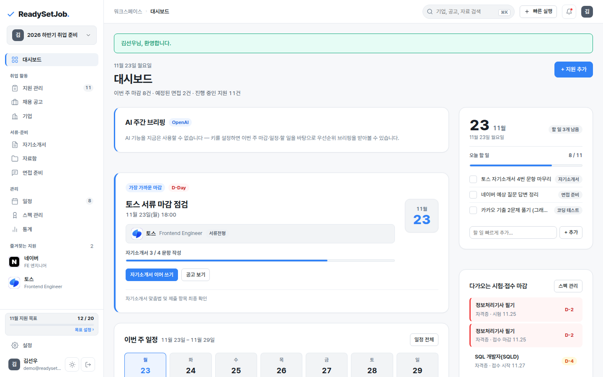
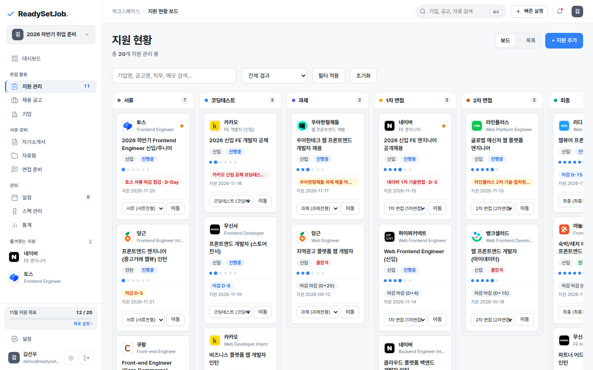
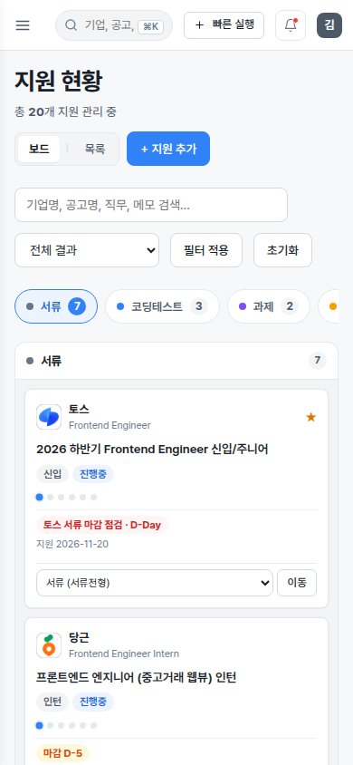
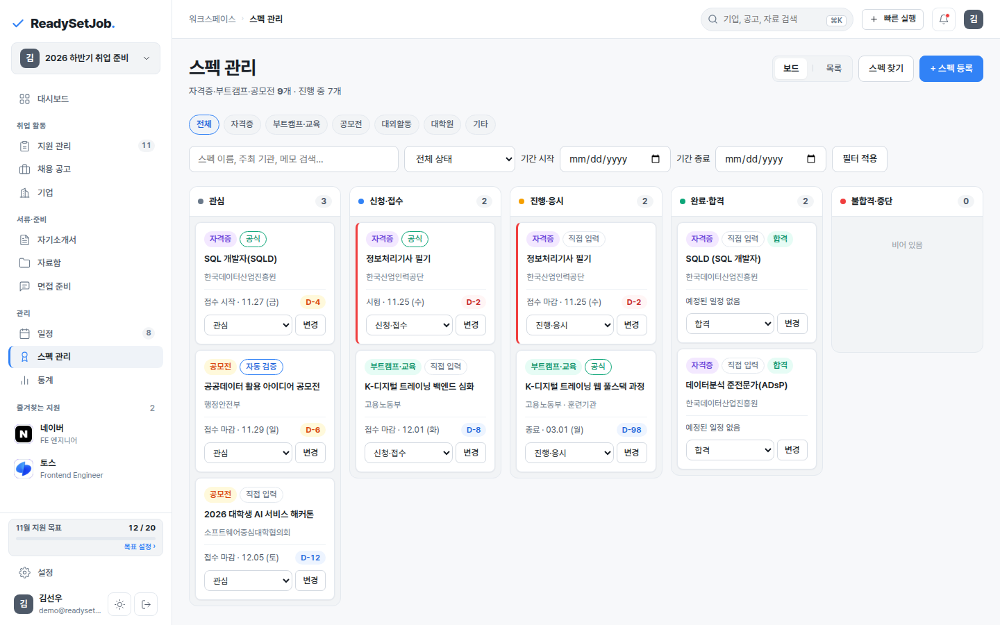
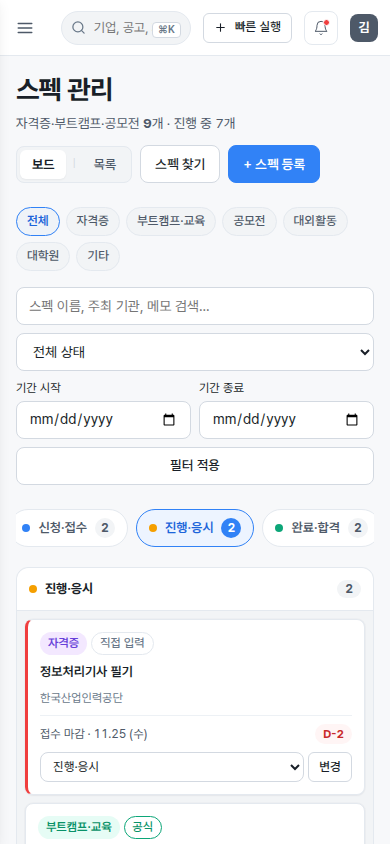
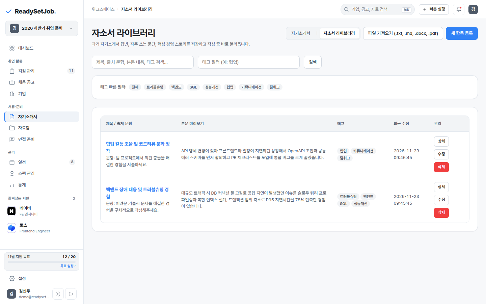
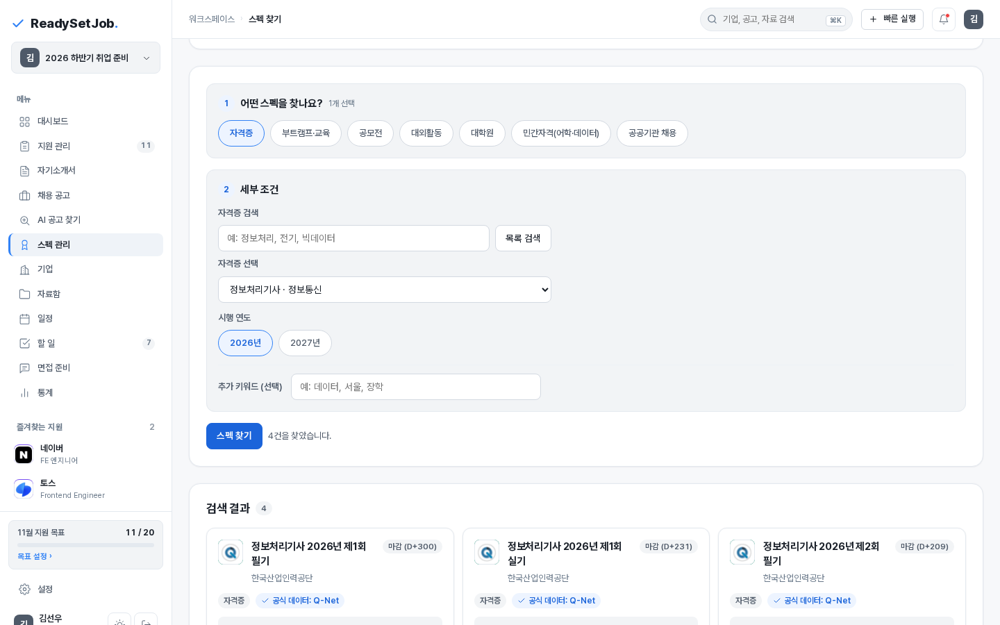
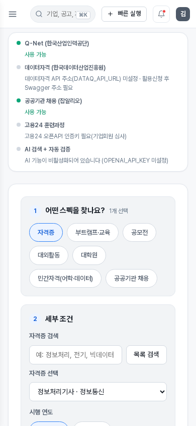

> **최종 갱신 2026-11-23 | 2026-12-16 기말 최종 제출 기준 현행화 완료 (로컬·자동화 테스트 199/199 검증 완료, 원격 Turso·Render 실연동 키 등록 대기)**

# ReadySetJob 최종 프로젝트 보고서

## Git 커밋 타임라인

`git log --oneline` 기준 실제 커밋 이력이다. 모든 작업은 기능 및 검증 단위로 분할하여 커밋했다.

| 커밋 해시 | 분류 | 커밋 메시지 | 주요 작업 내용 |
|---|---|---|---|
| `4077b85` | `feat` | P0 Express/EJS/SQLite foundation with auth, CRUD, and tests | 기반 환경, 12개 테이블 스키마, 인증/세션, P0 핵심 CRUD |
| `5d4a7c1` | `docs` | add competitor research notes and UI design references | 국내외 9개 취업 플랫폼 분석 및 6대 UI 원칙 수립 |
| `460718b` | `docs` | add SPEC, ARCHITECTURE, DB_DESIGN, TASKS and design mockups A/B/C with screenshots | 기술 명세서 4종 및 A/B/C 디자인 시안 9종과 스크린샷 12장 |
| `8a2b2ae` | `feat` | kanban board drag-and-drop and essay editor with immutable versions | 6단계 칸반 보드 드래그앤드롭, 자소서 에디터, 불변 버전 스냅샷 및 비교 |
| `1370b14` | `feat` | dashboard statistics with Chart.js and materials library CRUD | 대시보드 KPI 집계, Chart.js 3종 차트 자체 서빙, 경험 자료함 CRUD |
| `4189b2a` | `fix` | harden session secret/cookies, block open redirects, strict date and id validation, consistent board ordering | Grok(Momus) 코드 리뷰 9건 수정 사항 반영 및 보안 강화 |
| `3d3c622` | `fix` | replace inline styles blocked by CSP with utility classes | Helmet CSP 차단 인라인 스타일을 CSS 유틸리티 클래스로 전환 |
| `471bf68` | `docs` | update task status for P2 and review fixes | 작업 진행 현황 및 변경 로그 갱신 |
| `f644920` | `feat` | interview questions with manual entry and server-side Gemini generation (disabled without API key) | 면접 질문 수동 관리 및 Gemini 연동(키 미설정 시 안전 비활성화) |
| `8278736` | `docs` | add living final report and full project README | 기말 최종 보고서 초안 및 상세 프로젝트 README 작성 |
| `22076c2` | `docs` | correct dashboard description in final report | 최종 보고서 대시보드 뷰 설명 정밀 보정 |
| `e801a60` | `docs` | record Notion hub URLs and sync status | Notion 허브 URL 및 문서 동기화 상태 기록 |
| `eed1831` | `design` | add v2 mockups (editorial, monochrome tool, soft consumer) after v1 rejection | 1안 반려 후 v2 디자인 시안 3종(에디토리얼·모노크롬 도구·소프트 컨슈머) 제작 |
| `eb16e1a` | `design` | add v3 minimal workspace shell and dashboard | v3 미니멀 워크스페이스 셸 및 대시보드 시안 |
| `ce59290` | `design` | add v3 document-focused essay editor | v3 문서 중심 자소서 에디터 시안 |
| `96927eb` | `design` | add v3 pastel stage board and mobile tabs | v3 파스텔 전형 단계 보드 및 모바일 탭 시안 |
| `086d94f` | `design` | capture v3 desktop and mobile previews | v3 데스크톱·모바일 프리뷰 스크린샷 캡처 |
| `24c2521` | `docs` | explain v3 design direction and review criteria | v3 디자인 방향성 및 검토 기준 문서화 |
| `c13944c` | `feat` | apply Figma design system across all views and integrate OpenAI Responses API features | Figma 승인 디자인 전 화면 적용, Gemini에서 OpenAI Responses API로 전환 및 AI 4종 기능 통합 |
| `dda89b4` | `chore` | add Render blueprint with persistent disk for SQLite | Render 배포 청사진 및 SQLite 영구 디스크 구성 |
| `217bf17` | `chore` | switch Render blueprint to free plan with AUTO_SEED demo data | Render 무료 플랜 전환 및 `AUTO_SEED=1` 데모 데이터 자동 시드 구성 |
| `2096659` | `feat` | AI job search, weekly briefing, auto-organize, auto feedback, and favicon | AI 공고 검색·주간 브리핑·일정/할 일 자동 정리·자동 AI 피드백·파비콘 및 웹 앱 아이콘 |
| `d9df67d` | `fix` | wait for in-flight AI briefing instead of surfacing 409 | 진행 중인 AI 브리핑 완료 대기 처리로 409 노출 제거 |
| `6c78a26` | `style` | unify control heights and fix toolbar/kanban alignment across views | `--control-height` 토큰으로 컨트롤 높이 통일 및 전 화면 툴바·칸반 정렬 수정 |
| `b708bc2` | `feat` | chip-based AI discover for jobs, internships, part-time, and grad school; harden briefing context | 목적(신입·경력·인턴·아르바이트·대학원) 칩 기반 AI 공고 찾기 개편 및 브리핑 컨텍스트 강화 |
| `0ada75c` | `feat` | show real company logos with SSRF-safe favicon proxy and initial fallback | SSRF 방어 파비콘 프록시로 실제 기업 로고 표시 및 이니셜 아바타 폴백 |
| `ce9920f` | `docs` | record alignment, chip discover, and company logo work | 정렬 통일·칩 탐색·기업 로고 작업 내역 기록 |
| `d2b7470` | `feat` | implement spec management module with public data integrations and automated schedules | P2-SPEC 스펙 관리 모듈 커밋 완료: `spec_items`·`spec_watch`·`external_cache`, 5상태 보드/목록, 일정·할 일·자료함 멱등 자동화, `/specs/discover` 및 SSRF 방어 원문 검증기 |
| `7d98f2d` | `feat` | remember-me login, profile photo, multi employment-type discover, quick-launch company search, logo fallback, hide AI config details | 피드백 트랙 A+B 7건: 30일 로그인 유지·안전 `returnTo`, 프로필 사진 업로드/삭제, 공고 탐색 고용형태 다중 선택, 빠른 실행 기업 검색, 로고 폴백 강화, AI 내부 설정 숨김 |
| `2b276e6` | `feat` | essay library with file import (txt/md/docx/pdf), reuse in editor, and AI essay question extraction | 피드백 트랙 C 3건: 자소서 라이브러리(`/library`, `essay_library`), `.txt`/`.md`/`.docx`/`pdf` 파일 가져오기·문항 자동 분할, 에디터 재사용 연동, AI 문항 추출 |
| `bc83b77` | `style` | group sidebar into sections and move sub-pages into page tabs | 사이드바 3그룹 정리 및 하위 화면 페이지 탭 통합 |
| `d8072bb` | `feat` | replace better-sqlite3 with libsql compatibility wrapper and dual-mode connection | `better-sqlite3` → `libsql@^0.5.29` 전환, 중첩 `SAVEPOINT`·`_metadata` 제거 호환 래퍼, 로컬/Turso embedded replica 이중 모드 및 단위 테스트 6건 |
| `fe2128b` | `test` | migrate legacy schema tests from better-sqlite3 to openDatabase | 레거시 마이그레이션 테스트 3건의 `better-sqlite3` 직접 참조를 `openDatabase`로 통일 |
| `dcd0e9e` | `fix` | guard closed db session cleanup and log active db mode on startup | 닫힌 DB 세션 정리 방어 및 서버 기동 로그 DB 모드(`local`/`replica`) 표시 |
| `015f226` | `chore` | add Turso embedded replica env vars to render.yaml and .env.example | `render.yaml` 및 `.env.example`에 Turso 환경변수(`TURSO_DATABASE_URL`, `TURSO_AUTH_TOKEN`, `TURSO_SYNC_PERIOD`) 추가 |
| (작업 트리 검증 완료) | `feat/docs` | 모바일(390px) 칸반 탭 전환 UX 폴리싱 및 기말 문서·최신 스크린샷 현행화 | 6열 지원 보드·5열 스펙 보드 모바일 탭 전환(`style=""` 0건, 회귀 테스트 2건 추가 → 199/199 통과), 최신 스크린샷 6종 캡처 및 기말 보고서·시연 시나리오 반영(사용자 승인 후 커밋 예정) |

---

## 1. 프로젝트 개요

ReadySetJob은 개발자 취업 및 인턴십 준비생을 위한 전형 일정 추적 및 불변 버전 자기소개서 관리 웹 애플리케이션이다. 고급웹프로그래밍 기말 과제로 기획되었으며, 1인 개발 체제로 설계 및 구현을 진행하고 있다.

지원자가 여러 기업에 동시 다발적으로 지원할 때 발생하는 전형 일정 누락, 자기소개서 버전 혼선, 기업별 작성 내용 파편화 문제를 단일 시스템에서 체계적으로 관리하는 것을 목표로 한다. 외부 서비스 의존성을 최소화하고, Node.js와 내장 SQLite 엔진을 기반으로 경량화된 독립 실행형 아키텍처를 채택했다.

## 2. 개발 동기

취업 준비 과정에서 구직자는 평균 수십 곳의 채용 공고에 지원한다. 이 과정에서 다음과 같은 실질적인 문제점들이 반복된다.

1. **전형 일정과 공고 정보의 분실**: 채용 공고 웹페이지는 마감 후 비공개로 전환되는 경우가 많아 지원서 제출 후 본인이 어떤 직무 요건으로 지원했는지 확인하기 어렵다.
2. **자기소개서 버전 관리 실패**: 여러 기업에 유사한 문항을 변형하여 제출하면서 로컬 파일명(예: `자소서_최종_진짜최종.docx`) 기반 관리가 파편화되고, 이전 버전의 문장을 되살리거나 변경 내역을 대조하기 어렵다.
3. **상용 플랫폼의 제약과 프라이버시 문제**: 기존 구직 관리 서비스는 특정 채용 플랫폼에 종속되어 있거나, 무거운 SaaS 구독 모델을 요구하며, 개인적인 경험과 지원 이력이 외부 클라우드에 노출되는 부담이 존재한다.

ReadySetJob은 사용자가 자신의 로컬 또는 단일 서버 환경에서 완전한 데이터 소유권을 유지하면서, 직관적인 6단계 칸반 보드와 Git 커밋 개념을 차용한 불변 자기소개서 버전 관리 시스템을 제공하기 위해 개발을 시작했다.

## 3. 주요 기능 (모듈별 상태)

ReadySetJob의 모든 기능은 "문서 작성 완료 ≠ 기능 완료"라는 원칙에 따라 계획, 개발 중, 구현 완료, 검증 완료의 4단계로 관리한다.

| 모듈 | 세부 기능 | 주요 내용 | 진행 상태 |
|:---|:---|:---|:---:|
| 인증 및 보안 | 회원가입·로그인·계정 편의 | bcryptjs(cost 10) 해싱, 세션 재생성, 30일 로그인 유지(rolling 쿠키)·안전 `returnTo`, 프로필 사진 업로드/삭제(`<=200KB` PNG/JPEG/WebP, SVG 차단) | 검증 완료 |
| 인증 및 보안 | 접근 제어 및 보호 | requireAuth 미들웨어, crypto.timingSafeEqual 기반 CSRF 방어 | 검증 완료 |
| 인증 및 보안 | 다중 사용자 격리 | 모든 SQL 쿼리에 user_id 바인딩, 타인 리소스 접근 시 404 반환 | 검증 완료 |
| 기업 및 공고 | 기업 관리 | 기업 CRUD, 사용자별 기업명 중복 방지(UNIQUE), 메모 기록, 빠른 실행 기업 검색 | 검증 완료 |
| 기업 및 공고 | 채용 공고 관리 | 공고 등록 시 인라인 기업 생성 트랜잭션, 북마크 토글, D-Day 계산 | 검증 완료 |
| 기업 및 공고 | 기업 로고 표시 | `GET /logos/company` 파비콘 프록시(구글·DuckDuckGo 허용 도메인 한정, 대체 도메인 폴백·이미지 시그니처 검사), `company_logos` 캐시(성공 30일/없음 1~7일), 실패 시 이니셜 아바타 폴백 | 검증 완료 |
| 지원 및 칸반 | 지원 현황 CRUD | 지원 등록, 전형 단계 및 결과 분리, 1개 공고당 1회 지원 제약 | 검증 완료 |
| 지원 및 칸반 | 6단계 칸반 보드 & 모바일 탭 | 서류부터 최종까지 6단계 카드 배치, HTML5 드래그앤드롭·키보드 조작·no-JS 폴백, 모바일(390px) 탭형 단계 전환 UI(`sessionStorage` 기억) | 검증 완료 |
| 지원 및 칸반 | 전형 변경 감사 | PATCH 요청 시 트랜잭션 기반 순서 재정렬 및 stage_logs 이력 누적 | 검증 완료 |
| 전형 일정 | 일정 추적 | 지원 건과 연결된 서류 마감, 코테, 면접 일정 CRUD 및 시간순 정렬 | 검증 완료 |
| 자기소개서 | 멀티 문항 작성기 | 공고별 자소서 문항 추가/삭제/순서변경, 글자수 카운터, 초안 실시간 저장, AI 문항 추출(`POST /api/essays/:id/extract-questions`) | 검증 완료 |
| 자기소개서 | 불변 버전 관리 | 스냅샷 기반 버전 생성(수정 불가), jsdiff 단어 단위 대조 화면 | 검증 완료 |
| 자기소개서 | 이력 보존 복원 | 복원 전 미저장 초안 자동 백업 및 복원 출처(계보) 기록 신규 버전 생성 | 검증 완료 |
| 자기소개서 | 자소서 라이브러리 & 파일 가져오기 | `/library` (`essay_library`) CRUD·태그/키워드 검색·에디터 즉시 재사용, `.txt`/`.md`/`.docx`/`pdf` (`<=5MB`, 매직바이트 검사) 가져오기 및 문항 자동 분할 미리보기 | 검증 완료 |
| 자기소개서 | 경험 자료 연계 | 과거 문항 검색 API(/api/essays/search), 경험 자료함 N:M 연결 | 검증 완료 |
| 대시보드 | 통계 및 시각화 | 단계별 깔때기 분석, 합불 도넛 차트, 월별 추이, Chart.js 로컬 서빙 | 검증 완료 |
| 경험 자료함 | 스펙 및 활동 정리 | 경험/프로젝트/수상/대외활동 CRUD, 태그 필터링, 키워드 검색 | 검증 완료 |
| 스펙 관리 및 공공·검증 데이터 연동 (SPEC) | 스펙 항목 CRUD 및 다중 뷰 (FR-SPEC-01) | 자격증·부트캠프·공모전·대외활동·대학원 스펙 5개 상태 컬럼 칸반 보드(모바일 390px 탭 전환 포함)/목록 표 뷰, 종류·상태·검색어·기간 필터링, 상세 타임라인, 부분 수정, `UNIQUE(user_id, source, source_ref)` 중복 방지 | 검증 완료 |
| 스펙 관리 및 공공·검증 데이터 연동 (SPEC) | 상태 전이 멱등 자동화 (FR-SPEC-02) | 7단계 상태 관리, 완료·합격 시 경험 자료함(`materials`) 초안 자동 생성(종류 매핑), 중단 시 미래 일정·미완료 할 일만 정리, 복귀 시 재동기화 | 검증 완료 |
| 스펙 관리 및 공공·검증 데이터 연동 (SPEC) | 일정·할 일 자동 동기화 (FR-SPEC-03) | 접수 시작(09:00)·접수 마감(18:00)·시험/시작·결과 발표 4슬롯 일정(`events`) 및 원서 접수 할 일(`todos`) 트랜잭션 내 자동 생성·변경분 동기화 | 검증 완료 |
| 스펙 관리 및 공공·검증 데이터 연동 (SPEC) | 관심 자격증 구독 및 위젯 (FR-SPEC-04) | `spec_watch` 구독 추가/삭제(멱등), 대시보드 14일 이내 스펙 일정 위젯(D-3 긴급 배지, 최대 5개) | 검증 완료 |
| 스펙 관리 및 공공·검증 데이터 연동 (SPEC) | 공공·검증 데이터 통합 탐색 (FR-SPEC-05) | `/specs/discover`에서 Q-Net·DataQ·잡알리오·고용24·AI 검증 5개 소스 통합 검색, 24자리 hex 세션 토큰 기반 안전 등록, 자격증 카탈로그 정적 폴백 | 검증 완료 |
| 스펙 관리 및 공공·검증 데이터 연동 (SPEC) | 외부 통신 보안 및 SSRF 방어 (FR-SPEC-06) | 8초 타임아웃·1MiB 본문 제한·공유 캐시(`external_cache`), 호스트 Allow-list·사설 IP 차단·DNS 핀닝·리다이렉트 검사·원문 증거 교차 검증 | 검증 완료 |
| AI 어시스턴트 | AI 5종 기능 지원 | 면접 질문·자소서 피드백·경험 STAR 초안·공고 추출·자소서 문항 추출 (OpenAI Responses API) | 검증 완료 |
| AI 어시스턴트 | 일정·할 일·AI 자동 정리 | 공고 마감 일정(18:00)·자소서 할 일·면접 준비 할 일 및 백그라운드 AI 면접 질문 자동 생성(중복 방지) | 검증 완료 |
| AI 어시스턴트 | 자소서 자동 AI 피드백 | `users.auto_feedback`(기본 off) 설정 시 버전 저장마다 문항별 AI 피드백 백그라운드 생성 | 검증 완료 |
| AI 어시스턴트 | AI 공고 검색·추천 | OpenAI `web_search` 기반 목적별(신입·경력·인턴·아르바이트·대학원) 다중 선택 칩 탐색 및 공고 검색(최대 8건, http/https 출처 검증, 서버 화이트리스트 검증, `POST /jobs` 수동 등록) | 검증 완료 |
| AI 어시스턴트 | AI 주간 브리핑 | 본인 데이터 기반 주간 브리핑, `ai_briefings` 하루 1회 캐시(`force=1` 새로고침), 내부 링크 allow-list | 검증 완료 |
| AI 어시스턴트 | 안전한 비활성화 및 설정 숨김 | API 키 미설정 시 503 및 안내 표시, 모의 응답 없는 투명한 동작, 10분 20회 속도 제한, 설정 화면에서 내부 모델·환경변수 상세 비노출 | 검증 완료 |
| 디자인 시스템 | 일관된 UI, 3그룹 사이드바 및 모바일 최적화 | Figma 승인 디자인 전면 적용, 사이드바 3그룹 정리·하위 페이지 탭 통합, Pretendard 로컬 서빙, 파비콘·웹 앱 매니페스트, 인라인 `style=""` 0건, `--control-height` 토큰 통일, 390px 칸반 탭 전환 | 검증 완료 |
| 데이터베이스 및 배포 | Turso(`libsql`) 이중 모드 및 Render 배포 | `libsql@^0.5.29` 동기 호환 래퍼(`SAVEPOINT`, `_metadata` 제거), 환경변수 미설정 시 로컬 SQLite 단독 / 설정 시 Turso embedded replica 전환, `render.yaml` 배포(`AUTO_SEED=1`, `https://readysetjob.onrender.com`) | 로컬·래퍼 검증 완료 / 원격 실연동 대기 |

## 4. 기술 스택

외부 상주 프로세스나 복잡한 빌드 도구 없이 단일 노드 런타임에서 온전히 동작하도록 경량 스택을 선정했다.

| 분류 | 기술 및 라이브러리 | 버전 | 선정 이유 |
|:---|:---|:---|:---|
| 런타임 | Node.js | 22 LTS (실행 환경 v22.23.5) | 최신 안정화 LTS 버전, 내장 테스트 러너(`node --test`) 활용 |
| 웹 프레임워크 | Express | ^4.21.1 | 간결하고 안정적인 HTTP 라우팅 및 검증된 미들웨어 생태계 |
| 템플릿 엔진 | EJS | ^3.1.10 | 서버 사이드 렌더링을 통한 초기 렌더 속도 보장 및 SEO 친화적 마크업 |
| 데이터베이스 | SQLite 3 / Turso (`libsql`) | ^0.5.29 | 동기 API 유지 및 로컬 SQLite 단독 실행·원격 Turso embedded replica 이중 모드 지원(Render 무료 플랜 재시작 시 DB 초기화 방지) |
| 세션 저장소 | `better-sqlite3-session-store` | ^0.1.0 | `libsql` 호환 래퍼를 주입해 동일 DB 내 세션 저장, 외부 메모리 DB(Redis 등) 불필요 |
| 보안 라이브러리 | `bcryptjs`, `helmet` | ^2.4.3 / ^8.0.0 | 안전한 단방향 암호화 해싱 및 HTTP 보안 헤더(strict CSP 포함) 강제 |
| 텍스트 차이 분석 | `diff` (jsdiff) | ^9.0.0 | 자소서 버전 간 단어 단위(word-level) 정밀 비교 및 HTML 이스케이프 |
| 문서 가져오기 파서 | `mammoth`, `pdf-parse` | ^1.13.0 / ^2.4.5 | 자소서 라이브러리 `.docx`/`.pdf` 텍스트 추출(5MB 제한 및 매직바이트 검증 동반) |
| 데이터 시각화 | Chart.js | ^4.6.1 | npm 설치 후 `/vendor`로 로컬 정적 서빙, 외부 CDN 의존 차단 |
| 테스트 도구 | `supertest`, `node:test` | ^7.0.0 / 내장 | 별도 테스팅 프레임워크(Jest 등) 없이 빠른 속도의 통합 테스트 수행 |
| 인공지능 API | OpenAI Responses API | gpt-6.1-terra / gpt-6-luna | 서버 사이드 Structured Outputs(JSON Schema) 기반 AI 5종 기능·공고 검색(`web_search`)·주간 브리핑 구현 |

## 5. 시스템 구조

ReadySetJob은 전형적인 3계층 아키텍처(Presentation - Business Logic - Data Access)를 따르며, 각 계층 간 책임을 명확히 격리했다.

```text
[ 브라우저 (클라이언트) ]
    │
    ├── HTML/EJS 폼 전송 (POST, PUT, DELETE + CSRF 토큰)
    └── 비동기 Fetch 요청 (PATCH 보드 이동, PUT 초안 저장, 자소서 라이브러리, AI 생성, 스펙 상태 변경·탐색)
    │
    ▼
[ Express 미들웨어 계층 ]
    ├── helmet (strict CSP, 인라인 style="" 0건, X-Content-Type-Options 등 보안 헤더)
    ├── express-session (SQLite/libsql 기반 세션 관리, session.regenerate, 30일 remember-me rolling)
    ├── csrfProtection (crypto.timingSafeEqual 기반 상수 시간 검증)
    ├── requireAuth (비인증 요청 302 리다이렉트 + 안전 returnTo 또는 401 JSON 분기)
    └── validation (입력값 검증, safeRedirectPath 오픈 리다이렉트 방어)
    │
    ▼
[ 라우터 계층 (src/routes/) ]
    ├── auth, companies, jobs, applications, events, essays, library (/library, /api/library),
    │   materials, dashboard, todos, settings, stats, search, logos, interviewQuestions,
    │   interviewPrep, specs (/specs, /api/specs), specDiscover (/specs/discover), ai
    └── HTTP 요청 파싱, 권한 확인, 서비스 계층 호출, 뷰 렌더링/JSON 응답
    │
    ▼
[ 서비스 계층 (src/services/) ]
    ├── 비즈니스 규칙 처리, 입력 데이터 가공, 트랜잭션 조율
    ├── applicationsService (보드 재정렬, stage_logs 감사 기록)
    ├── essaysService (불변 버전 생성, jsdiff 비교, 이력 보존 복원)
    ├── libraryService & libraryImportService (자소서 라이브러리, .txt/.md/.docx/.pdf 파싱·자동 문항 분할)
    ├── automationService (공고·지원·면접 연동 일정·할 일 자동 정리, 백그라운드 AI 질문)
    ├── specsService & specsModel (스펙 CRUD, 5상태 보드, 다중 조건 필터링)
    ├── specAutomationService (일정 4슬롯·접수 할 일 멱등 자동화, 완료·합격 시 자료함 초안 생성)
    ├── specWatchService (관심 자격증 구독, 대시보드 14일 이내 위젯)
    ├── specSources/ (Q-Net·DataQ·잡알리오·고용24·AI 검증 어댑터, 공유 캐시)
    │   └── verifier (호스트 Allow-list, 사설 IP 차단, DNS 핀닝, 원문 증거 교차 검증 = SSRF 방어)
    └── aiService & aiFeaturesService (OpenAI Responses API 통신, 속도 제한, 스키마 검증)
    │
    ▼
[ 데이터베이스 계층 (src/db/connection.js — libsql 래퍼 & 이중 모드) ]
    ├── 로컬 SQLite 단독 모드 (WAL, foreign_keys = ON) / 원격 Turso embedded replica (syncUrl, authToken, readYourWrites)
    ├── 중첩 SAVEPOINT 트랜잭션, _metadata 제거, pragma simple 보정, 멱등 close() + 종료 sync()
    └── 총 22개 테이블 + 21개 인덱스 (사용자별 완전 격리)
```

## 6. DB 설계

ReadySetJob의 데이터베이스는 `libsql@^0.5.29` 드라이버와 `src/db/connection.js` 호환 래퍼를 통해 **로컬/원격 이중 모드**로 운영된다. 환경변수(`TURSO_DATABASE_URL`, `TURSO_AUTH_TOKEN`)가 미설정된 로컬·테스트 환경에서는 로컬 SQLite 파일(`data/readysetjob.db`, `PRAGMA journal_mode = WAL`, `PRAGMA foreign_keys = ON`)로 단독 동작하며, 두 변수가 설정된 운영 환경에서는 Turso 원격 Primary와 동기화되는 **embedded replica 모드**(`readYourWrites: true`, 시작·종료 시 `sync()`, 선택적 `TURSO_SYNC_PERIOD`)로 전환되어 Render 무료 플랜 재시작 시에도 데이터를 영속 보존한다.

### 6.1 핵심 테이블 구성 요약 (총 22개 테이블, 21개 인덱스)

1. `users`: 사용자 계정 (이메일 고유키, bcryptjs 해시 비밀번호, `season_label`, `auto_feedback`, `avatar_data`)
2. `companies`: 사용자가 등록한 관심 및 지원 기업 (`UNIQUE(user_id, name)`)
3. `job_posts`: 채용 공고 (기업 참조, 마감일, 직무, 근무 형태, 북마크)
4. `applications`: 지원 현황 (`job_post_id` 1:1 유일 제약, 전형 단계 `stage`, 결과 `result`, 보드 순서 `board_order`, 즐겨찾기 `is_favorite`)
5. `stage_logs`: 전형 단계 및 결과 변경 감사 로그 (변경 전후 단계 및 결과 타임스탬프 기록)
6. `events`: 지원 건별 전형 일정 (서류 마감, 코딩테스트, 면접, 결과 발표 등, 스펙 연동 `spec_item_id`)
7. `essays`: 자기소개서 문서 헤더 (지원 건 연결 `ON DELETE SET NULL`)
8. `essay_questions`: 자기소개서 실시간 작성 초안 문항 (순서, 문항, 글자수 제한, 답변)
9. `essay_versions`: 불변 버전 스냅샷 (`version_no`, 레이블, 문항 스냅샷 JSON, 복원 출처 `restored_from_version_id`)
10. `essay_library`: 자소서 재사용 라이브러리 (제목, 문항, 본문, 태그, 파일 가져오기 저장소)
11. `materials`: 경험 자료함 (경험, 프로젝트, 수상, 대외활동, 기타 분류 및 태그)
12. `essay_materials`: 자기소개서와 경험 자료 간의 N:M 매핑 테이블
13. `interview_questions`: 지원 공고 및 자소서 기반 예상 면접 질문 (수동 등록 및 AI 생성 질문)
14. `spec_items`: 스펙 항목 (자격증·부트캠프·공모전·대외활동·대학원, 7단계 상태, 5개 날짜 슬롯, `UNIQUE(user_id, source, source_ref)`)
15. `spec_watch`: 관심 자격증 구독 (`PRIMARY KEY (user_id, cert_code)`)
16. `external_cache`: 외부 공공·검증 데이터 공유 캐시 (`PRIMARY KEY (source, query_hash)`, TTL 기반 만료)

위 16개 핵심 도메인 테이블 외에도 할 일(`todos`), 월간 지원 목표(`monthly_goals`), AI 생성 결과(`essay_feedback`, `material_star_drafts`, `ai_briefings`), 기업 로고 캐시(`company_logos`) 등 6개 지원 테이블이 함께 정의되어 있어 `src/db/schema.sql`은 총 **22개 테이블과 21개 인덱스**로 구성된다.

### 6.2 주요 설계 의사결정

* **단계(stage)와 결과(result)의 분리**: 서류, 코딩테스트, 면접 등 전형 단계와 진행중, 합격, 불합격, 지원취소 등 전형 결과를 서로 다른 컬럼으로 분리하여 파이프라인 집계와 상태 표현의 모호성을 제거했다.
* **자기소개서 스냅샷 불변성 보장**: `essay_versions` 테이블의 레코드는 생성 후 절대 수정되지 않는다. 복원 시에도 기존 버전을 덮어쓰는 대신 복원 출처를 명시한 신규 버전을 생성하여 감사 추적성을 확보했다.
* **스펙 관리의 멱등 자동화와 듀얼 마이그레이션**: `spec_items` 등록·수정·상태 변경 시 `specAutomationService`가 일정 4슬롯(`events`)과 접수 할 일(`todos`)을 트랜잭션 내에서 중복 없이 동기화하고, 완료·합격 전이 시에만 경험 자료함(`materials`) 초안을 자동 생성하여 `spec_items.material_id`로 연결한다. 신규 DB(`schema.sql`)에는 외래키 `ON DELETE CASCADE`를 정의하고 기존 DB(`migrate.js`)에는 `ALTER TABLE` 기반 듀얼 마이그레이션을 적용하여 두 환경이 동일하게 동작한다.
* **외부 데이터 공유 캐시(external_cache)**: 사용자 식별자가 없는 순수 외부 공개 데이터만 `source`+`query_hash` 복합키로 캐싱한다(일반 12시간, 자격증 카탈로그 24시간). 외부 API 호출 비용과 지연을 최소화하면서도 개인 데이터는 절대 캐시에 남기지 않는다.
* **사용자별 소유권 격리**: 모든 주요 테이블은 `user_id`를 외래키로 가지며, 복합 인덱스(`user_id`, `status` 등 총 20개 인덱스)를 통해 빠른 조회와 데이터 격리를 동시에 달성했다.

자세한 ERD 다이어그램과 DDL 스키마, 인덱스 명세는 `docs/DB_DESIGN.md`를 참조한다.

## 7. 화면별 구현 내용

현재 구현된 모든 라우트와 뷰는 사용자가 승인한 Figma 디자인을 기반으로 확정한 정식 디자인 시스템(`docs/DESIGN_SYSTEM.md`, `public/css/tokens.css`)에 따라 렌더링된다. 라이트/다크 모드(`data-theme`)를 지원하며 모든 색상과 컨트롤 높이는 CSS 변수 토큰만 사용한다.

* **인증 화면 (`/login`, `/signup`)**: 이메일 및 비밀번호 유효성 검사, 실패 시 입력값 보존 및 오류 배너 노출, 회원가입 완료 후 자동 로그인 및 세션 재생성, 30일 로그인 유지(rolling 쿠키) 및 오픈 리다이렉트 차단 `returnTo` 복귀를 지원한다.
* **사이드바 내비게이션 & 대시보드 (`/dashboard`)**: 사이드바를 3개 그룹으로 단순화하고 관련 하위 페이지를 상단 탭으로 통합했다. 대시보드는 KPI 카드, 진행 중 전형 단계별 분포 막대 차트, 합격/불합격 도넛 차트, 월별 지원 추이 선 그래프(Chart.js 로컬 서빙), 14일 이내 마감 공고·다가오는 일정·스펙 일정 위젯, AI 주간 브리핑 카드를 통합 제공한다.
* **기업 관리 (`/companies`)**: 등록된 기업 목록 조회, 기업명 검색, 빠른 실행 기업 검색, 신규 기업 등록 및 메모 수정을 지원한다.
* **채용 공고 관리 (`/jobs`)**: 지원 여부 및 마감일 D-Day 배지 표시, 관심 공고 북마크 토글, 공고 등록 시 신규 기업 인라인 즉시 생성 모달을 제공한다.
* **지원 현황 목록 및 상세 (`/applications`, `/applications/:id`)**: 공고별 지원 내역 목록, 상세 화면 내 전형 이력 타임라인, 연결된 전형 일정 목록, 작성된 자기소개서 바로가기, 예상 면접 질문 섹션을 통합 제공한다.
* **칸반 보드 (`/applications/board`)**: 서류, 코딩테스트, 과제, 1차 면접, 2차 면접, 최종 등 6개 전형 단계를 열 단위로 구성했다. 데스크톱에서는 6열 드래그앤드롭·키보드 조작·no-JS 폼 폴백을 제공하고, 모바일(`<= 768px`, 390px 실측)에서는 상단 단계 탭(`role="tablist"`)으로 전환해 단일 풀폭 컬럼에 집중할 수 있도록 개선했다.
* **전형 일정 관리 (`/events`)**: 전체 지원 기업의 서류 마감, 코딩테스트, 면접 일정을 시간순으로 정렬하여 표시하고 추가/삭제를 지원한다.
* **자기소개서 작성·버전 관리 및 라이브러리 (`/essays`, `/essays/:id`, `/library`)**: 복수 문항 추가/삭제/순서 이동, 실시간 글자수 카운터, 자동 초안 저장(Ctrl+S), 불변 버전 스냅샷 생성, 단어 단위 `jsdiff` 대조 뷰(`compare.ejs`), 안전한 복원, AI 문항 추출 기능을 제공한다. `/library`에서는 자주 쓰는 문항·답변을 태그별로 관리하고 `.txt`/`.md`/`.docx`/`.pdf` 파일(최대 5MB)을 업로드해 문항별로 자동 분할 저장한 뒤 자소서 에디터에서 즉시 불러와 재사용할 수 있다.
* **경험 자료함 (`/materials`)**: 프로젝트, 수상, 인턴 경험 등을 키워드 및 태그별로 정리하고 자기소개서 작성 시 즉시 연계할 수 있도록 지원한다.
* **스펙 관리 (`/specs`)**: 자격증, 부트캠프, 공모전, 대외활동, 대학원 준비 이력을 5개 상태 컬럼 칸반 보드(모바일 390px 탭형 단계 전환 포함)와 목록 표 뷰로 관리한다. 종류·상태·검색어·기간 필터를 지원하며, 상세 화면에서 접수~발표 5개 날짜 타임라인, 자동 생성된 일정·할 일, 완료·합격 시 연동된 경험 자료를 함께 표시한다.
* **스펙 탐색 (`/specs/discover`)**: Q-Net, DataQ, 잡알리오, 고용24, AI 검증 소스를 통합 검색한다. 검색 결과는 24자리 hex 세션 토큰으로 서버에 격리 저장된 정규화 데이터만으로 안전하게 스펙에 등록되며, 잡알리오 공고는 채용공고 등록으로 분기 안내한다. 인증키 미설정 소스는 오류 대신 안내 문구로 비활성 표시된다.
* **AI 공고 찾기 (`/jobs/discover`)**: 신입, 경력, 인턴, 아르바이트, 대학원 목적(다중 선택 지원)을 선택한 뒤 분야·지역·학위·근무 형태를 칩으로 고르면 AI가 실시간 채용 공고를 추천하고, 카드 내 "공고 등록" 버튼으로 직접 등록한다.
* **설정 및 프로필 (`/settings`)**: 사용자 이름·시즌 라벨·월간 지원 목표·자동 AI 피드백 설정과 200KB 이하 프로필 아바타(PNG/JPEG/WebP, SVG 차단) 업로드/삭제를 제공한다.

### 7.1 최신 실행 화면 스크린샷 (2026-11-23 실측 캡처)

Playwright 헤드리스 Chromium으로 최신 코드(`demo@readysetjob.dev` 데모 데이터 기준)를 데스크톱(1440×900) 및 모바일(390×844) 뷰포트에서 직접 캡처한 결과이다.

| 화면 | 뷰포트 | 스크린샷 |
|---|---|---|
| 대시보드 (3그룹 사이드바 + KPI/차트/일정) | Desktop 1440×900 |  |
| 지원 현황 6열 칸반 보드 | Desktop 1440×900 |  |
| 지원 현황 모바일 탭 전환 보드 | Mobile 390×844 |  |
| 스펙 관리 5열 칸반 보드 | Desktop 1440×900 |  |
| 스펙 관리 모바일 탭 전환 보드 | Mobile 390×844 |  |
| 자소서 라이브러리 및 파일 가져오기 | Desktop 1440×900 |  |
| 스펙 탐색 (`/specs/discover`) | Desktop 1440×900 / Mobile 390×844 |   |

## 8. 핵심 코드 및 구현 방법

### 8.1 칸반 보드 단계 이동 및 순서 압축 트랜잭션 (`src/services/applicationsService.js`)

카드를 다른 전형 단계로 이동할 때 이전 컬럼과 대상 컬럼의 순서(`board_order`)를 0부터 n-1까지 연속된 정수로 재정렬하고 `stage_logs`에 감사 로그를 남긴다.

```javascript
    if (oldStage !== nextStage) {
      const oldSiblings = selectColumnStmt.all(uid, oldStage, existing.id);
      for (let i = 0; i < oldSiblings.length; i += 1) {
        updateOrderStmt.run(i, oldSiblings[i].id, uid);
      }
    }

    const targetSiblings = selectColumnStmt.all(uid, nextStage, existing.id);
    const hasIndex = toIndex !== undefined && toIndex !== null && toIndex !== '' && !Number.isNaN(Number(toIndex));
    const clampedIndex = hasIndex
      ? Math.max(0, Math.min(targetSiblings.length, Math.trunc(Number(toIndex))))
      : targetSiblings.length;

    targetSiblings.splice(clampedIndex, 0, { id: existing.id });

    db.prepare("UPDATE applications SET stage = ?, result = ?, board_order = ?, updated_at = datetime('now') WHERE id = ? AND user_id = ?")
      .run(nextStage, nextResult, clampedIndex, existing.id, uid);

    for (let i = 0; i < targetSiblings.length; i += 1) {
      updateOrderStmt.run(i, targetSiblings[i].id, uid);
    }
```

### 8.2 자기소개서 불변 스냅샷 생성 및 이력 보존 복원 (`src/services/essaysService.js`)

현재 에디터의 모든 문항과 답변을 JSON으로 직렬화하여 불변 버전으로 생성한다. 복원 시에도 기존 버전을 덮어쓰지 않고 미저장분을 백업한 뒤 복원 출처(`restored_from_version_id`)를 기록한 새 버전을 발행한다.

```javascript
// 불변 버전 스냅샷 생성 (MAX(version_no) + 1 자동 부여)
const createEssayVersion = (db, userId, { essayId, label = '' }) => {
  const essay = getEssayHeader(db, userId, essayId);
  if (!essay) return null;
  const snapshotItems = buildSnapshotItems(getEssayQuestions(db, essay.id));
  const created = db.transaction(() => insertVersionSnapshot(db, {
    essayId: essay.id, label: String(label || '').trim() || '버전 스냅샷',
    snapshotItems, restoredFromVersionId: null
  }))();
  return { ...created, snapshot: parseSnapshotJson(created.snapshot_json) };
};

// 버전 복원 트랜잭션 (미저장분 백업 및 계보 기록 신규 버전 발행)
const backupVersion = !latestRow || draftsDiffer(currentItems, latestSnapshot)
  ? insertVersionSnapshot(db, { essayId: essay.id, label: '복원 전 자동 저장', snapshotItems: currentItems })
  : null;
const restoredVersion = insertVersionSnapshot(db, {
  essayId: essay.id, label: `v${targetVersion.version_no}에서 복원`,
  snapshotItems: buildSnapshotItems(getEssayQuestions(db, essay.id)),
  restoredFromVersionId: targetVersion.id
});
```

### 8.3 상수 시간 CSRF 토큰 검증 미들웨어 (`src/middleware/csrf.js`)

세션별로 32바이트 난수 토큰을 발행하고, 상태 변경 요청 시 타이밍 공격을 방어하기 위해 `crypto.timingSafeEqual`로 검증한다.

```javascript
function tokensMatch(expected, actual) {
  if (typeof expected !== 'string' || typeof actual !== 'string') return false;
  const expectedBuf = Buffer.from(expected, 'utf8');
  const actualBuf = Buffer.from(actual, 'utf8');
  if (expectedBuf.length !== actualBuf.length) return false;
  return crypto.timingSafeEqual(expectedBuf, actualBuf);
}

function csrfProtection(req, res, next) {
  const token = ensureCsrfToken(req);
  res.locals.csrfToken = token;
  if (SAFE_METHODS.has(req.method)) return next();

  const submitted =
    (req.body && typeof req.body._csrf === 'string' && req.body._csrf) ||
    req.get('X-CSRF-Token') ||
    req.get('x-csrf-token') ||
    '';

  if (!tokensMatch(token, submitted)) {
    if (req.originalUrl.startsWith('/api')) {
      return res.status(403).json({ error: '유효하지 않은 CSRF 토큰입니다.' });
    }
    return res.status(403).render('error', { title: '보안 토큰 오류 (403)', status: 403, message: '유효하지 않은 CSRF 토큰입니다.' });
  }
  return next();
}
```

### 8.4 안전한 리다이렉트 경로 검증 (`src/middleware/validation.js`)

외부 악성 도메인으로의 오픈 리다이렉트 공격 및 프로토콜 변조 공격을 차단하기 위해 엄격한 정규식과 문자열 검사를 수행한다.

```javascript
function safeRedirectPath(value, fallback = '/') {
  if (typeof value !== 'string') return fallback;
  const trimmed = value.trim();
  if (
    !SAFE_REDIRECT_REGEX.test(trimmed) ||
    trimmed.includes('://') ||
    trimmed.includes('\\') ||
    CONTROL_CHARS_REGEX.test(trimmed)
  ) {
    return fallback;
  }
  return trimmed;
}
```

### 8.5 Authorization 헤더 기반 API 키 전달 및 Structured Outputs 검증 (`src/services/aiService.js`)

URL 쿼리 스트링에 키를 절대 노출하지 않고 `Authorization: Bearer ${apiKey}` 헤더를 통해 OpenAI Responses API를 서버 사이드에서만 호출하며, 수신된 응답의 JSON 스키마를 엄격히 검증한다.

```javascript
  const res = await fetchFn('https://api.openai.com/v1/responses', {
    method: 'POST',
    headers: {
      'Content-Type': 'application/json',
      Authorization: `Bearer ${apiKey}`,
    },
    body: JSON.stringify({
      model,
      instructions,
      input,
      text: {
        format: {
          type: 'json_schema',
          name: schemaConfig.name,
          strict: true,
          schema: schemaConfig.schema,
        },
      },
      reasoning: { effort: reasoningEffort },
    }),
    signal: controller.signal,
  });
```

### 8.6 Turso(`libsql`) 동기 호환 래퍼 및 로컬/원격 이중 모드 (`src/db/connection.js`)

기존 서비스 계층의 동기식 SQLite 호출(`prepare().get()/all()/run()`, 중첩 `db.transaction()`)을 한 줄도 깨뜨리지 않으면서 Render 무료 플랜 재시작 시 DB 초기화 문제를 방지하기 위해 `libsql@^0.5.29` 호환 래퍼와 로컬/원격 이중 모드를 구현했다.

```javascript
// 중첩 트랜잭션 SAVEPOINT 래핑 + 로컬/Turso embedded replica 분기
const buildRunner = (beginMode) => function txRunner(...args) {
  if (txDepth === 0 && !rawDb.inTransaction) {
    return runScope(beginMode ? `BEGIN ${beginMode}` : 'BEGIN', 'COMMIT', () => execSafe('ROLLBACK'), this, args);
  }
  const sp = `_rsj_sp_${++savepointSeq}`;
  return runScope(`SAVEPOINT ${sp}`, `RELEASE SAVEPOINT ${sp}`, () => {
    execSafe(`ROLLBACK TO SAVEPOINT ${sp}`);
    execSafe(`RELEASE SAVEPOINT ${sp}`);
  }, this, args);
};

// 환경변수 미설정 시 로컬 SQLite(WAL), TURSO_DATABASE_URL + TURSO_AUTH_TOKEN 설정 시 embedded replica
const dbOpts = config.isReplica
  ? { syncUrl: config.syncUrl, authToken: config.authToken, readYourWrites: true }
  : { timeout: 5000 };
```

## 9. 발생한 문제와 해결 과정

ReadySetJob 개발 과정에서 발생한 실제 기술적 문제와 해결 내역이다.

### 9.1 better-sqlite3-session-store 만료 타이머로 인한 테스트 무한 대기
* **문제**: `npm test`(`node --test`) 실행 시 모든 테스트 단언이 통과했음에도 프로세스가 종료되지 않고 무한 대기(Hang) 상태에 빠졌다.
* **원인**: `better-sqlite3-session-store` 패키지 내부에서 세션 만료 처리를 위해 15분 주기 `setInterval` 타이머를 실행하고 있었으나, 타이머 객체에 `timer.unref()`가 호출되지 않아 Node.js 이벤트 루프가 종료를 대기했다.
* **해결**: `src/app.js`에서 원본 스토어를 상속한 `UnrefSqliteSessionStore` 클래스를 정의하고, `startInterval()` 실행 직후 생성된 내부 타이머에 `timer.unref()`를 호출하도록 수정했다.

### 9.2 대용량 단일 문서 작성 시 AI 도구 타임아웃
* **문제**: 계획서 및 기술 명세서 등 300줄 이상의 문서를 한 번에 파일 쓰기 도구로 생성할 때 모델 응답이 멈추거나 타임아웃이 발생했다.
* **원인**: 컨텍스트 버퍼 출력 한도와 도구 실행 시간 제한으로 인한 병목이었다.
* **해결**: 200줄 미만 초기 생성 후 edit 도구를 활용한 점진적 분할 추가(Chunked Writing) 전략으로 전환하여 내용 유실 없이 대용량 문서를 완성했다.

### 9.3 서브에이전트 파일 탐색 후 조기 종료
* **문제**: P1 단계(칸반 및 자소서 버전 관리) 작업을 하위 작업자에게 일괄 위임했을 때 코드 작성 없이 파일 탐색만 수행한 뒤 조기 종료했다.
* **원인**: 칸반 보드와 자소서 버전 관리라는 광범위한 요구사항이 한 프롬프트에 묶여 완료 조건이 모호했다.
* **해결**: 작업을 칸반 보드 트랙과 자소서 에디터 트랙으로 명확히 분할하고, 단순 분석을 넘어 반드시 대상 소스 파일과 뷰를 생성 및 수정하여 테스트를 통과할 것을 명시해 완수했다.

### 9.4 Gemini Argon 쿼터 소진과 Gemini Flash 자동 폴백
* **문제**: 고속 구현 및 목업 제작 과정에서 Gemini 2.5 Argon 모델의 분당 요청 쿼터가 소진되는 한계에 도달했다.
* **원인**: 일시적인 모델 요청 급증으로 인한 API Rate Limit 발생이었다.
* **해결**: 에이전트 런타임에 설정된 자동 폴백 정책에 따라 Gemini 2.5 Flash 모델로 즉시 전환되어 파이프라인 중단 없이 구현 작업을 지속했다.

### 9.5 Notion MCP 인증 만료와 로컬 백업
* **문제**: Notion MCP를 통한 원격 문서 동기화 시도 중 인증 만료(Unauthorized) 오류가 발생하여 원격 동기화가 차단되었다.
* **원인**: 외부 통합 인증 토큰 갱신 주기 만료 때문이었다.
* **해결**: 외부 플랫폼 장애가 전체 프로젝트 진행을 막지 않도록 `docs/notion/*.md` 디렉터리에 로컬 백업 마크다운을 구축하고 이를 진실 공급원(Single Source of Truth)으로 삼아 독립성을 확보했다.

### 9.6 Grok(Momus) 코드 리뷰 9건 수정 사항 반영
독립적인 코드 리뷰를 거쳐 보안과 데이터 무결성 관련 9가지 지적 사항을 전면 수정했다.
1. **Fix 1 (SESSION_SECRET 필수화)**: 프로덕션 환경(`NODE_ENV=production`)에서 시크릿 미설정 시 서버 시작을 즉시 차단(throw)하고 개발 환경은 안전 fallback을 유지하도록 보강했다.
2. **Fix 2 (세션 쿠키 보안 강화)**: 프로덕션 환경에서 `cookie.secure: true` 및 `trust proxy: 1`을 적용하고, 로그아웃 시 동일한 보안 옵션으로 세션 쿠키를 삭제했다.
3. **Fix 3 (오픈 리다이렉트 방지)**: `safeRedirectPath` 헬퍼를 도입하여 외부 도메인, 스키마 없는 프로토콜(`//evil.com`), 역슬래시(`/\\evil.com`), 제어문자가 포함된 리다이렉트를 차단했다.
4. **Fix 4 (엄격한 달력 날짜 검증)**: 정규식을 넘어 윤년과 일수를 계산하는 `isValidDate`, `isValidDateTime`을 구현하여 2월 31일 등의 비정상 일시 입력을 422로 차단했다.
5. **Fix 5 (칸반 순서 조밀 압축)**: `PUT` 단계 이동 및 삭제 시 이전 컬럼과 대상 컬럼의 `board_order`를 빈틈없이 0부터 n-1까지 재정렬하여 순서 누수를 방지했다.
6. **Fix 6 (비정수 보드 순서 차단)**: `PATCH /api/applications/:id/stage`에 문자열이나 소수점 `board_order`가 들어올 경우 422로 거부하도록 유효성 검사를 강화했다.
7. **Fix 7 (자소서 서비스 소유권 검증)**: `createEssay`, `saveEssayDraft` 트랜잭션 내에서 지정한 `application_id`가 실제 로그인 사용자 소유인지 검증하여 타인 지원서 연결 시 404를 반환했다.
8. **Fix 8 (정수 ID 파싱 헬퍼 parseId)**: 숫자가 아닌 URL 파라미터(`abc` 등)나 boolean 값에 대해 서버 500 에러를 내지 않고 404를 반환하도록 안전하게 파싱했다.
9. **Fix 9 (가입 이메일 경합 처리)**: 회원가입 시 동시성으로 인한 `SQLITE_CONSTRAINT_UNIQUE` 발생 시 500 에러 대신 422("이미 사용 중인 이메일입니다")로 사용자에게 안내했다.

### 9.7 Helmet CSP 인라인 스타일 차단과 유틸리티 클래스 전환
* **문제**: Helmet의 콘텐츠 보안 정책(CSP)으로 인해 EJS 템플릿의 인라인 `style="..."` 속성이 브라우저 콘솔에서 차단 오류를 일으켰다.
* **원인**: unsafe-inline 스타일을 허용하지 않는 보안 정책 때문이었다.
* **해결**: `public/css/app.css`에 텍스트 정렬, 너비, 여백 등 유틸리티 클래스를 정의하고 템플릿의 인라인 스타일을 클래스로 교체하여 브라우저 콘솔 오류 0건을 달성했다.

### 9.8 Playwright 드래그 테스트 타깃 화면 밖 오류 해결
* **문제**: 칸반 보드 E2E 테스트 중 우측 끝 열로 카드를 드래그할 때 마우스 좌표가 빗나가 드래그앤드롭이 실패했다.
* **원인**: 6개 컬럼이 뷰포트 너비를 초과하여 화면 밖(off-screen)에 위치해 좌표 계산이 어긋났다.
* **해결**: 브라우저 뷰포트 너비를 1440px로 확장하고 드래그 타깃 컬럼을 뷰포트 안으로 스크롤(`scrollIntoView`)하는 보정 로직을 테스트 하네스에 추가했다.

### 9.9 `better-sqlite3` → Turso `libsql` 전환 시 동기 API 호환성 격차 해결
* **문제**: Render 무료 플랜의 임시 파일시스템 특성상 컨테이너 재시작 시 SQLite 파일이 초기화되는 문제를 해결하기 위해 `libsql@^0.5.29`를 도입했으나, 기존 `better-sqlite3`와 4가지 미묘한 동작 차이가 발견되었다: (1) 중첩 `db.transaction()`이 `SAVEPOINT` 없이 `BEGIN`을 재호출해 `cannot start a transaction within a transaction` 오류 발생, (2) `stmt.get()` 반환 객체에 `_metadata: { duration }` 속성이 혼입되어 테스트의 `deepEqual` 및 직렬화 오염, (3) `stmt.pluck(true).get()`·`iterate()` 및 `db.pragma(..., { simple: true })`가 스칼라 대신 객체 반환, (4) 단일 `null` 바인딩 파라미터 처리 차이.
* **해결**: `src/db/connection.js`에 242줄 규모의 경량 호환 래퍼(`wrapDatabase`/`wrapStatement`)를 구축해 중첩 `SAVEPOINT` 관리, `_metadata` 제거, `pluck`/`raw`/`pragma simple` 스칼라 정규화, 멱등 `close()` 및 종료 시 best-effort `sync()`를 일괄 처리했다. 또한 `:memory:` 및 `NODE_ENV=test`에서 원격 환경변수 오염을 차단하고 mock `DatabaseClass` 주입 단위 테스트(`test/db-connection.test.js` 6건)로 로컬·원격 이중 모드를 검증했다.

### 9.10 모바일(390px) 6열·5열 칸반 보드 가로 스크롤 UX 개선
* **문제**: 데스크톱(1440px)에 맞춰 설계된 6열 지원 칸반 보드와 5열 스펙 보드가 모바일(390px)에서는 긴 수평 스크롤을 요구해 탐색 피로도가 높았다.
* **해결**: `views/applications/board.ejs`와 `views/specs/index.ejs`에 단계별 색상 점·라벨·건수 배지를 갖춘 `role="tablist"` 모바일 탭 바를 추가하고, `<= 768px` 구간에서 선택된 단일 단계 컬럼만 풀폭으로 표시하도록 CSS(`tokens.css` 토큰 전용, 인라인 `style=""` 0건)와 Vanilla JS(`sessionStorage` 선택 유지, no-JS 폴백 보존)를 적용했다. Playwright 390×844 실측에서 문서 가로 넘침 `0px`(`scrollWidth === clientWidth === 390`)과 탭 전환 동작을 검증했다.

---

## 10. 실제 테스트 결과

프로젝트의 신뢰성을 입증하기 위해 작성된 전체 자동화 테스트를 직접 실행했다.

### 10.1 npm test 자동화 테스트 실행 결과 (2026-11-23 기준)

Node.js 22 내장 테스트 러너(`node --test test/`)와 `supertest`를 이용해 **32개 테스트 파일, 32개 스위트, 199개 테스트 케이스**를 실행한 결과이다. 피드백 10건(계정·아바타 8건, 자소서 라이브러리·파일 가져오기·AI 문항 추출 7건), 사이드바 3그룹 개편(1건), Turso `libsql` 호환 래퍼·이중 모드(6건), 모바일 칸반 탭 전환 회귀 테스트(2건)를 모두 포함한다.

```text
# 실행 명령: npm test (node --test test/)
✔ Auth, Session, requireAuth, and CSRF Security (4 tests)
✔ Companies, Job Posts, Applications, and Events CRUD (4 tests)
✔ Ownership Isolation and Korean Demo Seed (2 tests)
✔ Kanban Board (/applications/board) & Stage Reordering API (6 tests)
✔ Essays CRUD, Draft Save, Questions, Search, and Ownership (6 tests)
✔ Essay Versions: Immutability, Compare, Restore, and Security (4 tests)
✔ Dashboard (/dashboard & /api/dashboard/stats) (3 tests)
✔ Materials (/materials) CRUD, Validation, Ownership, CSRF, Search (5 tests)
✔ Code Review Fixes (Part 1: Fixes 1-4) (4 tests)
✔ Code Review Fixes (Part 2: Fixes 5-9) (5 tests)
✔ Interview Questions Feature (8 tests)
✔ Migration Idempotency, Todos, Settings, and Favorites (4 tests)
✔ Stats Pass-Rates, Interview Prep, Global Search, Shell Data, and Home Object (5 tests)
✔ OpenAI Responses API Features (Feedback, STAR Draft, Job Parse, Settings) (5 tests)
✔ OpenAI error mapping, model override, settings, and shared rate limit (3 tests)
✔ Auto-organize automation (todos, deadline events, interview AI) (6 tests)
✔ Auto AI feedback on essay version save (6 tests)
✔ AI job search (C): service + /jobs/discover + /api/jobs/search (7 tests)
✔ AI job search options: whitelist validation, purpose prompts, parttime & grad_school mapping (4 tests)
✔ AI briefing & dashboard card tests (4 tests)
✔ AI briefing safety: scoped context, valid cache, and concurrent requests (5 tests)
✔ Company logos (14 tests)
✔ Specs routes (/specs) CRUD, validation, ownership, CSRF, mobile tabs (12 tests)
✔ specsService contract (6 tests)
✔ spec automation (events, todos, material drafts, cleanup) (9 tests)
✔ Specs dashboard widget and watch subscriptions (3 tests)
✔ spec sources: parsing, normalization, cache, adapters (11 tests)
✔ spec verifier: SSRF guards and evidence matching (9 tests)
✔ aiVerified adapter: only auto-verified candidates survive (4 tests)
✔ /specs/discover routes (10 tests)
✔ Account Features (Track B): Remember-Me Login, ReturnTo & Profile Avatar (8 tests)
✔ Track C: Essay Library (/library), File Import, Editor Reuse, and AI Question Extraction (7 tests)
✔ DB Connection Wrapper (libsql compatibility & dual mode) (6 tests)

ℹ tests 199
ℹ suites 32
ℹ pass 199
ℹ fail 0
ℹ cancelled 0
ℹ skipped 0
ℹ todo 0
```

### 10.2 테스트 파일별 검증 범위 (총 32개 파일, 199개 테스트)

| 파일명 | 테스트 수 | 주요 검증 내용 |
|---|:---:|---|
| `test/auth-and-security.test.js` | 4 | 비인증 302/401 분기, CSRF 토큰 누락 403 차단, 가입 입력 검증, bcryptjs 및 세션 재생성 |
| `test/crud-and-ownership.test.js` | 4 | 기업 CRUD 및 중복 방지, 공고 인라인 기업 생성, 지원 내역 및 stage_logs 기록, 일정 CRUD |
| `test/ownership-and-seed.test.js` | 2 | 타 사용자 리소스 접근 시 404 차단(존재 은닉), 한국어 데모 시드 데이터 정합성 |
| `test/board.test.js` | 6 | 6개 전형 컬럼 렌더링, PATCH 순서 재정렬, 컬럼 내 순서 보존, 400/404/422 검증, no-JS 폴백, 모바일 6단계 탭·인라인 스타일 0건 |
| `test/essays.test.js` | 6 | 자소서 CRUD, 초안 저장(버전 미생성), CSRF 검증, 문항 이동/수정, 과거 문항 검색, 소유권 격리 |
| `test/essay-versions.test.js` | 4 | 불변 스냅샷 생성, jsdiff 단어 단위 비교 및 XSS 차단, 이력 보존 복원, 타인 버전 접근 차단 |
| `test/dashboard.test.js` | 3 | KPI 집계 및 소유권 격리, HTML 내 차트 JSON 주입, XSS 방지 특수문자 이스케이프 |
| `test/materials.test.js` | 5 | 경험 자료함 CRUD, 입력값 유효성(422), 소유권 격리(404), CSRF 차단, 태그 및 키워드 검색 |
| `test/review-fixes.test.js` | 4 | 코드 리뷰 1~4 (SESSION_SECRET 필수, secure 쿠키, 오픈 리다이렉트 방어, 엄격한 날짜 검증) |
| `test/review-fixes-2.test.js` | 5 | 코드 리뷰 5~9 (순서 압축, 비정수 순서 차단, 자소서 지원서 소유권 검증, parseId, 가입 경합 422) |
| `test/interview-questions.test.js` | 8 | 면접 질문 수동 CRUD, 소유권 격리, CSRF 검증, AI 비활성화, 스텁 API 호출, 잘못된 응답 거부, 속도 제한 |
| `test/todos-and-settings.test.js` | 4 | 마이그레이션 멱등성(`openDatabase`), 할 일 관리, 설정 화면, 즐겨찾기 |
| `test/stats-search-shell-home.test.js` | 5 | 전형 단계별 통과율 통계, 면접 준비, 전역 검색, 셸 데이터 및 홈 객체, 사이드바 3그룹 내비게이션·탭 활성 상태 |
| `test/ai-features.test.js` | 5 | AI 4종(자소서 피드백·STAR 초안·공고 파싱·설정) 스텁 응답 스키마 검증, 소유권 및 CSRF |
| `test/ai-errors-and-limits.test.js` | 3 | OpenAI 에러 매핑, 모델 오버라이드, API 키 미노출, 통합 속도 제한(429) |
| `test/automation.test.js` | 6 | 공고 마감 일정(18:00) 자동 생성, 지원 시 일정 연결·자소서 할 일 생성, 면접 전환 할 일·백그라운드 AI 질문 자동 생성(중복 방지) |
| `test/auto-feedback.test.js` | 6 | `users.auto_feedback` 옵션, 버전 저장 시 문항별 백그라운드 피드백, 속도 제한 도달 시 중단, 응답 무영향 |
| `test/ai-search.test.js` | 7 | `web_search` 서비스, `/jobs/discover`·`/api/jobs/search` 라우트, 출처 URL 검증, 수동 등록 연동 |
| `test/ai-search-options.test.js` | 4 | 목적 화이트리스트 검증, 목적별 검색 프롬프트, 아르바이트·대학원 매핑, 고용형태 다중 선택 검증 |
| `test/ai-briefing.test.js` | 4 | 프롬프트 상한 초과 지원 반영·타인 데이터 제외, 엔드포인트 CSRF·비활성화·속도 제한, 일일 캐시·강제 갱신·대시보드 이스케이프, 비활성 안내·내부 링크 allow-list |
| `test/ai-briefing-safety.test.js` | 5 | 브리핑 컨텍스트 스코프, 유효 캐시 판정, 동시 요청 안전 처리 |
| `test/company-logos.test.js` | 14 | 파비콘 프록시 허용 도메인 한정, 이미지 시그니처 검사, 부정 캐시 만료·대체 후보 도메인 폴백, 소유권 검증, 이니셜 아바타 폴백 |
| `test/specs.test.js` | 12 | 스펙 CRUD·부분 수정, 입력 검증(422), 5상태 보드/목록 뷰, 필터 조건 보존, 소유권 404, CSRF 차단, 모바일 5단계 탭·인라인 스타일 0건 |
| `test/specs-service.test.js` | 6 | specsService 계약(생성·일정 동기화·상태 자동화·삭제 트랜잭션) |
| `test/specs-automation.test.js` | 9 | 일정 4슬롯·접수 할 일 자동 생성·동기화, 완료·합격 시 자료함 초안 생성, 중단 시 일정·할 일 정리, 멱등성 |
| `test/specs-dashboard.test.js` | 3 | 14일 이내 스펙 일정 위젯, D-3 긴급 배지, 관심 자격증 구독 추가·삭제 |
| `test/spec-sources.test.js` | 11 | 외부 소스 응답 파싱·정규화, 공유 캐시(TTL), Q-Net·DataQ·잡알리오·고용24 어댑터, 인증키 미설정 시 안내 처리 |
| `test/spec-verifier.test.js` | 13 | SSRF 가드(호스트 Allow-list·사설 IP 차단·DNS 핀닝·리다이렉트 검사), 원문 증거 교차 검증, AI 검증 통과 항목만 생존 |
| `test/spec-discover.test.js` | 10 | 탐색 화면 렌더링·칩 필터, 24자리 세션 토큰 등록·타인 토큰 재사용 차단, 중복 등록 안내, 잡알리오 공고 분기, AI 속도 제한 준수 |
| `test/account-features.test.js` | 8 | 30일 로그인 유지(rolling 쿠키)·안전 `returnTo`, `users.avatar_data` 멱등 마이그레이션, 프로필 아바타 업로드/삭제(200KB·SVG 차단·CSRF·소유권) |
| `test/essay-library.test.js` | 7 | `essay_library` 멱등 마이그레이션, 인증·CSRF·소유권 격리, CRUD·태그 검색·에디터 재사용, `.txt`/`.docx` 가져오기·자동 문항 분할·위장 파일 차단, AI 문항 추출 |
| `test/db-connection.test.js` | 6 | `libsql` 호환 래퍼(`_metadata` 제거, `pluck`/`raw`/`pragma simple`, 단일 `null` 바인딩), 중첩 `SAVEPOINT` 트랜잭션·`SqliteError` 보존, 로컬/원격 이중 모드 설정·가드·mock `sync()` 라이프사이클 |

### 10.3 실제 브라우저 인터랙션 및 CLI 검증

헤드리스 브라우저(Playwright Chromium)와 로컬 CLI 환경에서 실제 사용자 시나리오를 구동하여 검증했다.

1. **칸반 카드 드래그 이동 및 모바일 탭 전환**: 데스크톱(1440×900)에서 서류 → 코딩테스트 드래그 시 `PATCH /api/applications/:id/stage` 200 및 새로고침 영속 유지 확인. 모바일(390×844)에서 지원 보드 6개 탭·스펙 보드 5개 탭 클릭 시 단일 풀폭 컬럼 전환, 문서 가로 넘침 `0px`(`scrollWidth === clientWidth === 390`), 콘솔·페이지 오류 0건 확인.
2. **에디터 초안 저장 및 라이브러리 가져오기**: Ctrl+S 초안 저장(`PUT /api/essays/:id/draft`), `.txt`/`.docx` 업로드 후 자동 문항 분할 저장, 에디터 내 라이브러리 검색·삽입 정상 동작 확인.
3. **CLI 마이그레이션·시드 검증**: `libsql` 전환 후 임시 DB 대상 `npm run migrate` 및 `npm run seed` 정상 실행 확인.
4. **외부 연동 검증 현황 (정직한 표기)**:
   - OpenAI 실호출: 공고 검색 3건(원티드 HTTP 200), 주간 브리핑, 자동 피드백 3문항, 면접 질문 7개, AI 문항 추출 실호출 검증 완료.
   - Turso 원격 실연동: 로컬 SQLite 단독 모드·호환 래퍼·mock 레플리카 라이프사이클은 `검증 완료`이며, 실제 원격 Turso DB 및 Render 환경변수 실연동은 `TURSO_DATABASE_URL`·`TURSO_AUTH_TOKEN` 등록 후 최종 확인 예정(`미검증`).
   - 공공 데이터 API: `DATA_GO_KR_SERVICE_KEY` 미등록 상태로 로컬 목업·어댑터 테스트만 검증 완료(실호출 `미검증`).

## 11. AI 활용 내용

ReadySetJob 개발 과정에서는 AI를 단순 보조 도구가 아닌 체계적인 멀티 에이전트 협업 파이프라인으로 운용했다.

* **오케스트레이션 런타임**: OpenCode 런타임 및 oh-my-opencode 멀티 에이전트 프레임워크를 기반으로 각 모델의 강점을 극대화했다.
* **지휘 및 아키텍처 수립**: 전체 P0~P5 단계별 로드맵 기획, 보안 및 트랜잭션 아키텍처 설계, `libsql` 호환 래퍼·이중 모드 설계, 작업 분할 및 완료 기준(DoD) 수립, 기능 단위 Git 커밋을 총괄했다.
* **전문 작업자 에이전트 (구현·UI·문서화)**: Express 라우터와 서비스 로직 작성, EJS 뷰 마크업, Figma 기반 디자인 시스템 및 모바일 390px 반응형 탭 UI 구현, 자동화 테스트 작성 및 기술 문서 현행화를 수행했다.
* **독립 코드 리뷰어**: 구현 완료된 코드에 대해 공격자 관점에서 보안 취약점과 경합 조건을 분석하여 세션 보안, 오픈 리다이렉트, 동시성 경합 등 9가지 핵심 개선 사항을 찾아내고 시스템을 견고하게 보강했다.
* **외부 조사 및 공식 문서 검증 (Perplexity / Librarian)**: 국내외 9개 구직 서비스 기능·요금제를 교차 검증(`docs/RESEARCH_NOTES.md`)하고, `libsql@0.5.29` 업스트림 소스를 직접 확인해 `syncPeriod`, `_metadata`, 중첩 `SAVEPOINT` 차이를 사전에 설계에 반영했다.
* **인간 및 자동화 검증 원칙**: 모든 변경은 `node --test` **199개 테스트(32개 스위트) 100% 통과**, `views/` 인라인 `style=""` 0건, Playwright 실제 브라우저 구동을 확인한 후에만 반영하는 엄격한 품질 원칙을 견지했다.

## 12. 최종 성과 (2026-11-23 기준)

2026년 11월 23일 현재 기준 ReadySetJob 프로젝트의 실증적 성과는 다음과 같다.

1. **기반 인프라 및 핵심 CRUD 완성 (Phase P0)**: Node.js 22, Express 4, SQLite/libSQL, 세션 저장소, `bcryptjs` 인증 및 상수 시간 CSRF 방어 기반 위에 기업, 채용 공고, 지원 현황, 일정 관리 CRUD를 완성하고 `user_id` 기반 소유권 격리를 100% 확립했다.
2. **인터랙티브 칸반 보드 및 불변 자소서 버전 관리 (Phase P1)**: 6단계 전형 칸반 보드(드래그앤드롭, 키보드 조작, no-JS 폼 폴백, 연속 번호 압축 재정렬)와 다중 문항 자소서 에디터, 불변 스냅샷 생성, 서버 사이드 `jsdiff` 단어 단위 대조 뷰, 복원 출처를 보존하는 안전한 버전 복원 시스템을 구축했다.
3. **통계 시각화 및 경험 자료함 (Phase P2)**: npm 설치 기반 Chart.js 로컬 서빙을 통해 단계별 깔때기 분석, 합불 도넛 차트, 월별 지원 추이 차트를 구현하고, 프로젝트 및 대외활동을 관리하는 경험 자료함을 자소서와 연결했다.
4. **스펙 관리 및 공공·검증 데이터 연동 (Phase P2-SPEC, `d2b7470`)**: 자격증·부트캠프·공모전·대외활동·대학원 5상태 보드/목록 뷰, 접수·시험·발표 4슬롯 일정·할 일 멱등 자동화, 완료·합격 시 자료함 초안 자동 생성, 대시보드 14일 위젯, 관심 자격증 구독, `/specs/discover` 5개 소스 통합 탐색 및 SSRF 방어 원문 검증기를 커밋·검증 완료했다.
5. **Figma 디자인 시스템, 3그룹 사이드바 및 모바일 390px 칸반 탭 전환 (Phase P3 + P5)**: Figma 승인 디자인, Pretendard 로컬 서빙, 파비콘·매니페스트, `--control-height` 토큰 통일, 사이드바 3그룹 정리(`bc83b77`), 모바일(390px) 6열 지원 보드·5열 스펙 보드 탭 전환 UX를 완성해 strict CSP(인라인 `style=""` 0건)와 모바일 가로 넘침 0px을 달성했다.
6. **OpenAI AI 5종·자동화 및 사용자 피드백 10건 완수 (Phase P4 + P5, `7d98f2d`, `2b276e6`)**: 면접 질문·자소서 피드백·STAR 초안·공고 추출·자소서 문항 추출 5종 AI, `web_search` 목적별 다중 선택 공고 탐색, 일일 캐시 주간 브리핑, 자동 일정/할 일/질문/피드백 정리, 30일 로그인 유지·프로필 아바타·자소서 라이브러리(`/library`) 및 `.txt/.md/.docx/.pdf` 파일 가져오기·자동 문항 분할을 전량 구현·검증했다.
7. **Render DB 초기화 방지용 Turso(`libsql`) 이중 모드 전환 (`d8072bb`~`015f226`)**: `better-sqlite3`를 `libsql@^0.5.29`와 242줄 호환 래퍼로 무손실 교체해 로컬 SQLite 단독 실행과 원격 Turso embedded replica 이중 모드를 완성했고, 전체 **32개 스위트 199개 테스트 100% 통과(`pass 199`, `fail 0`)**를 입증했다.

## 13. 개선점 및 한계

이전 보고서(11/12)에서 지적했던 **모바일(390px) 칸반 보드 가로 스크롤 문제**와 **자소서 문서 파일(`.docx`/`.pdf`) 가져오기 부재**는 각각 모바일 탭형 단계 전환 UI와 `/library` 파일 가져오기 기능으로 해결 완료했다. 현재 남아 있는 정직한 한계와 향후 과제는 다음과 같다.

1. **원격 Turso 및 Render 실연동 최종 확인 대기**: `libsql` 전환 코드, 호환 래퍼, 로컬/원격 이중 모드 분기, `render.yaml` 환경변수 선언은 로컬·mock 테스트로 검증을 마쳤으나, 실제 Turso 클라우드 DB의 `TURSO_DATABASE_URL`과 `TURSO_AUTH_TOKEN`을 Render 대시보드에 등록한 뒤 재배포·재기동 영속성을 확인하는 최종 운영 검증이 남아 있다.
2. **공공데이터 API 실호출 미검증**: 스펙 탐색의 공공 소스(Q-Net, DataQ, 잡알리오, 고용24)는 `DATA_GO_KR_SERVICE_KEY` 미등록으로 로컬 목업·어댑터 테스트만 검증되었으며, 키 입력 후 실데이터 응답 검증이 필요하다.
3. **AI 상시 운영 시 응답 품질 편차 및 비용 모니터링**: 통합 속도 제한(10분 20회)과 일일 캐시(`ai_briefings`), 비활성화 가드(503)를 적용했으나, 다수 사용자 실사용 시 모델 응답 지연과 토큰 비용 추이는 지속 모니터링이 필요하다.
4. **이력서·포트폴리오 원본 바이너리 장기 보관**: 자소서 `.txt`/`.md`/`.docx`/`.pdf` 텍스트 추출·분할 가져오기는 지원하지만, PDF 원본 파일 자체를 오브젝트 스토리지(S3/R2 등)에 보관하고 미리보기하는 기능은 경량 단일 런타임 범위 밖의 차기 확장 과제로 남겼다.

## 14. 2026-12-16 최종 발표 시연 시나리오

발표 시간 **약 6분(시연 5분 + 아키텍처·보안·테스트 요약 1분)** 기준으로, 데모 계정(`demo@readysetjob.dev` / `demo1234!`, `AUTO_SEED=1`)을 사용해 핵심 가치를 끊김 없이 보여주는 실전 시나리오이다.

| 단계 | 시간 | 이동 경로 / 화면 | 시연 액션 및 강조 포인트 |
|---|:---:|---|---|
| **1. 도입 & 대시보드** | 0:00 ~ 1:00 | `/login` → `/dashboard` | "30일 로그인 유지" 체크 후 데모 계정 로그인 → **3그룹으로 정리된 사이드바**, KPI 카드, Chart.js 3종 차트(로컬 서빙), 14일 이내 마감·스펙 일정 위젯, AI 주간 브리핑 카드 소개 |
| **2. 공고 탐색 & 6열 칸반** | 1:00 ~ 2:10 | `/jobs/discover` → `/applications/board` | 신입·인턴 다중 선택 칩 탐색 구조 시연 후 지원 보드로 이동 → 카드를 `서류` → `1차 면접`으로 드래그 이동(`PATCH /api/applications/:id/stage`, `stage_logs` 기록 + 면접 준비 할 일 자동 생성 확인) → 브라우저 개발자도구 **390×844 모바일 뷰 전환**해 상단 6단계 탭 전환(가로 넘침 0px) 시연 |
| **3. 자소서 라이브러리 & 불변 버전** | 2:10 ~ 3:30 | `/library` → `/essays/:id` → `/compare` | `/library`에서 기존 자소서(`.txt`/`.docx`/`.pdf`) 가져오기·문항 자동 분할 미리보기 소개 → 자소서 에디터에서 라이브러리 문항 불러오기·Ctrl+S 초안 저장 → **불변 버전 스냅샷 생성** → 두 버전 간 **`jsdiff` 단어 단위 대조** 및 **이력 보존 복원** 시연 |
| **4. 스펙 관리 & 자동화** | 3:30 ~ 4:30 | `/specs` → `/specs/discover` | 5상태 스펙 보드(데스크톱 5열 + 390px 모바일 5탭)에서 자격증/부트캠프 상태 변경 시 일정 4슬롯·접수 할 일·완료 시 경험 자료함 초안 자동 연계 시연 → `/specs/discover` 공공·AI 검증 탐색 및 SSRF 방어 원문 검증 구조 설명 |
| **5. 보안·Turso·테스트 요약** | 4:30 ~ 5:30 | 터미널 / `render.yaml` / `docs/FINAL_REPORT.md` | 보안 4대 축(`user_id` 소유권 404, 상수 시간 CSRF, strict CSP 인라인 `style=""` 0건, SSRF DNS 핀닝), `libsql` 로컬/Turso embedded replica 이중 모드, **`npm test` 32개 스위트 199/199 통과** 실측 결과 제시 |
| **6. Q&A 대비** | 5:30 ~ 6:00 | — | Render 무료 플랜 재시작 초기화 문제 → Turso `libsql` 전환 배경 및 중첩 `SAVEPOINT` 래퍼 해결 사례 설명 |

### 발표 전 점검 체크리스트 (플랜 B 포함)
1. **사전 워밍업**: 발표 10분 전 `https://readysetjob.onrender.com/login`에 접속해 Render 무료 인스턴스 콜드 스타트를 미리 깨워둔다.
2. **Turso 영속화 확인**: 발표 전 Render 환경변수(`TURSO_DATABASE_URL`, `TURSO_AUTH_TOKEN`) 연동 시 기동 로그 `(db: replica)`와 재기동 후 데이터 유지 여부를 1회 점검한다.
3. **플랜 B (네트워크/외부 API 장애 대비)**: 행사장 Wi-Fi 불안정 또는 OpenAI/Render 지연 시 즉시 `npm start`로 로컬 SQLite 단독 모드(`http://localhost:3000`, `demo@readysetjob.dev` / `demo1234!`)를 시연하고, API 키 미설정 시 503 안전 비활성화 동작을 오히려 투명한 장애 대응 설계 포인트로 활용한다.

## 15. 참고 자료

* **경쟁 서비스 조사 및 레퍼런스**:
  * 해외 구직 트래커: Huntr (huntr.co), Teal (tealhq.com), Simplify (simplify.jobs)
  * 국내 채용 및 자소서 플랫폼: 자소설닷컴 (jasoseol.com), 잡코리아, 사람인, 링커리어, 캐치
  * 경쟁 서비스 기능 비교 및 요금제 분석 기록: `docs/RESEARCH_NOTES.md`
* **UI/UX 디자인 및 서체 레퍼런스**:
  * 디자인 레퍼런스 분석서: `docs/DESIGN_REFERENCES.md`
  * 승인된 디자인 시스템 정의서: `docs/DESIGN_SYSTEM.md`
  * 디자인 시안 A/B/C 및 스크린샷 보고서: `design/mockups/README.md`
  * 서체: Pretendard Variable (고정폭 숫자 `tabular-nums` 적용)
* **공식 기술 문서 및 가이드**:
  * Node.js 22 내장 테스트 러너 공식 문서 (`node:test`)
  * Express 4.x 공식 가이드 및 Helmet 보안 권고
  * Turso / libSQL Node.js 바인딩 공식 저장소 (`tursodatabase/libsql-js`)
  * Chart.js 4.x 문서 및 로컬 번들링 가이드
  * `mammoth` (.docx 파서) 및 `pdf-parse` (.pdf 텍스트 추출) 문서
  * OpenAI Responses API 및 Structured Outputs 개발자 가이드
* **프로젝트 내부 설계 및 관리 문서**:
  * 기능 요구사항 명세서: `docs/SPEC.md`
  * 스펙 관리 코어 계약서: `docs/SPECS_CORE.md`
  * 시스템 아키텍처 정의서: `docs/ARCHITECTURE.md`
  * 데이터베이스 설계서: `docs/DB_DESIGN.md`
  * 단계별 작업 목록 및 추적표: `docs/TASKS.md`
  * 개발 일지 및 아이디어 로그: `docs/IDEA_LOG.md`
  * 프로젝트 계획서: `docs/PROJECT_PROPOSAL.md`
