# ReadySetJob(레디셋잡) 프로젝트 계획서

## 1. 표지 및 프로젝트 개요

### 1.1 프로젝트 기본 정보

| 항목 | 내용 |
| :--- | :--- |
| **교과목명** | 고급웹프로그래밍 (기말 프로젝트) |
| **프로젝트명** | ReadySetJob(레디셋잡) : 취업 지원 관리 및 자기소개서 버전 관리 웹 애플리케이션 |
| **학번 / 이름** | (작성자 기입) |
| **제출일** | 2026-11-16 (최종 발표 및 보고서 제출일: 2026-12-16) |
| **개발 인원** | 1명 (1인 풀스택 기획 및 개발) |
| **평가 배점 기준** | 기획 20% / 구현 50% / 보고서 20% / 창의성 5% / AI 활용 5% |
| **핵심 기술 스택** | Node.js 22, Express 4, EJS, Vanilla JS, HTML/CSS, SQLite (`better-sqlite3`), Chart.js |
| **GitHub 저장소** | https://github.com/NoNamad5196/ReadySetJob |

### 1.2 프로젝트 한 문단 개요

**ReadySetJob(레디셋잡)**은 대학생 인턴 준비생과 신입 구직자가 겪는 채용 지원 일정 파편화 및 자기소개서 개정 이력 유실 문제를 해결하기 위해 설계된 통합 웹 애플리케이션이다. 본 서비스는 국내 IT 및 일반 기업의 전형 절차를 반영한 6단계 고정 파이프라인(`서류` → `코딩테스트` → `과제` → `1차 면접` → `2차 면접` → `최종`) 칸반 보드를 제공하며, 전형 단계(`stage`)와 합불 결과(`result`: `진행중`, `합격`, `불합격`, `지원취소`)를 독립된 컬럼으로 분리해 어느 전형에서 합격 또는 탈락했는지 맥락을 온전히 보존한다. 또한 문항별 실시간 글자수 계산기를 갖춘 자기소개서 편집기와 불변(Immutable) 버전 스냅샷(`essay_versions`) 아키텍처를 결합하여, 수정 시마다 이전 문항을 덮어쓰지 않고 보존하며 서버 사이드 단어 단위 비교(`jsdiff`)와 이력 보존형 복원을 지원한다. 여기에 채용 공고 북마크, 개인 프로젝트 및 대외활동 경험을 정리해 에디터에서 바로 인용하는 경험 자료함(Materials), Chart.js 기반 지원 현황 대시보드, 자격증·부트캠프·공모전 등 외부 공공데이터 탐색 및 일정 멱등 연계 기반 스펙 관리(SPEC), 그리고 OpenAI Responses API(Structured Outputs: `gpt-6.1-terra` / `gpt-6-luna`) 기반의 4대 핵심 AI 기능(직무·자소서 연계 면접 질문 생성, 문항별 첨삭 피드백, 경험 소재 STAR 구조화 초안, 공고 텍스트 파싱)과 OpenAI 내장 `web_search` 연동 채용 공고 탐색(Job Discover), 대시보드 AI 주간 브리핑(일일 캐시), API 키 미설정 시 우아한 비활성화(HTTP 503 및 가짜 응답 배제) 및 10분당 20회 통합 속도 제한을 하나의 일관된 워크플로로 통합한다.

### 1.3 핵심 기능 모듈 요약

| 모듈 구분 | 모듈 코드 | 핵심 제공 기능 | 관련 요구사항 ID (`docs/SPEC.md`) | 우선순위 |
| :--- | :---: | :--- | :--- | :---: |
| **사용자 인증 및 보안** | `AUTH` | 회원가입(`bcryptjs` 해싱), 로그인/로그아웃(`express-session` SQLite 스토어), 세션 재생성, `requireAuth` 보호, 동기화 토큰 기반 CSRF 검증 | `FR-AUTH-01` ~ `FR-AUTH-05` | P0 |
| **기업·공고·지원·칸반·일정** | `APP` | 기업 및 채용 공고 CRUD(인라인 기업 동시 생성, D-Day 배지), 전형 단계(6단계)와 결과(4종) 분리형 지원 관리, 변경 이력(`stage_logs`) 자동 기록, 전형 일정(`events`) 관리, 6열 칸반 보드 드래그앤드롭 | `FR-APP-01` ~ `FR-APP-07` | P0 ~ P1 |
| **자기소개서 및 버전 관리** | `ESSAY` | 문항별 분리 작성 및 실시간 글자수/제한 표시, 초안(Draft) 저장, 불변 버전 스냅샷 생성, 버전 간 단어 단위 Diff 비교(`jsdiff`), 자동 백업 기반 이전 버전 복원, 과거 문항 키워드 검색 | `FR-ESSAY-01` ~ `FR-ESSAY-07` | P1 |
| **대시보드 및 통계** | `DASH` | 7개 핵심 지표 요약 카드, Chart.js(로컬 `/vendor` 서빙) 기반 단계별·결과별 분포 차트, 마감 임박 공고(D-7 이내) 위젯, 다가오는 전형 일정 타임라인 위젯 | `FR-DASH-01` ~ `FR-DASH-04` | P0, P2 |
| **공고 북마크 및 경험 자료함** | `MAT` | 채용 공고 북마크 토글 및 필터링, 경험 자료(`experience`, `project`, `award`, `activity`, `other`) CRUD 및 태그 필터, 자기소개서와 경험 자료 간 N:M 연결(`essay_materials`) | `FR-MAT-01` ~ `FR-MAT-04` | P0 ~ P2 |
| **스펙 관리 및 공공·검증 데이터 탐색** | `SPEC` | 자격증·부트캠프·공모전·대외활동·대학원 5열 칸반/목록 관리, 접수·시험·발표 일정(`events`) 및 접수 할 일(`todos`) 멱등 자동 연계, 완료·합격 시 경험 자료함(`materials`) STAR 초안 연동, 14일 임박 대시보드 위젯, 관심 자격증 구독(`spec_watch`), Q-Net·DataQ·잡알리오·고용24·AI검증 소스 탐색 및 24자리 세션 토큰 안전 등록 | `FR-SPEC-01` ~ `FR-SPEC-06` | P1 ~ P2 |
| **OpenAI 기반 AI 4종 기능 및 탐색·브리핑** | `AI` | OpenAI Responses API(Structured Outputs: `gpt-6.1-terra`, `gpt-6-luna`) 기반 4대 핵심 AI 기능(지원·자소서 연계 면접 질문 생성, 문항별 첨삭 피드백, 경험 소재 STAR 초안 생성 및 반영, 공고 원문 텍스트 자동 파싱) 및 OpenAI `web_search` 기반 공고 탐색·추천, 대시보드 AI 주간 브리핑(일일 캐시), 면접 전환 시 백그라운드 질문 자동 생성, `OPENAI_API_KEY` 미설정 시 우아한 비활성화(HTTP 503, 가짜 응답 없음) 및 10분 20회 통합 슬라이딩 윈도우 속도 제한 | `FR-AI-01` ~ `FR-AI-12` | P4 |

---

## 2. 개발 배경

채용 시장이 정기 공개채용 중심에서 수시 채용과 상시 인턴십 모집이 병행되는 형태로 다변화되면서, 대학생과 취업 준비생이 한 학기 또는 한 공채 시즌 동안 동시에 추적해야 하는 기업과 채용 공고의 범위가 크게 넓어졌다. 개발자 관찰 및 학부생 구직 경험에 따르면, 구직자는 채용 포털(잡코리아, 사람인, 자소설닷컴, 링커리어, 캐치 등)뿐 아니라 개별 기업의 자체 채용 홈페이지(자체 채용 솔루션, 노션 채용 페이지 등)를 오가며 서류를 접수한다. 이 과정에서 지원 마감일, 코딩테스트 일시, 과제 제출 기한, 1차 및 2차 면접 일정이 각기 다른 시점에 병렬로 진행되기 때문에, 지원 파이프라인을 한곳에서 체계적으로 통제하지 못하면 전형 일정을 놓치거나 준비 우선순위를 판단하기 어렵다.

특히 한국 기업의 신입 및 인턴 채용은 해외의 영문 단일 이력서(Resume) 및 커버레터(Cover Letter) 제출 방식과 뚜렷이 구별되는 고유한 전형 구조를 가진다. 첫째, 서류 전형에서 지원동기, 직무 역량, 협업 및 문제 해결 경험 등 기업별로 3~5개의 서술형 문항이 주어지며 각 문항마다 500자, 700자, 1,000자 등 엄격한 글자수 제한이 부여된다(출처: https://jasoseol.com/blog/post/8/ , https://www.catch.co.kr/JobN/CoverLetter/Main). 둘째, IT 및 소프트웨어 직군을 비롯한 다수 기업에서는 서류 합격 이후 최종 합격에 이르기까지 코딩테스트와 사전 과제 전형이 필수 관문으로 자리 잡고 있다.

그러나 현재 구직자들이 활용하는 도구들은 채용 공고 탐색이나 단순 텍스트 입력에만 머물러 있을 뿐, 구직자 개인의 시각에서 "어느 기업의 어떤 공고에, 내 어떤 프로젝트 경험을 인용하여, 몇 번째 버전의 자기소개서를 제출했고, 현재 6단계 전형 중 어디에서 어떤 결과를 얻었는가"라는 일련의 구직 생명주기(Lifecycle)를 연결해 주지 못한다. 스프레드시트에 지원 내역을 적고 워드 파일이나 메모장에 자기소개서를 따로 보관하는 수기 관리 방식은 지원 건수가 늘어날수록 파일 파편화와 버전 혼선을 초래한다(출처: https://www.tealhq.com/post/job-search-tracking-spreadsheet). 이에 따라 한국형 채용 전형 구조와 문항별 자기소개서 버전 관리를 유기적으로 통합한 전용 웹 애플리케이션의 개발이 절실히 요구된다.

---

## 3. 문제 정의

기존 채용 플랫폼, 해외 구직 트래커, 범용 문서 도구를 사용하는 과정에서 취업 준비생이 겪는 핵심적인 사용자 고충(User Pain Points)을 개발자 관찰 및 경쟁 서비스 조사(`docs/RESEARCH_NOTES.md`)에 기반하여 5가지 핵심 문제(P1~P5)로 정의한다.

### P1. 채용 공고 및 지원 현황의 다중 채널 파편화
* **사용자 고충**: 잡코리아와 사람인의 입사지원 현황 메뉴는 해당 플랫폼 내부에서 `즉시지원`으로 접수한 내역만 기록하며, 대기업이나 IT 기업의 자체 채용 홈페이지에서 직접 지원한 내역은 전혀 연동하거나 추적할 수 없다(출처: https://m.jobkorea.co.kr/help/faq/user , https://www.saramin.co.kr/zf_user/help/help-word/help-search?keyword=%EC%9E%85%EC%82%AC%EC%A7%80%EC%9B%90). 또한 링커리어와 캐치 역시 관심 공고 스크랩이나 플랫폼 내 즉시지원 목록 확인에 머물러 있다(출처: https://linkareer.com/calendar , https://www.catch.co.kr/MyDrawer/RecentList?mobile).
* **개발자 관찰**: 구직자가 여러 채용 사이트와 기업 자체 채용 페이지를 동시에 이용할 때, 마감 임박 공고(D-Day)와 실제 지원 완료 건, 앞으로 예정된 코딩테스트·면접 일정을 단일 대시보드에서 통합 조회할 수 없어 일정 누락과 중복 확인 비용이 반복적으로 발생한다.

### P2. 전형 단계(Stage)와 합불 결과(Result) 혼재로 인한 탈락 맥락 소실
* **사용자 고충**: 해외 대표 구직 트래커인 Huntr는 칸반 보드의 기본 열을 `Wishlist` → `Applied` → `Interview` → `Offer` → `Rejected`로 구성하여, 불합격(`Rejected`)을 전형 단계와 동일한 선상의 단일 열로 배치한다(출처: https://help.huntr.co/en/articles/13413245-the-job-board). Teal 또한 단일 상태 필드로 지원 건을 분류하며 칸반 보드를 제공하지 않는다(출처: https://www.tealhq.com/post/teal-vs-huntr).
* **개발자 관찰**: 지원 카드를 `Rejected(불합격)` 열로 옮기는 순간, 해당 지원 건이 서류 전형에서 탈락했는지, 코딩테스트나 과제 전형에서 탈락했는지, 아니면 2차 임원 면접에서 탈락했는지 단계적 맥락이 보드에서 즉시 사라진다. 그 결과 구직자는 본인의 취업 준비 과정에서 어느 전형 단계가 병목(Bottleneck)인지 정량적으로 파악할 수 없다.

### P3. 자기소개서 퇴고 과정의 덮어쓰기 저장과 버전 유실 및 비교(Diff) 불가
* **사용자 고충**: 자소설닷컴, 잡코리아, 사람인, 캐치 등 국내 자기소개서 작성 도구들은 클라우드 저장 및 글자수 세기를 지원하지만, 단일 자기소개서 안에서 수정할 때마다 불변 버전 스냅샷을 남기고 두 버전 간의 문구 차이를 단어 단위로 비교(Diff)하거나 복원하는 기능을 제공하지 않는다(공식 안내상 확인 불가, 출처: https://jasoseol.com/blog/post/8/ , https://www.jobkorea.co.kr/service/user/tool/textcount). Notion 무료 플랜은 페이지 기록(Page History) 보관 기간이 7일(학생용 Education 플랜은 30일)로 제한되며 전용 텍스트 Diff UI가 없다(출처: https://www.notion.com/blog/notion-introduces-business-plan-and-expanded-free-plan , https://www.notion.com/help/notion-for-education).
* **개발자 관찰**: 취업 준비생이 1,000자 초안을 700자 제한에 맞춰 줄이거나 타 기업 지원용으로 문장을 고쳐 쓸 때, 기존 내용을 덮어쓰면 이전에 작성했던 더 나은 표현을 되찾을 수 없다. 이를 피하려고 `자소서_최종.docx`, `자소서_최종_수정2.docx`처럼 로컬 파일을 복제하면 어느 파일이 실제 기업 제출본인지 혼동하게 된다(출처: https://www.tealhq.com/post/job-search-tracking-spreadsheet).

### P4. 경험 소재(Materials)와 문항별 자기소개서 작성 환경의 단절
* **사용자 고충**: 구직자는 학부 캡스톤 프로젝트, 인턴십, 해커톤 수상, 동아리 활동 등 제한된 개수의 핵심 경험 소재를 여러 기업의 자기소개서 문항에 맞게 재가공하여 활용한다. 그러나 스프레드시트나 일반 채용 사이트에서는 경험 정리 노트와 자기소개서 입력창, 지원 공고 화면이 서로 분리되어 있어 여러 창을 띄워 놓고 복사 및 붙여넣기를 반복해야 한다(출처: https://www.tealhq.com/post/job-search-tracking-spreadsheet , https://www.jobkorea.co.kr/service/user/tool/textcount).
* **개발자 관찰**: 특정 기업의 자기소개서를 작성할 때 우측에 본인의 경험 자료 카드를 바로 띄워 참조하고, 해당 자기소개서에 어떤 경험 소재(`materials`)가 인용되었는지 구조적으로 연결(`essay_materials`)해 두지 않으면, 추후 면접 준비 시 당시 어떤 프로젝트 사례를 중심으로 서류를 작성했는지 빠르게 파악하기 어렵다.

### P5. 서류 제출 이후 면접 준비로의 맥락 단절 및 지능형 구직 지원(AI) 부재
* **사용자 고충**: 사람인의 경우 입사지원 후 제출 이력서 및 첨부파일을 확인할 수 있는 기간이 지원 후 2개월로 제한되어 있어, 공채 시즌이 길어지거나 다음 시즌을 준비할 때 본인이 제출했던 원문을 복기하기 어렵다(출처: https://www.saramin.co.kr/zf_user/help/help-word/help-search?keyword=%EC%9E%85%EC%82%AC%EC%A7%80%EC%9B%90). 또한 기존 채용 플랫폼 및 범용 문서 도구는 채용 공고 텍스트 수기 입력, 경험 소재의 STAR 기법 구조화, 자기소개서 문항별 실시간 첨삭 피드백, 실시간 웹 검색 기반 공고 발굴, 대시보드 맞춤형 주간 일정 브리핑 등 구직 전 과정에 걸친 체계적이고 신뢰성 높은 AI 보조 기능을 제공하지 못하며, 서류 작성 도구와 면접 예상 질문 정리 도구가 별개로 파편화되어 있다.
* **개발자 관찰**: 실무 면접 질문의 상당수는 지원자가 채용 공고의 직무 요건에 맞춰 제출한 자기소개서 문항 답변에서 파생되며, 공고 분석부터 서류 퇴고, 면접 대비까지 단절 없는 맥락 유지가 필수적이다. 따라서 지원 상세 화면에서 기업·직무 정보와 실제 제출 자기소개서 버전 스냅샷을 결합한 맞춤형 면접 예상 질문 도출뿐만 아니라, 자기소개서 문항별 첨삭 피드백, 경험 소재의 STAR 초안 변환, 공고 텍스트 파싱, OpenAI 내장 웹 검색 기반 실시간 공고 탐색, 대시보드 주간 브리핑에 이르는 통합 AI 스위트가 요구된다. 이때 외부 API 장애나 키 미설정 시 가짜 데이터(mock) 생성을 배제하고 정직하게 안내하며 HTTP 503을 반환하는 우아한 비활성화(Graceful Degradation) 및 사용자당 10분 내 20회 공유 속도 제한(Shared Rate Limiting) 메커니즘이 안정적으로 수반되어야 한다.

---

## 4. 프로젝트 목적과 필요성

### 4.1 프로젝트 목적

본 프로젝트의 목적은 한국 대학생과 취업 준비생이 기업 탐색, 채용 공고 북마크, 자기소개서 문항별 집필 및 버전 관리, 6단계 전형 파이프라인 추적, 그리고 면접 준비에 이르는 전 과정을 단일 웹 환경에서 완결할 수 있는 **자기주도형 구직 관리 플랫폼(ReadySetJob)**을 구축하는 것이다.

구체적인 세부 달성 목표는 다음과 같다.
1. **전형 단계와 합불 결과가 분리된 한국형 6단계 채용 파이프라인 구축**: `서류` → `코딩테스트` → `과제` → `1차 면접` → `2차 면접` → `최종`의 6단계 전형 흐름과 `진행중`, `합격`, `불합격`, `지원취소`의 4종 결과를 독립된 데이터 컬럼으로 관리하고, 모든 상태 변경을 `stage_logs` 테이블에 트랜잭션으로 자동 기록한다.
2. **데이터 유실 없는 불변(Immutable) 자기소개서 버전 관리 시스템 구현**: 문항별 글자수 계산기를 갖춘 편집기에서 초안(Draft) 저장과 버전 스냅샷 생성을 분리하고, 저장된 버전(`essay_versions`)은 절대 수정하지 않는 불변 구조로 설계하여 단어 단위 Diff 비교(`jsdiff`)와 자동 백업 기반 복원을 보장한다.
3. **경험 자료함 연동 및 데이터 기반 구직 통계 제공**: 개인의 프로젝트·수상·대외활동 경험을 구조화해 자기소개서와 N:M으로 연결하고, Chart.js를 활용해 단계별·결과별 지원 현황과 마감 임박 공고(D-7 이내)를 시각화한다.
4. **보안성과 경량성을 갖춘 서버 사이드 렌더링(SSR) 아키텍처 실증**: 외부 클라우드 DB나 무거운 SPA 프레임워크 없이 Node.js 22, Express 4, EJS, `better-sqlite3`(WAL 모드)만으로 소유권 격리(`user_id = ?`), Prepared Statement, CSRF 방어, 세션 고정 방지, CSP 보안 헤더를 완벽히 갖춘 실용적 웹 애플리케이션을 구현한다.
5. **OpenAI Responses API 기반 신뢰성 높은 서버 사이드 통합 AI 스위트 구축**: 순수 Node.js 백엔드에서 OpenAI Responses API(Structured Outputs: `gpt-6.1-terra`, `gpt-6-luna`)를 연동하여 4대 핵심 AI 기능(면접 예상 질문 생성, 자소서 문항별 첨삭 피드백, 경험 소재 STAR 구조화 초안, 공고 텍스트 파싱)과 OpenAI 내장 `web_search` 연동 공고 탐색(Job Discover), 대시보드 AI 주간 브리핑(일일 캐시)을 제공한다. `OPENAI_API_KEY` 미설정 시 HTTP 503 반환 및 가짜 응답을 배제하는 우아한 비활성화(Graceful Degradation)와 10분 내 20회 통합 슬라이딩 윈도우 속도 제한으로 운영 신뢰성을 보장한다.

### 4.2 프로젝트의 필요성

| 관점 | 필요성 및 기대 가치 |
| :--- | :--- |
| **구직자 실무 관점** | 여러 채용 포털과 기업 자체 채용 사이트에 흩어진 지원 내역, 로컬 폴더에 파편화된 자기소개서 파일, 별도 메모장에 적힌 경험 소재를 한곳으로 통합하여 구직 관리 비용을 획기적으로 절감한다. |
| **자기소개서 품질 관리 관점** | 마치 개발자가 Git으로 소스코드 변경 이력을 관리하듯, 자기소개서 문항의 퇴고 과정을 불변 스냅샷과 단어 단위 Diff로 대조함으로써 문장 다듬기 과정에서 발생하는 데이터 유실 불안을 해소한다. |
| **경제적 접근성 관점** | 월 $29~$40에 달하는 해외 유료 구직 트래커(Huntr Pro 월 $40, Simplify+ 월 $39.99, Teal+ 30일 $29)의 과금 장벽 없이, 대학생 누구나 무료로 자체 호스팅하여 무제한 공고와 버전을 관리할 수 있다(출처: https://huntr.co/pricing , https://help.simplify.jobs/articles/5623502-whats-included-in-simplify-features-and-pricing , https://www.tealhq.com/pricing). |
| **웹 프로그래밍 공학적 관점** | 단순 단일 테이블 CRUD를 넘어, 다중 테이블 트랜잭션(`applications` + `stage_logs`, `essays` + `essay_questions` + `essay_versions`), 불변 스냅샷 직렬화, 서버 사이드 텍스트 Diff 이스케이핑 렌더링, 선택적 외부 AI API 연동(Graceful Degradation) 등 고급웹프로그래밍 교과목의 핵심 주제를 종합적으로 실증한다. |

---

## 5. 기존 취업 관리 서비스 비교

구직자가 채용 지원 관리와 자기소개서 작성에 활용하는 해외 구직 트래커 3종(Huntr, Teal, Simplify), 국내 채용 플랫폼 4종(자소설닷컴, 잡코리아/사람인, 링커리어, 캐치), 그리고 범용 도구 2종(Notion 템플릿, 스프레드시트/엑셀)을 조사하여 ReadySetJob과 비교 분석하였다. 모든 비교 내용은 공식 문서 및 공개 화면에서 확인된 사실(`docs/RESEARCH_NOTES.md`, 확인 기준일: 2026-11-10)에 근거하며, 공개 자료로 확인되지 않는 사항은 `확인 불가`로 표기하였다.

### 5.1 경쟁 서비스 및 ReadySetJob 핵심 기능 비교표

| 서비스 (출처) | 지원 칸반 보드 | 단계/결과 분리 | 자소서 문항별 작성 | 자소서 버전 비교/복원 | 경험 자료 연결 | 통계 대시보드 | 한국어 및 국내 전형(코테·과제) 반영 | 무료 여부 및 요금제 |
| :--- | :--- | :--- | :--- | :--- | :--- | :--- | :--- | :--- |
| **Huntr**<br>(https://huntr.co/product/job-tracker , https://huntr.co/pricing) | 지원 (드래그 앤 드롭 보드, 기본 5열 커스텀 가능) | 미지원 (`Rejected`가 단계와 동일 선상의 열로 존재) | 미지원 (영문 단일 Cover Letter 중심) | 미지원 (파일 업로드 및 AI 생성 위주, 텍스트 Diff 확인 불가) | 부분 지원 (Base Resume 항목 기반 AI 반영) | 지원 (`Job Search Funnel` 및 기간별 활동 차트) | 미지원 (영문 UI, 해외 채용 기준) | 부분 무료 (무료 100개 공고·맞춤 이력서 2개 한도, Pro 월 $40 / 3개월 $90 / 6개월 $160) |
| **Teal**<br>(https://www.tealhq.com/tools/job-tracker , https://www.tealhq.com/pricing) | 미지원 (상태별 그룹화가 가능한 표/Grid 뷰 제공) | 미지원 (`Bookmarked` ~ `Accepted` 단일 상태 관리) | 미지원 (영문 단일 Cover Letter 중심) | 부분 지원 (이력서 다중 버전 생성 가능, 텍스트 Diff/복원 확인 불가) | 지원 (마스터 이력서 성과 문장 버전별 선택) | 부분 지원 (이력서·공고 키워드 매칭 점수 위주) | 미지원 (영문 UI, 영문 ATS 키워드 중심) | 부분 무료 (공고·이력서 버전 무제한, 무료 AI 커버레터 2회 한정, Teal+ 7일 $13 / 30일 $29 / 90일 $79 / 연 $179) |
| **Simplify**<br>(https://simplify.jobs/job-application-tracker , https://help.simplify.jobs/articles/5623502-whats-included-in-simplify-features-and-pricing) | 부분 지원 (대시보드 상태별 관리 및 아카이브) | 미지원 (상태 중심 관리) | 부분 지원 (Simplify+ 유료 플랜에서 지원서 질문 AI 답변 지원) | 부분 지원 (유료 플랜 다중 이력서 보관, 텍스트 Diff 확인 불가) | 지원 (Copilot 프로필 경력 데이터 재사용) | 유료 지원 (Simplify+ 플랜에 Job Analytics 포함) | 미지원 (Workday·Greenhouse·Lever 등 해외 ATS 특화, 직무 설명 5,000자 제한) | 부분 무료 (기본 트래커·Autofill 무료, Simplify+ 주 $19.99 / 월 $39.99 / 3개월 $89.99) |
| **Notion 템플릿**<br>(https://www.notion.com/templates/category/job-application-tracking , https://www.notion.com/pricing) | 지원 (데이터베이스 보드 뷰 제공) | 가능 (사용자가 별도 Select 속성을 직접 설계할 경우) | 부분 가능 (페이지 본문 작성 가능하나 전용 글자수/바이트 계산 UI 없음) | 제한적 (무료 플랜 페이지 기록 7일, Education 플랜 30일 보관, 전용 Diff UI 없음) | 가능 (별도 경험 DB와 Relation 속성 직접 연결 시) | 미지원 (기본 차트 및 전환율 대시보드 수동 구성 필요) | 수동 구성 필요 (사용자가 직접 단계 속성 설정) | 무료 (개인 Free 플랜 및 무료 템플릿 기준, Education 플랜 학생 무료) |
| **자소설닷컴**<br>(https://jasoseol.com/recruit , https://jasoseol.com/resume , https://jasoseol.com/blog/post/8/) | 부분 지원 (채용달력 및 스케줄러 합불 카드 이동) | 부분 지원 (스케줄러 합불 이동 존재, 6단계 전형별 분리 상세는 확인 불가) | 지원 (기업별 문항 및 최대 글자수 자동 로드, 실시간 글자수·맞춤법 검사) | 확인 불가 (클라우드 저장 지원, 불변 버전 Diff 및 복원은 확인 불가) | 부분 지원 (AI 마스터 자소서용 이력 및 경험 입력) | 지원 (단, 개인 전환율이 아닌 타 지원자 스펙 비교 데이터랩 중심) | 부분 지원 (한국어 자소서 특화, 단 코테·과제 중심 6단계 보드는 아님) | 무료 (개인 구직자 핵심 기능 무료, 대학 제휴 커리어캠퍼스 별도) |
| **잡코리아 / 사람인**<br>(https://m.jobkorea.co.kr/help/faq/user , https://www.saramin.co.kr/zf_user/tools/character-counter) | 미지원 (목록형 입사지원 현황 및 열람 여부 표시) | 미지원 (열람/미열람 및 지원 취소 위주, 외부 지원 연동 불가) | 지원 (자소서 보관함 및 별도 글자수/바이트 계산기·맞춤법 검사기 제공) | 확인 불가 (잡코리아 이력서 최대 10개 등록 가능하나 문항별 버전 Diff 확인 불가) | 부분 지원 (이력서 경력 항목 및 자소서 보관함 불러오기) | 부분 지원 (공고별 지원자 통계 위주, 개인 파이프라인 통계 미지원) | 부분 지원 (한국어 지원, 외부 홈페이지 지원 및 코테·과제 추적 불가) | 무료 (개인 구직자 공고 검색·즉시지원·도구 무료) |
| **링커리어**<br>(https://linkareer.com/cover-letter/search , https://linkareer.com/calendar) | 미지원 (`공고 달력` 및 `내 스크랩 달력` 목록 위주) | 확인 불가 (관심 공고 스크랩 및 마감 일정 확인 중심) | 지원 (합격 자소서 스크랩 참고 작성 안내) | 확인 불가 | 확인 불가 (자소서 만능검색기 합격 사례 스크랩 중심) | 미지원 (합격자 스펙 열람 위주) | 부분 지원 (국내 인턴·신입·대외활동 특화, 전형 파이프라인 추적 미비) | 무료 (개인 회원 기능 무료) |
| **캐치 (CATCH)**<br>(https://www.catch.co.kr/JobN/CoverLetter/Main , https://www.catch.co.kr/MyDrawer/RecentList?mobile) | 미지원 (마이페이지 즉시지원현황 및 스크랩 목록 위주) | 확인 불가 | 지원 (기업별 문항 불러오기, 문항 추가, 공백 포함 글자수 표시, AI 업그레이드) | 확인 불가 | 부분 지원 (경험 기반 AI 업그레이드 초안 다듬기 지원) | 부분 지원 (기업 재무 평가 및 서류 합격 역량 분석 중심) | 부분 지원 (국내 대기업·중견기업 분석 특화, 6단계 전형 칸반 미지원) | 무료 (개인 회원 무료, 일부 상세 분석 로그인 필수) |
| **스프레드시트 / 엑셀**<br>(https://www.tealhq.com/post/job-search-tracking-spreadsheet) | 미지원 (행과 열로 구성된 테이블 시트) | 가능 (수동으로 단계 열과 결과 열을 분리 입력 시) | 부적합 (장문 문항을 셀에 넣으면 가독성 저하, 외부 문서 파일로 분리됨) | 미지원 (파일명 수동 구분, 두 파일 간 텍스트 Diff 불가) | 미지원 (시트와 문서 간 수동 복사 및 붙여넣기) | 수동 구성 필요 (피벗 테이블 및 차트 수식 직접 제작) | 수동 구성 가능 (모든 데이터를 수기로 입력 시) | 무료 (Google Sheets 무료, Excel은 대학 라이선스/구독) |
| **ReadySetJob**<br>(본 프로젝트) | **지원** (6단계 고정 칸반 보드 및 목록 뷰 전환) | **지원** (6단계 `stage`와 4종 `result` 완전 분리 및 `stage_logs` 기록) | **지원** (문항별 분리 에디터 및 실시간 글자수/글자수 제한 표시) | **지원** (불변 버전 스냅샷 생성, 서버 사이드 단어 단위 Diff 비교 및 복원) | **지원** (경험 자료함 CRUD 및 에디터 우측 패널 N:M 연결·참조) | **지원** (7대 지표 카드, Chart.js 분포 차트, D-7 마감·일정 위젯) | **지원** (한국어 UI 및 서류→코테→과제→1·2차면접→최종 기본 내장) | **무료** (오픈소스 / 로컬 및 자체 호스팅 웹 앱) |

### 5.2 서비스군별 상세 분석 요약

1. **해외 구직 트래커 군 (Huntr, Teal, Simplify)**:
   * **Huntr**는 드래그 앤 드롭 기반의 Job Board(`Wishlist` → `Applied` → `Interview` → `Offer` → `Rejected`), Chrome 확장 클리퍼, `Job Search Funnel` 전환 통계를 제공하지만, 무료 플랜은 추적 공고 100개 및 맞춤 이력서 2개로 제한되며 Pro 플랜은 월 $40이다(출처: https://huntr.co/product/job-tracker , https://huntr.co/pricing , https://help.huntr.co/en/articles/10042709-maps-and-metrics).
   * **Teal**은 무제한 공고 추적과 마스터 이력서 기반 다중 이력서 버전 생성을 무료로 제공하나, 칸반 보드가 아닌 표(Grid) 방식이며 무료 AI 커버레터 생성이 계정당 2회 일회성으로 제한된다. 유료 플랜인 Teal+는 30일 $29이다(출처: https://www.tealhq.com/tools/job-tracker , https://www.tealhq.com/post/teal-vs-huntr , https://www.tealhq.com/pricing).
   * **Simplify**는 Workday, Greenhouse, Lever 등 해외 ATS 자동 입력(Copilot)과 Gmail 연동 상태 추적을 지원하지만, 구직 통계(Job Analytics)와 다중 이력서 보관 및 AI 문항 답변 생성은 월 $39.99의 Simplify+ 유료 플랜에만 포함된다(출처: https://simplify.jobs/copilot , https://help.simplify.jobs/articles/5623502-whats-included-in-simplify-features-and-pricing).
2. **국내 채용 플랫폼 군 (자소설닷컴, 잡코리아/사람인, 링커리어, 캐치)**:
   * **자소설닷컴**은 국내 공채 달력, 기업별 자기소개서 문항 및 최대 글자수 자동 불러오기, 실시간 글자수 세기와 맞춤법 검사, 데이터랩을 무료로 제공하지만, 불변 버전 간 단어 단위 Diff 비교 및 복원이나 코딩테스트·과제 전형을 포함한 6단계 칸반 파이프라인은 공식 문서상 확인되지 않는다(출처: https://jasoseol.com/recruit , https://jasoseol.com/blog/post/8/ , https://jasoseol.com/blog/post/58/).
   * **잡코리아와 사람인**은 공백 포함·제외 글자수 및 바이트 계산기, 맞춤법 검사기(사람인 기준 최대 4,000자)를 무료로 제공하나, 입사지원 현황에서는 각 플랫폼 내 `즉시지원` 내역과 인사담당자 열람 여부만 확인할 수 있을 뿐 외부 기업 홈페이지 지원 건은 추적할 수 없다(출처: https://m.jobkorea.co.kr/help/faq/user , https://www.jobkorea.co.kr/service/user/tool/textcount , https://www.saramin.co.kr/zf_user/help/help-word/help-search?keyword=%EC%9E%85%EC%82%AC%EC%A7%80%EC%9B%90 , https://www.saramin.co.kr/zf_user/tools/character-counter).
   * **링커리어**(`자소서 만능검색기`, `내 스크랩 달력`)와 **캐치**(심층 기업분석 리포트, 문항별 공백 포함 글자수 표시 및 `AI 업그레이드`) 역시 공고 탐색과 서류 작성 보조에는 강점이 있으나, 서류 제출 이후 전형 단계와 합불 결과를 분리 추적하는 칸반 보드 및 버전 Diff 기능은 확인되지 않는다(출처: https://linkareer.com/cover-letter/search , https://linkareer.com/calendar , https://www.catch.co.kr/Comp/AnalysisComp , https://m.catch.co.kr/JobN/CoverLetter/Write/New).
3. **범용 생산성 도구 군 (Notion 템플릿, 스프레드시트/엑셀)**:
   * **Notion**은 보드 뷰와 관계형(Relation) 속성을 사용자가 직접 구성할 수 있으나, 무료 플랜 페이지 기록이 7일(학생용 Education 플랜 30일)만 유지되고 문항별 글자수 계산기와 전용 텍스트 Diff 비교 화면이 없다(출처: https://www.notion.com/templates/category/job-application-tracking , https://www.notion.com/blog/notion-introduces-business-plan-and-expanded-free-plan , https://www.notion.com/help/notion-for-education).
   * **스프레드시트(Excel / Google Sheets)**는 행·열 기반 수기 관리가 가능하지만 장문 자기소개서를 셀에 넣으면 가독성이 무너져 결국 로컬 워드 파일과 시트가 분리되는 한계를 지닌다(출처: https://www.tealhq.com/post/job-search-tracking-spreadsheet).

---

## 6. 기존 서비스의 한계

위 비교 분석을 통해 확인된 기존 서비스들의 구조적 한계는 다음 네 가지 영역으로 집약된다.

### 6.1 해외 구직 트래커의 한국 채용 문화 부적합 및 높은 구독 비용
Huntr, Teal, Simplify와 같은 해외 구직 관리 서비스는 파이프라인 시각화나 이력서 키워드 매칭에서 완성도 높은 인터페이스를 갖추고 있다(출처: https://help.huntr.co/en/articles/13413245-the-job-board , https://www.tealhq.com/post/teal-vs-huntr). 그러나 이들 서비스는 모두 영문 단일 문서 형태의 Resume 및 Cover Letter 양식을 전제로 설계되어 있어, 기업마다 3~5개의 서술형 문항이 다르고 문항별 글자수 제한(예: 500자, 700자, 1,000자)이 엄격한 한국식 자기소개서 작성 환경을 전혀 지원하지 않는다. 또한 Simplify의 핵심 기능인 브라우저 자동 입력(Copilot)은 Workday, Greenhouse, Lever 등 해외 ATS 전용이어서 국내 기업 채용 홈페이지에서는 작동하지 않는다(출처: https://help.simplify.jobs/articles/2415391-use-copilot-to-autofill-applications). 무엇보다 Huntr 무료 플랜의 100개 공고 제한 및 월 $40의 Pro 요금제, Teal+의 30일 $29 요금제, Simplify+의 월 $39.99 요금제는 수개월간 구직 활동을 이어가는 대학생에게 큰 경제적 부담이 된다(출처: https://huntr.co/pricing , https://www.tealhq.com/pricing , https://help.simplify.jobs/articles/5623502-whats-included-in-simplify-features-and-pricing).

### 6.2 국내 채용 플랫폼의 즉시지원 종속성과 파이프라인 추적 부재
잡코리아, 사람인, 캐치, 링커리어는 채용 공고 탐색과 기업 분석, 합격 자기소개서 열람에는 유용하지만 구직자 개인의 통합 트래커로는 기능적 공백이 크다. 잡코리아(취업활동 증명서 최근 90일 내 즉시지원 한정)와 사람인(최근 2년간 즉시지원 내역 조회, 제출 파일 2개월간 확인 가능)의 입사지원 현황은 오직 해당 포털 내부에서 `즉시지원`으로 제출한 공고만 추적할 뿐, 대기업이나 IT 기업의 자체 채용 사이트에서 접수한 지원 건은 등록하거나 관리할 수 없다(출처: https://m.jobkorea.co.kr/help/faq/user , https://www.saramin.co.kr/zf_user/help/help-word/help-search?keyword=%EC%9E%85%EC%82%AC%EC%A7%80%EC%9B%90). 자소설닷컴은 공채 달력과 기업별 문항 자동 불러오기 기능을 제공하지만, 플랫폼에 등록되지 않은 중소·스타트업 수시 공고를 관리하기 어렵고 `서류` → `코딩테스트` → `과제` → `1차 면접` → `2차 면접` → `최종`에 이르는 세부 전형 단계와 단계별 합불 결과를 분리해 시각화하는 칸반 파이프라인 및 개인 전환율 대시보드는 공식 문서상 확인되지 않는다(출처: https://jasoseol.com/blog/post/58/).

### 6.3 칸반 보드 내 전형 단계와 합불 결과의 결합으로 인한 정보 손실
Huntr의 기본 칸반 보드나 일반적인 구직 관리 템플릿은 `Rejected(불합격)`를 전형 단계 열들과 나란히 마지막 열에 배치한다(출처: https://help.huntr.co/en/articles/13413245-the-job-board). 이러한 단일 차원 상태 모델에서는 지원자가 코딩테스트에서 불합격하든 2차 면접에서 불합격하든 카드를 `Rejected` 열로 이동시키는 순간 "어느 전형 단계까지 진출했다가 탈락했는가"라는 핵심 정보가 보드 표면에서 사라진다. 결과적으로 구직자는 서류 통과율 대비 코딩테스트 통과율이 낮은지, 실무 면접 통과율이 낮은지 단계별 성과를 분석할 수 없다.

### 6.4 범용 문서 도구 및 수기 파일 관리의 버전 이력 휘발성
Notion이나 스프레드시트, 워드프로세서를 조합하는 방식은 초기 세팅 비용이 높고 자기소개서 버전 관리에 취약하다. Notion 무료 플랜은 페이지 버전 기록을 7일만 보관하며(학생용 Education 플랜도 30일 한정), 두 버전의 문항 텍스트를 나란히 놓고 추가된 어절과 삭제된 어절을 대조하는 전용 Diff 화면을 제공하지 않는다(출처: https://www.notion.com/blog/notion-introduces-business-plan-and-expanded-free-plan , https://www.notion.com/help/notion-for-education). 스프레드시트는 장문의 자기소개서 문항 여러 개를 셀 안에 담아두기에 가독성이 떨어져 결국 로컬 폴더에 워드 파일을 버전별 이름(`최종_수정1.docx` 등)으로 따로 저장하게 만들며, 이는 지원 현황 시트와 제출 문서 간의 연결 고리를 끊어 놓는다(출처: https://www.tealhq.com/post/job-search-tracking-spreadsheet).

---

## 7. ReadySetJob의 차별성

ReadySetJob은 앞서 3절에서 정의한 5가지 핵심 문제(P1~P5)와 6절의 기존 서비스 한계를 정면으로 해결하기 위해 다음 5대 차별화 설계를 도입한다.

### 7.1 문제 정의(P1~P5) 대비 ReadySetJob 차별화 매핑

| 해결 대상 문제 | ReadySetJob 핵심 차별화 요소 | 구현 메커니즘 및 관련 요구사항 (`docs/SPEC.md`) |
| :--- | :--- | :--- |
| **P1. 공고 및 지원 현황의 다중 채널 파편화** | **자유로운 외부 공고 등록·북마크·D-Day 계산 및 통합 일정 브리핑** | 특정 채용 포털 즉시지원에 종속되지 않고 모든 기업과 공고를 직접 등록(신규 기업 인라인 동시 생성 `db.transaction` 지원)한다. 마감일 기준 `D-Day`, `D-N`(`urgent` ≤3일, `soon` ≤7일), `마감(D+N)` 배지를 자동 계산하고 대시보드에서 D-7 이내 마감 공고와 전형 일정을 통합 브리핑한다 (`FR-APP-01`, `FR-APP-02`, `FR-APP-05`, `FR-MAT-01`, `FR-DASH-03`, `FR-DASH-04`). |
| **P2. 전형 단계와 합불 결과 혼재로 인한 맥락 소실** | **한국형 6단계 고정 칸반 보드와 4종 합불 결과의 2차원 분리 설계** | 전형 단계(`stage`: `document`, `coding_test`, `assignment`, `interview1`, `interview2`, `final`)와 결과(`result`: `in_progress`, `passed`, `failed`, `withdrawn`)를 별도 DB 컬럼으로 분리한다. 불합격 시에도 카드를 별도 열로 치우지 않고 해당 단계 열 안에 유지하며, 모든 변경 내역을 `stage_logs` 테이블에 자동 기록하고 Chart.js 통계에 반영한다 (`FR-APP-03`, `FR-APP-04`, `FR-APP-06`, `FR-APP-07`, `FR-DASH-02`). |
| **P3. 자기소개서 덮어쓰기 저장 및 버전 유실·비교 불가** | **초안(Draft)과 분리된 불변(Immutable) 버전 스냅샷 및 서버 사이드 단어 단위 Diff·복원** | 작성 중인 초안 저장(`PUT /api/essays/:id/draft`)과 불변 스냅샷 생성(`POST /essays/:id/versions`)을 이원화한다. `essay_versions` 레코드는 생성 후 절대 수정(`UPDATE`)하지 않으며, `jsdiff`(`diffWords`) 기반 문항별 추가(`<ins>`)·삭제(`<del>`) 비교와 자동 백업 생성 후 복원(`restored_from_version_id` 기록)을 지원한다 (`FR-ESSAY-02` ~ `FR-ESSAY-06`). |
| **P4. 경험 소재와 문항별 에디터의 단절** | **문항별 글자수 계산 에디터와 경험 자료함(Materials) 우측 참조 패널의 결합** | 프로젝트·인턴·수상·대외활동 경험을 분류(`kind`)와 태그로 정리해 두고, 자기소개서 편집기 우측 패널에서 즉시 열람하며 `essay_materials` 복합키 테이블로 N:M 연결한다. 또한 과거 작성한 모든 자기소개서 문항·답변 키워드 검색(`GET /api/essays/search`)을 지원한다 (`FR-ESSAY-01`, `FR-ESSAY-07`, `FR-MAT-02` ~ `FR-MAT-04`). |
| **P5. 서류 제출 이후 면접 준비로의 맥락 단절 및 지능형 구직 지원 부재** | **OpenAI Responses API 기반 통합 AI 스위트(면접 질문·자소서 피드백·STAR 초안·공고 파싱·공고 탐색·주간 브리핑) 및 우아한 비활성화** | 지원 상세 화면에서 기업·공고·직무 정보와 연결된 자기소개서 문항/답변을 조합하여 서버 측에서 OpenAI Responses API(Structured Outputs: `gpt-6.1-terra`, `gpt-6-luna`)로 맞춤 면접 질문(`source = 'ai'`)을 생성하고 수동 질문(`source = 'manual'`)과 함께 관리한다. 나아가 자소서 문항별 첨삭 피드백, 경험 소재 STAR 구조화 초안, 공고 텍스트 자동 파싱, 내장 `web_search` 도구 연동 공고 탐색·추천, 대시보드 맞춤형 주간 브리핑(일일 캐시)을 유기적으로 연계한다. `OPENAI_API_KEY` 미설정 시 가짜 데이터(Mock) 생성 없이 명확한 안내와 함께 HTTP `503`을 반환하는 우아한 비활성화(Graceful Degradation) 및 10분 내 최대 20회 공유 속도 제한(429)을 적용한다 (`FR-AI-01` ~ `FR-AI-12`). |

### 7.2 UI/UX 및 기술적 차별성
UI/UX 측면에서는 `docs/DESIGN_REFERENCES.md`와 `design/mockups/README.md`에서 검증한 세 가지 레퍼런스(Linear의 미니멀 역 L자 크롬 및 슬라이드오버 드로어, Huntr의 6단계 전폭 칸반 및 퍼널 배너, Craft의 문서 중심 타이포그래피와 인라인 Diff 시트)의 장점을 결합하였다. 모든 스타일은 하드코딩 색상 없이 `public/css/tokens.css`의 CSS 변수 체계로만 구성하여 기본 라이트 모드와 `[data-theme="dark"]` 다크 모드를 모두 지원하며, 숫자가 실시간으로 변하는 D-Day 배지와 글자수 카운터에는 `Pretendard Variable` 서체의 `tabular-nums` 속성을 적용해 레이아웃 흔들림을 방지한다(`NFR-UI-01`). 기술적으로도 OpenAI Responses API의 Structured Outputs 체계를 통해 JSON 스키마를 엄격히 강제하여 할루시네이션과 파싱 오류를 원천 차단하고, `OPENAI_API_KEY` 미설정 시 HTTP 503과 가짜 응답 배제(Graceful Degradation), 사용자당 10분 20회 통합 속도 제한을 서버 사이드에서 보장한다.

---

## 8. 목표 사용자 및 사용 시나리오

ReadySetJob의 핵심 목표 사용자는 국내 채용 시장에서 다수의 기업에 동시에 지원하며 문항별 자기소개서를 반복적으로 작성·개정하는 **컴퓨터공학과 4학년 인턴 준비생**과 **신입 공개채용(공채) 및 수시채용 준비생**이다. 두 대표 페르소나와 실제 기능 흐름에 따른 단계별 사용 시나리오를 제시한다.

### 8.1 페르소나 1: 컴퓨터공학과 4학년 인턴 준비생 (김학부, 24세)

* **배경 및 특징**: 4학년 2학기 재학 중이며 동계방학 및 학기 중 채용연계형 백엔드·풀스택 개발 인턴십 10여 곳에 지원하고 있다. 학업(고급웹프로그래밍 등 전공 프로젝트)과 코딩테스트·과제 전형 일정을 병행해야 한다.
* **주요 고충**: 기업마다 자체 채용 페이지(노션, 그리팅 등)를 사용해 지원 내역이 한눈에 안 들어오고(P1), 코딩테스트나 과제 전형에서 탈락했을 때 기록이 섞이며(P2), 학부 캡스톤 프로젝트 경험을 기업별 글자수(500자, 800자)에 맞춰 줄이다가 원래 문장을 잃어버린 적이 있다(P3, P4).

#### 단계별 사용 시나리오 (시나리오 A: 인턴십 공고 수집부터 과제 전형·면접 준비까지)
1. **회원가입 및 경험 자료함 등록 (`FR-AUTH-01`, `FR-MAT-02`)**: 김학부 학생은 `/signup`에서 계정을 생성한 뒤 로그인하여 `/materials` 메뉴에 학부 캡스톤 디자인 프로젝트(`kind: 'project'`), 교내 해커톤 수상(`kind: 'award'`) 경험을 태그와 함께 등록한다.
2. **채용 공고 등록 및 인라인 기업 생성 (`FR-APP-02`, `FR-MAT-01`)**: 관심 있는 IT 스타트업의 백엔드 인턴 공고를 발견하고 `POST /jobs` 폼에서 `new_company_name`을 입력해 기업과 채용 공고(`employment_type: 'intern'`, 마감일 지정)를 단일 트랜잭션으로 동시 생성한 뒤 북마크(`POST /jobs/:id/bookmark`)를 설정한다. 대시보드와 공고 목록에서 `D-5`(`soon`) 배지를 확인한다.
3. **지원 내역 생성 및 자기소개서 초안 작성 (`FR-APP-03`, `FR-ESSAY-01`, `FR-ESSAY-02`, `FR-MAT-04`)**: 해당 공고에 대한 지원 내역(`stage: 'document'`, `result: 'in_progress'`)을 생성하고, 지원 건과 연결된 자기소개서를 만든다. 편집기(`GET /essays/:id`) 우측 패널에서 미리 등록한 캡스톤 프로젝트 경험 자료를 연결(`essay_materials`)해 띄워 놓고, 실시간 글자수 카운터(`char_limit: 800`)를 보며 초안(`PUT /api/essays/:id/draft`)을 저장한다.
4. **불변 버전 스냅샷 생성 및 Diff 비교·복원 (`FR-ESSAY-03` ~ `FR-ESSAY-06`)**: 초안 완성과 함께 `v1 (초안 800자)` 스냅샷(`POST /essays/:id/versions`)을 생성한다. 이후 문장을 압축해 `v2 (제출본)`를 만든 뒤, `GET /essays/:id/compare?from=1&to=2` 화면에서 단어 단위 Diff(`<ins>`, `<del>`)로 빠진 기술 키워드가 없는지 대조한다. 만약 `v1`의 표현이 더 낫다고 판단되면 `POST /essays/:id/versions/1/restore`를 실행해 현재 초안을 자동 백업하면서 안전하게 복원한다.
5. **칸반 보드 단계 이동 및 코딩테스트·과제 일정 관리 (`FR-APP-04` ~ `FR-APP-07`)**: 서류 합격 통보를 받은 뒤 칸반 보드(`GET /applications/board`)에서 카드를 `서류(document)` 열에서 `코딩테스트(coding_test)` 열로 드래그앤드롭(`PATCH /api/applications/:id/stage`)한다. 이때 `stage_logs`에 상태 전이가 자동 기록되며, `/events`에 주말 코딩테스트 일시(`type: 'test'`)를 등록한다.
6. **OpenAI 기반 AI 예상 면접 질문 생성 및 피드백 (`FR-AI-01`, `FR-AI-02`, `FR-AI-04`)**: 과제 전형까지 통과해 `1차 면접(interview1)` 단계에 진입한 후, 지원 상세 화면에서 `POST /applications/:id/interview-questions/generate`를 호출한다. 서버는 공고의 직무 설명과 연결된 자기소개서 답변을 바탕으로 OpenAI Responses API(`gpt-6.1-terra`, Structured Outputs)를 호출해 캡스톤 프로젝트 아키텍처에 관한 심층 예상 질문을 생성해 주며, 학생은 본인이 예상한 추가 질문(`source: 'manual'`)도 함께 등록해 면접에 대비한다. 또한 필요 시 자소서 에디터에서 문항별 실시간 AI 첨삭 피드백(`FR-AI-04`)을 받아 면접 답변 논리를 가다듬는다.

### 8.2 페르소나 2: 하반기 신입 공채 준비생 (이취준, 26세)

* **배경 및 특징**: 졸업을 앞두고 금융권·대기업·판교 IT 기업의 하반기 신입 공개채용(`employment_type: 'new_grad'`) 20곳 이상에 집중 지원하고 있다.
* **주요 고충**: 동시에 진행되는 서류 마감일과 1·2차 면접 일정이 겹쳐 우선순위 파악이 어렵고(P1), 기업마다 유사한 문항(지원동기, 입사 후 포부, 협업 갈등 해결)을 매번 새로 찾느라 시간이 오래 걸리며(P4), 상반기 탈락 원인이 어느 전형 단계에 있었는지 통계적으로 복기하고 싶다(P2, P5).

#### 단계별 사용 시나리오 (시나리오 B: 다수 공채 동시 추적 및 과거 자소서 검색·통계 복기)
1. **대시보드 브리핑 및 마감 임박 공고 점검 (`FR-DASH-01`, `FR-DASH-03`, `FR-DASH-04`)**: 이취준 사용자는 매일 아침 `/dashboard`에 접속해 7개 핵심 요약 지표(등록 기업 수, 전체 공고 수, 관심 공고 수, 총 지원 수, 진행 중, 합격, 등록 일정 수)와 마감 7일 이내(`D-Day` ~ `D-7`) 공고 위젯, 다가오는 면접 일정 타임라인을 확인하여 당일 작성할 자기소개서 우선순위를 결정한다.
2. **과거 자기소개서 키워드 검색 및 문항 재구성 (`FR-ESSAY-07`, `FR-ESSAY-03`)**: 신규 대기업 공채 자기소개서의 '협업 갈등 해결 경험(1,000자)' 문항을 작성할 때, `GET /api/essays/search?q=협업` 기능으로 앞서 타 기업에 작성했던 유사 문항 답변을 즉시 검색해 참고한다. 기업 인재상에 맞게 문구를 수정한 뒤 `1차 제출본` 라벨을 붙여 불변 버전 스냅샷을 남긴다.
3. **단계와 결과가 분리된 합불 기록 및 통계 분석 (`FR-APP-03`, `FR-APP-04`, `FR-DASH-02`)**: 20여 개 지원 건 중 A기업은 `코딩테스트(coding_test)` 단계에서 `불합격(failed)`으로, B기업은 `2차 면접(interview2)` 단계에서 `진행중(in_progress)`으로, C기업은 `최종(final)` 단계에서 `합격(passed)`으로 각각 상태를 갱신한다. 불합격한 A기업 카드도 코딩테스트 열에 남아 있어 어느 전형에서 고배를 마셨는지 보존되며, 대시보드의 Chart.js 막대·도넛 차트를 통해 본인의 전형 단계별 분포와 합격 비율을 한눈에 복기한다.

---

## 9. 핵심 기능 및 상세 요구사항

ReadySetJob의 모든 기능 요구사항(`FR-*`)과 비기능 요구사항(`NFR-*`)은 단계별 개발 로드맵(`P0` ~ `P4`)과 현재 검증 상태에 맞춰 체계적으로 정의되어 있다. 각 요구사항의 전체 인수 조건(Acceptance Criteria) 및 세부 테스트 케이스 명세는 `docs/SPEC.md` 전문을 기준으로 한다.

### 9.1 우선순위(P0~P4) 및 상태 정의 기준

* **`P0` (기반 및 핵심 CRUD)**: 데이터베이스 스키마, 회원가입/로그인/세션/CSRF 보안, 기업·채용 공고·지원 현황·전형 일정 핵심 CRUD 및 대시보드 기본 지표 (`검증 완료`)
* **`P1` (핵심 차별화 기능)**: 6단계 칸반 보드 뷰 및 드래그앤드롭 순서 재정렬, 자기소개서 문항별 에디터·초안 저장·불변 버전 스냅샷·단어 단위 Diff 비교·복원·키워드 검색, 자소서와 경험 자료 연결 (`개발 중`, 계획된 명세 기준)
* **`P2` (통계 및 자료함 확장)**: Chart.js 기반 단계별·결과별 분포 차트, 마감 임박 공고(D-7) 및 일정 타임라인 위젯, 경험 자료함(Materials) CRUD 및 분류/태그 필터 (`계획`)
* **`P3` (UI/UX 폴리싱)**: 승인된 디자인 시스템 토큰(`tokens.css`) 고도화, 다크 모드 완성, 반응형 및 접근성 폴리싱 (`계획`)
* **`P4` (OpenAI Responses API 기반 통합 AI 스위트)**: OpenAI Responses API(Structured Outputs: `gpt-6.1-terra`, `gpt-6-luna`) 기반 4대 핵심 AI 기능(면접 예상 질문, 자소서 첨삭 피드백, 경험 소재 STAR 초안, 채용 공고 파싱), `web_search` 연동 공고 탐색·추천, 대시보드 AI 주간 브리핑(일일 캐시), 면접 전환 시 질문 자동 생성 등 일정 연계 자동화, `OPENAI_API_KEY` 미설정 시 우아한 비활성화(HTTP 503, 가짜 응답 없음) 및 10분당 20회 통합 슬라이딩 윈도우 속도 제한 (`검증 완료`)

### 9.2 모듈별 기능 요구사항(Functional Requirements) 요약표

#### (1) 모듈 A: 사용자 인증 및 세션 관리 (`AUTH`)

| 요구사항 ID | 기능명 | 핵심 동작 및 라우트 명세 요약 | 우선순위 | 현재 상태 (`docs/SPEC.md`) |
| :--- | :--- | :--- | :---: | :--- |
| `FR-AUTH-01` | 회원가입 | `GET/POST /signup`: 이름·이메일 정규식·비밀번호(8자 이상) 검증(실패·중복 시 `422`), `bcryptjs`(cost 10) 해싱 저장, `req.session.regenerate()` 후 `/dashboard` 리다이렉트 | P0 | 검증 완료 |
| `FR-AUTH-02` | 로그인 | `GET/POST /login`: 형식 오류 시 `422`, 자격증명 불일치 시 계정 존재 여부를 숨긴 동일 메시지와 `401` 반환, 성공 시 세션 재생성 후 `/dashboard` 리다이렉트 | P0 | 검증 완료 |
| `FR-AUTH-03` | 로그아웃 | `POST /logout`: CSRF 토큰 검증 후 `req.session.destroy()` 및 `readysetjob.sid` 쿠키 삭제, `/login` 리다이렉트 | P0 | 검증 완료 |
| `FR-AUTH-04` | 인증 보호 미들웨어 (`requireAuth`) | 비로그인 시 보호된 HTML 경로는 `/login`으로 `302` 리다이렉트, `/api/*` 경로는 `401` JSON 반환, 루트(`GET /`)는 로그인 여부에 따라 분기 | P0 | 검증 완료 |
| `FR-AUTH-05` | CSRF 토큰 발급 및 검증 | 세션당 32바이트 난수 hex 토큰 생성, 상태 변경 요청(`POST/PUT/PATCH/DELETE`)에서 `_csrf` 바디 또는 `X-CSRF-Token` 헤더를 `crypto.timingSafeEqual`로 검증(실패 시 `403`) | P0 | 검증 완료 |

#### (2) 모듈 B: 기업·채용 공고·지원 현황·일정·칸반 보드 (`APP`)

| 요구사항 ID | 기능명 | 핵심 동작 및 라우트 명세 요약 | 우선순위 | 현재 상태 (`docs/SPEC.md`) |
| :--- | :--- | :--- | :---: | :--- |
| `FR-APP-01` | 기업(Companies) CRUD 및 검색 | `GET/POST /companies`, `GET/PUT/DELETE /companies/:id`: 기업별 공고 수·지원 수 집계, 키워드(`?q=`) 검색, `UNIQUE(user_id, name)` 및 URL 프로토콜 검증, 삭제 시 하위 데이터 연쇄 삭제(`ON DELETE CASCADE`) | P0 | 검증 완료 |
| `FR-APP-02` | 채용 공고(Job Posts) CRUD 및 인라인 기업 생성 | `GET/POST /jobs`, `GET/PUT/DELETE /jobs/:id`: 검색(`q`), 채용 형태(`intern`, `new_grad`, `experienced`, `other`), 북마크 필터, 정렬(`deadline`, `recent`), `new_company_name` 트랜잭션 동시 생성, `calculateDday()` 배지 계산 | P0 | 검증 완료 |
| `FR-APP-03` | 지원 내역(Applications) CRUD 및 단계·결과 분리 | `GET/POST /applications`, `GET/PUT/DELETE /applications/:id`: 공고당 1건(`UNIQUE`) 제약, 6단계 `stage`와 4종 `result` 분리 저장, 필터링, 상세 화면 내 변경 이력(`stageLogs`) 및 연결 일정(`events`) 통합 조회 | P0 | 검증 완료 |
| `FR-APP-04` | 전형 단계 변경 API 및 이력(`stage_logs`) 자동 기록 | 생성·수정 및 `PATCH /api/applications/:id/stage` 호출 시 트랜잭션 내에서 `applications` 상태 갱신과 동시에 `stage_logs` 테이블에 이전/이후 단계·결과 이력을 자동 기록 | P0 | 검증 완료 |
| `FR-APP-05` | 전형 일정(Events) 등록·조회·삭제 | `GET/POST /events`, `DELETE /events/:id`: 시작 일시(`starts_at ASC`) 정렬 조회, 일정 유형(`deadline`, `test`, `interview`, `announcement`, `other`) 및 본인 소유 `application_id` 검증 | P0 | 검증 완료 |
| `FR-APP-06` | 칸반 보드 뷰 (`GET /applications/board`) | 6개 전형 단계(`document` ~ `final`) 컬럼 구성, 컬럼 내 `board_order ASC, updated_at DESC` 정렬, 기업·공고·직무·결과 배지·D-Day 표시 및 키보드/버튼 기반 단계 이동 컨트롤 제공 | P1 | 구현 완료 (2026-11-10 자동 테스트·브라우저 확인) |
| `FR-APP-07` | 칸반 카드 드래그앤드롭 및 순서 재정렬 | `PATCH /api/applications/:id/stage`에서 `{ stage, result?, index? }` 페이로드를 받아 컬럼 간 이동과 동일 컬럼 내 `board_order` 재정렬을 단일 트랜잭션으로 처리 | P1 | 구현 완료 (2026-11-10 자동 테스트·브라우저 확인) |

#### (3) 모듈 C: 자기소개서 작성 및 버전 관리 (`ESSAY`)

| 요구사항 ID | 기능명 | 핵심 동작 및 라우트 명세 요약 | 우선순위 | 현재 상태 (`docs/SPEC.md`) |
| :--- | :--- | :--- | :---: | :--- |
| `FR-ESSAY-01` | 자기소개서 목록·생성·편집기 화면 | `GET /essays`, `GET/POST /essays/new`, `GET /essays/:id`: 연결 기업/공고·문항 수·최신 버전 번호 목록 조회, 멀티 문항(`essay_questions`) 편집기, 실시간 글자수/제한(`char_limit`) 표시기, 버전 히스토리 및 경험 자료 패널 렌더링 | P1 | 구현 완료 (2026-11-10 자동 테스트·브라우저 확인) |
| `FR-ESSAY-02` | 작업 초안(Draft) 저장 | `PUT /api/essays/:id/draft`: 새 버전을 생성하지 않고 현재 작성 중인 제목 및 문항별 질문·답변·글자수 제한·정렬 순서만 갱신 | P1 | 구현 완료 (2026-11-10 자동 테스트·브라우저 확인) |
| `FR-ESSAY-03` | 불변(Immutable) 버전 스냅샷 생성 | `POST /essays/:id/versions`: 전체 문항을 직렬화한 `snapshot_json`과 라벨(`label`)을 `version_no = COALESCE(MAX(version_no), 0) + 1`로 트랜잭션 삽입, 생성 후 수정(`UPDATE`) 금지 | P1 | 구현 완료 (2026-11-10 자동 테스트·브라우저 확인) |
| `FR-ESSAY-04` | 버전 목록 및 특정 버전 스냅샷 조회 | `GET /essays/:id/versions`, `GET /essays/:id/versions/:no`: 버전 메타데이터 목록 조회 및 특정 버전의 `snapshot_json` 파싱 후 읽기 전용 문항·답변·글자수 표시 | P1 | 구현 완료 (2026-11-10 자동 테스트·브라우저 확인) |
| `FR-ESSAY-05` | 버전 간 서버 사이드 단어 단위 Diff 비교 | `GET /essays/:id/compare?from=:v1&to=:v2`: 두 버전 스냅샷을 문항별로 `jsdiff`(`diffWords`) 비교, 원본 텍스트 HTML 이스케이프 후 `<ins>`·`<del>` 마크업 렌더링 | P1 | 구현 완료 (2026-11-10 자동 테스트·브라우저 확인) |
| `FR-ESSAY-06` | 이전 버전 복원 (이력 보존형) | `POST /essays/:id/versions/:no/restore`: 단일 트랜잭션으로 (1) 변경된 현재 초안 자동 백업 버전 생성, (2) 대상 버전 스냅샷으로 초안 덮어쓰기, (3) `restored_from_version_id`를 기록한 새 버전(`max + 1`) 생성 | P1 | 구현 완료 (2026-11-10 자동 테스트·브라우저 확인) |
| `FR-ESSAY-07` | 과거 자기소개서 문항·답변 키워드 검색 | `GET /api/essays/search?q=`: 사용자의 전체 자기소개서 제목, 문항 질문, 답변에서 키워드를 검색하여 편집기 참고용 JSON 결과 반환 | P1 | 구현 완료 (2026-11-10 자동 테스트·브라우저 확인) |

#### (4) 모듈 D: 대시보드 및 통계 (`DASH`)

| 요구사항 ID | 기능명 | 핵심 동작 및 라우트 명세 요약 | 우선순위 | 현재 상태 (`docs/SPEC.md`) |
| :--- | :--- | :--- | :---: | :--- |
| `FR-DASH-01` | 핵심 지표 요약 카드 조회 | `GET /dashboard`: 등록 기업 수, 전체 공고 수, 관심 공고 수, 총 지원 수, 진행 중, 합격, 등록 일정 수의 7개 핵심 카운트 표시 | P0 | 검증 완료 |
| `FR-DASH-02` | 전형 단계별·결과별 분포 차트 | 로컬 `/vendor` 경로로 서빙되는 `chart.js`를 사용하여 전형 단계별 지원 건수 막대 차트 및 합격/불합격/진행중 비율 도넛 차트 렌더링 | P2 | 계획 |
| `FR-DASH-03` | 마감 임박 공고(D-7 이내) 위젯 | 마감일이 오늘부터 7일 이내(`D-Day` ~ `D-7`)인 공고 목록을 대시보드에서 우선 노출 | P2 | 계획 |
| `FR-DASH-04` | 다가오는 전형 일정 타임라인 위젯 | 향후 예정된 면접·코딩테스트·서류 마감 일정을 시간순으로 요약 표시 | P2 | 계획 |

#### (5) 모듈 E: 관심 공고 북마크 및 경험 자료함 (`MAT`)

| 요구사항 ID | 기능명 | 핵심 동작 및 라우트 명세 요약 | 우선순위 | 현재 상태 (`docs/SPEC.md`) |
| :--- | :--- | :--- | :---: | :--- |
| `FR-MAT-01` | 채용 공고 북마크 토글 및 필터 | `POST /jobs/:id/bookmark`: `is_bookmarked` 값을 `0 <-> 1` 토글(JSON 또는 폼 리다이렉트 응답), `GET /jobs?bookmarked=1` 필터 지원 | P0 | 검증 완료 |
| `FR-MAT-02` | 경험 자료함(Materials) CRUD | `/materials`: 경험 분류(`experience`, `project`, `award`, `activity`, `other`), 제목, 기간, 내용, 태그에 대한 목록·생성·수정·삭제 제공 | P2 | 계획 |
| `FR-MAT-03` | 자료함 분류(`kind`) 및 태그(`tags`) 필터 | 경험 자료 목록에서 분류별 필터링 및 키워드/태그 검색 제공 | P2 | 계획 |
| `FR-MAT-04` | 자기소개서-경험 자료 N:M 연결 및 해제 | `essay_materials` 복합 PK 테이블을 통해 특정 자기소개서에 활용된 경험 소재를 연결·해제하고 편집기 우측 패널에서 참조 | P1 | 구현 완료 (2026-11-10 자동 테스트·브라우저 확인) |

#### (6) 모듈 F: OpenAI Responses API 연동 AI 4종 기능 및 탐색·브리핑 (`AI`)

| 요구사항 ID | 기능명 | 핵심 동작 및 라우트 명세 요약 | 우선순위 | 현재 상태 (`docs/SPEC.md`) |
| :--- | :--- | :--- | :---: | :--- |
| `FR-AI-01` | OpenAI 기반 면접 질문 서버 사이드 생성 | `POST /applications/:id/interview-questions/generate`: 해당 지원 건의 기업·공고·직무 정보와 연결 자소서 문항/답변을 조합해 서버 측에서 OpenAI Responses API(Structured Outputs, `OPENAI_MODEL_INTERVIEW` 기본: `'gpt-6.1-terra'`, effort `low`) 호출 후 `interview_questions`(`source = 'ai'`) 저장 (API 키 미노출) | P4 | 검증 완료 (`test/interview-questions.test.js`) |
| `FR-AI-02` | 수동 면접 질문 관리 | 사용자가 직접 면접 질문(`source = 'manual'`)을 추가·삭제하며 AI 생성 질문과 함께 지원 상세 및 면접 준비 화면에서 통합 관리 | P4 | 검증 완료 (`test/interview-questions.test.js`) |
| `FR-AI-03` | `OPENAI_API_KEY` 미설정 시 우아한 비활성화 | 환경 변수 `OPENAI_API_KEY` 미설정 시 가짜 응답(Mock)을 배제하고 AI 버튼 비활성화(`disabled`) 및 안내 문구 표시, API 요청 시 HTTP `503` 반환 | P4 | 검증 완료 (`test/ai-features.test.js`, `test/ai-errors-and-limits.test.js`) |
| `FR-AI-04` | 자기소개서 문항별 AI 피드백 생성 및 조회 | `POST/GET /api/essays/:id/questions/:qid/feedback`: 질문, 답변, 글자수, 공고 직무 맥락을 바탕으로 구조화된 첨삭 피드백(총평, 강점, 개선점, 수정 제안, 예시 문장) 생성 및 `essay_feedback` 테이블 저장 (`OPENAI_MODEL_FEEDBACK` 기본: `'gpt-6.1-terra'`, effort `medium`) | P4 | 검증 완료 (`test/ai-features.test.js`, `test/ai-errors-and-limits.test.js`) |
| `FR-AI-05` | 경험 소재 기반 STAR 구조화 초안 생성 및 반영 | `POST /api/materials/:id/star-draft`: 경험 자료를 Situation, Task, Action, Result 및 한 줄 요약으로 구조화해 `material_star_drafts` 저장 (`OPENAI_MODEL_DRAFT` 기본: `'gpt-6.1-terra'`, effort `low`). `POST /materials/:id/star-draft/:draftId/apply`로 본문 반영 | P4 | 검증 완료 (`test/ai-features.test.js`, `test/ai-errors-and-limits.test.js`) |
| `FR-AI-06` | 채용 공고 텍스트 자동 파싱 및 폼 채우기 | `POST /api/jobs/parse`: 복사한 공고 원문 텍스트에서 기업명, 공고명, 직무, 고용 형태, 마감일, URL, 메모, 자소서 문항 목록을 JSON Schema로 추출해 반환 (`OPENAI_MODEL_EXTRACT` 기본: `'gpt-6-luna'`, effort `none`, DB 미저장 폼 자동 채움) | P4 | 검증 완료 (`test/ai-features.test.js`, `test/ai-errors-and-limits.test.js`) |
| `FR-AI-07` | 공통 모델 오버라이드 및 통합 속도 제한 | 전역 `OPENAI_MODEL` 또는 기능별 `OPENAI_MODEL_*` 환경 변수 지원, 키 원문 미노출, 사용자당 10분 내 최대 20회 통합 슬라이딩 윈도우 속도 제한(429) 적용 | P4 | 검증 완료 (`test/ai-errors-and-limits.test.js`) |
| `FR-AI-08` | 공고·지원·면접 연동 일정 및 할 일 자동 정리 | 공고 등록 시 서류 마감 일정(18:00) 자동 생성, 지원 등록 시 마감 일정 연결 및 자소서 작성 할 일 생성, 면접 전환 시 면접 준비 할 일 자동 생성 (`src/services/automationService.js`) | P4 | 검증 완료 (`test/automation.test.js`) |
| `FR-AI-09` | 면접 단계 전환 시 백그라운드 AI 면접 질문 자동 생성 | 1차/2차 면접 단계 전환 시 기존 AI 질문이 3개 미만이면 백그라운드로 AI 면접 질문 자동 생성 및 저장 (공유 속도 제한 준수, 단계 전환 응답 무영향) | P4 | 검증 완료 (`test/automation.test.js`) |
| `FR-AI-10` | 자기소개서 버전 저장 시 자동 AI 피드백 생성 | 설정(`users.auto_feedback`) 활성화 시 자소서 버전 저장(`POST /essays/:id/versions`)마다 답변 문항별 백그라운드 AI 피드백 자동 생성 및 저장 | P4 | 검증 완료 (`test/auto-feedback.test.js`) |
| `FR-AI-11` | OpenAI `web_search` 기반 AI 공고 검색·추천 | `GET /jobs/discover`, `POST /api/jobs/search`: OpenAI Responses API 내장 `web_search` 도구(`OPENAI_MODEL_SEARCH` 기본: `'gpt-6.1-terra'`)로 최대 8건 공고 탐색·추천, 출처 URL 검증 및 DB 미저장 카드 등록 연동 | P4 | 검증 완료 (`test/ai-search.test.js`) |
| `FR-AI-12` | 대시보드 AI 주간 브리핑 및 일일 캐시 | `GET/POST /api/briefing`: 본인 데이터(7일 내 마감·일정, 미완료 할 일, 진행 지원, 월 목표) 기반 맞춤 주간 브리핑 생성(`OPENAI_MODEL_BRIEFING` 기본: `'gpt-6-luna'`), `ai_briefings` 테이블 하루 1회 캐시 및 내부 링크 allow-list 적용 | P4 | 검증 완료 (`test/ai-briefing.test.js`) |

#### (7) 모듈 G: 스펙 관리 및 발견 (`SPEC`)

| 요구사항 ID | 기능명 | 핵심 동작 및 라우트 명세 요약 | 우선순위 | 현재 상태 (`docs/SPEC.md`) |
| :--- | :--- | :--- | :---: | :--- |
| `FR-SPEC-01` | 스펙 항목(Spec Items) CRUD 및 다중 뷰·기간 필터링 | `GET /specs` 5개 컬럼 칸반 및 목록(`?view=list`) 뷰, 스펙 종류·상태·검색어·기간 필터링, `GET/POST /specs` 등록, `GET /specs/:id` 상세 타임라인, `PUT /specs/:id` 부분 수정, `DELETE /specs/:id` 연계 일정/할 일 일괄 삭제 | P1 | 검증 완료 (`test/specs.test.js`, `test/specs-service.test.js`) |
| `FR-SPEC-02` | 스펙 진행 상태 변경 및 멱등적 자동화 라이프사이클 | `POST /specs/:id/status` 및 `PATCH /api/specs/:id/status`: 7종 상태 전이, `interested` 이탈 시 접수 할 일 자동 완료, `completed`/`passed` 시 경험 자료함(`materials`) STAR 초안 자동 생성·연계, `dropped` 시 미래 일정/할 일 삭제 | P1 | 검증 완료 (`test/specs.test.js`, `test/specs-automation.test.js`) |
| `FR-SPEC-03` | 스펙 연동 일정 및 할 일 자동 생성·동기화 | 스펙 등록 및 활성 상태 시 4개 슬롯(접수 시작, 접수 마감, 시험/시작, 결과 발표) 전형 일정(`events`) 및 접수 할 일(`todos`) 멱등 자동 생성 및 수정 시 날짜 동기화 | P1 | 검증 완료 (`test/specs-automation.test.js`, `test/specs-service.test.js`) |
| `FR-SPEC-04` | 관심 자격증 구독(Watch) 및 대시보드 위젯 연동 | `POST/DELETE /specs/watch`: 종목 코드 기반 관심 자격증 구독 관리(`spec_watch`), 대시보드 14일 이내 접수/시험 일정 최대 5개 시간순 노출 및 D-3 긴급 배지 강조 | P2 | 검증 완료 (`test/specs-dashboard.test.js`, `test/specs-service.test.js`) |
| `FR-SPEC-05` | 멀티 소스 스펙 탐색 및 세션 토큰 기반 안전 등록 | `GET/POST /specs/discover`, `POST /api/specs/discover`: 5개 소스(Q-Net, DataQ, 잡알리오, 고용24, OpenAI `web_search` 기반 `ai_verified`) 통합 탐색, 24자리 hex 세션 토큰 안전 등록(`POST /specs/discover/register`), 자격증 카탈로그 폴백 | P2 | 검증 완료 (`test/spec-discover.test.js`, `test/spec-sources.test.js`) |
| `FR-SPEC-06` | 외부 데이터 소스 보안 통신 및 SSRF 방어 자동 검증 | 8초 타임아웃, 1MiB 크기 제한, MIME 검증, 12~24시간 공유 캐시(`external_cache`), AI 검색 결과 SSRF 방어(허용 도메인 화이트리스트, 사설 IP 차단, DNS 핀닝, 리다이렉트 추적, 원문 키워드/일정 증거 교차 검증) | P2 | 검증 완료 (`test/spec-verifier.test.js`, `test/spec-sources.test.js`) |

### 9.3 비기능 요구사항(Non-Functional Requirements) 요약표

| 요구사항 ID | 구분 | 핵심 명세 요약 | 현재 상태 (`docs/SPEC.md`) |
| :--- | :--- | :--- | :--- |
| `NFR-SEC-01` | 데이터 소유권 격리 | 모든 사용자 데이터 쿼리에 `WHERE ... user_id = ?` 조건 강제, 타 사용자 리소스 접근 시 존재 여부 은닉을 위해 `404` 반환 | 검증 완료 |
| `NFR-SEC-02` | SQL 인젝션 방지 | `better-sqlite3`의 `db.prepare(...).get/all/run(...)` 파라미터 바인딩만 사용, 문자열 연결 SQL 금지 | 구현 완료 |
| `NFR-SEC-03` | 세션 및 쿠키 보안 | `readysetjob.sid` 쿠키 `httpOnly: true`, `sameSite: 'lax'`, 유효기간 7일, SQLite 세션 스토어 영속화 및 인증 직후 `req.session.regenerate()` 호출 | 검증 완료 |
| `NFR-SEC-04` | 보안 헤더 및 CSP | `helmet` 기반 엄격한 CSP(`default-src 'self'`, `script-src 'self'`, `frame-ancestors 'none'` 등) 적용으로 XSS 및 클릭재킹 차단 | 구현 완료 |
| `NFR-SEC-05` | 비밀값 관리 | `SESSION_SECRET`, `OPENAI_API_KEY` 등은 `.env`로 분리(커밋 금지)하고 저장소에는 `.env.example`만 유지 | 검증 완료 |
| `NFR-PERF-01` | 경량 실행 및 트랜잭션 | 무거운 번들러나 상주 워커 배제, `better-sqlite3` WAL 모드(`PRAGMA journal_mode = WAL`) 및 `db.transaction`으로 정합성·성능 확보 | 구현 완료 |
| `NFR-PERF-02` | 세션 만료 타이머 정리 | `SqliteSessionStore` 만료 정리 타이머에 `timer.unref()`를 적용해 테스트 종료 시 이벤트 루프 블로킹 방지 | 구현 완료 |
| `NFR-A11Y-01` | 시맨틱 마크업 및 접근성 | 모든 입력 필드에 `<label for="...">` 연결, 주 메뉴 `aria-label`, 비활성 항목 `aria-disabled="true"`, 플래시 메시지 `role="status"` 부여 | 구현 완료 |
| `NFR-UI-01` | 디자인 토큰 및 다크 모드 | 하드코딩 색상을 금지하고 `public/css/tokens.css` 변수만 사용, `<html data-theme="light/dark">` 및 `localStorage('rsj_theme')` 테마 전환 지원 | 구현 완료 |
| `NFR-COMPAT-01` | 외부 CDN 무의존 호환성 | 최신 데스크톱·모바일 브라우저 지원 및 외부 CDN 없이 로컬 정적 자산(`/css`, `/js`, `/vendor`)만으로 독립 실행 보장 | 구현 완료 |

---

## 10. 화면 구성도

ReadySetJob의 전체 정보 구조(Information Architecture)와 화면 간 탐색 흐름은 비로그인 영역(로그인·회원가입)과 인증 보호 영역(`requireAuth` 적용)으로 구분된다. 아래 Mermaid 사이트맵 플로차트는 루트 진입부터 대시보드, 지원 현황(칸반 보드·목록·상세), 채용 공고(목록·북마크·상세), 기업, 자기소개서(목록·에디터·버전 기록·비교), 경험 자료함, 전형 일정, 그리고 AI 면접 예상 질문으로 이어지는 전체 화면 구성을 나타낸다.

### 10.1 전체 사이트맵 및 화면 전환 구성도 (Mermaid Flowchart)

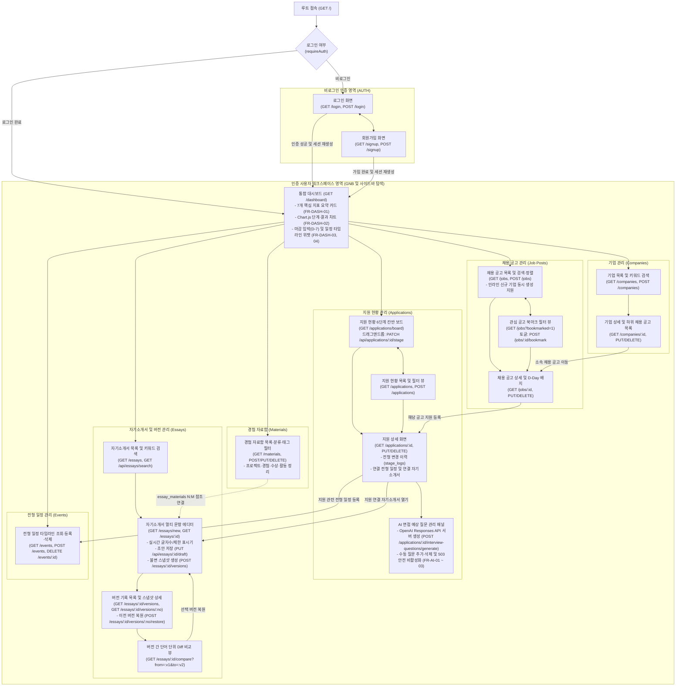

### 10.2 주요 화면별 구성 및 설계 특징 (`docs/DESIGN_REFERENCES.md` 및 `design/mockups/README.md` 기반)

| 화면 영역 | 주요 경로(Route) | 핵심 UI 구성 요소 및 인터랙션 설계 |
| :--- | :--- | :--- |
| **로그인 / 회원가입** | `/login`, `/signup` | 중앙 정렬된 단일 카드 폼 구조로 구성된다. 입력 검증 실패(`422`) 시 사용자가 입력했던 이름·이메일 값을 유실 없이 보존하며, 각 `<input>`에 연결된 `<label for>`와 명확한 인라인 에러 배너(`role="status"`)를 제공한다. |
| **대시보드** | `/dashboard` | 상단에 7대 핵심 지표 요약 카드를 배치하고, 중단에는 로컬 서빙되는 Chart.js 기반의 전형 단계별 막대 차트와 합불 결과 도넛 차트를 배치한다. 하단에는 마감 7일 이내(`D-Day` ~ `D-7`) 공고 위젯과 다가오는 전형 일정 타임라인을 배치해 일일 브리핑 허브 역할을 수행한다. |
| **지원 현황 (칸반 보드 / 목록 / 상세)** | `/applications/board`, `/applications`, `/applications/:id` | 보드 뷰는 `서류` → `코딩테스트` → `과제` → `1차 면접` → `2차 면접` → `최종`의 6개 고정 열로 구성되며, 각 카드에 기업명, 직무, 합불 결과 캡슐 배지(`진행중`/`합격`/`불합격`/`지원취소`), D-Day를 표시한다. 드래그앤드롭 이동과 키보드 접근성용 단계 변경 컨트롤을 모두 지원하며, 상세 화면에서는 `stage_logs` 타임라인과 연결 일정·자기소개서·AI 면접 질문을 한눈에 관리한다. |
| **채용 공고 및 기업 관리** | `/jobs`, `/jobs/:id`, `/companies`, `/companies/:id` | 채용 공고 목록은 키워드 검색, 채용 형태 필터, 북마크 전용 필터(`?bookmarked=1`), 마감 임박순/최신순 정렬을 한 줄의 상단 필터 바에 집약한다. 공고 등록 시 별도 화면 이탈 없이 신규 기업명을 함께 입력해 생성할 수 있으며, 기업 상세 화면에서는 해당 기업의 전체 공고와 지원 현황을 연결해 보여준다. |
| **자기소개서 (목록 / 에디터 / 버전 기록 / 비교)** | `/essays`, `/essays/:id`, `/essays/:id/versions/:no`, `/essays/:id/compare` | 중앙에는 장문 한국어 집필에 최적화된 문항별 편집 카드(본문 `15px`, 행간 `1.7`, `word-break: keep-all`)와 실시간 글자수 카운터(`tabular-nums`)를 배치하고, 우측 보조 패널에는 불변 버전 히스토리 목록과 연결된 경험 자료함(`essay_materials`) 카드를 배치한다. 버전 비교 화면에서는 `jsdiff`가 계산한 추가(`<ins>`)·삭제(`<del>`) 어절을 시맨틱 컬러로 대조하고 원클릭 이력 보존형 복원을 제공한다. |
| **경험 자료함 및 전형 일정** | `/materials`, `/events` | 경험 자료함은 프로젝트, 인턴, 수상, 대외활동 소재를 분류(`kind`)와 태그별로 카드화하여 관리한다. 전형 일정 화면은 서류 마감, 코딩테스트, 면접, 합격 발표 일정을 시작 일시 순으로 정렬해 지원 상세 화면과 양방향으로 연동한다. |
| **OpenAI 기반 통합 AI 스위트** | `/applications/:id`, `/essays/:id`, `/materials/:id`, `/jobs/new`, `/jobs/discover`, `/dashboard` | 지원 상세 하단 면접 질문 생성(`FR-AI-01`), 자소서 문항별 첨삭 피드백(`FR-AI-04`), 경험 소재 STAR 초안 생성(`FR-AI-05`), 공고 원문 텍스트 파싱(`FR-AI-06`), `web_search` 연동 공고 탐색(`/jobs/discover`, `FR-AI-11`), 대시보드 맞춤형 주간 브리핑(`FR-AI-12`)을 제공한다. 서버 환경 변수에 `OPENAI_API_KEY`가 설정되지 않은 경우 가짜(mock) 데이터 없이 명확한 비활성화 안내 및 HTTP `503`을 반환하며, 10분 내 20회 통합 속도 제한을 적용한다. |

### 10.3 디자인 시안(A/B/C안) 검토 및 화면 설계 방향 (`docs/DESIGN_REFERENCES.md`, `design/mockups/README.md`)

ReadySetJob의 화면 구성은 글로벌 SaaS 및 문서 도구 레퍼런스 조사(`docs/DESIGN_REFERENCES.md`)를 바탕으로 제작된 세 가지 정적 목업 시안(`design/mockups/a/`, `b/`, `c/`)의 비교 분석 결과를 반영한다.

| 시안 구분 | 레퍼런스 기반 및 핵심 레이아웃 특징 | 주요 채택 요소 |
| :--- | :--- | :--- |
| **A안: 미니멀 SaaS형** | Linear(역 L자 크롬, LCH 기반 저채도 중립 표면, `1px solid` 보더) 및 Attio(뷰 전환 및 우측 레코드 프리뷰 드로어) 패턴 기반 (출처: https://linear.app/now/how-we-redesigned-the-linear-ui , https://linear.app/now/behind-the-latest-design-refresh , https://attio.com/help/reference/managing-your-data/views) | 전체 앱의 정갈한 `1px solid` 경계선 구획, 상단 1줄 압축 검색·필터 바, 빠른 상세 속성 확인 인터랙션 |
| **B안: 채용 파이프라인 중심형** | Huntr(수평 칸반 보드, 단계별 건수 배지, 전환 퍼널 지표) 패턴 기반 (출처: https://help.huntr.co/en/articles/13413245-the-job-board , https://help.huntr.co/en/articles/10042709-maps-and-metrics) | 6단계 전형(`서류` ~ `최종`) 칸반 열 헤더와 건수 배지, 카드 표면의 핵심 요약 정보(기업·직무·결과 배지·D-Day) 압축 배치 |
| **C안: 문서 작업 스튜디오형** | Craft(문항 목차·중앙 집필 시트·우측 보조 인스펙터 3영역 분리) 및 Pretendard(`tabular-nums` 숫자 정렬) 패턴 기반 (출처: https://support.craft.do/en/introduction/navigation , https://github.com/orioncactus/pretendard) | 자기소개서 멀티 문항 에디터의 본문 가독성(`15px`, 행간 `1.7`, `word-break: keep-all`), 우측 버전 히스토리·경험 자료 참조 패널, 단어 단위 `<ins>`/`<del>` Diff 뷰 |

#### 화면 전반의 공통 디자인 토큰 및 접근성 적용 원칙 (`public/css/tokens.css`)
* **표면 및 경계선 위계**: 과도한 그림자를 지양하고 오프화이트 배경(`Surface Muted`)과 흰색 작업 카드(`Surface Primary`), `1px solid` 저대비 보더로 영역을 구획한다. `<html data-theme="light|dark">` 속성과 `localStorage('rsj_theme')`를 연동해 라이트 모드(기본)와 다크 모드를 일관되게 지원한다(`NFR-UI-01`).
* **시맨틱 상태 컬러 체계**: 전형 결과(`진행중`, `합격`, `불합격`, `지원취소`), 마감 임박 경고(`D-Day` ~ `D-3`), 자기소개서 버전 Diff 추가(`<ins>`) 및 삭제(`<del>`) 하이라이트는 모두 `tokens.css`에 정의된 시맨틱 변수만 참조한다.
* **한국어 타이포그래피 및 숫자 정렬**: 국문과 영문·숫자가 혼용되는 기업명, 직무명, 날짜, 실시간 글자수 카운터에 `Pretendard Variable` 서체와 `font-variant-numeric: tabular-nums`를 적용하여 실시간 입력 중에도 레이아웃 흔들림이 발생하지 않도록 설계한다.
* **시맨틱 마크업 및 키보드 접근성**: 모든 폼 요소에 `<label for="...">`를 명시적으로 연결하고, 주 내비게이션(`aria-label="주 메뉴"`), 비활성 요소(`aria-disabled="true"`), 플래시 알림 배너(`role="status"`), 칸반 보드 내 단계 이동 버튼 컨트롤을 함께 제공하여 마우스 드래그가 어려운 환경에서도 동일한 조작성을 보장한다(`FR-APP-06`, `NFR-A11Y-01`).


## 11. 주요 화면 설계

ReadySetJob의 화면은 채용 파이프라인의 흐름을 조망하는 **대시보드**, 6개 전형 단계별 카드를 이동하는 **지원 현황 칸반 보드**, 경험 자료를 옆에 띄우고 실시간 글자수를 확인하며 집필하는 **자기소개서 에디터**, 그리고 불변 스냅샷 간의 문구 차이를 대조하는 **버전 비교(Diff) 화면**의 4대 핵심 뷰로 구성된다.

### 11.1 핵심 화면 와이어프레임

#### (1) 대시보드 화면 (`/dashboard`)
대시보드는 사용자의 구직 현황 지표를 상단 KPI 카드로 요약하고, 중단에는 전형 단계별·결과별 통계 차트(P2 계획)를, 하단에는 마감 임박 공고(D-7 이내)와 다가오는 전형 일정 타임라인을 배치한다.

```text
+---------------------------------------------------------------------------------------+
| ReadySetJob          [대시보드] [기업] [채용공고] [지원현황] [자소서] [일정]  [테마] [로그아웃] |
+---------------------------------------------------------------------------------------+
| [요약 KPI 카드 7종 (P0 검증 완료)]                                                     |
| +----------+ +----------+ +----------+ +----------+ +----------+ +--------+ +-------+ |
| | 등록 기업 | | 전체 공고 | | 관심 공고 | | 총 지원   | | 진행 중   | | 합격   | | 일정  | |
| |    6     | |    6     | |    3     | |    6     | |    4     | |   1    | |   3   | |
| +----------+ +----------+ +----------+ +----------+ +----------+ +--------+ +-------+ |
|                                                                                       |
| +---------------------------------------------+ +-----------------------------------+ |
| | 전형 단계별 지원 분포 (Chart.js 막대 차트, P2) | | 합불 결과 비율 (도넛 차트, P2)    | |
| |  서류    [████████████] 2건                 | |                                   | |
| |  코테    [██████]       1건                 | |      진행중 66% / 합격 17%        | |
| |  과제    [██████]       1건                 | |      불합격 17%                   | |
| |  1차면접 [██████]       1건                 | |                                   | |
| |  2차/최종[██████]       1건                 | |                                   | |
| +---------------------------------------------+ +-----------------------------------+ |
|                                                                                       |
| +---------------------------------------------+ +-----------------------------------+ |
| | 마감 임박 관심 공고 (D-7 이내)               | | 다가오는 전형 일정 (starts_at 순) | |
| | - [D-2] 카카오 백엔드 신입 서류 마감         | | - 11/12 14:00 네이버 코딩테스트   | |
| | - [D-5] 토스 Server Developer 인턴 마감     | | - 11/15 10:00 당근 1차 직무면접   | |
| +---------------------------------------------+ +-----------------------------------+ |
+---------------------------------------------------------------------------------------+
```

#### (2) 지원 현황 칸반 보드 (`/applications/board`)
칸반 보드는 가로축 열(Column)을 오직 6개 채용 전형 단계(`서류`, `코딩테스트`, `과제`, `1차 면접`, `2차 면접`, `최종`)로만 고정하고, 각 지원 건의 합불 결과(`진행중`, `합격`, `불합격`, `포기`)는 카드 내부의 배지로 분리 표시한다. 이를 통해 특정 단계에서 불합격하더라도 카드가 어느 단계까지 도달했는지 시각적 맥락이 보존된다.

```text
+---------------------------------------------------------------------------------------+
| 지원 현황 보드   [검색: 기업·공고·직무] [결과 필터: 전체 v]  [목록 뷰 | 칸반 뷰] [+ 지원 등록] |
+---------------------------------------------------------------------------------------+
| +-----------+ +-----------+ +-----------+ +-----------+ +-----------+ +-------------+ |
| | 서류 (2)  | | 코테 (1)  | | 과제 (1)  | | 1차면접(1)| | 2차면접(0)| | 최종 (1)    | |
| +-----------+ +-----------+ +-----------+ +-----------+ +-----------+ +-------------+ |
| |+---------+| |+---------+| |+---------+| |+---------+| |           | |+-----------+| |
| ||카카오   || ||네이버   || ||쿠팡     || ||토스     || | (카드없음)| ||당근       || |
| ||백엔드   || ||클라우드 || ||풀스택   || ||서버개발 || |           | ||백엔드인턴 || |
| ||[진행중] || ||[진행중] || ||[불합격] || ||[진행중] || |           | ||[합격]     || |
| ||D-2 자v2 || ||11/12시험|| ||과제제출 || ||11/15면접|| |           | ||최종합격   || |
| |+---------+| |+---------+| |+---------+| |+---------+| |           | |+-----------+| |
| |+---------+| +-----------+ +-----------+ +-----------+ +-----------+ +-------------+ |
| ||라인     ||                                                                         |
| ||플랫폼   ||  * 카드를 다른 열로 드래그앤드롭 시 PATCH /api/applications/:id/stage 호출 |
| ||[진행중] ||  * 트랜잭션으로 board_order 재정렬 및 stage_logs 변경 이력 자동 기록      |
| |+---------+|                                                                         |
+---------------------------------------------------------------------------------------+
```

#### (3) 자기소개서 에디터 (`/essays/:id`)
자기소개서 에디터는 상단에 현재 저장 상태와 버전 생성 버튼을 두고, 좌측에는 경험 자료함 및 과거 자기소개서 문항 검색 참고 패널을, 중앙에는 문항별 실시간 글자수 카운터가 결합된 작성 캔버스를 배치한다.

```text
+---------------------------------------------------------------------------------------+
| [자소서 제목: 2026 하반기 네이버 신입 백엔드] (연결: 네이버 공채)                      |
| 상태: 초안 저장됨 (14:22) | 최신 버전: v3 | [초안 임시저장] [새 버전으로 저장] [버전 비교] |
+---------------------------------------------------------------------------------------+
| [좌측 참고 패널: 자료함 / 검색 / 버전] | [중앙 문항별 작성 영역]                        |
| +-----------------------------------+ | +-------------------------------------------+ |
| | [탭: 경험자료 | 자소서검색 | 버전] | | | 문항 1. 지원동기 및 입사 후 포부           | |
| | 검색: [성능 개선          ] [찾기] | | | ----------------------------------------- | |
| |                                   | | | 대용량 트래픽 처리 경험을 바탕으로...       | |
| | [연결된 경험 자료 (essay_materials)]| | | (본문 15px, 줄간격 1.7, keep-all 적용)     | |
| | * 웹소켓 채팅 서버 부하 개선       | | |                                           | |
| |   #백엔드 #성능개선 (2026.03~06)   | | | ----------------------------------------- | |
| |   [본문에 인용] [연결 해제]        | | | 공백포함 648 / 700자 (92.6%) | 공백제외 512| |
| |                                   | | +-------------------------------------------+ |
| | [불변 버전 히스토리]               | | +-------------------------------------------+ |
| | - v3 첨삭반영 (11/10 14:00) [비교] | | | 문항 2. 협업 및 문제해결 경험             | |
| | - v2 1차퇴고  (11/09 21:10) [복원] | | | 공백포함 890 / 1000자 (89.0%)             | |
| | - v1 초안     (11/08 18:00) [복원] | | +-------------------------------------------+ |
+-----------------------------------+ +-------------------------------------------------+
```

#### (4) 자기소개서 버전 비교 화면 (`/essays/:id/compare?from=2&to=3`)
버전 비교 화면은 사용자가 선택한 두 불변 스냅샷(`from`, `to`)의 `snapshot_json`을 서버에서 `jsdiff`(`diffWords`)로 비교하여, 문항별로 삭제된 어절(`<del>`)과 추가된 어절(`<ins>`)을 직관적으로 대조하고 원하는 시점으로 안전하게 복원할 수 있도록 설계했다.

```text
+---------------------------------------------------------------------------------------+
| 버전 비교: 2026 하반기 네이버 신입 백엔드               [에디터로 돌아가기]           |
| 기준 버전(From): [v2 1차퇴고 (11/09) v]  -->  비교 버전(To): [v3 첨삭반영 (11/10) v]  |
| 범례: [-삭제된 문구 (<del> 적색 취소선)-]  [+추가된 문구 (<ins> 녹색 강조)+]           |
+---------------------------------------------------------------------------------------+
| 문항 1. 지원동기 및 입사 후 포부                         글자수 변화: 612자 -> 648자  |
| +-----------------------------------------------------------------------------------+ |
| | 저는 학부 캡스톤 프로젝트에서 [-단순한 게시판 서버를-] [+대규모 트래픽을 고려한    | |
| | 메시지 큐 기반 비동기 처리 파이프라인을+] 설계하며 백엔드 엔지니어의 역량을         | |
| | 키웠습니다. 특히 [-응답 속도를 개선한-] [+응답 지연 시간을 320ms에서 85ms로 단축한+] | |
| | 경험은 네이버의 안정적인 서비스 운영 철학과 맞닿아 있습니다.                        | |
| +-----------------------------------------------------------------------------------+ |
| [v2를 새 버전(v4)으로 복원하기]  * 복원 시 미저장 초안을 자동 백업한 뒤 새 버전 생성  |
+---------------------------------------------------------------------------------------+
```

### 11.2 통합 디자인 원칙 및 3종 시각 목업 (A / B / C안)

글로벌 표준 SaaS 및 문서 도구 6종(Linear, Huntr, Craft, Attio, Notion, Pretendard 타이포그래피 체계)을 분석하여 도출한 **ReadySetJob 통합 디자인 원칙**은 다음과 같다(`docs/DESIGN_REFERENCES.md` 기준).

1. **오프화이트 기반 표면 위계와 라이트/다크 테마 토큰**: 장시간 한국어 자기소개서를 읽고 다듬기에 편안한 오프화이트(`#F8FAFC` / `#F7F7F5`) 배경과 순백색(`#FFFFFF`) 작업 카드를 기본으로 하며, 모든 색상은 하드코딩 없이 `public/css/tokens.css`의 CSS 변수와 `[data-theme="dark"]` 선택자로 관리한다.
2. **1px 저대비 보더와 절제된 그림자**: 무거운 그림자 대신 `1px solid` 경계선과 표면 명도 차이로 영역을 구획하고, 드래그 중인 카드나 모달에만 절제된 Elevation을 부여한다.
3. **의미론적(Semantic) 상태 색상 제한**: 화면의 85% 이상을 무채색으로 유지하고, `진행중`(슬레이트), `합격` 및 Diff 추가 `<ins>`(에메랄드 그린), `불합격` 및 Diff 삭제 `<del>`(로즈 레드), `D-3 임박`(앰버)에만 저채도 배경 + 고대비 텍스트 배지를 적용한다.
4. **Pretendard 기반 타이포그래피와 고정폭 숫자(`tabular-nums`)**: UI 요소는 13px~14px로 촘촘하게 유지하되, 자기소개서 에디터 본문과 Diff 뷰는 15px, 줄간격 1.7, `word-break: keep-all`을 적용한다. D-Day, 통계 수치, 실시간 글자수 카운터에는 `font-variant-numeric: tabular-nums`를 강제해 숫자 변경 시 레이아웃 흔들림을 방지한다.

현재 `design/mockups/` 디렉터리에는 동일한 한국어 데모 데이터를 기반으로 제작된 정적 HTML 시각 시안 3종(A안, B안, C안)과 데스크톱·모바일 스크린샷이 구축되어 있다.

| 시안 구분 | 레퍼런스 및 핵심 콘셉트 | 레이아웃 및 인터랙션 특징 | 주요 액센트 컬러 |
|---|---|---|---|
| **A안** (`design/mockups/a/`) | **Linear형 미니멀 SaaS** (고밀도 워크스페이스) | 좌측 220px 고정 사이드바 + 48px 단일 뷰 헤더, 84px 컴팩트 칸반 타일, 우측 440px 슬라이드오버 드로어 상세, 2단 분할 에디터 | Indigo Slate (`#4F46E5`) |
| **B안** (`design/mockups/b/`) | **Huntr형 채용 관리 중심** (파이프라인 & 일정 허브) | 상단 56px 수평 GNB + 64px 전폭 6단계 퍼널 배너, 가로 스크롤 없는 100% 전폭 6열 칸반 보드, 860px 중앙 탭 상세 모달 | Royal Blue (`#2563EB`) |
| **C안** (`design/mockups/c/`) | **Craft형 문서 작업 중심** (자소서 집필 & Diff 스튜디오) | 좌측 200px 문항 목차(TOC) 글자수 신호등 + 중앙 760px 순백색 종이 시트 & 어절 단위 Diff 뷰 + 우측 340px 경험·버전 인스펙터 | Deep Teal Ink (`#0F766E`) |

#### 시안별 주요 화면 스크린샷 비교
- **A안 (Linear형 미니멀 SaaS)**:
  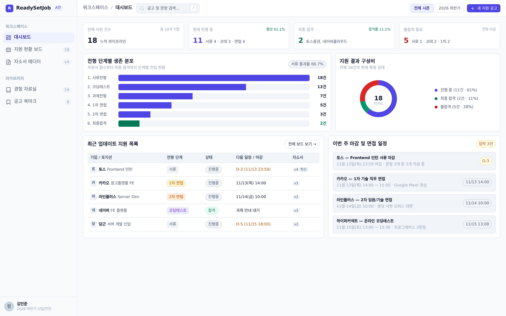
  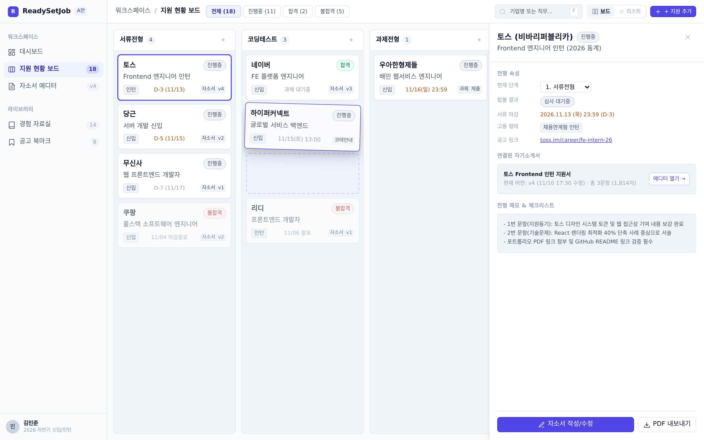
  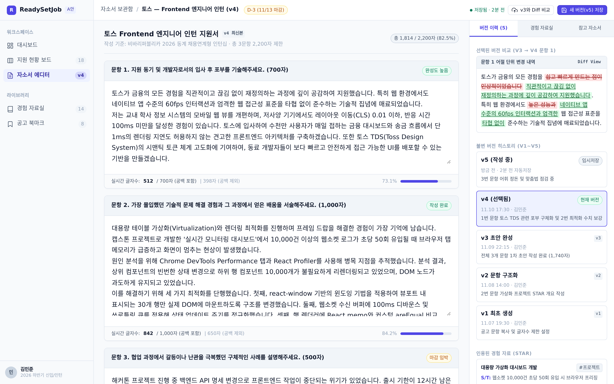
- **B안 (Huntr형 채용 관리 중심)**:
  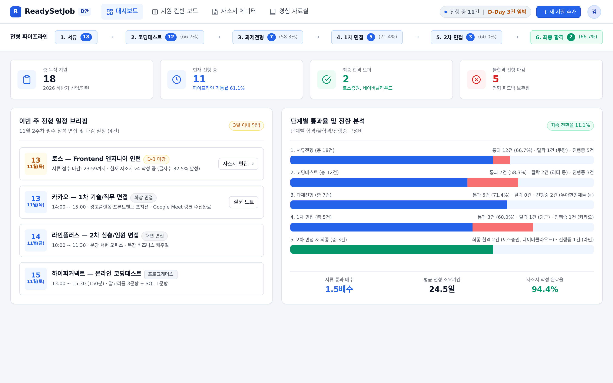
  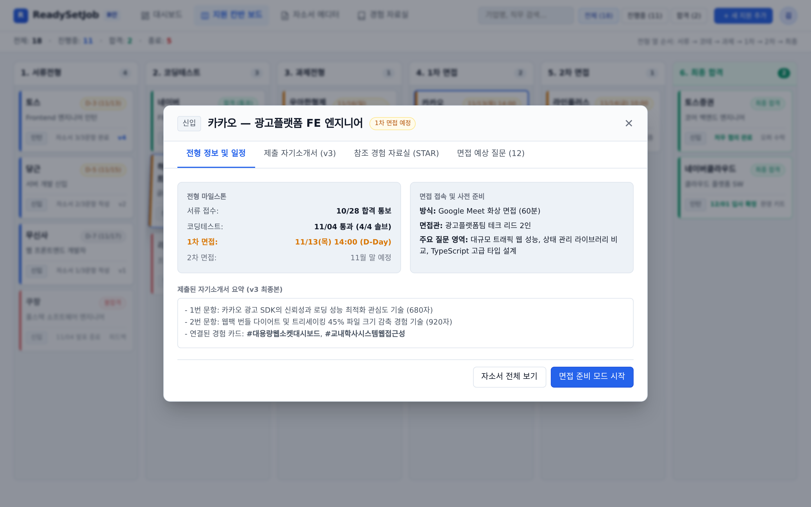
  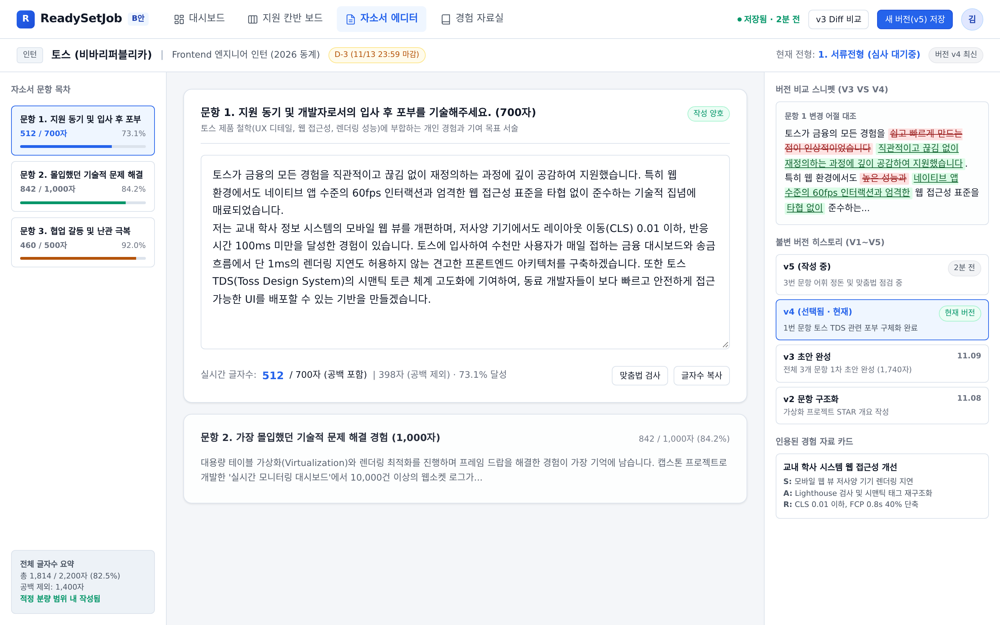
- **C안 (Craft형 문서 작업 중심)**:
  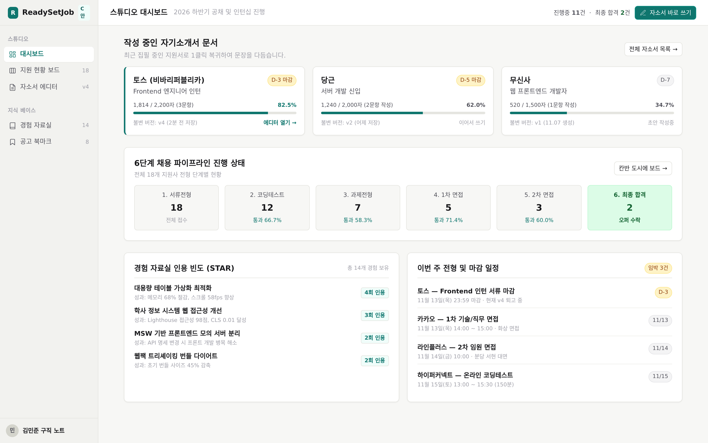
  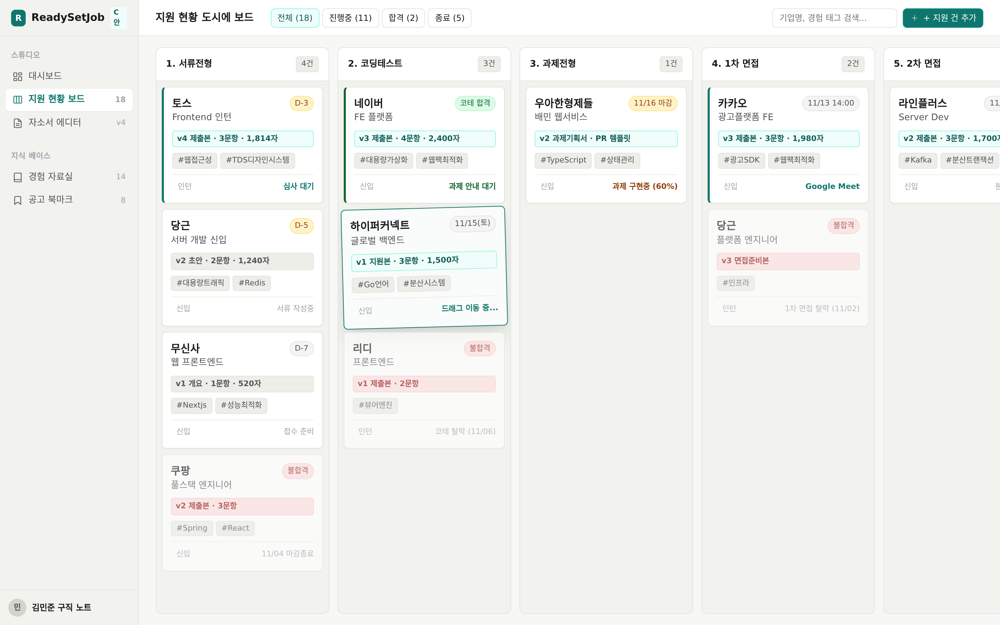
  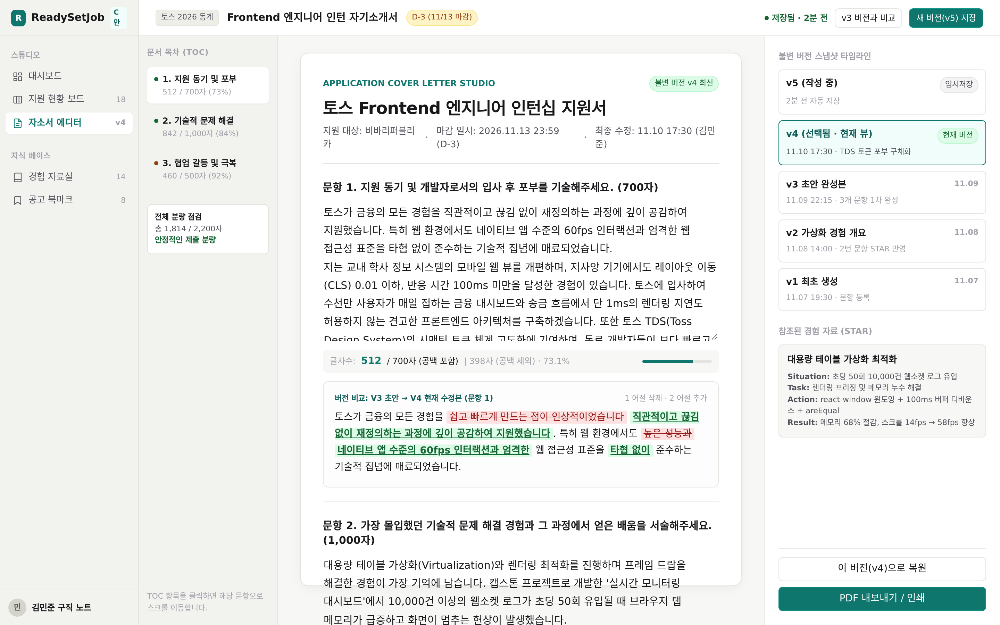

> **디자인 확정 절차**: 프로젝트 규칙(`AGENTS.md`)에 따라 위 3가지 시안은 현재 **사용자 검토 및 승인 대기** 상태이다. 사용자의 시안 선택(또는 B안의 전폭 칸반 보드와 C안의 종이형 에디터·Diff 뷰를 결합하는 하이브리드 승인)이 완료된 후 `docs/DESIGN_SYSTEM.md`에 최종 디자인 토큰과 컴포넌트 규격을 확정하여 P3 단계에서 전체 EJS 뷰에 일괄 반영한다.

---

## 12. 시스템 아키텍처

ReadySetJob은 상주 백그라운드 워커나 외부 데이터베이스 서버 없이 단일 Node.js 프로세스와 로컬 파일 기반 SQLite만으로 완결성 있게 동작하는 **3계층 서버 사이드 렌더링(SSR) + JSON API 하이브리드 아키텍처**를 채택했다.

### 12.1 계층형 아키텍처 다이어그램

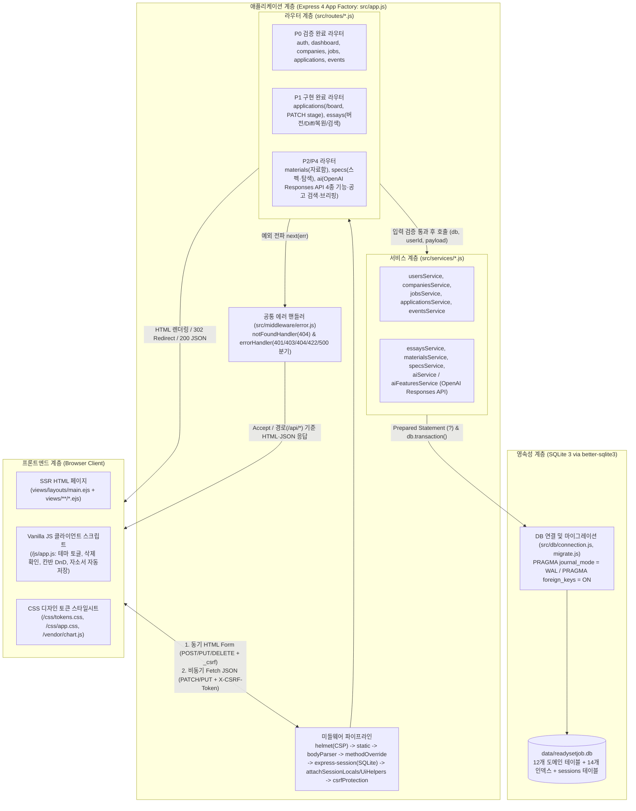

### 12.2 아키텍처 핵심 설계 원칙
1. **앱 팩토리 패턴(`createApp({ dbPath })`)을 통한 테스트 격리**: `src/app.js`는 데이터베이스 파일 경로를 인자로 받아 마이그레이션을 수행하고 독립된 Express 앱 인스턴스를 반환한다. 덕분에 운영 환경(`src/server.js`)과 자동화 테스트(`test/helpers.js`의 임시 디렉터리 DB)가 동일한 미들웨어·라우터 구성을 공유하면서도 완벽히 격리된 데이터 환경에서 동작한다.
2. **얇은 라우터(Thin Router)와 트랜잭션 서비스 계층**: 라우터는 HTTP 파라미터 파싱, 진입부 입력 검증(`isValidEmail`, `isValidDate`, `isValidUrl`, Enum 체크), 상태 코드 결정(`302`, `422`, `404`)만 담당한다. 복수 테이블을 갱신하는 모든 도메인 로직(인라인 기업+공고 생성, 지원 생성+`stage_logs` 기록, 자기소개서 버전 복원 등)은 서비스 계층의 `db.transaction()` 내부에서 원자적으로 실행된다.
3. **전 구간 사용자 소유권(`user_id`) 강제**: 모든 서비스 함수는 `req.session.user.id`를 명시적 인자로 전달받아 SQL `WHERE` 절에서 `user_id = ?`를 검증한다. 타 사용자의 리소스 ID에 접근하면 `403` 대신 `404 Not Found`를 반환하여 리소스 존재 자체를 노출하지 않는다.

### 12.3 HTTP 요청 처리 생명주기 (Request Lifecycle)
클라이언트에서 발생한 요청은 `src/app.js`에 등록된 순서에 따라 다음 8단계를 거쳐 처리된다.

1. **보안 헤더 및 레이아웃 설정**: `express-ejs-layouts`가 기본 레이아웃(`views/layouts/main.ejs`)을 지정하고, `helmet`이 `script-src 'self'`, `style-src 'self'`, `frame-ancestors 'none'` 등 엄격한 CSP 헤더를 부여한다.
2. **정적 자산 조기 반환**: `public/` 경로(`/css`, `/js`, `/vendor`)와 매칭되는 정적 파일 요청은 세션 DB 조회 없이 즉시 응답한다.
3. **바디 파싱 및 메서드 오버라이드**: `express.urlencoded`와 `express.json`이 요청 본문을 파싱한 뒤, `method-override`가 쿼리(`?_method=PUT`) 또는 폼 본문(`req.body._method`)을 읽어 HTML `<form>`의 `POST` 요청을 `PUT`이나 `DELETE`로 변환한다.
4. **SQLite 세션 복원**: `express-session`과 `better-sqlite3-session-store`가 `readysetjob.sid` 쿠키를 검증하고 SQLite `sessions` 테이블에서 로그인 세션 정보를 복원한다.
5. **뷰 로컬 변수 주입 (`attachSessionLocals`, `attachUiHelpers`)**: `res.locals`에 `currentUser`, `currentPath`, 1회성 `flash` 메시지, 도메인 한글 라벨 맵(`STAGE_LABELS`, `RESULT_LABELS`), `calculateDday` 헬퍼를 바인딩한다.
6. **CSRF 동기화 토큰 검증 (`csrfProtection`)**: 세션에 32바이트 난수 토큰(`res.locals.csrfToken`)을 보장하고, `POST`/`PUT`/`PATCH`/`DELETE` 요청 시 폼의 `_csrf` 필드 또는 `X-CSRF-Token` 헤더를 `crypto.timingSafeEqual`로 검증한다(실패 시 `403`).
7. **인증 검사 및 라우터 입력 검증**: 보호 라우트의 `requireAuth`가 미인증 요청을 차단(페이지 `302 /login`, API `401` JSON)한 후, 라우터 진입부에서 입력값을 검증한다. 검증 실패 시 기존 입력값을 보존한 채 HTTP `422`로 폼을 재렌더링한다.
8. **서비스 실행 및 응답/에러 분기**: 서비스가 Prepared Statement 또는 트랜잭션으로 SQLite를 조작하고 결과를 반환한다. 정상 처리 시 `res.render()`, `res.redirect()`, `res.json()`으로 응답하며, 리소스 미존재나 예외 발생 시 `errorHandler`가 일반 경로는 `views/error.ejs` HTML로, `/api/*` 경로는 `{ error }` JSON으로 일관되게 응답한다.

---

## 13. 데이터베이스 및 ERD

ReadySetJob의 데이터베이스는 `src/db/schema.sql`에 정의된 **12개 도메인 테이블**과 **14개 인덱스**(고유 제약에 의한 자동 인덱스 별도), 그리고 `express-session`이 관리하는 `sessions` 테이블로 구성된다. 데이터베이스 연결 시점(`src/db/connection.js`)과 마이그레이션 시점(`src/db/migrate.js`)에 항상 `PRAGMA journal_mode = WAL;`과 `PRAGMA foreign_keys = ON;`을 강제 활성화하여 동시 읽기·쓰기 성능과 참조 무결성을 보장한다.

### 13.1 개체-관계 다이어그램 (ERD)

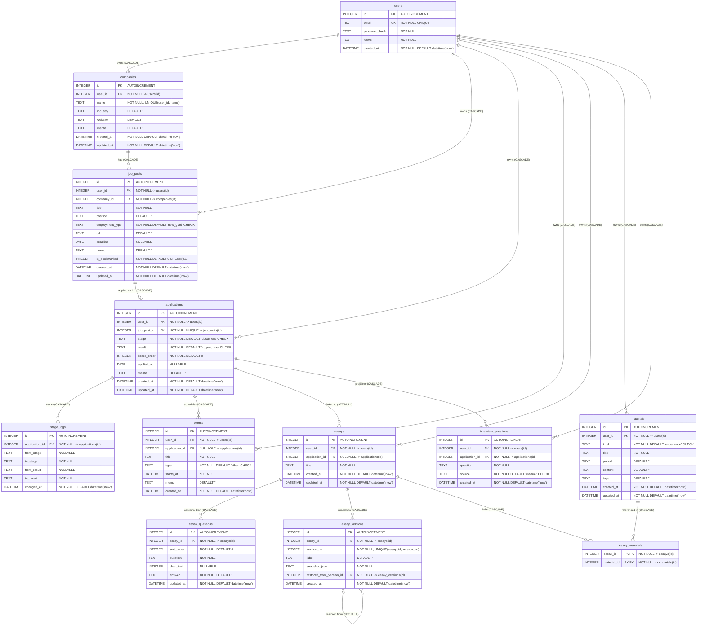

### 13.2 핵심 데이터베이스 설계 의사결정

1. **전형 단계(`stage`)와 전형 결과(`result`)의 분리**:
   - 지원 상태를 단일 컬럼으로 관리할 경우 `1차면접 불합격`, `코딩테스트 진행중`처럼 조합이 폭발하거나, 불합격 처리 시 어느 단계에서 탈락했는지 알 수 없게 된다.
   - `applications` 테이블에서 `stage`(`document`, `coding_test`, `assignment`, `interview1`, `interview2`, `final` 6단계)와 `result`(`in_progress`, `passed`, `failed`, `withdrawn` 4상태)를 별도 `CHECK` 제약 컬럼으로 분리하여, 칸반 보드 열 배치와 단계별 통과율 집계를 동시에 달성했다.
2. **감사 로그 테이블 `stage_logs`를 통한 전형 타임라인 추적**:
   - 지원 생성 및 단계·결과 변경 시마다 `from_stage`, `to_stage`, `from_result`, `to_result`, `changed_at`을 `stage_logs` 테이블에 누적 기록한다. 최초 생성 시에는 `from_stage`와 `from_result`를 `NULL`로 저장하여 시작 상태를 명확히 표현한다.
3. **칸반 보드 정렬 순서를 위한 `board_order`**:
   - 동일한 `stage` 열 내부에서 사용자가 드래그앤드롭으로 지정한 카드 배치 순서를 영속화하기 위해 정수형 `board_order` 컬럼과 복합 인덱스 `idx_applications_user_stage(user_id, stage)`를 설계했다.
4. **작업 초안(`essay_questions.answer`)과 불변 스냅샷(`essay_versions.snapshot_json`)의 이원화**:
   - 작성 중 수시로 일어나는 임시저장은 정규화된 `essay_questions` 테이블의 `answer` 컬럼을 직접 갱신(`UPDATE`)하여 가벼운 입출력과 SQL `LIKE` 기반 문항·답변 키워드 검색(`/api/essays/search`)을 지원한다.
   - 반면 사용자가 명시적으로 생성하는 버전(`essay_versions`)은 저장 시점의 전체 문항 배열(`[{ sort_order, question, char_limit, answer }]`)을 `snapshot_json`에 직렬화하여 **불변(Immutable) INSERT-only** 방식으로 보존한다. 이를 통해 중간에 문항이 추가·삭제되더라도 과거 버전의 정확한 문항 구성을 완벽히 재현한다.
5. **복원 계보 추적을 위한 자기참조 외래키 `restored_from_version_id`**:
   - 과거 버전으로 복원할 때 기존 버전을 삭제하거나 덮어쓰지 않고 신규 버전(`version_no = max + 1`)을 생성하면서, 원본 버전의 ID를 `restored_from_version_id`에 기록해 버전 간 파생 계보를 남긴다.
6. **자기소개서와 경험 자료함의 다대다(`M:N`) 매핑(`essay_materials`)**:
   - 하나의 프로젝트·인턴 경험(`materials`)은 여러 기업의 자기소개서에 재사용되고, 하나의 자기소개서 역시 복수의 경험 소재를 참조하므로 복합 기본키(`PRIMARY KEY (essay_id, material_id)`)를 가진 조인 테이블 `essay_materials`로 연결했다.
7. **루트 엔티티 `user_id` 소유권 강제**:
   - 7개 루트 테이블(`companies`, `job_posts`, `applications`, `events`, `essays`, `materials`, `interview_questions`) 모두 `user_id` 외래키와 단일/복합 인덱스를 보유하여, 조인 없이도 단일 테이블 쿼리에서 즉시 소유권을 검증한다.
8. **데이터 성격을 반영한 `ON DELETE` 참조 무결성 정책**:
   - 사용자 탈퇴나 시드 초기화 시 잔여 데이터가 남지 않도록 `users` 하위 외래키와 종속 엔티티(`job_posts -> applications -> stage_logs / events / interview_questions`, `essays -> essay_questions / essay_versions`)에는 `ON DELETE CASCADE`를 적용했다.
   - 단, **`essays.application_id`에는 `ON DELETE SET NULL`을 적용**했다. 특정 지원 내역이나 채용 공고를 삭제하더라도 사용자가 오랜 시간 작성한 자기소개서와 버전 히스토리는 타 기업 지원 시 재활용해야 하는 핵심 자산이므로 삭제하지 않고 연결만 해제되도록 설계했다. `essay_versions.restored_from_version_id` 또한 원본 버전 정리 시 후속 버전을 보존하기 위해 `ON DELETE SET NULL`을 사용한다.

---

## 14. 기술 스택과 선정 근거

프로젝트 제약 사항(헤드리스 리눅스 환경, 무거운 상주 프로세스 배제, 외부 CDN 무의존)과 요구사항(빠른 트랜잭션, 정교한 버전 Diff, 자동화 검증)을 충족하기 위해 선정한 기술 스택과 대안 비교는 다음과 같다.

| 구분 | 채택 기술 (버전) | 프로젝트 내 용도 | 선정 근거 | 고려한 대안 및 배제 사유 |
|---|---|---|---|---|
| **런타임** | **Node.js 22 LTS** (`>=22`) | 서버 실행 환경 및 내장 테스트 러너(`node:test`) 실행 | 최신 LTS로 안정성이 높고, 별도 외부 프레임워크 없이 `node --test`와 `node --watch`를 기본 제공하여 의존성을 최소화함 | **Python (Django/FastAPI)**: 프론트엔드 JS 코드 및 `jsdiff` 생태계와 언어가 이원화되어 1인 개발 생산성 저하 |
| **웹 프레임워크** | **Express 4** (`^4.21.1`) | HTTP 라우팅, 미들웨어 파이프라인, 요청/응답 처리 | 구조가 직관적이며 `createApp({ dbPath })` 앱 팩토리 패턴으로 `supertest` 기반 통합 테스트 격리가 용이함 | **Next.js / NestJS**: 번들링·빌드 메모리 점유율이 높고 SSR 폼+간결한 REST API 구조에 비해 보일러플레이트가 과도함 |
| **템플릿 엔진** | **EJS** (`^3.1.10`) + `express-ejs-layouts` | 서버 사이드 HTML 렌더링 및 공통 레이아웃(`main.ejs`) 구성 | 표준 HTML 문법과 유사해 학습 비용이 낮고, `<%= %>` 기본 이스케이핑을 통해 사용자 입력값 및 Diff 출력 시 XSS를 안전하게 방어함 | **React SPA**: 클라이언트 상태 관리, 라우팅, API 직렬화 코드가 중복 발생하여 1인 기말 프로젝트 범위에 비효율적임 |
| **데이터베이스** | **SQLite 3** + **`better-sqlite3`** (`^11.5.0`) | 12개 도메인 테이블 영속화, WAL 모드 및 동기식 트랜잭션 처리 | 별도 DB 데몬 프로세스가 필요 없는 파일 DB이며, C++ 네이티브 동기 API와 `db.transaction()`을 제공해 다중 테이블 갱신 시 원자성과 속도가 뛰어남 | **PostgreSQL / MySQL / Supabase**: 외부 서버 프로세스 상주 또는 외부 클라우드 네트워크 의존성이 발생하여 독립 실행 환경에 부적합 |
| **인증 및 세션** | **`express-session`** + `better-sqlite3-session-store` + **`bcryptjs`** (`^2.4.3`) | 쿠키 기반 서버 세션 영속화 및 비밀번호 단방향 해싱(cost 10) | 세션 데이터를 동일 SQLite 파일에 저장해 서버 재시작 시에도 로그인이 유지되며, `bcryptjs`는 네이티브 컴파일 오류 없이 모든 OS에서 동작함 | **JWT (Stateless Cookie)**: 로그아웃이나 세션 고정 방지 시 토큰 즉시 무효화를 위해 결국 서버 블랙리스트 저장소가 추가로 필요함 |
| **보안 미들웨어** | **`helmet`** (`^8.0.0`) + 자체 **CSRF 미들웨어** (`crypto.timingSafeEqual`) | CSP 보안 헤더 강제 및 상태 변경 요청 CSRF 동기화 토큰 검증 | 폐기(deprecated)된 `csurf` 패키지 대신 Node 내장 `crypto` 모듈로 폼(`_csrf`)과 헤더(`X-CSRF-Token`)를 모두 검증하는 경량 미들웨어를 직접 구현해 의존성 취약점을 제거함 | **`csurf` 패키지**: 공식 지원 종료(deprecated)로 보안 유지보수가 중단됨 |
| **버전 비교 (Diff)** | **`jsdiff`** (npm `diff` `^9.0.0`) | 자기소개서 두 버전(`snapshot_json`) 간 문항별 어절/단어 단위 비교 | 서버 사이드에서 `diffWords`를 수행해 클라이언트 연산 부담을 줄이고, 이스케이프된 `<ins>`/`<del>` 조각으로 정확한 문구 변경점을 시각화함 | **클라이언트 직접 문자열 비교**: 한국어 어절 경계 처리 및 긴 텍스트 비교 시 구현 복잡도와 브라우저 부하 증가 |
| **데이터 시각화** | **Chart.js** (P2, 로컬 `/vendor` 정적 서빙) | 대시보드 전형 단계별 막대 차트 및 합불 비율 도넛 차트 렌더링 | Canvas 기반으로 가볍고 반응형 차트 구성이 쉬우며, npm 설치 후 로컬 정적 경로로 서빙해 외부 CDN 장애나 오프라인 환경에서도 동작함 | **D3.js / 외부 CDN 스크립트**: D3는 기본 차트 대비 구현 공수가 크고, 외부 CDN은 `helmet` CSP(`script-src 'self'`) 정책 및 오프라인 실행 원칙에 위배됨 |
| **AI 모델 및 API** | **OpenAI Responses API**<br>(Structured Outputs: `gpt-6.1-terra` / `gpt-6-luna`) | 4대 핵심 AI 기능(면접 질문, 자소서 피드백, STAR 초안, 공고 파싱), `web_search` 공고 탐색, 대시보드 주간 브리핑 | 엄격한 JSON Schema 준수(Strict Mode)로 파싱 에러 없는 결정론적 데이터 반환, 내장 `web_search` 도구를 통한 실시간 채용 정보 검색, 작업 복잡도별 모델 분리(`gpt-6.1-terra` 심층 생성·추론, `gpt-6-luna` 저지연 추출·요약) 가능 | **Google Gemini API**: 초기 검토 대상이었으나 복잡한 한국어 자소서 다중 문항 및 공고 파싱 시 JSON 스키마 강제력과 실시간 웹 검색 도구 연동 안정성 검증 결과 OpenAI Responses API의 완성도가 월등하여 전환함.<br>**Anthropic Claude API**: 프롬프트 캐싱에 강점이 있으나 네이티브 웹 검색 통합 도구 부재 및 스키마 검증 파이프라인 복잡도로 배제함. |
| **테스트 도구** | **`node:test`** + **`supertest`** (`^7.0.0`) | 인증, CSRF, CRUD, 소유권 격리(404), 버전 관리 자동화 통합 테스트 | 실제 포트 바인딩 없이 Express 앱 인스턴스에 HTTP 요청과 쿠키/세션 에이전트를 전송하여 실제 운영과 동일한 미들웨어 체인을 초 단위로 검증함 | **Jest / Mocha**: 무거운 트랜스파일러 및 추가 러너 의존성이 필요함 |

---

## 15. 구현 방법

ReadySetJob은 안정성과 유지보수성을 최우선으로 고려하여 핵심 기능을 설계하고 구현한다. 모든 구현은 외부 서비스 의존성을 최소화하고 웹 표준과 Node.js 내장 기능을 최대한 활용한다.

### 15.1 사용자 인증, 세션 관리 및 보안

1. **비밀번호 단방향 해싱과 검증**:
   - 회원가입 시 `bcryptjs.hash(password, 10)`을 사용하여 비밀번호를 안전하게 단방향 해싱한 뒤 `users.password_hash`에 보관한다.
   - 로그인 시 `bcryptjs.compare(password, user.password_hash)`로 검증하며, 계정 미존재와 비밀번호 불일치 시 동일한 401 오류 메시지를 반환하여 사용자 열거 공격을 차단한다.
2. **세션 고정(Session Fixation) 방지 및 영속화**:
   - 로그인 및 회원가입 성공 즉시 `req.session.regenerate()`를 호출하여 새로운 세션 ID를 발급한다.
   - `better-sqlite3-session-store`를 통해 세션 데이터를 동일한 SQLite 파일의 `sessions` 테이블에 영속화하므로, 서버 재시작 시에도 로그인 상태가 유지된다.
   - 쿠키 옵션으로 `httpOnly: true`, `sameSite: 'lax'`, 유효기간 7일을 설정한다.
3. **인증 보호 미들웨어 (`requireAuth`)**:
   - 비인가 사용자가 보호된 페이지에 접근하면 302 리다이렉트로 로그인 페이지(`/login`)로 이동시킨다.
   - `/api/*` 경로로 요청이 들어온 경우에는 HTML 리다이렉트 대신 401 Unauthorized 상태 코드와 `{ error: '로그인이 필요합니다.' }` JSON 응답을 반환한다.
4. **동기화 토큰 기반 CSRF 방어 (`csrfProtection`)**:
   - `crypto.randomBytes(32).toString('hex')`로 생성한 32바이트 난수 토큰을 세션에 보관한다.
   - `POST`, `PUT`, `PATCH`, `DELETE` 요청 시 요청 본문의 `_csrf` 또는 요청 헤더의 `X-CSRF-Token`을 `crypto.timingSafeEqual()`로 검증한다.
   - 토큰이 누락되거나 일치하지 않으면 즉시 403 Forbidden 상태 코드를 반환한다.

### 15.2 공통 CRUD 아키텍처 및 소유권 격리

1. **얇은 라우터와 트랜잭션 서비스 분리**:
   - 라우터는 요청 파라미터 파싱, 진입부 유효성 검사, HTTP 응답 상태 코드 결정만 수행한다.
   - 비즈니스 로직과 SQL 쿼리는 서비스 계층에 배치하며, 여러 테이블을 연속 수정하는 작업은 `db.transaction()`으로 묶어 원자성을 보장한다.
2. **엄격한 소유권 검증 및 404 차단**:
   - 모든 서비스 함수는 세션에서 추출한 `userId`(`req.session.user.id`)를 전달받아 SQL `WHERE user_id = ?` 조건절을 필수로 실행한다.
   - 타인의 리소스 식별자로 조회를 시도하면 리소스 존재 여부 자체를 은폐하기 위해 403 대신 404 Not Found를 반환한다.
3. **입력 검증 실패 시 사용자 경험 보존**:
   - 이메일 형식 오류, 필수값 누락, 유효하지 않은 날짜 등 검증 실패 시 422 Unprocessable Entity 상태 코드로 응답한다.
   - 폼 화면을 다시 렌더링할 때 사용자가 입력했던 이전 값을 그대로 유지하여 재입력 불편을 없앤다.

### 15.3 칸반 보드 드래그앤드롭 및 순서 재정렬

1. **HTML5 Drag and Drop API 연동**:
   - 칸반 카드는 `draggable="true"` 속성을 부여받아 드래그 시작 시 카드 ID(`applicationId`)와 출발 단계(`stage`)를 `dataTransfer`에 기록한다.
   - 목표 컬럼의 카드를 지나갈 때 위치를 계산하여 시각적 안내선(Placeholder)을 표시한다.
2. **비동기 상태 변경 API 호출**:
   - 카드를 놓는 즉시 브라우저는 `PATCH /api/applications/:id/stage`로 비동기 fetch 요청을 전송한다.
   - 요청 헤더에는 `<meta name="csrf-token">`에서 읽어온 `X-CSRF-Token`을 포함하며, 본문에는 이동할 `{ stage, result, index }` 정보를 담는다.
3. **서버 트랜잭션 처리 및 순서 재정렬**:
   - `applicationsService.updateStageAndOrder()`는 단일 트랜잭션 내에서 동작한다.
   - 먼저 해당 지원 건의 소유권을 검증하고, 이전 단계와 목표 단계의 카드 목록을 조회한다.
   - 새로운 열에서의 삽입 위치(`index`)를 기준으로 해당 열 카드들의 `board_order` 값을 0부터 순차적으로 재부여한다.
   - 단계(`stage`) 또는 결과(`result`)가 변경된 경우 `stage_logs` 테이블에 이전 상태와 새 상태, 변경 일시를 신규 레코드로 삽입한다.

### 15.4 자기소개서 저장, 불변 버전 스냅샷 및 이력 보존형 복원

자기소개서는 작성 중 빈번한 저장이 발생하는 초안(Draft)과, 중요한 시점에 기록하는 불변 버전(Version Snapshot), 그리고 과거 시점으로 되돌리는 복원(Restore)의 3단계 흐름으로 동작한다.

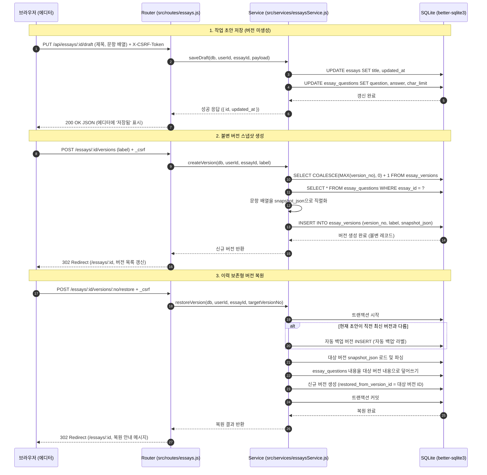

1. **작업 초안 저장 (`PUT /api/essays/:id/draft`)**:
   - 에디터에서 사용자가 글을 작성할 때 5초 디바운스 자동저장 또는 수동 임시저장 버튼으로 호출된다.
   - 정규화된 `essay_questions` 테이블의 답변 컬럼만 빠르게 갱신하며, `essay_versions`에는 레코드를 남기지 않아 데이터베이스 용량 낭비를 방지한다.
2. **불변 버전 스냅샷 생성 (`POST /essays/:id/versions`)**:
   - 지원서 제출 전이나 첨삭 후 사용자가 명시적으로 버전을 기록할 때 실행된다.
   - 전체 문항 데이터를 JSON 배열로 직렬화하여 `snapshot_json` 컬럼에 저장한다. 이 테이블은 UPDATE나 DELETE를 수행하지 않는 불변(Immutable) 원칙을 따른다.
3. **이력 보존형 복원 (`POST /essays/:id/versions/:no/restore`)**:
   - 과거 버전으로 복원할 때 현재 작업 중인 내용이 유실되지 않도록, 현재 초안을 먼저 "자동 백업" 버전으로 저장한다.
   - 이후 대상 버전의 스냅샷을 현재 에디터 작업본으로 복사하고, 대상 버전의 ID를 `restored_from_version_id`로 기록하는 새 버전을 추가 발행한다.

### 15.5 서버 사이드 텍스트 Diff 비교 및 XSS 방어

1. **`jsdiff` 기반 어절 단위 비교**:
   - `GET /essays/:id/compare?from=2&to=3` 요청 시 두 버전의 `snapshot_json`을 각각 파싱하여 동일 문항끼리 매칭한다.
   - 줄 전체를 교체하는 방식이 아니라 단어 및 어절 단위로 변경점을 보여주기 위해 npm `diff` 패키지의 `diffWords()` 함수를 서버에서 실행한다.
2. **보안 렌더링 파이프라인**:
   - 비교 대상 문자열을 먼저 `escapeHtml()` 함수로 이스케이프하여 사용자 입력값에 포함된 악성 스크립트를 무력화한다.
   - 이스케이프가 완료된 텍스트 조각에 대해 추가된 어절은 `<ins class="diff-ins">`, 삭제된 어절은 `<del class="diff-del">`, 유지된 어절은 일반 텍스트로 감싼 안전한 HTML 토큰을 생성하여 뷰 템플릿에 전달한다.

### 15.6 Chart.js 대시보드 집계 및 로컬 정적 서빙

1. **외부 CDN 의존성 배제 및 로컬 서빙**:
   - Chart.js를 npm 패키지로 설치하고 Express의 `express.static()`을 이용해 `/vendor/chart.js` 경로로 직접 서빙한다.
   - 외부 CDN을 호출하지 않으므로 오프라인 환경에서도 정상 작동하며, `helmet`의 엄격한 Content Security Policy(`script-src 'self'`)를 위반하지 않는다.
2. **효율적인 SQL 집계 쿼리**:
   - 전형 단계별 지원 분포: `SELECT stage, COUNT(*) AS count FROM applications WHERE user_id = ? GROUP BY stage`
   - 합불 결과 비율: `SELECT result, COUNT(*) AS count FROM applications WHERE user_id = ? GROUP BY result`
   - 위 쿼리 결과를 HTML 템플릿의 `data-chart` 속성에 JSON 문자열로 바인딩하고, 클라이언트 스크립트가 로드 시점에 Canvas 차트를 렌더링한다.

### 15.7 AI 기능 서버 사이드 격리 및 우아한 비활성화 (Graceful Degradation)

1. **OpenAI Responses API 서버 사이드 격리 및 Structured Outputs**:
   - AI 4종 기능(면접 질문 생성, 자소서 첨삭 피드백, 경험 소재 STAR 초안, 공고 원문 텍스트 파싱)과 `web_search` 기반 공고 탐색, 대시보드 주간 브리핑은 브라우저가 아닌 Node.js 백엔드 서비스(`src/services/aiService.js`, `aiFeaturesService.js`, `aiBriefingService.js`)에서만 OpenAI Responses API를 호출한다.
   - 모든 AI 호출은 `src/services/aiSchemas.js`에 정의된 엄격한 JSON Schema(`response_format: { type: 'json_schema', json_schema: { strict: true, ... } }`)를 강제하여 클라이언트 렌더링에 적합한 신뢰성 높은 정형 데이터를 보장한다.
   - 도메인 특성에 맞춰 심층 추론 및 생성 작업(면접 질문, 자소서 피드백, STAR 초안, 공고 검색)에는 `gpt-6.1-terra`를, 빠른 텍스트 추출 및 요약(공고 파싱, 주간 브리핑)에는 `gpt-6-luna`를 매핑하며, `OPENAI_MODEL` 및 `OPENAI_MODEL_*` 환경 변수를 통한 세부 오버라이드를 지원한다.
2. **API 키 은닉 및 안전한 설정 안내**:
   - API 키는 서버 환경 변수(`OPENAI_API_KEY`)로만 주입하며 클라이언트 브라우저나 HTTP 응답 본문, 로그에 절대 노출하지 않는다.
   - 설정 화면(`GET /settings/ai`)에서도 키 원문은 은닉하고 활성화 여부(설정됨/미설정) 및 기능별 모델 매핑 상태만 표시한다.
3. **키 미설정 시 정직한 비활성화(Graceful Degradation) 및 가짜 응답 배제**:
   - `OPENAI_API_KEY` 환경 변수가 누락되었거나 비어 있는 경우, UI 상의 AI 버튼을 비활성화(`disabled`)하고 `AI 기능이 비활성화되어 있습니다 (OPENAI_API_KEY 미설정)` 안내를 명확히 표기한다.
   - API 엔드포인트 직접 호출 시 HTTP `503 Service Unavailable` 상태 코드와 정형 에러 JSON(`{ error: 'AI 기능이 비활성화되어 있습니다 (OPENAI_API_KEY 미설정)' }`)을 반환한다.
   - **정직성 원칙 (`AGENTS.md`)**: 키가 없는 환경에서 가짜(Mock) 데이터를 무단 생성하여 실제 AI 응답인 것처럼 사용자를 기만하지 않는다.
4. **통합 슬라이딩 윈도우 속도 제한(Shared Rate Limiter) 및 타임아웃**:
   - 무분별한 토큰 소모 및 외부 API 과금을 방지하기 위해, 모든 AI 기능을 통틀어 사용자 ID 기준 **10분 내 최대 20회**의 슬라이딩 윈도우 인메모리 속도 제한(`src/services/aiRateLimiter.js`)을 적용한다. 초과 시 HTTP `429 Too Many Requests`를 반환한다.
   - 외부 API 네트워크 지연에 대비해 `AbortController` 기반의 15초(또는 웹 검색 20초) 타임아웃을 적용하고, 실패 시 적절한 에러 캐치 미들웨어를 통해 시스템 크래시를 방지한다.

### 15.8 테스트 전략 (`node:test` + `supertest`)

1. **경량 내장 테스트 러너 채택**:
   - Jest나 Mocha 같은 무거운 외부 테스트 프레임워크 대신 Node.js 22에 내장된 `node:test`와 `assert/strict`를 사용한다.
2. **테스트 환경 데이터 격리 (`test/helpers.js`)**:
   - 테스트 실행 시마다 OS 임시 디렉터리(`node:os.tmpdir()`)에 고유한 SQLite 데이터베이스 파일을 생성하고 마이그레이션을 실행한다.
   - 테스트 종료 후 임시 파일을 자동으로 정리하여 테스트 간 데이터 오염과 순서 의존성을 방지한다.
3. **통합 테스트 커버리지**:
   - `test/auth-and-security.test.js`: 회원가입, 로그인 세션 유지, 세션 재생성, CSRF 토큰 누락 및 변조 시 403 차단 검증.
   - `test/crud-and-ownership.test.js`: 기업, 공고, 지원, 일정 CRUD 동작 및 타인 데이터 접근 시 404 차단 검증.
   - `test/ownership-and-seed.test.js`: 데모 시드 데이터 정합성 및 사용자 격리 검증.

---

## 16. 개발 일정 및 추진 현황

본 프로젝트는 2026년 11월 10일부터 2026년 12월 16일까지 총 5주간 단계적으로 진행된다.

### 16.1 주차별 개발 추진 계획

| 주차 | 기간 | 개발 단계 | 주요 작업 내용 | 완료 기준 (Definition of Done) |
|---|---|:---:|---|---|
| **1주차** | 11/10 ~ 11/16 | **P0** (완료)<br>**P1** (착수) | - 프로젝트 스캐폴딩 및 SQLite 스키마(12개 테이블) 구축<br>- 인증, 세션, CSRF, 핵심 도메인 CRUD 및 소유권 격리 구현<br>- 프로젝트 계획서 작성 및 GitHub 저장소 연동<br>- 디자인 시안 3종(A/B/C) 제작 및 사용자 승인 대기 | - P0 자동화 테스트 10개 통과<br>- 계획서 11/16 제출 완료<br>- 디자인 목업 스크린샷 확보 |
| **2주차** | 11/17 ~ 11/23 | **P1** | - 6개 전형 단계 칸반 보드 뷰(`/applications/board`) 구현<br>- HTML5 드래그앤드롭 및 `PATCH /api/applications/:id/stage` 연동<br>- 자기소개서 멀티 문항 에디터 및 글자수 계산기 구현<br>- 초안 저장, 불변 버전 스냅샷 생성 및 `jsdiff` 비교 화면 구현<br>- 이력 보존형 복원 알고리즘 구현 및 P1 통합 테스트 검증 | - 칸반 카드 이동 및 순서 재정렬 동작<br>- 자소서 버전 생성, 단어 단위 Diff, 복원 기능 검증 통과 |
| **3주차** | 11/24 ~ 11/30 | **P2** | - Chart.js npm 설치 및 `/vendor` 로컬 정적 서빙 라우트 구성<br>- 대시보드 전형 단계별 막대 차트 및 결과별 도넛 차트 연동<br>- 마감 임박 공고(D-7) 및 전형 일정 타임라인 위젯 연동<br>- 경험 자료함(`/materials`) CRUD 및 태그 필터 구현<br>- 자기소개서와 경험 자료 간 N:M 연결(`essay_materials`) 연동 | - 대시보드 차트 정상 렌더링 확인<br>- 경험 자료함 등록 및 자소서 에디터 인용 동작 확인 |
| **4주차** | 12/01 ~ 12/07 | **P3** | - 사용자 승인된 디자인 시안 기반 `docs/DESIGN_SYSTEM.md` 확정<br>- 전체 EJS 뷰에 최종 CSS 토큰 및 UI 스타일 일괄 적용<br>- 라이트/다크 테마(`[data-theme="dark"]`) 색상 대비 점검<br>- 모바일 및 태블릿 반응형 레이아웃, 키보드 접근성 점검<br>- 빈 상태(Empty State) 안내 및 오류 화면 UX 개선 | - 전체 화면 디자인 일관성 확보<br>- 테마 토글 및 모바일 화면 정상 동작 |
| **5주차** | 12/08 ~ 12/16 | **P4** | - OpenAI Responses API(Structured Outputs: `gpt-6.1-terra` / `gpt-6-luna`) 기반 AI 4종 기능(면접 질문, 자소서 피드백, STAR 초안, 공고 파싱) 연동<br>- OpenAI 내장 `web_search` 도구 연동 공고 탐색 및 대시보드 AI 주간 브리핑(일일 캐시) 구현<br>- `OPENAI_API_KEY` 미설정 시 우아한 비활성화(503, 가짜 응답 없음) 및 10분 20회 공유 속도 제한 적용<br>- 면접 단계 전환 연동 백그라운드 AI 질문 자동 생성 및 수동 면접 질문 관리 완성<br>- 전체 시스템 기능 회귀 테스트 및 성능 점검<br>- 최종 보고서(`docs/FINAL_REPORT.md`) 작성 및 발표 준비 | - 최종 보고서 및 시연 영상 준비 완료<br>- 12/16 최종 발표 및 제출 |

### 16.2 프로젝트 간트 차트 (Gantt Chart)

```mermaid
gantt
    title ReadySetJob 개발 및 추진 일정 (2026-11-10 ~ 2026-12-16)
    dateFormat  YYYY-MM-DD
    axisFormat  %m/%d

    section P0 기반 및 CRUD
    프로젝트 초기화 및 DB 스키마 구축     :done, p0_1, 2026-11-10, 2026-11-12
    인증, 세션, CSRF 보안 미들웨어 구현   :done, p0_2, 2026-11-10, 2026-11-13
    기업·공고·지원·일정 CRUD 및 테스트     :done, p0_3, 2026-11-11, 2026-11-14
    프로젝트 계획서 작성 (제출: 11/16)    :active, p0_4, 2026-11-10, 2026-11-16

    section 디자인 트랙
    레퍼런스 분석 및 디자인 시안 A/B/C 제작 :done, dsn_1, 2026-11-10, 2026-11-12
    사용자 시안 검토 및 최종 승인 대기    :active, dsn_2, 2026-11-12, 2026-11-18

    section P1 칸반 및 자소서 버전 관리
    칸반 보드 뷰 및 드래그앤드롭 구현    :active, p1_1, 2026-11-14, 2026-11-20
    자소서 에디터, 버전 스냅샷, Diff, 복원 :active, p1_2, 2026-11-15, 2026-11-23

    section P2 통계 및 경험 자료함
    Chart.js 로컬 서빙 및 대시보드 시각화 : p2_1, 2026-11-24, 2026-11-27
    경험 자료함 CRUD 및 N:M 자소서 연결   : p2_2, 2026-11-27, 2026-11-30

    section P3 디자인 시스템 및 접근성
    승인 디자인 시스템 EJS 전체 반영     : p3_1, 2026-12-01, 2026-12-04
    다크 모드, 반응형, 빈 상태 UX 폴리싱 : p3_2, 2026-12-04, 2026-12-07

    section P4 AI 기능 및 최종 보고서
    OpenAI Responses API 통합 AI 스위트 연동 : p4_1, 2026-12-08, 2026-12-11
    전체 기능 회귀 테스트 및 QA          : p4_2, 2026-12-11, 2026-12-13
    최종 보고서 작성 및 발표 (마감: 12/16): p4_3, 2026-12-12, 2026-12-16
```

### 16.3 현재 추진 현황 (2026-11-10 기준)

| 구분 | 단계 | 진행 상태 | 세부 내용 및 달성 결과 |
|---|:---:|:---:|---|
| **기반 및 보안** | **P0** | **검증 완료** | Node.js 22 + Express 4 + SQLite(`better-sqlite3`) 스택 초기화, 12개 테이블 스키마 및 한국어 시드 구축 완료. `bcryptjs` 해싱, 세션 재생성, CSRF 동기화 토큰, `requireAuth` 보호 구현 및 자동화 테스트 통과. |
| **핵심 도메인 CRUD** | **P0** | **검증 완료** | 기업(`/companies`), 채용 공고(`/jobs`), 지원 현황(`/applications`), 전형 변경 이력(`stage_logs`), 전형 일정(`/events`) CRUD 구현 완료. 사용자별 소유권 격리(`user_id = ?`, 타인 리소스 접근 시 404) 및 자동화 테스트 10개 통과. |
| **화면 디자인** | **디자인 트랙** | **개발 중**<br>(승인 대기) | Linear형(A안), Huntr형(B안), Craft형(C안) 3종 시각 시안 및 스크린샷 제작 완료. 사용자 최종 승인 대기 중이며, 승인 완료 후 디자인 시스템(`docs/DESIGN_SYSTEM.md`) 확정 예정. |
| **칸반 및 자소서** | **P1** | **구현 완료** | 6단계 칸반 보드(HTML5 드래그앤드롭·키보드 이동·순서 재정렬), 문항별 자기소개서 에디터, 초안 저장, 불변 버전 스냅샷, 서버 측 `jsdiff` 비교, 이력 보존형 복원 구현. 자동 테스트 25개 통과 및 브라우저 조작(드래그 후 새로고침 유지, Ctrl+S 저장) 확인. 승인된 디자인 적용은 P3. |
| **통계 및 자료함** | **P2** | **계획** | 데이터베이스 스키마(`materials`, `essay_materials`) 구축 완료. Chart.js 로컬 서빙 및 통계 대시보드, 경험 자료함 CRUD 및 검색 라우터는 3주차 구현 예정. |
| **AI 기능** | **P4** | **검증 완료** | OpenAI Responses API(Structured Outputs: `gpt-6.1-terra`, `gpt-6-luna`) 기반 4대 핵심 AI 기능(면접 질문, 자소서 피드백, STAR 초안, 공고 파싱) 및 `web_search` 기반 공고 탐색(`/jobs/discover`), 대시보드 AI 주간 브리핑(`ai_briefings` 일일 캐시) 구현 완료. `OPENAI_API_KEY` 미설정 시 우아한 비활성화(HTTP 503, 가짜 응답 없음) 및 10분 20회 공유 속도 제한 검증 완료 (`test/ai-features.test.js`, `test/ai-errors-and-limits.test.js`, `test/ai-search.test.js`, `test/ai-briefing.test.js` 전원 통과). |
| **스펙 관리 (SPEC)** | **P1 ~ P2** | **검증 완료** | 자격증·부트캠프·공모전·대외활동·대학원 5열 칸반/목록 뷰, 일정(`events`)·할 일(`todos`) 멱등 자동 연계, 완료·합격 시 경험 자료함 STAR 초안 연계, 관심 자격증 구독(`spec_watch`), 14일 임박 대시보드 위젯, 공공데이터(Q-Net, DataQ, 잡알리오, 고용24) 및 AI 검증 소스 탐색, 24자리 세션 토큰 안전 등록, SSRF 방어 가드 구현 완료 (`test/specs.test.js`, `test/spec-discover.test.js` 등 통과). |

---

## 17. AI 활용 계획

ReadySetJob은 **(a) 제품 내 AI 기반 면접 예상 질문 생성 기능**과 **(b) 개발 과정에서의 멀티 에이전트 협업 체계**라는 두 축으로 인공지능을 체계적으로 활용한다.

### 17.1 제품 내 AI 기능: OpenAI Responses API 기반 통합 AI 스위트 (P4)
서류 전형 준비부터 면접 단계에 이르는 전 과정에서 구직자가 실질적인 도움을 받을 수 있도록, OpenAI Responses API(Structured Outputs: `gpt-6.1-terra` / `gpt-6-luna`) 기반의 통합 AI 스위트를 구축하였다.

1. **4대 핵심 AI 기능 및 연계 입력·출력 데이터 구조**:
   - **(1) 지원·자소서 연계 면접 예상 질문 생성 (`POST /applications/:id/interview-questions/generate`)**:
     - *입력*: 기업명, 업종, 공고 직무/자격 요건, 연결 자기소개서 문항 및 답변.
     - *동작*: `OPENAI_MODEL_INTERVIEW || 'gpt-6.1-terra'`(effort `low`)를 호출하여 질문, 의도, 카테고리를 포함한 정형 JSON 배열을 생성하고 `interview_questions`(`source = 'ai'`) 테이블에 영속화.
     ```json
     [
       {
         "question": "캡스톤 프로젝트에서 메시지 큐를 도입하여 응답 지연을 85ms로 단축했다고 기술하셨는데, Redis Pub/Sub이나 Kafka 등 다양한 대안 중 해당 기술을 선택한 기술적 트레이드오프 기준은 무엇이었습니까?",
         "intent": "기술 스택 선정의 타당성 및 시스템 아키텍처 이해도 평가",
         "category": "직무역량/아키텍처"
       }
     ]
     ```
   - **(2) 자기소개서 문항별 실시간 첨삭 피드백 (`POST/GET /api/essays/:id/questions/:qid/feedback`)**:
     - *입력*: 문항 질문, 현재 작성 답변 본문, 글자수/제한, 공고 직무 맥락.
     - *동작*: `OPENAI_MODEL_FEEDBACK || 'gpt-6.1-terra'`(effort `medium`)를 호출하여 총평, 강점, 개선점, 구체적 수정 제안, 예시 문장을 구조화 추출하고 `essay_feedback` 테이블에 영속화.
   - **(3) 경험 소재 기반 STAR 구조화 초안 생성 및 반영 (`POST /api/materials/:id/star-draft`)**:
     - *입력*: 경험 자료 제목, 분류, 기간, 본문 내용, 태그.
     - *동작*: `OPENAI_MODEL_DRAFT || 'gpt-6.1-terra'`(effort `low`)를 호출하여 Situation(상황), Task(과제), Action(행동), Result(성과) 및 한 줄 요약으로 재구성해 `material_star_drafts`에 저장하며, `POST /materials/:id/star-draft/:draftId/apply`로 원문 본문에 즉시 서식화 반영.
   - **(4) 채용 공고 원문 텍스트 자동 파싱 및 폼 채우기 (`POST /api/jobs/parse`)**:
     - *입력*: 사용자가 외부 채용 페이지에서 복사한 임의의 공고 원문 텍스트.
     - *동작*: `OPENAI_MODEL_EXTRACT || 'gpt-6-luna'`(effort `none`)를 호출하여 기업명, 공고 제목, 직무, 고용 형태, 마감일, URL, 요약 메모, 자소서 문항 목록을 정형 JSON으로 추출하여 브라우저 입력 폼을 자동으로 완성(DB 자동 저장 없음).

2. **실시간 웹 검색 공고 탐색 및 대시보드 맞춤형 주간 브리핑**:
   - **OpenAI `web_search` 기반 공고 탐색 (`GET /jobs/discover`, `POST /api/jobs/search`)**: Responses API 내장 `web_search` 도구(`tools: [{ type: "web_search" }]`, `OPENAI_MODEL_SEARCH || 'gpt-6.1-terra'`)를 활용하여 구직 목적별 실시간 채용 공고를 최대 8건 검색·추천하며, HTTP/HTTPS 출처 검증 후 원클릭 공고 등록(`POST /jobs`) 지원.
   - **대시보드 AI 주간 브리핑 (`GET/POST /api/briefing`)**: 본인 소유의 7일 내 마감·일정, 미완료 할 일, 진행 중인 지원 데이터를 종합하여 `OPENAI_MODEL_BRIEFING || 'gpt-6-luna'` 기반 주간 브리핑을 생성하며, `ai_briefings` 테이블(`UNIQUE(user_id, briefing_date)`)을 통해 하루 1회 캐시(강제 새로고침 `force=1` 지원).

3. **Structured Outputs 및 프롬프트 엔지니어링 전략**:
   - **엄격한 JSON Schema 강제 (Strict Mode)**: OpenAI Responses API의 `json_schema` strict 모드를 강제하여 파싱 실패가 발생하지 않는 결정론적 출력을 보장.
   - **페르소나 부여 및 할루시네이션(환각) 억제 앵커링**: "지원 대상 기업 도메인과 직무 요구사항을 깊이 이해하는 10년 차 기술 면접관/채용 전문가" 역할을 부여하고, "반드시 제공된 공고와 본문 텍스트에만 근거하라"는 네거티브 제약을 설정하여 사실 추정을 원천 차단.

4. **호출 제한, 공유 속도 제한(Rate Limiting) 및 타임아웃**:
   - 무분별한 API 과금 및 토큰 남용을 방지하기 위해 사용자 ID 기준 **10분 내 최대 20회**의 통합 슬라이딩 윈도우 속도 제한(`src/services/aiRateLimiter.js`)을 적용(초과 시 HTTP `429 Too Many Requests` 반환).
   - `AbortController` 기반 15초(웹 검색 20초) 타임아웃 및 에러 캐치 미들웨어를 통해 업스트림 지연에 따른 스레드 블로킹을 방지.

5. **`OPENAI_API_KEY` 미설정 시 우아한 비활성화(Graceful Degradation) 및 가짜 응답 금지**:
   - 서버 환경 변수 `OPENAI_API_KEY`가 미설정된 환경에서는 UI의 AI 기능 버튼을 `disabled` 처리하고 `AI 기능이 비활성화되어 있습니다 (OPENAI_API_KEY 미설정)` 안내를 표시하며, API 직접 요청 시 HTTP `503 Service Unavailable`을 반환.
   - **정직성 원칙 (`AGENTS.md`)**: 키가 없는 환경에서 가짜(mock) 텍스트를 임의 생성하여 마치 AI가 응답한 것처럼 사용자를 속이지 않으며, 수동 질문 등록(`source = 'manual'`) 등 기본 워크플로는 100% 정상 제공.

### 17.2 개발 과정에서의 AI 활용: 멀티 에이전트 오케스트레이션
본 프로젝트는 1인 개발의 리소스 한계를 극복하고 상용 수준의 아키텍처 완결성을 확보하기 위해 **OpenCode + oh-my-opencode** 하네스 기반의 멀티 에이전트 협업 파이프라인을 구축하여 진행한다.

| 에이전트/도구 | 담당 역할 및 구체적 작업 범위 | 품질 통제 및 검증 방식 |
|---|---|---|
| **Claude Opus**<br>(지휘 에이전트) | - 상위 기획 분석, 요구사항 명세서(`SPEC.md`) 및 아키텍처(`ARCHITECTURE.md`) 설계<br>- 데이터베이스 정규화 및 트랜잭션 설계 검토, 코드 리뷰 총괄 | 산출물 구조 검토 및 Git Conventional Commits 준수 관리 |
| **Sisyphus / Gemini**<br>(작업자 서브에이전트) | - 도메인 라우터(`src/routes/*.js`), 서비스(`src/services/*.js`), 뷰 템플릿 마크업 작성<br>- 디자인 토큰 바인딩(`tokens.css`) 및 문서화 작업 보조<br>*(※ 개발 환경의 작업자 서브에이전트 역할이며, 런타임 제품 AI 서비스는 OpenAI Responses API를 전용 호출함)* | 단위 구현 완료 즉시 `node:test` 스위트 실행 및 무에러 검증 |
| **Perplexity MCP**<br>(기술 리서처) | - 최신 보안 표준(OWASP CSRF/Password Storage), Express 4 미들웨어 공식 동작 조사<br>- `better-sqlite3` WAL 튜닝 및 `jsdiff` 한글 형태소 대응 API 조사 | 공식 문서 URL 및 최신 릴리스 노트 직접 확인(`docs/RESEARCH_NOTES.md`) |
| **Notion MCP**<br>(지식 관리) | - 개발 세션별 의사결정 기록, 트러블슈팅 일지 및 회고 동기화 (`docs/IDEA_LOG.md`) | 작업 완료 후 마일스톤별 누적 백업 유지 |

### 17.3 AI 활용의 한계 인식 및 윤리적 관리 방안
1. **AI 생성 코드의 검증 의무**: AI가 제안한 코드는 비존재 라이브러리 참조나 더 이상 권장되지 않는 패턴(deprecated)을 포함할 수 있으므로, 모든 코드는 공식 문서를 통한 검증과 `node:test` 자동화 테스트를 통과한 경우에만 최종 반영한다.
2. **소유권 검증 및 SQL 보안 감사**: AI가 생성한 DB 접근 코드에서 `user_id = ?` 소유권 검증 누락이나 문자열 연결 방식의 SQL 취약점이 발생하지 않도록 사람이 직접 Prepared Statement 파라미터 바인딩을 이중 점검한다.
3. **비밀값 및 프라이버시 보호**: 사용자 개인정보나 `.env`에 정의된 세션 시크릿, API 키 등은 외부 프롬프트나 저장소에 절대 유출되지 않도록 환경 변수 주입 패턴을 엄격히 준수한다.

---

## 18. 예상 문제 및 해결 방안

프로젝트 개발 및 운영 과정에서 발생할 수 있는 주요 기술적·기능적 문제와 이에 대한 구체적인 대응 방안은 다음과 같다.

| 구분 | 발생 가능한 문제 상황 | 잠재적 영향 | 구체적 대응 및 기술적 해결 방안 |
|---|---|---|---|
| **데이터베이스 동시성** | 파일 기반 SQLite의 특성상 동시 쓰기 요청 시 파일 잠금(`SQLITE_BUSY`) 발생 위험 | 요청 처리 지연 또는 500 내부 서버 오류 | 1. 연결 초기화 시 `PRAGMA journal_mode = WAL;`을 적용하여 읽기 작업과 쓰기 작업의 락 경합을 원천 분리함.<br>2. `PRAGMA synchronous = NORMAL;`을 설정해 쓰기 성능을 확보하고, 서비스 계층의 다중 갱신 작업을 `db.transaction()`으로 짧게 유지함. |
| **서버 성능 (Diff 연산)** | 수천 자에 달하는 자기소개서 다중 문항을 `diffWords`로 비교할 때 CPU 연산 부하 및 이벤트 루프 블로킹 위험 | 서버 응답 지연 및 동시 요청 처리율 저하 | 1. 전체 자소서를 하나의 문자열로 합쳐 비교하지 않고 문항(`essay_questions`) 단위로 분할하여 독립 비교를 수행함.<br>2. `jsdiff` 옵션에 길이 제한 및 타임아웃 안전장치를 마련하고, 필요 시 비동기 래퍼로 감싸 이벤트 루프 지연을 최소화함. |
| **데이터 무결성 및 보존** | 특정 채용 공고나 지원 내역 삭제 시, 심혈을 기울여 작성한 자기소개서가 함께 삭제되는 사고 위험 | 구직자의 핵심 자산인 자소서 본문 및 버전 히스토리 유실 | `essays.application_id` 외래키에 `ON DELETE SET NULL`을 적용하여, 연결된 공고나 지원 건이 삭제되더라도 자기소개서 레코드와 하위 버전(`essay_versions`)은 영구 보존되도록 DB 수준에서 방어함. |
| **칸반 인터랙션** | 드래그앤드롭 과정에서 네트워크 순서 역전이나 중복 호출로 인한 컬럼 내 카드 순서(`board_order`) 꼬임 | 보드 카드 정렬 순서 불일치 및 사용자 혼란 | `PATCH /api/applications/:id/stage` API가 대상 컬럼 내 전체 카드 ID의 정렬 순서를 트랜잭션 내에서 일괄 재계산(`UPDATE ... board_order = ?`)하고, 갱신된 순서 결과를 클라이언트에 반환해 UI를 동기화함. |
| **웹 보안 (XSS 방어)** | 버전 비교 화면에서 변경된 텍스트 조각을 `<ins>`, `<del>` 태그로 렌더링할 때 악성 스크립트 주입 위험 | XSS(Cross-Site Scripting)를 통한 세션 탈취 위험 | 서버에서 완성된 HTML 문자열을 클라이언트에 넘겨 무검증 렌더링(`<%- %>`)하지 않고, 각 단어 조각의 `value`를 먼저 HTML 이스케이프(`&`, `<`, `>`, `"`, `'`) 처리한 후 안전한 태그로 감싸서 EJS에 바인딩함. |
| **외부 AI API 의존성** | OpenAI API 네트워크 지연, 호출 한도(Quota) 초과 또는 API 키 미설정 환경 | AI 기능 요청 실패, 서버 스레드 블로킹 또는 애플리케이션 크래시 | 1. **서버 측 타임아웃 및 격리**: 15초(웹 검색 20초) `AbortController` 타임아웃과 에러 캐치 미들웨어를 적용해 지연 누적을 방지함.<br>2. **공유 속도 제한(Rate Limiting)**: 사용자당 10분 내 최대 20회의 통합 슬라이딩 윈도우 속도 제한(HTTP 429)을 두어 API 쿼터 고갈 및 비용 폭증을 방어함.<br>3. **우아한 비활성화(Graceful Degradation)**: `OPENAI_API_KEY` 미설정 시 UI 버튼을 `disabled` 처리하고 HTTP 503과 명확한 안내를 반환하며, 가짜(Mock) 데이터를 일절 생성하지 않고 수동 작성·등록 워크플로를 항시 보장함. |

---

## 19. 기대 효과

ReadySetJob의 구축 및 활용은 취업 준비생 개인의 구직 효율성뿐만 아니라, 풀스택 웹 프로그래밍의 공학적 완성도 측면에서 다음과 같은 명확한 기대 효과를 창출한다.

### 19.1 사용자(취업 준비생) 측면의 기대 효과
1. **구직 파이프라인의 통합 관리 및 전형 일정 누락 방지**:
   - 캘린더, 메모장, 채용 사이트 지원 내역 등으로 흩어져 있던 지원 기업, 전형 단계, 마감일, 면접 일정을 단일 대시보드와 6단계 칸반 보드에서 통합 관리하여 마감 및 전형 일정 누락 사고를 방지한다.
2. **자기소개서 작성 자산의 안전한 보존 및 퇴고 품질 극대화**:
   - 글자수를 줄이거나 타 기업용으로 수정하는 과정에서 이전 문구가 영구 삭제되는 문제를 **불변 버전 스냅샷**과 **어절 단위 Diff 비교**로 완벽히 해결한다. 사용자는 언제든 안심하고 문장을 압축할 수 있으며, 최적의 표현을 과거 버전에서 즉시 복원할 수 있다.
3. **경험 소재의 재활용성과 일관성 강화**:
   - 프로젝트, 대외활동, 수상 경력을 정리한 **경험 자료함(STAR 기법)**을 에디터 옆에 띄워 놓고 직무 역량을 인용함으로써, 기업별 자기소개서 작성에 소요되는 시간을 대폭 단축하고 서류의 완성도를 높인다.
4. **객관적인 구직 성향 및 취약 전형 진단**:
   - 단계와 결과를 분리한 통계 데이터를 바탕으로 "서류 합격률은 높으나 코딩테스트 통과율이 저조함", "과제 전형 통과 후 면접 단계 전환율이 우수함"과 같은 자신의 강점과 병목 구간을 데이터로 확인하고 선제적으로 보완할 수 있다.

### 19.2 기술적·교육적(고급웹프로그래밍 프로젝트) 측면의 기대 효과
1. **외부 프레임워크에 의존하지 않는 정통 웹 표준과 보안 모델 구현**:
   - 무거운 프론트엔드 프레임워크나 외부 BaaS에 의존하지 않고, Node.js + Express + EJS 기반의 정통 서버 사이드 렌더링(SSR), 세션 쿠키 플래그, `timingSafeEqual` 기반 자체 CSRF 토큰 검증, `helmet` CSP 정책, SQL 바인딩 파라미터 등 엔터프라이즈급 웹 보안 표준을 밑바닥부터 체득하고 입증한다.
2. **고성능 로컬 데이터베이스 아키텍처 및 트랜잭션 무결성 검증**:
   - 파일 기반 SQLite와 `better-sqlite3` 환경에서 WAL 모드, 외래키 캐스케이드 정책, 감사 로그(`stage_logs`), 불변 JSON 스냅샷(`essay_versions`)을 트랜잭션(`db.transaction`)으로 제어함으로써 높은 동시성과 데이터 정합성을 동시에 달성하는 백엔드 역량을 확립한다.
3. **테스트 주도 개발(TDD)과 앱 팩토리 패턴을 통한 유지보수성 확보**:
   - `createApp({ dbPath })` 패턴과 Node 내장 `node:test` + `supertest`를 결합하여 개발 초기 단계(P0)부터 10개의 통합 테스트를 통과시키는 등, 1인 개발 환경에서도 견고하고 회귀 결함 없는 소프트웨어 엔지니어링 프로세스를 실현한다.

---

## 20. 참고 문헌 및 출처

본 계획서의 경쟁 분석, 아키텍처 설계, 보안 표준 및 디자인 시스템 수립에 인용된 모든 공식 문서와 기술 레퍼런스는 다음과 같다 (접근일: 2026-11-10 기준).

### 20.1 경쟁 서비스 및 도메인 레퍼런스
1. **Huntr**:
   - Huntr Job Tracker: https://huntr.co/product/job-tracker
   - Huntr Pricing: https://huntr.co/pricing
   - Huntr Help Center (The Job Board): https://help.huntr.co/en/articles/13413245-the-job-board
   - Huntr Help Center (Understanding the Job Card): https://help.huntr.co/en/articles/12640406-understanding-the-job-card
   - Huntr Help Center (Activities): https://help.huntr.co/en/articles/10042702-activities
   - Huntr Help Center (Maps and Metrics): https://help.huntr.co/en/articles/10042709-maps-and-metrics
2. **Teal**:
   - Teal Job Tracker: https://www.tealhq.com/tools/job-tracker
   - Teal Knowledge Base (Exploring the Dashboard): https://help.tealhq.com/en/articles/9524944-exploring-the-dashboard
   - Teal Knowledge Base (Leveraging Your Job Tracker Tools): https://help.tealhq.com/en/articles/9525013-leveraging-your-job-tracker-tools
   - Teal Job Search Tracking Spreadsheet Guide: https://www.tealhq.com/post/job-search-tracking-spreadsheet
3. **Simplify**:
   - Simplify Job Application Tracker: https://simplify.jobs/job-application-tracker
   - Simplify Copilot: https://simplify.jobs/copilot
   - Simplify Help (What's included in Simplify+ features and pricing): https://help.simplify.jobs/articles/5623502-whats-included-in-simplify-features-and-pricing
4. **Notion**:
   - Notion Job Application Tracking Templates: https://www.notion.com/templates/category/job-application-tracking
   - Notion Free Plan & Page History: https://www.notion.com/blog/notion-introduces-business-plan-and-expanded-free-plan
   - Notion for Education: https://www.notion.com/help/notion-for-education
5. **국내 채용 플랫폼**:
   - 자소설닷컴 메인 및 채용달력: https://jasoseol.com/ , https://jasoseol.com/recruit
   - 자소설닷컴 자기소개서 클라우드: https://jasoseol.com/resume
   - 잡코리아 글자수 세기 및 바이트 계산기: https://www.jobkorea.co.kr/service/user/tool/textcount
   - 사람인 글자수 세기 및 맞춤법 검사기: https://www.saramin.co.kr/zf_user/tools/character-counter
   - 링커리어 자소서 만능검색기: https://linkareer.com/cover-letter/search
   - 캐치 기업분석 리포트 및 자소서 작성기: https://www.catch.co.kr/Comp/AnalysisComp , https://m.catch.co.kr/JobN/CoverLetter/Write/New

### 20.2 UI/UX 디자인 레퍼런스 및 타이포그래피
6. **Linear**:
   - How we redesigned the Linear UI (part II): https://linear.app/now/how-we-redesigned-the-linear-ui
   - A calmer interface for a product in motion: https://linear.app/now/behind-the-latest-design-refresh
   - Linear Docs (Board layout & Issue properties): https://linear.app/docs/board-layout , https://linear.app/docs/issue-properties-home
7. **Craft**:
   - Craft Help Center (Documents, Pages, and Blocks): https://support.craft.do/en/introduction/documents
   - Craft Help Center (Navigation & Table of Contents): https://support.craft.do/en/introduction/navigation
   - Craft Help Center (Styling & Cards): https://support.craft.do/en/write-and-edit/styling/cards
8. **Attio**:
   - Attio Help Center (Understanding records & Views): https://attio.com/help/reference/attio-101/attios-data-model/understanding-records.md
   - Attio Help Center (Create and manage Kanban views): https://attio.com/help/reference/managing-your-data/views/create-and-manage-kanban-views
9. **Pretendard Font**:
   - Pretendard GitHub 공식 저장소: https://github.com/orioncactus/pretendard
   - 오리온캑터스 프로젝트 소개: https://orioncactus.com/projects/pretendard

### 20.3 웹 기술 스택, 라이브러리 및 보안 표준
10. **Node.js & Express**:
    - Node.js 22 Test Runner API (`node:test`): https://nodejs.org/api/test.html
    - Express 4.x API Reference: https://expressjs.com/en/4x/api.html
    - express-session 공식 가이드: https://expressjs.com/en/resources/middleware/session.html
11. **SQLite & better-sqlite3**:
    - SQLite WAL (Write-Ahead Logging) 공식 사양: https://sqlite.org/wal.html
    - better-sqlite3 GitHub 저장소 및 API: https://github.com/WiseLibs/better-sqlite3
    - better-sqlite3 성능 최적화 가이드: https://github.com/WiseLibs/better-sqlite3/blob/master/docs/performance.md
12. **보안 및 템플릿**:
    - OWASP CSRF Prevention Cheat Sheet: https://cheatsheetseries.owasp.org/cheatsheets/Cross-Site_Request_Forgery_Prevention_Cheat_Sheet.html
    - OWASP Password Storage Cheat Sheet: https://cheatsheetseries.owasp.org/cheatsheets/Password_Storage_Cheat_Sheet.html
    - Helmet.js 공식 문서: https://helmetjs.github.io/
    - EJS 공식 문서: https://ejs.co/docs/
13. **텍스트 비교 및 데이터 시각화**:
    - kpdecker/jsdiff (npm `diff`): https://github.com/kpdecker/jsdiff
    - Chart.js 공식 문서: https://www.chartjs.org/docs/latest/


