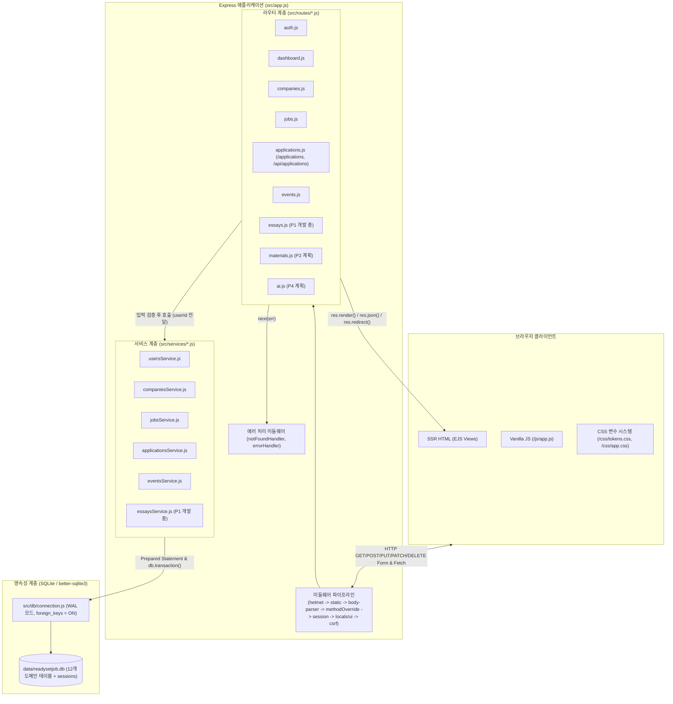
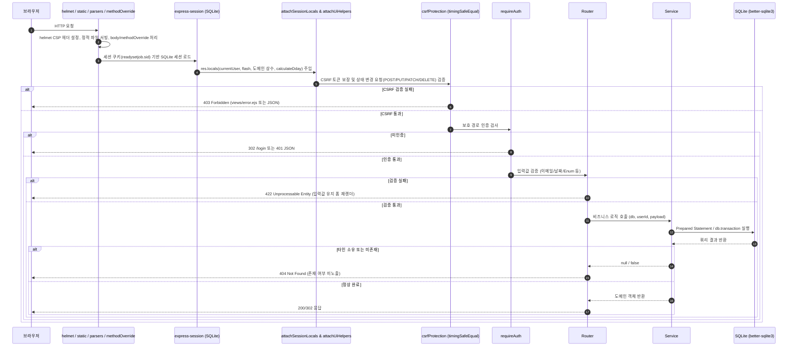
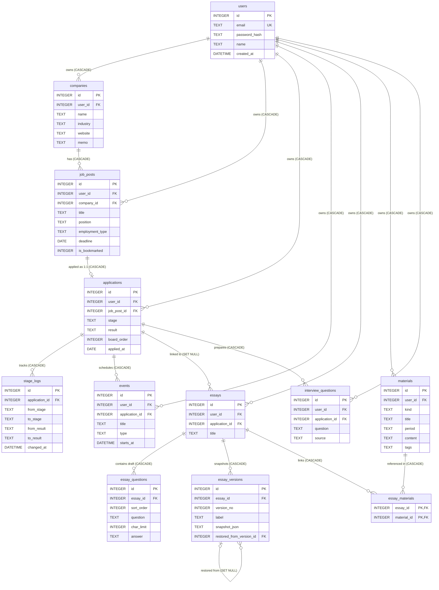

# ReadySetJob: 시스템 아키텍처 및 DB 설계

> 💡 **개요**: 본 문서는 ReadySetJob의 3계층 아키텍처, 미들웨어 파이프라인, 보안 격리 모델, SQLite 12개 도메인 테이블 ERD, 외래키 삭제 정책 및 전체 라우터 명세를 집약한 하위 기술 문서이다.

---

## 1. 계층형 아키텍처 및 요청 생명주기

ReadySetJob은 외부 프레임워크나 무거운 상주 프로세스 없이 Node.js 22와 Express 4 기반의 3계층(Presentation / Application-Router / Service-Data) 구조로 동작한다.

### 1.1 계층별 핵심 설계 원칙
* **앱 팩토리 패턴 (`createApp({ dbPath })`)**: `src/app.js`는 데이터베이스 경로를 주입받아 격리된 Express 인스턴스를 반환한다. 운영 서버(`src/server.js`)는 `data/readysetjob.db`를 바라보며, 테스트(`test/helpers.js`)는 임시 디렉터리의 독립된 DB 파일을 생성하여 병렬 테스트 간 간섭을 원천 차단한다.
* **얇은 라우터(Thin Router)와 서비스 분리**: 라우터(`src/routes/*.js`)는 요청 파라미터 추출, 입력값 검증, 상태 코드 결정(`302`, `422`, `404`), 뷰 렌더링만 처리한다. 모든 SQL 실행과 트랜잭션(`db.transaction`)은 `src/services/*.js`에 캡슐화한다.
* **명시적 `user_id` 전달 및 소유권 강제**: 모든 서비스 함수는 첫 번째 인자로 `db`, 두 번째 인자로 `userId`(`req.session.user.id`)를 전달받아 SQL `WHERE user_id = ?`를 강제한다.

### 1.2 요청 처리 생명주기 및 미들웨어 흐름

---

## 2. 데이터베이스 엔진 및 연결 설정

* **DBMS 엔진**: SQLite 3 (`better-sqlite3` 패키지, C++ 네이티브 동기식 바인딩 드라이버).
* **저널 모드**: `PRAGMA journal_mode = WAL;` (Write-Ahead Logging). 읽기 작업과 쓰기 작업의 동시성을 대폭 향상하고 파일 락 충돌을 방지한다.
* **외래키 제약**: `PRAGMA foreign_keys = ON;` 연결 초기화 시점과 마이그레이션 실행 시점 모두 강제 활성화한다.
* **세션 테이블**: `sessions` 테이블 (`better-sqlite3-session-store`). 서버 재시작 시에도 로그인 세션을 영속적으로 유지한다.

---

## 3. 개체-관계 다이어그램 (ERD)

ReadySetJob은 12개 도메인 테이블과 14개 인덱스로 구성된다. 모든 사용자 데이터는 루트 엔티티의 `user_id`를 통해 격리된다.

---

## 4. 핵심 테이블 스키마 및 외래키 연쇄 삭제 정책

### 4.1 핵심 테이블 컬럼 명세 요약

| 테이블명 | 역할 및 핵심 컬럼 | 제약 조건 및 인덱스 |
|:---|:---|:---|
| `users` | 사용자 계정: `id`, `email`, `password_hash`, `name` | `email UNIQUE`, bcryptjs(cost 10) |
| `companies` | 지원 기업: `id`, `user_id`, `name`, `industry`, `website`, `memo` | `UNIQUE(user_id, name)`, `idx_companies_user_id` |
| `job_posts` | 채용 공고: `id`, `company_id`, `title`, `position`, `employment_type`, `deadline`, `is_bookmarked` | `employment_type CHECK`, `idx_job_posts_deadline` |
| `applications` | 지원 내역: `id`, `job_post_id`, `stage`, `result`, `board_order`, `applied_at` | `job_post_id UNIQUE`, `stage CHECK`, `result CHECK` |
| `stage_logs` | 전형 감사 로그: `id`, `application_id`, `from_stage`, `to_stage`, `from_result`, `to_result`, `changed_at` | `idx_stage_logs_application_id` |
| `events` | 전형 일정: `id`, `user_id`, `application_id`, `title`, `type`, `starts_at` | `type CHECK`, `idx_events_starts_at` (시간순 정렬) |
| `essays` | 자기소개서 마스터: `id`, `user_id`, `application_id`, `title` | `application_id NULLABLE`, `idx_essays_user_id` |
| `essay_questions` | 문항 작업 초안: `id`, `essay_id`, `sort_order`, `question`, `char_limit`, `answer` | `idx_essay_questions_essay_id` (빠른 텍스트 검색) |
| `essay_versions` | 불변 버전 스냅샷: `id`, `essay_id`, `version_no`, `label`, `snapshot_json`, `restored_from_version_id` | `UNIQUE(essay_id, version_no)`, INSERT-only |
| `materials` | 경험 자료함: `id`, `user_id`, `kind`, `title`, `period`, `content`, `tags` | `kind CHECK`, `idx_materials_user_id` |
| `essay_materials` | 자소서-경험 연결: `essay_id`, `material_id` | 복합 기본키 `PRIMARY KEY(essay_id, material_id)` |
| `interview_questions`| 면접 질문: `id`, `application_id`, `question`, `source` | `source IN ('ai', 'manual')` CHECK |

### 4.2 참조 무결성(ON DELETE) 정책 및 설계 근거

* **`users` -> 하위 도메인 테이블 전체**: `ON DELETE CASCADE`. 회원 탈퇴나 테스트 시드 재설정 시 모든 하위 데이터를 일괄 정리한다.
* **`companies` -> `job_posts`**: `ON DELETE CASCADE`. 기업 삭제 시 소속 공고와 연관 지원 내역을 연쇄 삭제하여 고아 데이터를 방지한다.
* **`job_posts` -> `applications`**: `ON DELETE CASCADE`. 공고 삭제 시 해당 지원 건도 유효하지 않으므로 연쇄 삭제한다.
* **`applications` -> `stage_logs`, `events`, `interview_questions`**: `ON DELETE CASCADE`. 전형 이력, 전형 일정, 해당 지원 건 전용 면접 질문은 지원 내역의 생명주기에 종속된다.
* **`applications` -> `essays`**: `ON DELETE SET NULL`. **핵심 정책이다**. 특정 지원 내역이나 채용 공고를 삭제하더라도 구직자가 공들여 작성한 자기소개서와 버전 히스토리는 타 기업 지원 시 재활용해야 할 핵심 자산이므로 삭제하지 않고 연결만 해제한다.
* **`essays` -> `essay_questions`, `essay_versions`, `essay_materials`**: `ON DELETE CASCADE`. 자기소개서 마스터가 명시적으로 삭제되면 하위 문항 초안과 버전 스냅샷, 매핑 행을 함께 정리한다.
* **`materials` -> `essay_materials`**: `ON DELETE CASCADE`. 경험 소재 삭제 시 자기소개서 본문은 유지하되 연결 매핑 행만 정리한다.

---

## 5. 핵심 아키텍처 및 DB 설계 의사결정

1. **전형 단계(`stage`)와 전형 결과(`result`)의 분리**:
   * 상태를 단일 컬럼으로 둘 경우 서류 합격, 1차면접 탈락 등 조합 폭발이 발생하고 탈락 시 전형 맥락이 소실된다.
   * 6개 전형 단계와 4개 결과를 분리하여 칸반 보드에서 어느 단계까지 도달했는지 직관적으로 표시하고 합불 여부를 독립 집계한다.
2. **감사 로그로서의 `stage_logs` 테이블**:
   * 상태 변경 시마다 `from_stage/result`와 `to_stage/result`, `changed_at`을 별도 테이블에 누적하여 전형 진행 타임라인을 재구성한다.
3. **작업 초안(`essay_questions`)과 불변 스냅샷(`essay_versions`)의 이원화**:
   * 에디터에서 수시로 저장하는 초안은 정규화된 테이블을 직접 갱신하여 빠른 편집과 SQL LIKE 키워드 검색을 지원한다.
   * 명시적 버전 저장은 문항 전체를 JSON 스냅샷으로 직렬화해 INSERT-only 불변 레코드로 영구 보존한다.
4. **이력 보존형 버전 복원 메커니즘**:
   * 과거 버전으로 복원할 때 기존 버전을 덮어쓰지 않는다.
   * 현재 작업 중이던 초안이 최신 버전과 다르면 자동 백업 버전을 생성한 뒤, 복원 대상 스냅샷을 적용하고 `restored_from_version_id`를 기록한 새 버전을 삽입한다.
5. **경험 자료함(`materials`)과 자기소개서의 N:M 연결**:
   * 하나의 인턴/프로젝트 경험이 여러 자소서에 인용되고, 하나의 자소서가 여러 경험을 참조하므로 복합 PK 조인 테이블(`essay_materials`)로 모델링했다.
6. **루트 엔티티 `user_id` 직접 보유를 통한 소유권 강제**:
   * 모든 1차 도메인 테이블이 `user_id`를 보유하여 조인 없이 단일 테이블 쿼리에서도 소유권을 즉시 검증한다. 타인 리소스 접근 시 존재 여부 자체를 숨기기 위해 `404 Not Found`를 일관되게 반환한다.
7. **`better-sqlite3`의 동기식 트랜잭션(`db.transaction`)**:
   * 공고 등록 시 인라인 기업 생성, 지원 등록 시 stage_logs 기록, 버전 복원 등 복수 쿼리를 단일 원자적 작업으로 감싸 데이터 정합성을 보장한다.

---

## 6. HTTP 라우터 전체 요약

### 6.1 구현 및 검증 완료 라우트 (P0)

| 도메인 | Method | Path | 보호 | 주요 기능 및 성공 응답 | 실패/에러 상태 코드 |
|:---|:---:|:---|:---:|:---|:---:|
| **인증** | `GET` | `/` | 공개 | 로그인 시 `/dashboard`, 비로그인 시 `/login` 리다이렉트 | 302 |
| | `GET` | `/signup`, `/login` | 공개 | 회원가입 및 로그인 폼 렌더링 | 200, 302 |
| | `POST` | `/signup` | CSRF | 계정 생성, 세션 재생성(`regenerate`) 후 `/dashboard` 이동 | 403, 422 |
| | `POST` | `/login` | CSRF | 자격증명 확인, 세션 재생성 후 `/dashboard` 이동 | 401, 403, 422 |
| | `POST` | `/logout` | CSRF | 세션 파기(`destroy`), 쿠키 삭제 후 `/login` 이동 | 302, 403 |
| **대시보드** | `GET` | `/dashboard` | 인증 | 7종 핵심 통계 카운트 조회 및 화면 렌더링 | 200, 302 |
| **기업** | `GET` | `/companies`, `/companies/new` | 인증 | 기업 목록 조회(검색 지원), 등록 폼 렌더링 | 200, 302 |
| | `POST` | `/companies` | 인증/CSRF | 기업 등록 후 상세 페이지 리다이렉트 | 302, 422 |
| | `GET` | `/companies/:id`, `/:id/edit` | 인증 | 기업 상세(소속 공고 목록 포함), 수정 폼 렌더링 | 200, 404 |
| | `PUT` | `/companies/:id` | 인증/CSRF | 기업 정보 수정 후 상세 페이지 이동 | 302, 404, 422 |
| | `DELETE` | `/companies/:id` | 인증/CSRF | 기업 삭제(소속 공고 및 지원 연쇄 삭제) 후 목록 이동 | 302, 404 |
| **채용 공고** | `GET` | `/jobs`, `/jobs/new` | 인증 | 공고 목록(필터/정렬), 등록 폼 렌더링 | 200, 302 |
| | `POST` | `/jobs` | 인증/CSRF | 공고 등록(인라인 신규 기업 동시 생성 트랜잭션) | 302, 404, 422 |
| | `GET` | `/jobs/:id`, `/:id/edit` | 인증 | 공고 상세 및 수정 폼 렌더링 | 200, 404 |
| | `PUT` | `/jobs/:id` | 인증/CSRF | 공고 수정 후 상세 페이지 이동 | 302, 404, 422 |
| | `POST` | `/jobs/:id/bookmark` | 인증/CSRF | 북마크 토글 (JSON 요청 시 200, 폼 제출 시 302) | 200, 302, 404 |
| | `DELETE` | `/jobs/:id` | 인증/CSRF | 공고 삭제 후 목록 리다이렉트 | 302, 404 |
| **지원 현황** | `GET` | `/applications`, `/applications/new` | 인증 | 지원 목록(단계/결과 필터), 등록 폼 렌더링 | 200, 302 |
| | `POST` | `/applications` | 인증/CSRF | 지원 등록 및 초기 stage_logs 자동 기록 트랜잭션 | 302, 404, 422 |
| | `GET` | `/applications/:id`, `/:id/edit` | 인증 | 지원 상세(전형 변경 이력, 일정 포함), 수정 폼 렌더링 | 200, 404 |
| | `PUT` | `/applications/:id` | 인증/CSRF | 지원 수정 및 단계/결과 변경 시 stage_logs 추가 | 302, 404, 422 |
| | `DELETE` | `/applications/:id` | 인증/CSRF | 지원 삭제 (자소서는 보존, 연결만 해제) | 302, 404 |
| | `PATCH` | `/api/applications/:id/stage` | 인증/CSRF | 단계/결과/순서 갱신 및 stage_logs 기록 JSON API | 200, 401, 403, 404, 422 |
| **일정** | `GET` | `/events` | 인증 | 전체 전형 일정 목록(시간순) 및 등록 폼 렌더링 | 200, 302 |
| | `POST` | `/events` | 인증/CSRF | 전형 일정 등록 후 리다이렉트 | 302, 404, 422 |
| | `DELETE` | `/events/:id` | 인증/CSRF | 전형 일정 삭제 후 리다이렉트 | 302, 404 |

### 6.2 P1 개발 중 라우트 (계획된 명세)

| 도메인 | Method | Path | 보호 | 설명 및 기대 동작 | 상태 |
|:---|:---:|:---|:---:|:---|:---:|
| **칸반** | `GET` | `/applications/board` | 인증 | 6개 전형 단계별 칸반 보드 화면 렌더링 | 개발 중 |
| | `PATCH` | `/api/applications/:id/stage` | 인증/CSRF | 카드 드래그 이동 및 컬럼 내 board_order 재정렬 처리 | 개발 중 |
| **자기소개서**| `GET` | `/essays`, `/essays/new` | 인증 | 자소서 목록 및 신규 작성 폼 렌더링 | 개발 중 |
| | `POST` | `/essays` | 인증/CSRF | 마스터 및 초기 문항 생성 트랜잭션 후 에디터 이동 | 개발 중 |
| | `GET` | `/essays/:id` | 인증 | 멀티 문항 에디터, 실시간 글자수, 버전 히스토리 렌더링 | 개발 중 |
| | `PUT` | `/api/essays/:id/draft` | 인증/CSRF | 문항별 작업 초안 저장 (버전 미생성) | 개발 중 |
| | `POST` | `/essays/:id/versions` | 인증/CSRF | 문항 전체 JSON 스냅샷 직렬화 및 불변 버전 레코드 생성 | 개발 중 |
| | `GET` | `/essays/:id/versions` | 인증 | 전체 버전 메타데이터 목록 조회 | 개발 중 |
| | `GET` | `/essays/:id/versions/:no` | 인증 | 특정 버전 번호의 읽기 전용 스냅샷 조회 | 개발 중 |
| | `GET` | `/essays/:id/compare` | 인증 | 서버 사이드 jsdiff 기반 단어 단위 버전 비교 화면 | 개발 중 |
| | `POST` | `/essays/:id/versions/:no/restore` | 인증/CSRF | 초안 자동 백업 및 복원 계보 새 버전 생성 트랜잭션 | 개발 중 |
| | `GET` | `/api/essays/search` | 인증 | 자소서 문항 및 답변 키워드 검색 JSON API | 개발 중 |
| | `POST` | `/essays/:id/materials` | 인증/CSRF | 자소서와 경험 자료 간 essay_materials 연결 및 해제 | 개발 중 |

### 6.3 P2 및 P4 계획 라우트

| 도메인 | Method | Path | 보호 | 설명 | 상태 |
|:---|:---:|:---|:---:|:---|:---:|
| **자료함** | `GET/POST/PUT/DELETE` | `/materials`, `/materials/:id` | 인증/CSRF | 경험, 프로젝트, 수상, 대외활동 CRUD 및 태그 필터링 | P2 계획 |
| **AI 면접**| `POST` | `/applications/:id/interview-questions/generate` | 인증/CSRF | 지원 맥락 및 자소서 기반 Gemini 면접 질문 서버 생성 | P4 계획 |

---

## 7. 아키텍처 및 보안 검증 조건 체크리스트

ReadySetJob의 모든 백엔드 구현은 다음 검증 조건을 만족해야 한다.

- [x] **데이터 격리 검증**: 타 사용자의 `company_id`, `job_post_id`, `application_id`, `event_id` 접근 시 일관되게 `404 Not Found`를 반환하는가? (`test/ownership-and-seed.test.js` 검증 완료)
- [x] **SQL 인젝션 방어**: 모든 데이터베이스 쿼리가 `better-sqlite3`의 Prepared Statement 파라미터 바인딩(`?`)을 준수하는가? (`src/services/*.js` 검증 완료)
- [x] **세션 고정 공격 차단**: 회원가입 및 로그인 성공 시 `req.session.regenerate()`를 호출하여 세션 ID와 CSRF 토큰을 새로 발급하는가? (`test/auth-and-security.test.js` 검증 완료)
- [x] **CSRF 이중 보호**: 동기 폼 바디(`_csrf`)와 비동기 요청 헤더(`X-CSRF-Token`) 양쪽에서 `crypto.timingSafeEqual` 상수 시간 검증을 수행하는가? (`test/auth-and-security.test.js` 검증 완료)
- [x] **비밀번호 안전 저장**: `bcryptjs` 해시 비용(Work Factor) 10 이상을 적용하고 평문 비밀번호를 보관하지 않는가? (`src/services/usersService.js` 검증 완료)
- [x] **이벤트 루프 블로킹 방지**: 세션 만료 정리 `setInterval` 타이머에 `timer.unref()`를 호출하여 테스트 종료 시 프로세스가 정상 종료되는가? (`src/app.js` 검증 완료)
- [x] **보안 헤더 강제**: `helmet`을 통해 `default-src 'self'`, 외부 스크립트 차단, 프레임 삽입 차단 CSP 정책을 적용했는가? (`src/app.js` 검증 완료)
- [ ] **P1 칸반 순서 정렬 원자성**: 카드 이동 및 컬럼 내 `board_order` 재계산이 단일 트랜잭션으로 처리되는가? (P1 개발 중)
- [ ] **P1 자소서 복원 계보 보존**: 과거 버전 복원 시 현재 초안이 자동 백업되고 `restored_from_version_id`가 새 버전에 정상 기록되는가? (P1 개발 중)
- [ ] **P1 Diff XSS 차단**: 단어 단위 비교 화면에서 원본 텍스트를 먼저 HTML 이스케이프한 뒤 `<ins>`, `<del>` 태그를 결합하는가? (P1 개발 중)
