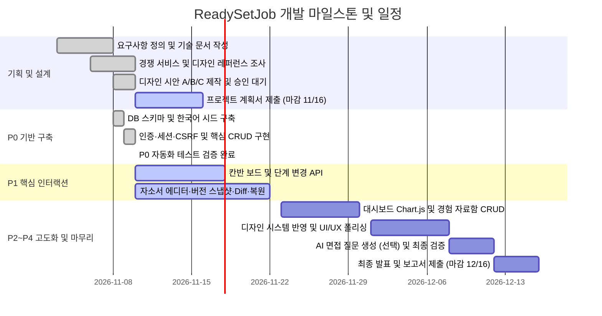

> 이 파일은 2026-11-10 작성한 Notion 업로드용 초안이다. 이후 상태·일정 수정은 Notion 허브(https://app.notion.com/p/4157cdef782d810bb5a1fcdde724f0ea)가 최신본이다.

> 💡 **ReadySetJob**: 취업과 인턴십 지원 현황을 국내 채용 전형에 맞춘 6단계 파이프라인으로 추적하고, 문항별 자기소개서 작성과 불변 버전 스냅샷 비교 및 복원을 지원하는 1인 개발 웹 애플리케이션이다.
>
> **현재 상태 (2026-11-10 기준)**: P0 백엔드 기반 및 보안 검증 완료 (자동화 테스트 10개 통과), 디자인 시안 A/B/C 제작 완료 후 사용자 승인 대기, P1 칸반 보드 및 자기소개서 버전 관리 모듈 개발 중, 2026-11-16 계획서 제출 준비 중.

---

## 1. 프로젝트 개요 및 GitHub 링크

ReadySetJob은 여러 기업에 동시 지원하는 구직자가 겪는 지원 현황 파편화와 자기소개서 문안 유실 문제를 해결하기 위해 기획된 웹 애플리케이션이다. 컴퓨터공학 전공 학부생 및 신입 구직자가 서류 접수부터 코딩테스트, 과제 전형, 면접까지 이어지는 긴 채용 과정을 하나의 화면에서 관리할 수 있도록 지원한다.

* **과목명**: 고급웹프로그래밍 (기말 개인 프로젝트, 1인 개발)
* **개발 기간**: 2026-11-03 ~ 2026-12-16 (계획서 마감: 2026-11-16, 최종 보고서 마감: 2026-12-16)
* **평가 배점 비중**: 기획 20%, 구현 50%, 최종 보고서 20%, 창의성 5%, AI 활용 5%
* **GitHub 원격 저장소**: [https://github.com/NoNamad5196/ReadySetJob](https://github.com/NoNamad5196/ReadySetJob)

---

## 2. 기획 배경

공채와 수시 채용이 병행되는 현대 채용 환경에서 구직자는 평균 20개에서 50개 이상의 채용 공고에 동시 지원한다. 채용 플랫폼마다 접수 방식이 다르고, 자체 채용 사이트를 운영하는 기업이 많아 지원 내역이 여러 곳으로 분산된다.

특히 개발 직군 채용은 서류 전형 이후 코딩테스트, 과제 제출, 1차 직무 면접, 2차 임원 면접 등 다단계로 진행된다. 구직자는 기업마다 다른 전형 일정과 마감일을 챙기는 동시에 각 기업의 인재상에 맞춰 자기소개서를 수시로 수정해야 한다. 이 과정에서 어떤 기업에 어떤 버전의 자기소개서를 제출했는지 파악하지 못해 면접 전형에서 낭패를 겪는 사례가 반복된다. 이러한 문제를 해결하고자 채용 단계 추적과 자기소개서 버전 관리를 유기적으로 결합한 전용 도구를 기획했다.

---

## 3. 문제 정의

기존 구직 관리 방식에서 나타나는 세 가지 구조적 한계를 다음과 같이 정의한다.

1. **지원 현황과 전형 결과의 맥락 유실**: 기존 칸반 도구는 불합격을 마지막 단일 열로 취급한다. 카드를 불합격 열로 이동하는 순간 서류 탈락인지, 코딩테스트 탈락인지, 최종 면접 탈락인지 전형 맥락이 사라져 개인 전형별 약점을 분석하기 어렵다.
2. **자기소개서 수정본의 버전 덮어쓰기 및 유실**: 워드나 메모장으로 자소서를 관리하면 `자소서_최종_수정2.docx`와 같이 파일이 난립한다. 웹 기반 폼은 이전 저장본을 덮어쓰므로 글자수를 줄이거나 문장을 고치는 과정에서 과거에 작성했던 유용한 문장이 영구 삭제된다.
3. **경험 정리와 자소서 작성의 단절**: 지원자가 정리해 둔 프로젝트, 수상 경력, 대외활동 소재가 별도 문서로 흩어져 있어 자소서 문항을 작성할 때마다 창을 오가며 복사하고 붙여넣는 불필요한 작업이 발생한다.

---

## 4. 핵심 아이디어

ReadySetJob은 세 가지 핵심 아이디어로 정의된 문제를 해결한다.

* **전형 단계(Stage)와 전형 결과(Result)의 데이터 모델 분리**: `서류` -> `코딩테스트` -> `과제` -> `1차 면접` -> `2차 면접` -> `최종`의 6개 고정 단계를 유지하고, 각 단계 내부에서 `진행중`, `합격`, `불합격` 상태를 독립적으로 부여한다. 탈락하더라도 어느 단계에서 탈락했는지 보드와 통계에 온전히 남는다.
* **불변(Immutable) JSON 스냅샷 기반 버전 관리와 단어 단위 Diff**: 자기소개서를 저장할 때 기존 행을 덮어쓰지 않고 불변 버전 레코드를 생성한다. 이전 버전과 현재 버전을 단어 단위로 비교하여 추가 및 삭제된 문구를 색상으로 확인하고, 원하는 과거 버전으로 안전하게 복원한다.
* **통합 지원 워크스페이스**: 채용 공고 등록, D-Day 계산, 전형 일정 관리, 문항별 실시간 글자수 계산 에디터, 경험 자료함 참조를 단일 웹 애플리케이션으로 묶어 구직 작업 흐름을 일원화한다.

---

## 5. 목표 사용자

* **1차 타깃**: IT 기업 및 스타트업 개발 직군에 지원하는 대학생 및 취업 준비생 (코딩테스트와 과제 전형이 포함된 다단계 전형을 치르는 구직자)
* **2차 타깃**: 하반기 및 상반기 공채 시즌에 30개 이상의 기업에 대량 지원하는 신입 및 인턴 지원자
* **사용자 요구사항 페르소나**:
  * 마감 3일 이내 공고와 다가오는 면접 일정을 한눈에 파악하고 싶어 한다.
  * 지원 기업별 자기소개서 문항 요구 글자수를 맞추며 실시간으로 분량을 검증하고 싶어 한다.
  * 이전 기업에 제출했던 합격 자기소개서 문구를 검색하여 새 지원서에 빠르게 인용하고 싶어 한다.

---

## 6. 기존 서비스 조사 (요약 비교)

| 서비스 | 지원 칸반 | 단계/결과 분리 | 자소서 문항별 작성 | 버전 비교(Diff)/복원 | 경험 자료 연결 | 통계 대시보드 | 국내 채용 적합성 | 비용 |
|:---|:---:|:---:|:---:|:---:|:---:|:---:|:---:|:---|
| **Huntr** | 지원 | 미지원 (Rejected 열 단일화) | 미지원 (영문 Cover Letter) | 미지원 | 부분 지원 | 지원 | 낮음 (영문 전용) | 부분 무료 (100개 제한, 유료 월 $40) |
| **Teal** | 미지원 (그리드) | 미지원 | 미지원 | 부분 지원 (Diff 불가) | 지원 | 부분 지원 | 낮음 (영문 ATS) | 부분 무료 (유료 월 $29) |
| **Notion 템플릿** | 지원 | 수동 가능 | 부분 가능 (글자수 계산 불편) | 제한적 (무료 7일 보관) | 수동 연결 | 미지원 (수식 필요) | 보통 (직접 구축) | 무료 (개인 플랜) |
| **자소설닷컴** | 부분 지원 | 부분 지원 | 지원 (실시간 글자수) | 확인 불가 (클라우드 덮어쓰기) | 부분 지원 | 스펙 비교 위주 | 높음 (공채 일정 중심) | 무료 |
| **사람인/잡코리아** | 미지원 | 미지원 | 지원 (보관함 분리) | 미지원 | 부분 지원 | 공고 통계 위주 | 보통 (자사 즉시지원만 추적) | 무료 |
| **ReadySetJob** | **지원** | **완전 분리** | **지원 (실시간 글자수/바이트)** | **지원 (불변 스냅샷/복원)** | **지원 (N:M 연결)** | **지원 (Chart.js 전환율)** | **최적화 (6단계 파이프라인)** | **무료 (자체 호스팅 오픈소스)** |

---

## 7. 차별화 전략

1. **국내 IT 채용에 최적화된 6단계 고정 파이프라인**: 해외 도구에는 없는 코딩테스트와 과제 전형 단계를 기본 제공하여 개발자 채용 현실을 정확히 반영한다.
2. **영구적인 자소서 버전 자산화**: Notion의 7일 보관 한계나 일반 에디터의 덮어쓰기 위험 없이, 지원 내역이 삭제되더라도 작성된 자기소개서와 버전 기록은 `application_id = NULL`로 영구 보존된다.
3. **서버 사이드 단어 단위 비교(Diff)**: 별도 텍스트 비교 도구를 띄우지 않고도 브라우저 내부에서 직전 제출본과의 차이점을 즉시 확인할 수 있다.
4. **외부 의존 없는 폐쇄망 구동 보장**: 외부 CDN 의존 없이 모든 라이브러리를 로컬에서 서빙하여 안정적인 실행 환경을 보장한다.

---

## 8. 전체 기능 명세

ReadySetJob의 전체 기능은 6대 모듈로 구성된다. 각 모듈의 상태는 실제 코드베이스 검증 여부에 따라 엄격히 구분한다.

| 모듈 ID | 모듈명 | 주요 기능 명세 | 우선순위 | 상태 |
|:---|:---|:---|:---:|:---:|
| **AUTH** | 사용자 인증 및 보안 | 회원가입, 로그인, 로그아웃, 세션 재생성, `requireAuth`, CSRF 이중 검증(`timingSafeEqual`), 사용자별 소유권 격리 | P0 | 검증 완료 |
| **COMP** | 기업 관리 | 지원 대상 기업 CRUD, 기업별 공고/지원 건수 집계, 산업군/메모 검색, `UNIQUE(user_id, name)` 중복 방지 | P0 | 검증 완료 |
| **JOBS** | 채용 공고 관리 | 채용 형태별 필터, 마감 임박 정렬, 인라인 신규 기업 동시 생성 트랜잭션, 북마크 토글, D-Day 자동 계산 | P0 | 검증 완료 |
| **APPS** | 지원 현황 및 일정 | 지원 내역 CRUD, 6단계 전형(`stage`)과 4개 결과(`result`) 분리, `stage_logs` 감사 로그 자동 기록, 전형 일정(Events) CRUD | P0 | 검증 완료 |
| **KANBAN** | 칸반 보드 | 6단계 전형별 칸반 컬럼 렌더링, 드래그앤드롭 카드 이동, 컬럼 내 순서(`board_order`) 재정렬 API | P1 | 개발 중 |
| **ESSAY** | 자기소개서 및 버전 | 문항별 글자수 에디터, 작업 초안 저장, 불변 버전 스냅샷 생성, 단어 단위 Diff 비교, 이력 보존형 복원, 키워드 검색 | P1 | 개발 중 |
| **DASH** | 대시보드 및 통계 | 7종 핵심 KPI 요약 카드(검증 완료), Chart.js 기반 전형별 통과율 및 합불 비율 차트, D-7 마감 임박 위젯 | P0/P2 | 일부 검증 완료 / 계획 |
| **MAT** | 경험 자료함 | 프로젝트/경험/수상/활동 자료 CRUD, 태그 필터, 자기소개서-경험 자료 N:M 연결(`essay_materials`) | P1/P2 | 개발 중 / 계획 |
| **AI** | 면접 질문 생성 | 공고 및 자소서 기반 Gemini API 면접 예상 질문 서버 생성, `GEMINI_API_KEY` 미설정 시 우아한 비활성화 | P4 | 계획 |

---

## 9. 화면별 사용 시나리오

1. **채용 공고 탐색 및 지원 등록 시나리오**:
   * 구직자는 `/jobs/new`에서 채용 공고를 등록한다. 기존에 등록된 기업이 없다면 `new_company_name`을 입력하여 공고와 기업을 단일 트랜잭션으로 동시에 생성한다.
   * 공고 마감일이 입력되면 시스템은 `D-3`(긴급), `D-7`(임박), `D-Day` 등의 상태 배지를 자동 계산한다.
   * 공고 상세 화면에서 `지원하기` 버튼을 누르면 `applications` 레코드와 초기 `stage_logs`(`null -> document`)가 생성되며 지원 현황으로 연동된다.
2. **칸반 보드 기반 전형 단계 업데이트 시나리오**:
   * 사용자는 `/applications/board`에 접속하여 6개 전형 단계 열에 나열된 지원 카드를 확인한다.
   * 서류 합격 통보를 받으면 카드를 `코딩테스트` 열로 드래그한다. 백엔드는 `PATCH /api/applications/:id/stage`를 호출하여 지원 상태를 갱신하고 `stage_logs`에 변경 이력을 원자적으로 기록한다.
   * 불합격 통보를 받더라도 카드는 해당 단계 열에 그대로 머물며, 결과 상태만 `불합격` 배지로 전환되어 어느 단계에서 탈락했는지 이력이 유지된다.
3. **자기소개서 작성, 버전 저장, Diff 비교 및 복원 시나리오**:
   * 사용자는 `/essays/new`에서 지원 공고를 선택하고 문항별 질문과 글자수 제한을 입력한다.
   * 에디터(`/essays/:id`)에서 글을 작성하는 동안 실시간으로 공백 포함 및 제외 글자수와 분량 진행률 바가 갱신된다.
   * 첨삭 전 상태를 보존하고 싶을 때 `버전 저장` 버튼을 누르면 현재 문항 전체가 JSON 스냅샷으로 직렬화되어 불변 레코드(`v1`)로 저장된다.
   * 문장을 대폭 수정한 후 `버전 비교` 메뉴에서 `v1`과 현재 버전을 선택하면, 서버 사이드 `jsdiff`가 단어 단위로 삭제된 문구(`<del>`)와 추가된 문구(`<ins>`)를 색상으로 강조한다.
   * 과거 초안이 더 좋았다고 판단되면 `v1으로 복원`을 실행한다. 시스템은 현재 작업 초안을 자동 백업한 뒤 `v1` 내용을 초안에 덮어쓰고 복원 계보가 기록된 새 버전(`v3`)을 생성한다.

---

## 10. DB 및 시스템 설계 (요약)

> **상세 내용 안내**: 전체 계층 구조 다이어그램, 12개 테이블 ERD, 외래키 삭제 정책 및 라우터 전체 명세는 하위 문서 **「시스템 아키텍처 및 DB 설계」** (`architecture.md`)에서 다룬다.

* **3계층 아키텍처**: Express 4 기반 프리젠테이션(EJS 뷰), 라우터 계층(얇은 컨트롤러), 서비스 계층(비즈니스 로직 및 SQL 캡슐화), 영속성 계층(SQLite WAL 모드)의 명확한 책임 분리를 구현했다.
* **데이터 무결성 및 소유권 보장**: 모든 도메인 테이블은 `user_id` 컬럼을 가지며, 서비스 계층의 모든 쿼리에서 소유권을 강제한다. 타 사용자의 리소스에 접근할 경우 존재 여부 자체를 노출하지 않기 위해 `403`이 아닌 `404 Not Found`를 반환한다.
* **핵심 테이블 구성**: `users`(계정), `companies`(기업), `job_posts`(공고), `applications`(지원), `stage_logs`(전형이력), `events`(일정), `essays`(자소서마스터), `essay_questions`(문항초안), `essay_versions`(불변스냅샷), `materials`(경험자료), `essay_materials`(N:M매핑), `interview_questions`(면접질문) 등 12개 도메인 테이블과 `sessions` 세션 테이블로 구성된다.
* **트랜잭션 안전성**: `better-sqlite3`의 `db.transaction()`을 활용하여 인라인 기업 생성, 지원 등록 시 감사 로그 생성, 버전 복원 시 자동 백업 등 복수 쿼리 실행의 원자성을 엄격히 보장한다.

---

## 11. UI/UX 디자인 결정 (요약)

> **상세 내용 안내**: SaaS 레퍼런스 분석(Linear, Huntr, Craft), 디자인 토큰 및 시안 A/B/C 스크린샷 비교 분석은 하위 문서 **「UI/UX 디자인 및 레퍼런스」** (`design.md`)에서 다룬다.

* **통합 디자인 원칙**:
  * 장시간 문서 작성 시 눈의 피로를 최소화하는 단일 오프화이트 라이트 모드 채택.
  * 과도한 그림자를 배제하고 정갈한 `1px solid` 테두리로 정보 구획.
  * 전체 화면의 85% 이상을 무채색으로 유지하고 액센트 컬러 및 상태 배지만 제한적으로 강조.
  * 한글과 영문 혼용 시 레이아웃 흔들림이 없는 Pretendard 가변 글꼴 및 숫자 고정폭(`tabular-nums`) 적용.
* **3개 디자인 시안 제작 및 현재 상황**:
  * **A안**: Linear 스타일 미니멀 SaaS형 (좌측 사이드바, 고밀도 6열 칸반, 우측 슬라이드오버 드로어).
  * **B안**: Huntr 스타일 채용 관리 중심형 (상단 GNB, 전폭 6열 칸반, 중앙 상세 탭 모달, 전형 퍼널 배너).
  * **C안**: Craft 스타일 문서 작업 중심형 (좌측 문항 목차, 중앙 760px 순백색 종이 캔버스, 단어 단위 Diff 뷰).
  * **승인 상태**: 3개 시안의 HTML 및 스크린샷 12장 제작 완료 후 사용자 검토 및 최종 승인 대기 중이다.

---

## 12. 기술 스택 선정 이유

ReadySetJob은 화려하고 무거운 프레임워크 대신, 1인 개발 환경에서 생산성과 신뢰성을 극대화할 수 있는 경량 SSR 스택을 선정했다.

* **Node.js 22 + Express 4**: Node.js 최신 LTS의 안정적인 비동기 I/O와 성숙한 미들웨어 생태계를 활용한다. 복잡한 빌드 도구 없이 빠른 렌더링과 라우팅을 제공한다.
* **EJS 템플릿 엔진**: 서버 사이드 렌더링을 통해 첫 화면 로딩 속도를 극대화하고 SEO 및 접근성을 보장한다. 사용자 입력 데이터는 기본 이스케이핑(`<%-` 대신 `<%=`)하여 XSS 공격을 원천 차단한다.
* **SQLite (`better-sqlite3`)**: 별도의 데이터베이스 서버 프로세스를 띄울 필요 없이 단일 파일로 동작하여 로컬 개발과 평가 환경 배포가 매우 간결하다. 동기식 C++ 바인딩 드라이버와 WAL 모드를 적용하여 높은 동시성과 빠른 처리 속도를 달성했다.
* **express-session + SQLite Session Store**: 세션 데이터를 메모리가 아닌 SQLite 데이터베이스에 영속화하여 서버 재시작 시에도 로그인 상태를 안전하게 유지한다.
* **Chart.js (로컬 정적 서빙)**: 외부 CDN에 의존하지 않고 npm 패키지를 설치하여 `/vendor` 경로로 자체 서빙함으로써 폐쇄망이나 네트워크 차단 환경에서도 차트가 정상 렌더링되도록 구현했다.

---

## 13. 개발 일정

총 6주(2026-11-03 ~ 2026-12-16) 개발 일정은 단계별 명확한 마일스톤을 중심으로 진행된다.

---

## 14. 구현 진행 상황

모든 항목은 실제 동작 및 테스트 통과 여부에 기반하여 엄격히 판정한다.

| 단계 | 항목 | 상세 내용 | 상태 |
|:---:|:---|:---|:---:|
| **P0** | Git 저장소 및 원격 연동 | GitHub 저장소 초기화 및 첫 커밋 푸시 완료 | 검증 완료 |
| **P0** | Express 앱 및 보안 기반 | helmet CSP, 세션 스토어, createApp 팩토리 | 검증 완료 |
| **P0** | SQLite 스키마 및 마이그레이션 | 12개 테이블 DDL, 14개 인덱스, WAL 모드 적용 | 구현 완료 |
| **P0** | 한국어 데모 시드 스크립트 | 6개 기업, 공고, 지원, 일정 데모 데이터 삽입 | 검증 완료 |
| **P0** | 인증 및 CSRF 보안 | bcryptjs, 세션 재생성, timingSafeEqual 검증 | 검증 완료 |
| **P0** | 핵심 도메인 CRUD 및 소유권 | 기업/공고/지원/일정 CRUD, stage_logs, 404 격리 | 검증 완료 |
| **P0** | 기술 설계 문서 4종 | SPEC, ARCHITECTURE, DB_DESIGN, TASKS 작성 | 구현 완료 |
| **디자인** | 레퍼런스 분석 및 디자인 토큰 | Linear, Huntr, Craft 분석 및 tokens.css 스캐폴딩 | 구현 완료 |
| **디자인** | 디자인 시안 A/B/C 제작 | HTML 목업 9종 + 스크린샷 12장 제작 완료 | 개발 중 (사용자 승인 대기) |
| **P0** | 프로젝트 계획서 작성 | 2026-11-16 제출용 계획서 초안 및 분할 검토 | 개발 중 |
| **P1** | 칸반 보드 화면 및 드래그앤드롭 | 6단계 컬럼 뷰, 카드 이동 및 순서 재정렬 API | 개발 중 |
| **P1** | 자기소개서 에디터 및 글자수 | 문항별 실시간 글자수 카운터, 작업 초안 저장 | 개발 중 |
| **P1** | 불변 버전 스냅샷 및 Diff 비교 | JSON 스냅샷 생성, jsdiff 단어 단위 비교 화면 | 개발 중 |
| **P1** | 이력 보존형 버전 복원 | 초안 자동 백업 및 복원 계보 기록 트랜잭션 | 개발 중 |
| **P1** | 자소서 문항 검색 및 자료함 연결 | 키워드 검색 API, essay_materials N:M 매핑 | 개발 중 |
| **P2** | 대시보드 통계 차트 (Chart.js) | 단계별 전환율 막대 및 합불 비율 도넛 차트 | 계획 |
| **P2** | 경험 자료함 CRUD | 프로젝트, 수상, 활동 정리 및 태그 필터 | 계획 |
| **P3** | 디자인 시스템 확정 및 폴리싱 | 승인 시안 전체 적용, 다크 모드, 접근성 검수 | 계획 |
| **P4** | AI 면접 질문 생성 | Gemini API 기반 서버 사이드 예상 질문 생성 | 계획 |
| **P4** | 최종 보고서 작성 | 기말 최종 보고서 및 시연 시나리오 완성 | 계획 |

---

## 15. 기술적 문제와 해결 과정 (요약)

> **상세 내용 안내**: 문제 원인 분석, 재현 과정, 상세 해결 코드 및 검증 결과는 하위 문서 **「구현·테스트 및 문제 해결 기록」** (`implementation-log.md`)에서 다룬다.

1. **better-sqlite3-session-store의 만료 세션 정리 타이머로 인한 테스트 프로세스 무한 대기**:
   * **문제**: 자동화 테스트(`node --test`) 실행 후 모든 케이스가 통과했음에도 프로세스가 종료되지 않고 멈춤.
   * **원인**: 세션 스토어 내부의 `setInterval` 만료 세션 정리 타이머(`900000ms`)가 Node.js 이벤트 루프의 활성 참조로 남아 프로세스 종료를 블로킹함.
   * **해결**: `SqliteSessionStore` 클래스를 상속한 커스텀 스토어를 정의하고, `startInterval()` 메서드를 오버라이드하여 내부 타이머에 `timer.unref()`를 호출함.
   * **검증**: `npm test` 실행 시 10개 테스트 통과 후 즉시 정상 종료됨을 검증함.
2. **대용량 단일 문서 작성 시 AI 도구 타임아웃 및 응답 중단**:
   * **문제**: 수백 줄 이상의 계획서와 Notion 문서를 한 번의 도구 호출로 작성할 때 응답이 멈추거나 잘리는 현상 발생.
   * **원인**: 단일 파일 쓰기 버퍼 한도 및 컨텍스트 부하로 인한 생성 타임아웃.
   * **해결**: 문서를 200줄 미만의 섹션 단위로 쪼개어 최초 생성 후 점진적 추가(Edit) 방식으로 전환함.
3. **서브에이전트 조기 종료 및 작업 누락**:
   * **문제**: P1 모듈 구현 위임 시 작업자가 파일 탐색만 수행하고 코드를 작성하지 않은 채 조기 종료함.
   * **원인**: 칸반 보드와 자기소개서라는 대규모 작업이 한 번에 위임되어 완료 조건이 모호했음.
   * **해결**: 칸반 보드와 자소서 에디터로 작업을 세부 분할하고, "반드시 파일 구현 완료 및 구동 확인"이라는 완료 조건을 명시하여 재위임함.

---

## 16. AI 활용 사례

ReadySetJob 개발 과정에서는 AI 도구를 단순 코드 완성이 아니라 역할 분담형 협업 파트너로 활용했다.

* **협업 아키텍처 및 역할 분담**:
  * **오케스트레이터 (Claude Opus)**: 전체 개발 마일스톤 관리, 아키텍처 및 보안 설계, 하위 작업 명세 작성, 최종 코드 검토 및 Git 커밋/푸시 총괄.
  * **구현 및 작성 작업자 (Gemini)**: P0 서비스/라우터 코드 작성, 정적 HTML 디자인 시안 제작, 기술 문서 및 계획서 초안 작성.
  * **조사 및 리서치 (Perplexity MCP)**: 해외 구직 트래커(Huntr, Teal, Simplify) 및 국내 플랫폼(자소설닷컴, 잡코리아)의 공식 요금제와 기능 명세 실시간 교차 검증.
  * **기록 및 관리 (Notion MCP)**: 프로젝트 허브 및 하위 기술 문서 동기화 관리.
* **품질 관리 원칙**: AI가 생성한 모든 코드는 `node --test` 자동화 테스트로 즉시 검증하고, 디자인 시안은 실제 브라우저 스크린샷 12장을 캡처하여 시각적 결함을 직접 확인한 뒤 반영했다.

---

## 17. 테스트 및 검증 기록 (요약)

* **테스트 러너 및 도구**: Node.js 22 내장 테스트 러너(`node --test`), `supertest` HTTP 통합 테스트, `assert/strict`.
* **테스트 격리 원칙**: 각 테스트 스위트 실행 시 임시 디렉터리에 격리된 SQLite 파일 DB를 생성하여 테스트 간 데이터 오염과 동시성 충돌을 원천 방지함.
* **P0 통합 검증 결과 (2026-11-10 기준)**:
  * 총 3개 테스트 파일, 10개 핵심 시나리오 테스트 전원 통과 (`pass 10`, `fail 0`).
  * `test/auth-and-security.test.js`: 회원가입 유효성, 이메일 중복 422, 로그인 세션 재생성, CSRF 토큰 검증, 미인증 접근 차단 4개 항목 통과.
  * `test/crud-and-ownership.test.js`: 기업 CRUD, 공고 인라인 기업 생성, 지원 등록 및 stage_logs 이력 기록, 단계 변경 API 4개 항목 통과.
  * `test/ownership-and-seed.test.js`: 사용자 A 리소스에 사용자 B 접근 시 404 차단(소유권 격리), 한국어 데모 시드 데이터 정합성 2개 항목 통과.

---

## 18. 향후 개선 사항

1. **디자인 시안 알려진 결함 수정**:
   * A안 칸반 보드에서 상세 드로어가 열릴 때 1440px 해상도에서 3개 열만 보이는 가로 폭 협소 문제 개선.
   * C안 에디터 본문이 캔버스 밖으로 일부 넘치는 CSS 오버플로 결함 수정.
2. **P1 칸반 드래그앤드롭 완성**: 브라우저 네이티브 드래그앤드롭 이벤트와 키보드 접근성(화살표 키로 단계 이동) 동시 지원.
3. **P2 Chart.js 통계 시각화 연동**: 대시보드 7종 지표를 바탕으로 전형 단계별 통과율과 월별 지원 추이 그래프 구현.
4. **P4 Gemini API 연동**: 지원 기업과 자기소개서 문항을 결합한 맞춤형 AI 면접 예상 질문 생성 기능 구현.

---

## 19. 개발 변경 이력

| 일자 | 구분 | 내용 | 상태 |
|:---:|:---:|:---|:---:|
| **2026-11-03** | 기획 | ReadySetJob 프로젝트 아이디어 구체화 및 요구사항 정의 시작 | 완료 |
| **2026-11-08** | 설계 | SQLite 12개 테이블 DDL 작성 및 기술 문서 4종(SPEC, ARCHITECTURE, DB_DESIGN, TASKS) 초안 작성 | 완료 |
| **2026-11-09** | 백엔드 | Express 4 앱 팩토리, WAL 모드 SQLite 연결, 한국어 데모 시드 스크립트 작성 | 완료 |
| **2026-11-10** | 보안 | bcryptjs, 세션 재생성, timingSafeEqual CSRF 미들웨어, 소유권 격리(404) 구현 | 검증 완료 |
| **2026-11-10** | 백엔드 | 기업, 공고, 지원, 일정 CRUD 및 stage_logs 자동 기록 트랜잭션 구현 | 검증 완료 |
| **2026-11-10** | 테스트 | P0 자동화 테스트 10개 통과 및 session-store timer.unref() 버그 해결 | 검증 완료 |
| **2026-11-10** | 리서치 | 경쟁 서비스 9종 심층 조사(RESEARCH_NOTES) 및 SaaS 레퍼런스 분석 완료 | 완료 |
| **2026-11-10** | 디자인 | 정적 HTML 디자인 시안 A/B/C 및 스크린샷 12장 제작, 사용자 승인 요청 | 개발 중 |
| **2026-11-10** | 문서 | Notion 프로젝트 허브 및 하위 3개 기술 문서, IDEA_LOG 로컬 작성 | 진행 중 |

---

## 20. 최종 결과물 (미완료)

* **현재 상태**: 2026-11-10 기준 프로젝트 진행 중 (계획서 마감 2026-11-16, 최종 마감 2026-12-16).
* **예정 산출물**:
  * 완성된 웹 애플리케이션 소스 코드 및 로컬 실행 가이드 (`README.md`)
  * 기말 최종 보고서 (`docs/FINAL_REPORT.md`)
  * 시연 영상 및 프레젠테이션 발표 자료
